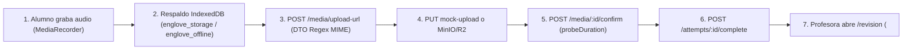

# Auditoría Exhaustiva Integral — Proyecto Englove

- **Fecha de auditoría:** 2026-11-05
- **Rama y commit auditados:** `develop` @ `756d32a` (`feat(resources): implement spec-10 extra content (eng-120, eng-121)`) — rama remota por defecto `origin/master` (no existe rama `main`).
- **Modo de ejecución:** **100 % solo lectura** sobre el código y la documentación existentes (ningún archivo rastreado fue modificado).
- **Skills utilizadas como marco de auditoría:** `englove-guardrails`, `englove-spec`, `security-review`, `code-review`, `nestjs-best-practices`, `vercel-react-best-practices`, `pwa-development`, `accessibility`, `supabase-postgres-best-practices`, `render-deploy` y `render-docker`.

> [!NOTE]
> **ESTADO DEL DOCUMENTO: AUDITORÍA HISTÓRICA — 100% SUBSANADA Y VERIFICADA (2026-11-08).**  
> Este documento de auditoría exhaustiva cumplió con éxito su cometido diagnóstico previo a la Etapa 12. Todos los hallazgos aquí identificados (**7 críticos, 16 altos, 15 medios y 10 bajos**), la divergencia estructural de la Decisión 111 y las decisiones planteadas en las secciones 8 y 10 fueron **íntegramente resueltos, implementados y verificados con pruebas de regresión** durante la **Etapa 12 («Calidad y remediación»)** bajo [`SPEC-11`](specs/SPEC-11-calidad-y-correcciones.md), las Decisiones 127 a 137 de [CONTEXT.md §14](.agents/CONTEXT.md#14-registro-de-decisiones-arquitectónicas-y-de-producto), [`planning/informe-etapa-12.md`](planning/informe-etapa-12.md) y [`planning/plan-remediacion-etapa-12.md`](planning/plan-remediacion-etapa-12.md).  
> **El veredicto de bloqueo preventivo quedó formalmente superado:** 566 pruebas automatizadas en verde en el monorepo, 0 errores en guardrails y compuertas de tipado, compilación y linting superadas. El sistema se encuentra apto para el aprovisionamiento de Staging y posterior Lanzamiento.

> [!CAUTION]
> **Veredicto Ejecutivo Original (2026-11-05, Superado): NO APTO PARA DESPLIEGUE EN NUBE (`BLOQUEADO`) HASTA CORREGIR HALLAZGOS CRÍTICOS.**
> *(Histórico)* Aunque las puertas estáticas iniciales pasaban en verde (`pnpm lint`: 0 errores; `pnpm typecheck`: 0 errores; `check-spec.mjs`: 10/10 specs `Verificada` con 0 errores; `check-guardrails.mjs --all`: 0 errores automáticos, 27 avisos, 54 supresiones), la auditoría profunda reveló 7 hallazgos críticos, 16 altos, 15 medios y 10 bajos, resueltos en su totalidad durante la Etapa 12.

---

## Resumen Ejecutivo y Métricas Verificadas

| Dimensión evaluada | Resultado automático | Resultado tras auditoría profunda |
|---|---|---|
| **Tipado y Linter (`pnpm typecheck`, `pnpm lint`)** | `4/4` paquetes en `0` errores | Más de 80 aserciones ciegas `as Type` / `as unknown as` (`G-C12`) ocultan defectos reales en runtime (p. ej. `correctAnswer: null` en `/revision`). |
| **Especificaciones (`check-spec.mjs` sobre `SPEC-01`..`SPEC-10`)** | `10/10` en estado `Verificada`, `0` errores | `SPEC-06` se contradice internamente (§1–§4 vs §5–§7) tras el parche de la Decisión 111; 6 specs superan el presupuesto de lectura de 20 min. |
| **Guardrails (`check-guardrails.mjs --all`)** | `0` errores, `27` avisos, `54` supresiones | **INCUMPLE en revisión manual/interactiva:** 1 supresión (`students.service.ts:762`) oculta un bug multi-tenant, y fallan `G-A03`, `G-B04`, `G-B06`, `G-B07`, `G-B08`, `G-B11`, `G-B12`, `G-B13`, `G-C08`, `G-C12` y `G-C13`. |
| **Grabación y guardado de audios (`speaking`)** | Tests unitarios con mocks pasan | **Roto en ejecución local por diseño actual** (8 causas raíz encadenadas) y vulnerable a **OOM / *boot-loop*** en los 512 MB de Render en nube. |
| **Seguridad (OWASP + Multi-tenant + Tablets compartidas)** | Helmet, Argon2id y `OriginGuard` activos | **Brechas críticas:** `JWT_SECRET` público por defecto en `staging`/`production`, corrupción de IndexedDB tras `logout`, envío cruzado de respuestas/audios entre alumnos en tablets compartidas, `logout` público que revoca sesiones sin verificar firma, y DoS en R2/RAM. |
| **Sincronización de copias de skills (`.agents`, `.claude`, `.kiro`)** | `100 %` idénticas por SHA-256 | `englove-spec` conserva reglas obsoletas en `check-spec.mjs:23` (cita Supabase en vez de Neon) y `validacion.md:28`. |

---

## 1. Incongruencias, Conflictos y Ambigüedades entre Fuentes de Verdad, Planeación, Specs y Código

### 1.1. Divergencia estructural mayor: la Decisión 111 (Microjuegos 24/7 sin `Assignment`) NO está implementada en el código

Esta es la contradicción funcional y de modelo de datos más profunda de todo el repositorio:

- **Qué ordenan las fuentes de verdad:**
  - [CONTEXT.md](.agents/CONTEXT.md#L608) (**Decisión 111**, vinculante): establece que los microjuegos (`ActivityType = game`) **jamás son una asignación (`Assignment`)**, que `POST /api/v1/assignments` rechaza `game`, que permanecen disponibles **24/7** en `/juegos` mientras estén `published` y `flags.games === true`, y que cada partida crea un `Attempt` con **`assignment_id = null`** y **`activity_id`** apuntando directamente a `Activity` (`@@unique([activity_id, student_id, attempt_number])`).
  - [architecture-overview.md](planning/architecture-overview.md#L477-L479), [SPEC-06-microjuegos.md](specs/SPEC-06-microjuegos.md#L26-L28) (§1–§4) y [SPEC-07-revision-y-feedback.md](specs/SPEC-07-revision-y-feedback.md#L184) reiteran esta regla.
- **Qué hace realmente el código en producción:**
  1. [schema.prisma](apps/api/prisma/schema.prisma#L402-L429): `Attempt.assignment_id` es `String @db.Uuid` (**`NOT NULL`**), **no existe columna `activity_id` en `Attempt`**, y solo existe `@@unique([assignment_id, student_id, attempt_number])`.
  2. [assignments.service.ts](apps/api/src/assignments/assignments.service.ts#L113-L124): `createAssignments` permite asignar actividades `type = 'game'` a grupos (y [seed-dev.ts](apps/api/prisma/seeds/seed-dev.ts#L646-L665) crea `Assignment` para microjuegos).
  3. [attempts.service.ts](apps/api/src/attempts/attempts.service.ts#L114-L265): `startAttempt` exige `assignmentId`, valida pertenencia al grupo activo y **bloquea por ventana `[opens_at, due_at]`** (`ATTEMPT_NOT_OPEN` / `ATTEMPT_CLOSED`) incluso para `ActivityType.game`.
  4. [juegos-client.tsx](apps/web/src/app/(student)/juegos/juegos-client.tsx#L48-L96): consulta `/api/v1/me/assignments?scope=available` (con límite por defecto de 20 tarjetas), arranca juegos con `POST /api/v1/assignments/${assignmentId}/attempts` y muestra el texto literal *"Aún no tienes juegos asignados — Cuando tu profesora te asigne actividades lúdicas, aparecerán aquí"* ([líneas 198-201](apps/web/src/app/(student)/juegos/juegos-client.tsx#L198-L201)). Si la profesora publica un microjuego sin asignarlo (siguiendo la Decisión 111), **ningún alumno lo verá jamás**.
- **Contradicción interna dentro de `SPEC-06`:** El parche del `2026-10-26` en [SPEC-06-microjuegos.md](specs/SPEC-06-microjuegos.md#L267) actualizó §1, §2, RF-7, RF-11 y §4 a `assignment_id = null`, pero dejó intactos §5 Contrato de API (`POST /assignments/:id/attempts`, [líneas 187-188](specs/SPEC-06-microjuegos.md#L187-L188)), §6 Modelo de datos ([línea 197](specs/SPEC-06-microjuegos.md#L197)) y §7 Interfaz ([líneas 209-210](specs/SPEC-06-microjuegos.md#L209-L210)).

### 1.2. Desincronización de estados de Etapas, Specs, Decisiones y conteo de pruebas

El estado real más reciente ([specs/README.md](specs/README.md#L15-L28), [SPEC-10-contenido-extra.md](specs/SPEC-10-contenido-extra.md#L5)) es **Etapas 0–10 implementadas en código, `SPEC-01` a `SPEC-10` en estado `Verificada`, decisiones `1–126` y `537` tests unitarios/integración + `8` suites E2E**. Sin embargo, los documentos rectores muestran cortes incompatibles:

| Documento | Corte que declara | Contradicción exacta |
|---|---|---|
| [AGENTS.md](AGENTS.md#L3-L13) | Etapas 0–8; `SPEC-01` a `SPEC-08` Verificadas; decisiones `1–115` | Omite Etapas 9–10, `SPEC-09`, `SPEC-10` y decisiones `116–126`. |
| [README.md](README.md#L48-L339) | Decisiones `1–115`; `407` tests; `SPEC-08` `Aprobada`; sin `SPEC-09`/`10` | Inventa tipos inexistentes (`multiple_choice`, `matching`, `audio_recording`) y mecánicas inexistentes (`word_scramble`, `drag_letters`, `pair_matching`, `flashcards`, `whack_a_mole`), promete *"asignaciones individuales"* (prohibidas por `SPEC-04`) y declara versiones de dependencias que no coinciden con `package.json`. |
| [CONTEXT.md](.agents/CONTEXT.md#L11) | Cabecera (:11) en Ronda 15 (`SPEC-01..09`, `490` tests); §11.1 (:390) dice `SPEC-06 En revisión`; §18 (:670) dice `SPEC-10 Aprobada` | En §14 (:632–638) ya incluye Ronda 16 (`SPEC-10`, decisiones 124–126) y contradice sus propios conteos de Etapa 8 (`451` en :11 vs `448` en :666) y Etapa 9 (`490` en :11 vs `492` en `pbp-development.md:9`). |
| [architecture-overview.md](planning/architecture-overview.md#L13) | Congelado en `2026-10-28` (`SPEC-01..08`, `451` tests) | Omite decisiones `116–126`, omite `ScoringModule` y endpoints de `SPEC-10` en §4.1, y detiene el catálogo de códigos de error (§13, [:1063](planning/architecture-overview.md#L1063-L1066)) en `SPEC-04`. |
| [sdd-process.md](planning/sdd-process.md#L7) | Línea 7 dice `SPEC-08 Aprobada` (`407` tests); línea 225 dice `SPEC-10 Aprobada` | Se contradice entre cabecera y §7, y no refleja `SPEC-10 Verificada`. |
| [taskboard.md](planning/taskboard.md#L33-L284) | Resumen dice `106 Hecho`, pero la tabla `## Hecho` solo tiene `103` filas | `SPEC-07` (:213), `ENG-120` (:275) y `ENG-121` (:276) quedaron olvidadas en `## Backlog` con estado `Hecho`; `taskboard.md:158` dice `SPEC-10 Aprobada` mientras `:5,270` dice `Verificada`. |
| [informe-etapa-9.md](planning/informe-etapa-9.md#L37-L181) | Afirma en `:181` que Etapa 10 es *"Resend / Sentry"* | Falso: Etapa 10 es Contenido extra (`SPEC-10`). Además clasifica *Fill in the Blank* como microjuego (viola Decisión 66) y tiene anclas rotas en el índice. |
| [poc-eng-140-informe.md](planning/poc-eng-140-informe.md#L37-L103) | Enlaces absolutos dependientes del equipo del auditor | Enlaces rotos fuera del equipo original; prueba `ffmpeg` a `128k` estéreo (en vez de `AAC mono 64k`, `SPEC-05:85`) y cita backup `Diario` (en vez de `semanal`, `CONTEXT.md:288`). |

### 1.3. Decisiones revocadas o términos inválidos que siguen figurando como vigentes

1. **`Howler.js` retirado en Decisión 107 ([CONTEXT.md](.agents/CONTEXT.md#L599)) sigue citado como activo** en `CONTEXT.md:263`, `architecture-overview.md:184`, `pbp-development.md:409,433`, `taskboard.md:129,217`, `skills-propias-pendientes.md:158` y `SPEC-06:27,210`.
2. **Estrategia `NetworkFirst para la API` en Service Worker prohibida por Decisiones 116–117 ([CONTEXT.md](.agents/CONTEXT.md#L623-L624)) sigue escrita** en `architecture-overview.md:980`, `pbp-development.md:516,534` y `taskboard.md:263`.
3. **Paquetes declarados en stack vs instalados realmente:**
   - **Serwist:** citado en `CONTEXT.md:266`, `architecture-overview.md:185,980`, `SPEC-09:21` y `G-C13`, pero **no está instalado** en [apps/web/package.json](apps/web/package.json); se escribió [sw.js](apps/web/public/sw.js) manual.
   - **Framer Motion (`motion`):** citado en `CONTEXT.md:263`, `architecture-overview.md:184` y `SPEC-06 RF-10`, pero **no está instalado**; [motion/index.ts](apps/web/src/lib/motion/index.ts) exporta objetos planos de configuración CSS.
   - **`Zod 4` vs `Zod 3`:** `CONTEXT.md:260,266` declara `Zod 4`, pero `packages/shared` y `apps/api` usan `"zod": "^3.24.2"`.
   - **`fluent-ffmpeg` dependencia muerta:** instalada en [apps/api/package.json](apps/api/package.json#L37) sin usarse en todo el código (se usa `spawn` nativo por `G-B13`).
4. **Estados, columnas y secciones inexistentes en documentos:**
   - **Decisión 110** ([CONTEXT.md](.agents/CONTEXT.md#L607)) ordena filtrar `Attempt.status = 'submitted'`, valor inexistente en `AttemptStatus` (`in_progress | pending_review | graded | abandoned`).
   - **Decisión 125** (`CONTEXT.md:637`) y `SPEC-10:8,91` remiten a `CONTEXT §4.2` (inexistente).
   - `SPEC-08:118` remite a `Organization.config.passing_score`, columna inexistente en `Organization` (vive en `FeatureFlag(key='games').config`).
   - `SPEC-07:77` usa `APP_PUBLIC_URL` mientras `env.validation.ts:27` y `.env.example:30` definen `WEB_BASE_URL` (y `ReviewsService` lee `APP_PUBLIC_URL` con fallback `http://localhost:3000`, ignorando `WEB_BASE_URL` en producción; ver §2.4).
   - `COOKIE_PREFIX` en `staging`: `SPEC-01:114` exige `englove_stg_`, pero [render.yaml](render.yaml#L35) configura `englove_staging_`.

### 1.4. Ambigüedades funcionales abiertas que admiten dos interpretaciones

1. **Alcance por nivel en `/juegos` bajo Decisión 111:** Si los microjuegos no se asignan a un grupo (`Assignment`), ¿un alumno `A1` debe ver todos los microjuegos publicados `A1`–`B2` de la organización (`SPEC-06:158`) o únicamente los de su `Student.level` como ocurre en `/extra` (`SPEC-10` Decisión 125)?
2. **Fórmula de estrellas (`1⭐` vs `2⭐`) cuando cambia `passing_score`:** La Decisión 101 (`CONTEXT.md:588`) fija el corte en `3.0` estático, mientras `architecture-overview.md:339` lo vincula dinámicamente al umbral `passing_score` configurable del tenant.
3. **Continuidad al cambiar de grupo con nuevo intento concedido:** `CONTEXT.md §5.2` y `SPEC-05` (`scope=continuity`) indican conservar continuidad sobre actividades previas del alumno, pero `AttemptsService.startAttempt` ([líneas 192-198](apps/api/src/attempts/attempts.service.ts#L192-L198)) bloquea iniciar el reintento concedido si la profesora movió al alumno de grupo (`404 ASSIGNMENT_NOT_IN_ACTIVE_GROUP`).
4. **Objetivo de accesibilidad (`WCAG 2.1 AA` vs `WCAG 2.2 AA`):** `SPEC-09:136` y `SPEC-10:143` validan reglas `wcag21aa`, mientras `skills-propias-pendientes.md:160` y la skill `accessibility` del proyecto exigen `WCAG 2.2 AA`.

---

## 2. Errores Funcionales y de Lógica de Negocio Detectados en Código

Además de los problemas de audio (§3) y seguridad (§6), se verificaron en código los siguientes **errores funcionales directos**:

1. **En `/revision`, la profesora recibe siempre `correctAnswer: null` en actividades `fill_blank` y `exam` (`SPEC-07 RF-3` roto en PostgreSQL real):**
   - [PrismaService](apps/api/src/prisma/prisma.service.ts#L19-L33) configura `omit: { fillBlankDetail: { answer_key: true }, gameDetail: { answer_key: true }, examDetail: { answer_key: true } }`, pero extiende `PrismaClient` sin propagar el parámetro de tipo de `omit`.
   - En [reviews.service.ts](apps/api/src/reviews/reviews.service.ts#L232-L237), `getReviewDetail` hace `include: { fill_blank_detail: true, exam_detail: true }` sin `select: { config: true, answer_key: true }` y castea con `as` ([líneas 264, 299](apps/api/src/reviews/reviews.service.ts#L264-L301)). En ejecución real contra PostgreSQL, `answer_key` es `undefined` y la profesora ve `correctAnswer: null` en todos los ítems. El mismo defecto afecta a `buildExistingCompletionView` en [attempts.service.ts](apps/api/src/attempts/attempts.service.ts#L533-L540) (`correction: null` al reintentar cerrar un juego ya calificado).
2. **`GET /api/v1/groups/:id/members?offset=0&limit=20` lanza `500 INTERNAL_ERROR`:**
   - [groups.controller.ts](apps/api/src/groups/groups.controller.ts#L108) declara `@Query() query: { offset?: number; limit?: number }` (tipo literal borrado en compilación) en lugar de una clase DTO. `ValidationPipe` no convierte tipos y pasa strings `'0'` y `'20'` a `skip`/`take` en [groups.service.ts](apps/api/src/groups/groups.service.ts#L346-L347), provocando `PrismaClientValidationError` (`500`).
3. **Calendario de rachas de 12 semanas calcula mal las semanas perdonadas (`status = 'forgiven'`) en `/estadisticas`:**
   - En [stats.service.ts](apps/api/src/stats/stats.service.ts#L1345-L1347), `calculateStreak(orgId, studentId, weekDate)` hace que dentro de [gamification.service.ts](apps/api/src/gamification/gamification.service.ts#L152-L155) `currentWeekKey === wKey`, saltándose la evaluación de `wKey` con `continue`. La semana realmente perdonada queda marcada `'inactive'` y una segunda semana inactiva consecutiva puede marcarse falsamente `'forgiven'`.
4. **Notificaciones de calificación usan `APP_PUBLIC_URL` (no declarada) en vez de `WEB_BASE_URL`:**
   - En [reviews.service.ts](apps/api/src/reviews/reviews.service.ts#L34) (`configService.get('APP_PUBLIC_URL') || 'http://localhost:3000'`) y [línea 1117](apps/api/src/reviews/reviews.service.ts#L1117), el correo enviado al alumno tras calificar en `staging` o `production` contendrá un enlace a **`http://localhost:3000/feedback`** porque `render.yaml` y `env.validation.ts` definen `WEB_BASE_URL`, no `APP_PUBLIC_URL`.
5. **Correo docente `teacher-pending-summary` tiene enlace roto `href="/inicio"` y bloquea avisos durante 3 días aunque haya 0 pendientes:**
   - [templates.ts](apps/api/src/mail/templates.ts#L141) renderiza `<a href="/inicio">` (URL relativa inválida en clientes de correo).
   - Además, en [maintenance.service.ts](apps/api/src/maintenance/maintenance.service.ts#L687-L716), cuando un lunes a las 08:00 hay `0` pendientes, no envía correo pero **sí registra `ScheduledJobRun` en `status = done`**, lo que impide por la regla de `diffDays < 3` ([línea 633](apps/api/src/maintenance/maintenance.service.ts#L633)) avisar martes y miércoles si llegan registros nuevos el lunes a las 09:00.
6. **Contrato roto en `open_question` entre `ActividadRunner` y `SPEC-05 §5`:**
   - [actividad-runner.tsx](apps/web/src/app/(student)/actividad/[attemptId]/actividad-runner.tsx#L965) envía `itemId = 'text'` con `answer` string plano, en vez de `itemId = activity.id` con `{ text }` (`SPEC-05 §5`), obligando a mantener un puente ad-hoc en [reviews.service.ts](apps/api/src/reviews/reviews.service.ts#L317-L323).
7. **Registro público `/registro` sin enlace al texto de Términos y Condiciones (`CONTEXT.md §4.1`):**
   - [registro/page.tsx](apps/web/src/app/(public)/registro/page.tsx#L222-L225) muestra el checkbox de aceptación sin ningún enlace navegable al documento legal, y no existe ruta pública `/terminos`.
8. **Flujos de recuperación de contraseña y OTP de cambio de correo imposibles de probar en `local`:**
   - Por cumplimiento de `G-C10` (cero tokens/OTP en logs), [mail.service.ts](apps/api/src/mail/mail.service.ts#L53-L61) en `APP_ENV=local` no envía correo ni expone el enlace/OTP, y `docker-compose.yml` no incluye un buzón SMTP local (como Mailpit); dado que la BD solo almacena el hash SHA-256, el desarrollador no puede completar ninguno de los dos flujos localmente.

---

## 3. Diagnóstico Exhaustivo: Grabación y Guardado de Audios (`speaking`)

Se trazó de extremo a extremo el flujo de grabación, respaldo en IndexedDB, subida prefirmada, confirmación, transcodificación `ffmpeg` y reproducción docente. **El fallo en ejecución local no se debe a una sola causa, sino a 8 defectos encadenados entre cliente, configuración local y backend** (varios de los cuales también romperán `staging` y `production`):



### Causa Raíz 1 — El modo local por defecto (`isMock = true`) descarta los bytes subidos y sirve `0 bytes` al reproducir
- **Dónde ocurre:** [media.service.ts](apps/api/src/media/media.service.ts#L53-L57) y [media.controller.ts](apps/api/src/media/media.controller.ts#L85-L98).
- **Qué sucede:** Al copiar [.env.example](.env.example#L19-L23), `R2_ACCOUNT_ID=placeholder_account_id` y no existe `R2_ENDPOINT`. `MediaService` entra en `this.isMock = true` y devuelve `http://localhost:3001/api/v1/media/mock-upload/:id`.
  - Cuando el navegador hace `PUT /api/v1/media/mock-upload/:id` con el `Blob` de audio grabado, `handleMockUpload` ([líneas 86-90](apps/api/src/media/media.controller.ts#L86-L90)) **ignora y descarta por completo el cuerpo HTTP** (no lo guarda ni en `os.tmpdir()` ni en memoria) y `transcodeAsset` ([línea 503](apps/api/src/media/media.service.ts#L503)) hace `return` inmediato.
  - Cuando la profesora intenta escuchar o descargar la grabación en `/revision` ([revision/page.tsx](apps/web/src/app/(teacher)/revision/page.tsx#L528)), `GET /api/v1/media/mock-stream/:id` ([línea 96](apps/api/src/media/media.controller.ts#L96)) responde **`Content-Length: 0` (archivo vacío)**, por lo que el reproductor `<audio>` falla siempre.

### Causa Raíz 2 — `helmet()` bloquea la reproducción `<audio>` entre puertos locales (`ERR_BLOCKED_BY_RESPONSE.NotSameOrigin`)
- **Dónde ocurre:** [main.ts](apps/api/src/main.ts#L25) y [revision/page.tsx](apps/web/src/app/(teacher)/revision/page.tsx#L528).
- **Qué sucede:** `app.use(helmet())` inyecta por defecto `Cross-Origin-Resource-Policy: same-origin`. Como el frontend corre en `http://localhost:3000` y la API en `http://localhost:3001` (distinto `origin` para CORP), la etiqueta `<audio controls src="http://localhost:3001/api/v1/media/mock-stream/...">` es bloqueada inmediatamente por Chrome/Edge/Firefox aunque devolviera bytes reales.

### Causa Raíz 3 — MinIO local en `docker-compose.yml` no funciona *out-of-the-box* (falta `R2_ENDPOINT`, bucket `englove-dev` no creado y puerto Postgres desalineado)
- **Dónde ocurre:** [docker-compose.yml](docker-compose.yml#L7-L37) y [.env.example](.env.example#L14-L23).
- **Qué sucede:**
  1. `.env.example` **no incluye `R2_ENDPOINT=http://localhost:9000`**, por lo que levantar MinIO (`docker compose --profile storage up -d`) deja a `MediaService` en `isMock = true` (o intentando conectar a `placeholder_account_id.r2.cloudflarestorage.com`).
  2. Incluso añadiendo `R2_ENDPOINT=http://localhost:9000`, `docker-compose.yml` **no tiene contenedor `mc` inicializador** que cree el bucket `englove-dev` ni configure CORS en MinIO (`PUT` desde `http://localhost:3000` hacia `http://localhost:9000` falla por CORS y por `404 NoSuchBucket`).
  3. Además, `docker-compose.yml:7` expone PostgreSQL en **`5433:5432`**, mientras `.env.example:14,16` apunta a **`localhost:5432`**.

### Causa Raíz 4 — `probeDuration` es un simulacro que nunca ejecuta `ffprobe` y rechaza grabaciones cortas reales (`422 AUDIO_IMPLAUSIBLE_DURATION`)
- **Dónde ocurre:** [media.service.ts](apps/api/src/media/media.service.ts#L296-L310) y [líneas 628-636](apps/api/src/media/media.service.ts#L628-L636).
- **Qué sucede:** `probeDuration(_key, sizeBytes)` ignora `_key`, jamás llama a `ffprobe`, y calcula:
  ```ts
  if (sizeBytes < 8000) return 1.0;
  const est = sizeBytes / 8000;
  ```
  En Chrome/Firefox, `MediaRecorder` usa Opus VBR (`audio/webm;codecs=opus` a ~12–24 kbps con silencios): **una grabación legítima de 2 a 4 segundos suele pesar entre 3.5 KB y 7.8 KB (`< 8000` bytes)**. `probeDuration` devuelve `1.0`, `confirmUpload` evalúa `duration < 2` ([línea 299](apps/api/src/media/media.service.ts#L299), ignorando además `speaking_detail.min_duration_seconds`) y rechaza el audio válido con **`422 AUDIO_IMPLAUSIBLE_DURATION` ("Graba al menos 2 segundos")**, marcando el asset como `pending_delete`. A la inversa, en Safari/iPadOS (`audio/mp4` AAC a 128 kbps = 16 KB/s), `sizeBytes / 8000` **duplica artificialmente la duración** y rechaza grabaciones válidas de 65 s como si duraran 130 s (`422 AUDIO_EXCEEDS_MAX_DURATION`).

### Causa Raíz 5 — Expresión regular de `mimeType` rechaza espacios y comillas de `MediaRecorder` en Firefox y Safari (`400 VALIDATION_ERROR`)
- **Dónde ocurre:** [media.dto.ts](apps/api/src/media/dto/media.dto.ts#L8) y [audio-upload.ts](apps/web/src/lib/audio-upload.ts#L31).
- **Qué sucede:** `@Matches(/^audio\/(webm|mp4|ogg)(;codecs=[a-zA-Z0-9.,_-]+)?$/)` no admite espacio tras `;` ni comillas. Navegadores como Firefox y Safari reportan `blob.type` como `"audio/ogg; codecs=opus"` o `"audio/mp4; codecs=\"mp4a.40.2\""`, haciendo que `POST /api/v1/media/upload-url` falle con `400 Bad Request`.

### Causa Raíz 6 — Tres bugs de estado en `ActividadRunner` bloquean reintentos, auto-parada y entrega online
- **Dónde ocurre:** [actividad-runner.tsx](apps/web/src/app/(student)/actividad/[attemptId]/actividad-runner.tsx#L301-L435).
- **Qué sucede:**
  1. **«Volver a grabar» nunca limpia `mediaId` ([líneas 301-329 vs 417](apps/web/src/app/(student)/actividad/[attemptId]/actividad-runner.tsx#L301-L417)):** Si el primer intento de subida creó un `mediaId` ([línea 376](apps/web/src/app/(student)/actividad/[attemptId]/actividad-runner.tsx#L376)) o falló en `confirm`/`complete` (dejando ese `mediaId` en `pending_delete`), y el niño pulsa **«Volver a grabar»**, se graba un nuevo `recordedAudioBlob` pero `mediaId` conserva el UUID viejo. Al pulsar «Entregar actividad», `if (recordedAudioBlob && !mediaId)` es `false`: **no sube la grabación nueva** y envía el `mediaId` muerto → error permanente `409 MEDIA_NOT_AVAILABLE`.
  2. **Clausura obsoleta (*stale closure*) en el temporizador de auto-corte ([líneas 332-355](apps/web/src/app/(student)/actividad/[attemptId]/actividad-runner.tsx#L332-L355)):** Dentro de `startRecording`, el `setInterval` invoca `stopRecording()`, donde `isRecording` quedó capturado como `false`; por tanto `if (mediaRecorderRef.current && isRecording)` jamás detiene la grabación al llegar al tope (que además está hardcodeado en `120` s en vez de `speakingConfig.maxDurationSeconds`).
  3. **Falso recibo «Guardado sin conexión» estando online ([líneas 382, 424-429](apps/web/src/app/(student)/actividad/[attemptId]/actividad-runner.tsx#L424-L429)):** Cuando una subida falla con error de validación (p. ej. `422` o `400`), `uploadError` queda no nulo. Si el alumno vuelve a pulsar «Entregar actividad», `Boolean(uploadError)` lanza artificialmente `new TypeError('Network request failed')`, engañando al `catch` para mostrar la pantalla de entrega offline y encolando un audio inválido en IndexedDB.

### Causa Raíz 7 — Corrupción de IndexedDB tras un primer «Cerrar sesión» y borrado propio por `'std-local'`
- **Dónde ocurre:** [auth-hygiene.ts](apps/web/src/lib/auth-hygiene.ts#L24), [actividad-runner.tsx](apps/web/src/app/(student)/actividad/[attemptId]/actividad-runner.tsx#L41-L104) y [student-shell.tsx](apps/web/src/components/student-shell.tsx#L24).
- **Qué sucede:**
  1. Si en el navegador local primero se inicia y cierra sesión (p. ej. con la cuenta docente del seed), `clearSharedDeviceSession()` ejecuta `indexedDB.open('englove_offline')` y `indexedDB.open('englove_storage')` **sin versión ni `onupgradeneeded`**, creando ambas bases en **`version = 1` con cero almacenes (`objectStores`)**. Cuando luego entra el alumno, `open('englove_offline', 1)` y `open('englove_storage', 1)` **no disparan `onupgradeneeded`** y toda escritura de audio/eventos falla con `NotFoundError` hasta borrar manualmente los datos del sitio en DevTools.
  2. Además, `ActividadRunner` inicializa `currentUserId = 'std-local'`; si el usuario graba o responde antes de que resuelva `/api/v1/me`, `StudentShell` llama a `purgeOtherUsersEntries(realUuid)` y **elimina las entradas `'std-local'` del propio alumno**.

### Causa Raíz 8 — Pruebas desde tablet/móvil por IP de red local (`http://192.168.x.x:3000`) o tras 15 minutos de sesión
- **Dónde ocurre:** [actividad-runner.tsx](apps/web/src/app/(student)/actividad/[attemptId]/actividad-runner.tsx#L305), [origin.guard.ts](apps/api/src/common/guards/origin.guard.ts#L10), [auth.service.ts](apps/api/src/auth/auth.service.ts#L95) y [proxy.ts](apps/web/src/proxy.ts#L43).
- **Qué sucede:**
  1. Fuera de `localhost` (p. ej. abriendo `http://192.168.x.x:3000` en una tablet física en red local sin HTTPS), los navegadores deshabilitan `navigator.mediaDevices` (`undefined` por contexto inseguro), lanzando `TypeError` que el `catch` disfraza como *"Por favor habilita el permiso de micrófono"*; simultáneamente `OriginGuard` rechaza el `Origin` con `403` y las cookies con `secure: true` fijo no se envían por HTTP en Safari/iPadOS.
  2. Si `.env` usa `COOKIE_PREFIX=englove_local_` (como trae `.env.example`) pero `apps/web` no recibe esa variable, `proxy.ts` busca `englove_access_token` y bloquea el acceso; y pasados 15 minutos (`access_token` expirado), ni `apiFetch` ni `uploadAudioBlob` refrescan la sesión (`401`).

---

## 4. Informe Oficial de `englove-guardrails` (37 Reglas Invariantes)

Siguiendo el formato obligatorio de [englove-guardrails/SKILL.md](.agents/skills/englove-guardrails/SKILL.md#L100-L121):

## Verificación `englove-guardrails`
- **Alcance:** Todo el repositorio (`292` archivos escaneados por script + revisión manual exhaustiva de las 37 reglas `G-A01`..`G-A11`, `G-B01`..`G-B13`, `G-C01`..`G-C13`).
- **CONTEXT.md §14:** hasta decisión `126` (script conoce hasta `126` — `Self-check: catálogo y script sincronizados`).
- **Estado de la spec:** `SPEC-01` a `SPEC-10` en estado `Verificada` (con contradicción interna en `SPEC-06` frente a Decisión 111).
- **Resultado del script:** `0 errores, 27 avisos, 54 suprimidos`
- **Veredicto:** `INCUMPLE (bloquea PR / cierre de tarea / despliegue a staging y producción)`

### Incumplimientos reales detectados en revisión manual e interactiva (`ERROR`)

| Archivo y línea | Regla | Fuente | Hallazgo | Corrección requerida |
|---|---|---|---|---|
| [render.yaml](render.yaml#L20-L21), [prisma.service.ts](apps/api/src/prisma/prisma.service.ts#L13) | `G-A03` | Decisión 82, arch §6.3 | `MIGRATION_DATABASE_URL` inyectada en el contenedor runtime de Render; `new Pool({ connectionString })` ignora `?connection_limit=5` (usa `max: 10`) y no ejecuta `pool.end()` en `onModuleDestroy`. | Retirar `MIGRATION_DATABASE_URL` de `render.yaml`; pasar `max: 5` explícito a `pg.Pool` y cerrar con `await pool.end()`. |
| [students.service.ts](apps/api/src/students/students.service.ts#L762-L765), [me.controller.ts](apps/api/src/auth/me.controller.ts#L56) | `G-A06`, `G-A11` | CONTEXT §16, arch §4.3 | `guardrails-ignore G-A06` copiado en `changeStudentEmail` sobre `user.findFirst` filtra por el `organization_id` del docente activo e impide ver correos de otros tenants antes del `UPDATE`; `me.controller.ts:56` usa `user.findUnique` solo por `id`. | Usar `normalizeEmail` + `findUnique({ where: { email } })` con justificación real; usar `findFirst({ where: { id, organization_id } })` en `me.controller.ts`. |
| [proxy.ts](apps/web/src/proxy.ts#L45-L49), [wrangler.jsonc](apps/web/wrangler.jsonc#L1-L15) | `G-B03`, `G-B11` | Decisión 88, SPEC-01 RF-15 | `proxy.ts` hace fallback a `englove_access_token` sin prefijo y no comprueba `exp`, provocando colisión `staging`/`production` bajo `Domain=.englove.org` y bucle infinito `/login` ↔ `/inicio`; `wrangler.jsonc` no define `COOKIE_PREFIX` ni entornos. | Leer únicamente `${cookiePrefix}access_token`, validar `exp`, y declarar `env.staging` y `env.production` en `wrangler.jsonc`. |
| 15 rutas `page.tsx` en [apps/web/src/app](apps/web/src/app/inicio/page.tsx#L1) | `G-B04` | CONTEXT §16, arch §3.2 | 15 de 26 `page.tsx` declaran `'use client'` en la raíz de la página y hacen `useEffect + apiFetch` manual en lugar de RSC por defecto + hojas cliente con TanStack Query. | Extraer hojas `*-client.tsx`, dejar `page.tsx` como RSC con `metadata` y completar migración a TanStack Query (`ENG-143`). |
| [ci.yml](.github/workflows/ci.yml#L5-L55), [turbo.json](turbo.json#L5-L10) | `G-B06` | Decisión 82, SPEC-01 RF-16 | `ci.yml` apunta a rama `main` (inexistente), no ejecuta `pnpm build`, no mide el tamaño del Worker (`<= 3 MB` / `<= 10 MB`), no corre Playwright/axe ni despliega a Workers; `turbo.json` no incluye `env` en `build`. | Apuntar CI a `master`/`develop`, añadir `pnpm build` + chequeo de tamaño del Worker + `env` en `turbo.json`. |
| [Dockerfile](apps/api/Dockerfile#L13-L50), [render.yaml](render.yaml#L10) | `G-B07`, `G-B08`, `G-B12` | Decisión 82, arch §11.1 | Sin `.dockerignore`; `Dockerfile` corre como `root`, usa `\|\| pnpm install`, copia `devDependencies` sin `pnpm prune --prod` y sin `--max-old-space-size` en 512 MB; `render.yaml` pone `plan: starter` en `staging` (debe ser `free`). | Crear `.dockerignore`, fijar `--frozen-lockfile`, `pnpm prune --prod`, `USER node`, tope de heap V8 y `plan: free` en `staging`. |
| [media.service.ts](apps/api/src/media/media.service.ts#L199-L204), [:543-549](apps/api/src/media/media.service.ts#L543-L549), [:628-636](apps/api/src/media/media.service.ts#L628-L636) | `G-B13`, `G-C08` | Decisiones 55, 64, 79; SPEC-05 RF-12..14 | `PutObjectCommand` no firma `ContentLength`, `HeadObject` ignora tamaño real, `transcodeAsset` carga todo el archivo en RAM (riesgo OOM 512 MB) y `probeDuration` divide `sizeBytes / 8000` sin ejecutar `ffprobe` ni tiene timeout en `ffmpeg`. | Firmar `ContentLength`, validar en `HeadObject`, hacer streaming con `pipeline` a `/tmp`, medir duración real con `ffprobe` y aplicar timeout a `ffmpeg`. |
| [env.validation.ts](apps/api/src/config/env.validation.ts#L31-L68) | `G-B11`, `G-C11` | SPEC-01 RF-3, arch §8.2 | `JWT_SECRET` tiene valor público por defecto incluso en `staging` y `production`, y falta en `render.yaml` y `.env.example`. | Exigir `JWT_SECRET` explícito y distinto del default local cuando `APP_ENV !== 'local'`, y validar `COOKIE_DOMAIN` y credenciales R2. |
| [maintenance.service.ts](apps/api/src/maintenance/maintenance.service.ts#L378-L386), [actividad-runner.tsx](apps/web/src/app/(student)/actividad/[attemptId]/actividad-runner.tsx#L724) | `G-C09` | Decisiones 32, 80 | `runMonthlyAgeReview` calcula cumpleaños con `getFullYear()/getMonth()/getDate()` locales en vez de `America/Bogota`; vistas de cliente formatean fechas sin `timeZone: 'America/Bogota'`. | Usar `calculateAgeInBogota` en el job mensual y helper común con `timeZone: 'America/Bogota'` en frontend. |
| [reviews.service.ts](apps/api/src/reviews/reviews.service.ts#L261-L301), [api.ts](apps/web/src/lib/api.ts#L66), microjuegos | `G-C12` | CONTEXT §16, SPEC-01 RF-13 | Más de 80 aserciones ciegas `as Type` / `as unknown as` en servicios NestJS y componentes React (no detectadas por `check-guardrails.mjs` porque solo busca `as any`), más `@Query()` sin clase DTO en `groups.controller.ts:108`. | Validar JSONB con `safeParse` de Zod, tipar `omit` en `PrismaService` y usar `GroupMembersQueryDto`. |
| [auth-hygiene.ts](apps/web/src/lib/auth-hygiene.ts#L24), [offline-queue.ts](apps/web/src/lib/offline-queue.ts#L470-L530), [sw.js](apps/web/public/sw.js#L5-L15) | `G-C13` | Decisiones 20, 51, 116–120; SPEC-09 RF-3..6, RF-18 | `clearSharedDeviceSession()` corrompe IndexedDB en dispositivos limpios; un login tras expiración envía respuestas/audios del alumno anterior; `sw.js` no usa Serwist ni precachea bundles; enlaces de `ExternalResource` no revalidan `https:` al renderizar. | Usar `deleteDatabase`, purgar/filtrar por `activeUserId` en login y `executeFlush`, inyectar manifiesto de build en `sw.js` y validar `isValidHttpsResourceUrl` al renderizar. |

### Avisos del script revisados (`27 AVISO` + `54 guardrails-ignore`)

| Archivo y línea / Bloque | Regla | Estado | Justificación o acción |
|---|---|---|---|
| [reviews.service.ts](apps/api/src/reviews/reviews.service.ts#L107-L108), [:187-188](apps/api/src/reviews/reviews.service.ts#L187-L188) (`4` avisos) | `G-A06` | **Seguro / Mejorar** | `where` incluye `organization_id: organizationId` líneas arriba (`:62` y `:142`), pero conviene escribir `where: { ...where, organization_id: organizationId }` inline para eliminar el aviso y blindar refactorizaciones. |
| [activities.service.ts](apps/api/src/activities/activities.service.ts#L118-L760) (`10` avisos) | `G-C04` | **Justificado** | Operaciones CRUD de `answer_key` exclusivas del editor docente (`@Roles(Role.teacher)` en `ActivitiesController`). Añadir comentario `guardrails-ignore G-C04` explícito. |
| [packages/shared/src/api/*.ts](packages/shared/src/api/activities.ts#L11-L12) (`13` avisos) | `G-C03` | **Justificado** | Campos `*At: string` en interfaces de respuesta del servidor, más `opensAt`/`dueAt` de programación docente en `CreateAssignmentInput` (autorizados por `SPEC-04 RF-1`). |
| `54` supresiones `guardrails-ignore` en el repo | Varias | **`53` legítimas / `1` errónea** | **53 son correctas** (`omit` global en `PrismaService`, autocalificación en servidor, `GamePublicConfig` de `SPEC-06 §4`, resolución de tokens opacos en `AuthService`, bandera `implausible_duration`). **1 es inválida y oculta un bug:** `students.service.ts:762` (ver tabla de `ERROR` arriba). |

### Resumen por bloque `englove-guardrails`
- **A. Motor SQL y Persistencia (Neon y Prisma):** `4 hallazgos` (`G-A03` `MIGRATION_DATABASE_URL` en runtime y `pg.Pool` sin `max`/`end()`, `G-A06` bug en `changeStudentEmail`, `G-A11` en `me.controller.ts`, más 5 índices parciales y `CHECK` ausentes de `schema.prisma` y desprotegidos ante `migrate dev`).
- **B. Despliegue y Hosting (Workers, Render, R2):** `7 hallazgos` (`G-B03`/`G-B11` colisión de cookies y bucle en `proxy.ts`, `G-B04` 15 páginas `'use client'` sin RSC/TanStack Query, `G-B06` CI en rama inexistente `main` sin `build`/bundle check, `G-B07`/`G-B08`/`G-B12` `Dockerfile` y `render.yaml`, `G-B13` R2 sin cota de tamaño ni `ffprobe` real).
- **C. Negocio, Integridad y Seguridad:** `5 hallazgos` (`G-C08` validación de audio simulada, `G-C09` zona horaria Bogotá en job mensual y fechas UI, `G-C11` `JWT_SECRET` por defecto en nube, `G-C12` `as Type` masivo + `@Query()` inline, `G-C13` corrupción de IndexedDB y fuga entre alumnos en tablets compartidas).

---

## 5. Calidad de Código (Clean Code), Rendimiento, PWA y Accesibilidad (WCAG 2.2)

### 5.1. Backend (`apps/api`) y Contratos (`packages/shared`) — *`nestjs-best-practices` & `supabase-postgres-best-practices`*

1. **Consultas N+1 secuenciales severas en `StatsService` (viola presupuesto `< 500 ms` de `SPEC-08 RF-4`):**
   - [stats.service.ts](apps/api/src/stats/stats.service.ts#L910-L918) invoca `gamificationService.calculateStreak(orgId, student.id, to)` dentro de un bucle `for` por cada alumno (2 queries secuenciales por alumno: **200 queries** con 100 alumnos y **1.000 queries** con 500 alumnos, bajo *polling* cada 30 s). También `getOverview` ([:336](apps/api/src/stats/stats.service.ts#L336)) y `getGroupStats` ([:616](apps/api/src/stats/stats.service.ts#L616)) cargan **todo el historial de `ProgressEvent`** de la organización en memoria en vez de usar `groupBy({ by: ['student_id'], _max: { occurred_at: true } })`.
2. **Aserciones ciegas `as Type` y `toPublicConfig` muerto:**
   - [registry.ts](packages/shared/src/activities/registry.ts#L508-L536) define `toPublicConfig()`, pero hace `JSON.parse(JSON.stringify(...)) as T` y **ningún servicio de `apps/api/src` la llama** (`AttemptsService` proyecta `config` a mano en tres sitios distintos).
3. **Inyecciones `@Optional()` defensivas en servicios críticos:**
   - [maintenance.service.ts](apps/api/src/maintenance/maintenance.service.ts#L24-L28) marca como `@Optional()` a `GamificationService`, `MediaService`, `FeatureFlagsService`, `PendingSummaryService` y `MailService`. Si un módulo rompe su inyección de dependencias, NestJS arranca sin avisar y los jobs nocturnos omiten silenciosamente retención de audios, rachas o correos.
4. **Índices SQL manuales fuera de `schema.prisma` y FKs sin índice:**
   - Cinco índices únicos parciales y `attempts_score_check` en [20261020000000_init/migration.sql](apps/api/prisma/migrations/20261020000000_init/migration.sql#L331-L351) no están representados ni protegidos por test contra `DROP INDEX` al correr `prisma migrate dev`. Además, `MediaAsset.student_id` (`onDelete: Cascade`) carece de índice en [schema.prisma](apps/api/prisma/schema.prisma#L535-L537), forzando *sequential scan* al borrar un alumno.
5. **Conflicto de límite de cuerpo HTTP en `main.ts` y `seed-volume.ts` inválido:**
   - [main.ts](apps/api/src/main.ts#L13-L31) crea la app sin `bodyParser: false`, por lo que Express aplica su tope interno de `100kb` antes de llegar a `express.json({ limit: '1mb' })`.
   - [seed-volume.ts](apps/api/prisma/seeds/seed-volume.ts#L120-L125) inserta `fill_blank` con esquema incompatible con `FillBlankConfigSchema` de Zod.
6. **Divergencia de códigos `code` HTTP:**
   - `SubmitReviewDto.score` ([reviews.dto.ts](apps/api/src/reviews/dto/reviews.dto.ts#L52-L56)) tiene `@Min(0) @Max(5)`, interceptando con `400 VALIDATION_ERROR` casos que `SPEC-07 RF-4/RF-5` exige devolver como `422 SCORE_OUT_OF_RANGE` o `422 SCORE_NOT_EDITABLE`.

### 5.2. Frontend (`apps/web`), React 19 / `vinext` y PWA — *`vercel-react-best-practices` & `pwa-development`*

1. **Ausencia de renovación automática ante `401` (`access_token` de 15 min) y `auth-session.ts` sin conectar:**
   - [api.ts](apps/web/src/lib/api.ts#L39-L73) no intercepta `401` para ejecutar `POST /api/v1/auth/refresh` (single-flight). Pasados 15 minutos, guardar una actividad, calificar o subir audio falla con `401`. Además, `setSharedSession` y `clearSharedSession` en [auth-session.ts](apps/web/src/lib/auth-session.ts#L41-L49) tienen **cero llamadas** en todo el proyecto.
2. **15 de 26 rutas `page.tsx` con `'use client'` en la raíz:**
   - Impide exportar `metadata` por ruta (dejando `<title>` genéricos) y mantiene `useEffect + useState` manual en lugar de TanStack Query en la mayoría del portal estudiantil y páginas de gestión docente (`grupos`, `alumnos`, `actividades`, `asignaciones`).
3. **Service Worker estático sin versión ni chunks (`SPEC-09 RF-3` y `RF-6` inoperantes en nube):**
   - [sw.js](apps/web/public/sw.js#L5-L15) tiene `CACHE_VERSION = 'englove-static-v1'` fijo y no precachea ningún bundle JS/CSS de `/_next/static/`. Entre despliegues `sw.js` no cambia byte a byte, por lo que **`PwaUpdateBanner` nunca se disparará**. Tampoco `NEXT_PUBLIC_APP_VERSION` se inyecta desde `package.json`, quedando fijo `'0.0.1'` en [pwa-manager.ts](apps/web/src/lib/pwa-manager.ts#L5).
4. **Bucle infinito de envío fallido en `offline-queue.ts` al descartar audio inválido:**
   - En [offline-queue.ts](apps/web/src/lib/offline-queue.ts#L620-L672), cuando `uploadAudioBlob` recibe `422` y llama a `discardAudioBlob(attemptId)`, el código **no hace `continue`** y ejecuta inmediatamente `POST /complete` sin `mediaId`, recibiendo `400` y dejando el `completionEvent` atascado indefinidamente en `pendingEvents`.
5. **Duplicidad y detalles de UI:**
   - [manifest.json](apps/web/public/manifest.json) y [manifest.webmanifest](apps/web/public/manifest.webmanifest) están duplicados; `<OfflineStatusBanner />` se renderiza dos veces en `/actividad/[attemptId]` (`student-shell.tsx:55` y `actividad-runner.tsx:707`); se usan `window.alert()` y `window.confirm()` nativos bloqueantes en 7 pantallas, y las notas se formatean con punto (`4.5`) en vez de coma (`4,5`).

### 5.3. Accesibilidad (`WCAG 2.2 AA`) — *`accessibility`*

1. **Contraste ilegible (~1.08:1 a 1.25:1) en tema oscuro `Teens`:**
   - [MatchGame.tsx](apps/web/src/components/activities/games/MatchGame.tsx#L263-L284) mantiene `text-zinc-100` (blanco humo) sobre fondos `bg-amber-100/90`, `bg-emerald-50/70` y `bg-indigo-50` al seleccionar/emparejar en `Teens` (texto blanco sobre fondo casi blanco).
   - `progreso-client.tsx:62`, `juegos-client.tsx:156`, `feedback/page.tsx:100` y `perfil-client.tsx:184` pintan encabezados `text-amber-950` (`#451a03`) sobre `bg-zinc-950` (`#09090b`) en `Teens`. *(El test `spec-09-pwa-offline-a11y.spec.ts` no lo detectó porque solo corrió `axe` en `/login` y `/offline`).*
2. **Controles interactivos anidados inválidos y expulsión de foco de teclado en microjuegos:**
   - `MatchGame.tsx:260-310` y [DragDropGame.tsx](apps/web/src/components/activities/games/DragDropGame.tsx#L320-L388) anidan `<button>` dentro de `<div role="button" tabIndex={0}>` (viola `WCAG 4.1.2`).
   - [MemoryGame.tsx](apps/web/src/components/activities/games/MemoryGame.tsx#L162) y [TimedChoiceGame.tsx](apps/web/src/components/activities/games/TimedChoiceGame.tsx#L222) ponen `disabled` al instante de pulsar una carta/opción, expulsando el foco de teclado a `<body>`, y carecen de región `aria-live` para anunciar jugadas.
3. **5 diálogos modales sin trampa de foco (`Tab`), sin `Escape` y 3 sin `aria-labelledby`:**
   - Afecta a [student-nav.tsx](apps/web/src/components/student-nav.tsx#L219-L254), `contenido-extra/page.tsx:509`, `alumnos/page.tsx:470` y `alumnos/[id]/page.tsx:588,675` (donde además el `<input placeholder="ELIMINAR">` no tiene `<label>`).
4. **Otros incumplimientos de `SPEC-09` y `WCAG 2.2`:**
   - Sin enlace «Saltar al contenido principal» (`WCAG 2.4.1`) en ningún layout.
   - Sin botón de lectura en voz alta TTS («Escuchar», `SPEC-09 RF-22`) en `GameRenderer` ni en los 5 microjuegos.
   - Objetivos táctiles `< 48×48 px` (e incluso `< 24×24 px`, `WCAG 2.5.8`) en botones `◀`/`▶`/`✕` de `OrderWordsGame`, `MatchGame` y `DragDropGame`.
   - Etiqueta visible `Espacio [uuid]:` distinta de `aria-label="Espacio 1"` en [actividad-runner.tsx](apps/web/src/app/(student)/actividad/[attemptId]/actividad-runner.tsx#L807) (`WCAG 2.5.3`).

---

## 6. Auditoría de Seguridad: Brechas Detectadas y Alternativas Recomendadas para Cerrarlas

Siguiendo la metodología de `security-review` (solo vulnerabilidades verificadas en código real con flujo trazado), se enlistan las brechas ordenadas por severidad junto con **distintas alternativas concretas de mitigación** para cada una.

### [SEC-01] CRÍTICA — `JWT_SECRET` público por defecto activo en `staging` y `production` (Falsificación total de identidad)
- **Ubicación:** [env.validation.ts](apps/api/src/config/env.validation.ts#L31-L68), [auth.service.ts](apps/api/src/auth/auth.service.ts#L57-L60), [jwt-auth.guard.ts](apps/api/src/common/guards/jwt-auth.guard.ts#L39-L42), [attempts.service.ts](apps/api/src/attempts/attempts.service.ts#L105-L108), [render.yaml](render.yaml#L13-L44).
- **Vector de ataque:** `JWT_SECRET` no figura en `render.yaml` ni se exige en el bloque `staging`/`production` de `env.validation.ts`. El servidor arranca usando la cadena pública `'englove-dev-jwt-secret-min-32-chars-long-local-secret!'` del repositorio, permitiendo forjar cookies `access_token` con `role: 'teacher'` y tokens `x-attempt-token` (ambos firmados además con el mismo secreto sin *claim* `typ`).
- **Formas recomendadas de cerrar la brecha:**
  - **Opción A (Recomendada — Fail-fast estricto + separación de propósito):** Eliminar `.default(...)` de `JWT_SECRET` en `env.validation.ts` (o permitirlo únicamente cuando `APP_ENV === 'local'`), bloquear el arranque si `JWT_SECRET` coincide con el valor de ejemplo, sustituir los 5 fallbacks en servicios/guards por `configService.getOrThrow('JWT_SECRET')`, declarar `JWT_SECRET` con `generateValue: true` o `sync: false` en `render.yaml`, e incluir un *claim* obligatorio `typ: 'access' | 'attempt'` (o un segundo secreto `ATTEMPT_TOKEN_SECRET`).
  - **Opción B (Defensa criptográfica superior — Claves asimétricas EdDSA / ES256):** Firmar JWTs con clave privada `JWT_PRIVATE_KEY` exclusiva de `AuthService` y verificar con clave pública `JWT_PUBLIC_KEY` (con `kid` para rotación sin cerrar sesiones activas).

### [SEC-02] CRÍTICA — Fuga y envío cruzado de respuestas/audios entre alumnos en tablets compartidas + corrupción de IndexedDB
- **Ubicación:** [login/page.tsx](apps/web/src/app/(public)/login/page.tsx#L89-L112), [offline-queue.ts](apps/web/src/lib/offline-queue.ts#L470-L530), [auth-hygiene.ts](apps/web/src/lib/auth-hygiene.ts#L24), [student-shell.tsx](apps/web/src/components/student-shell.tsx#L20-L26).
- **Vector de ataque / fallo de privacidad infantil:** Si la sesión del Alumno A expira en una tablet del aula sin pulsar «Cerrar sesión» y el Alumno B inicia sesión, `login/page.tsx` no purga IndexedDB ni `queryClient`; al entrar a `/inicio` o dispararse `OfflineStatusBanner`, `executeFlush()` lee todos los registros sin filtrar `userId` y los envía con las cookies del Alumno B (además de dejar el audio crudo del Alumno A en `englove_storage` sin `userId`). Adicionalmente, `clearSharedDeviceSession()` abre IndexedDB sin versión y corrompe los almacenes en tablets limpias.
- **Formas recomendadas de cerrar la brecha:**
  - **Opción A (Recomendada — Aislamiento estricto por `userId` + `deleteDatabase` en logout):** Unificar todo en `englove_offline` (eliminando `englove_storage` y `'std-local'`), usar `indexedDB.deleteDatabase('englove_offline')` en `clearSharedDeviceSession()`, ejecutar `await purgeOtherUsersEntries(user.id)` y `queryClient.clear()` dentro del `onSubmit` de `/login` **antes** de redirigir, y exigir `activeUserId` como parámetro obligatorio en `executeFlush(activeUserId)` y `hasPendingWork(activeUserId)`.
  - **Opción B (Base de datos por usuario):** Nombrar la base IndexedDB como `englove_offline_${userId}` y, en cada login o logout, enumerar `indexedDB.databases()` (con registro auxiliar en `localStorage`) borrando toda base cuyo sufijo no coincida con el `userId` actual.
  - **Opción C (Cifrado efímero en cliente con Web Crypto API):** Cifrar `payload` y `Blob` en IndexedDB con una clave `AES-GCM` derivada/almacenada únicamente en `sessionStorage` vinculada a la sesión activa, volviendo ilegible cualquier residuo en disco al cerrarse la pestaña o cambiar de alumno.

### [SEC-03] CRÍTICA — Bypass de tamaño máximo en subida a Cloudflare R2 y agotamiento de memoria (OOM + *boot-loop*) en los 512 MB de Render
- **Ubicación:** [media.service.ts](apps/api/src/media/media.service.ts#L72-L93), [:199-204](apps/api/src/media/media.service.ts#L199-L204), [:268-291](apps/api/src/media/media.service.ts#L268-L291), [:543-593](apps/api/src/media/media.service.ts#L543-L593).
- **Vector de ataque:** Un usuario con rol `student` solicita `POST /media/upload-url` indicando `sizeBytes: 20000`, pero sube un objeto de `300 MB` a la URL prefirmada (ya que `PutObjectCommand` no firma `ContentLength` y `confirmUpload` ignora el `ContentLength` de `HeadObjectCommand`). `transcodeAsset` descarga todo el objeto a un `Uint8Array` + `Buffer` en memoria, tumbando por OOM la única instancia de 512 MB de toda la academia; al reiniciar, `onModuleInit` reencola el mismo asset 3 veces seguidas (*boot-loop*).
- **Formas recomendadas de cerrar la brecha:**
  - **Opción A (Recomendada — Cota firmada en R2 + validación `HeadObject` + *streaming* a disco):** Añadir `ContentLength: dto.sizeBytes` en `PutObjectCommand` (R2 rechaza cualquier tamaño distinto con `403`/`400`), verificar `head.ContentLength <= 10 * 1024 * 1024` en `confirmUpload` (borrando el objeto si excede), reemplazar `transformToByteArray()`/`readFileSync()` por `stream/promises` `pipeline()` con contador de bytes abortable hacia `/tmp`, e incrementar `transcode_attempts` **antes** de descargar en `transcodeAsset` para impedir *boot-loops*.
  - **Opción B (Delegar o prefiltrar en Cloudflare Worker):** Enrutar la subida por un Worker con límite estricto de `Content-Length` y *magic bytes* WebM/MP4/Ogg antes de escribir en el binding R2 privado.

### [SEC-04] ALTA — `@Public() POST /api/v1/auth/logout` permite revocar sesiones arbitrarias sin verificar firma ni hash
- **Ubicación:** [auth.controller.ts](apps/api/src/auth/auth.controller.ts#L75-L92), [auth.service.ts](apps/api/src/auth/auth.service.ts#L468-L500).
- **Vector de ataque:** `logout` es `@Public()`. Si un atacante envía cookie `refresh_token=<sid>.basura` o un JWT sin firma válida con `{ "sid": "<uuid>" }` (pues usa `jwtService.decode()` en vez de `verify()`), el servidor revoca la fila `AuthSession` de cualquier docente o alumno en cualquier tenant (DoS dirigido de sesión).
- **Formas recomendadas de cerrar la brecha:**
  - **Opción A (Recomendada — Verificar prueba criptográfica antes de revocar en BD):** Limpiar siempre las cookies del navegador (`clearSessionCookies(res)`), pero revocar en BD **únicamente** si `timingSafeEqual(hashSha256(secret), session.refresh_token_hash)` es verdadero o si `jwtService.verify(accessToken, { secret, ignoreExpiration: true })` es válido (filtrando además `user_id` y `organization_id`).
  - **Opción B (Separar limpieza local y revocación autenticada):** Exigir `JwtAuthGuard` o `refresh_token` válido para revocar en servidor y devolver `204` limpiando cookies aunque el token ya no sea válido.

### [SEC-05] ALTA — Condición de carrera en confirmación de OTP de cambio de correo evade el tope de 3 intentos
- **Ubicación:** [auth.service.ts](apps/api/src/auth/auth.service.ts#L802-L869), [me.controller.ts](apps/api/src/auth/me.controller.ts#L193-L201).
- **Vector de ataque:** `confirmEmailChange` lee `failed_attempts < 3` fuera de transacción y solo tiene el rate limit global de `120 req/min`. Una ráfaga concurrente de 120 peticiones evalúa 120 códigos OTP en paralelo antes de que `failed_attempts` llegue a `3`, y `consumeResult` ni siquiera filtra `failed_attempts: { lt: 3 }`.
- **Formas recomendadas de cerrar la brecha:**
  - **Opción A (Recomendada — Bloqueo pesimista `FOR UPDATE` + rate limit dedicado):** Abrir transacción con `SELECT ... FROM email_change_requests WHERE id = ... FOR UPDATE`, exigir `failed_attempts < 3` en `consumeResult` y añadir límite de tasa específico `5 intentos / 10 min` por `userId` en el endpoint.
  - **Opción B (Incremento atómico previo *optimistic guard*):** Ejecutar primero `updateMany({ where: { id, used_at: null, expires_at: { gt: now }, failed_attempts: { lt: 3 } }, data: { failed_attempts: { increment: 1 } } })`; si `count === 0`, rechazar de inmediato sin condición de carrera.

### [SEC-06] ALTA — Endpoints `@Public()` `mock-upload` y `mock-stream` activos en producción y degradación silenciosa de fallos S3
- **Ubicación:** [media.controller.ts](apps/api/src/media/media.controller.ts#L85-L98), [media.service.ts](apps/api/src/media/media.service.ts#L213-L220), [:372-379](apps/api/src/media/media.service.ts#L372-L379).
- **Vector de ataque:** Cualquier cliente anónimo en Internet puede enviar peticiones `PUT /api/v1/media/mock-upload/:id` o `GET /mock-stream/:id` contra la instancia de producción; además, si falla `getSignedUrl`, `MediaService` devuelve estas URLs falsas ocultando errores críticos de R2.
- **Formas recomendadas de cerrar la brecha:**
  - **Opción A (Recomendada — Exclusión de módulo/controlador fuera de `local`):** Separar los endpoints mock en un `LocalMediaMockController` registrado condicionalmente en `MediaModule` solo cuando `process.env.APP_ENV === 'local'`, y lanzar excepción 500 real si `getSignedUrl` falla en `staging`/`production`.
  - **Opción B (Eliminar por completo el mock y usar MinIO local):** Añadir un contenedor `minio-init` (`mc mb --ignore-existing local/englove-dev`) en `docker-compose.yml` y `R2_ENDPOINT=http://localhost:9000` en `.env.example`, probando en local exactamente el mismo flujo S3/R2 real que en producción.

### [SEC-07] ALTA — Inflado ilimitado de `Attempt.payload` JSONB en `SubmitEventsDto` + contaminación de claves
- **Ubicación:** [attempts.dto.ts](apps/api/src/attempts/dto/attempts.dto.ts#L16-L33), [attempts.service.ts](apps/api/src/attempts/attempts.service.ts#L475-L508).
- **Vector de ataque:** `SubmitEventsDto` no tiene `@ArrayMaxSize`, `@MaxLength` en `itemId`/`clientEventId` ni límite de tamaño en `answer`, ni filtra `__proto__`/`constructor`. Un alumno puede inflar `Attempt.payload` con megabytes de JSON en minutos hasta tumbar por RAM los 512 MB al deserializar en `SELECT ... FOR UPDATE`.
- **Formas recomendadas de cerrar la brecha:**
  - **Opción A (Recomendada — Cotas declarativas en DTO + validación contra la `Activity`):** Añadir `@ArrayMaxSize(50)`, `@MaxLength(100)` en `itemId`, `@IsUUID('4')` en `clientEventId`, validar que `itemId` pertenezca al conjunto real de ítems de la actividad (lo que bloquea de raíz claves arbitrarias y `__proto__`) y acotar `processedEventIds` a una cola FIFO de 500 IDs.
  - **Opción B (Validación Zod por evento):** Validar cada `answer` con el esquema parcial Zod correspondiente al `ActivityType` antes de persistir en `payload`.

### [SEC-08] ALTA — Colisión de cookies entre `staging` y `production` (`Domain=.englove.org`) y fallbacks inseguros
- **Ubicación:** [proxy.ts](apps/web/src/proxy.ts#L43-L49), [jwt-auth.guard.ts](apps/api/src/common/guards/jwt-auth.guard.ts#L140-L145), [auth.controller.ts](apps/api/src/auth/auth.controller.ts#L61-L88).
- **Vector de ataque / denegación de servicio:** Con `COOKIE_DOMAIN=.englove.org`, las cookies de producción (`englove_access_token`) viajan también a `staging`. Como `proxy.ts` y `JwtAuthGuard` hacen fallback a `englove_access_token` si no hallan `${cookiePrefix}access_token`, las sesiones de ambos entornos interfieren entre sí y provocan bucles infinitos de redirección.
- **Formas recomendadas de cerrar la brecha:**
  - **Opción A (Recomendada — Lectura estricta por prefijo + subdominios aislados):** Eliminar todos los fallbacks de nombres de cookie en `proxy.ts`, `JwtAuthGuard` y `AuthController` (leer únicamente `${cookiePrefix}access_token` y `${cookiePrefix}refresh_token`) y validar `exp` en `proxy.ts`.
  - **Opción B (Cookies `__Host-` con proxy en el Worker):** Enrutar `/api/v1/*` a través del propio Cloudflare Worker del entorno (`app.englove.org/api/v1/*` → `api.englove.org`), eliminando `COOKIE_DOMAIN` compartido y permitiendo usar el prefijo de seguridad del navegador `__Host-access_token` (`Secure; Path=/; sin Domain`), inmune a *cookie tossing* entre subdominios.

### [SEC-09] MEDIA — Otras brechas relevantes de defensa en profundidad y disponibilidad (512 MB)

| ID | Brecha verificada | Alternativas de mitigación |
|---|---|---|
| **SEC-09a** | **Cobertura parcial de `TenantPrismaExtension`** ([tenant-prisma.extension.ts](apps/api/src/common/tenant/tenant-prisma.extension.ts#L19-L55)): no intercepta `aggregate`, `groupBy`, `findUnique`, `update`, `delete`, `upsert`, y falla en abierto cuando `TenantContext` está vacío. | **A)** Añadir `aggregate`, `groupBy`, `findFirstOrThrow` y lanzar error si se llama `findUnique` en modelos de tenant sin excepción explícita. **B)** Activar además políticas RLS en PostgreSQL (`SET LOCAL app.current_org_id`) como segunda barrera en BD (requeriría decisión nueva en `CONTEXT §14` frente a `G-A02`). |
| **SEC-09b** | **Fuga de memoria en `RateLimiterService` y `/health` limitado** ([rate-limiter.service.ts](apps/api/src/common/rate-limiting/rate-limiter.service.ts#L26-L53)): `Map` infinito sin purga de claves expiradas (vector OOM en 512 MB) y `/health` sujeto a 30 req/min. | **A)** Barrido periódico cada 5 min + tope máximo LRU (`10.000` claves) + excluir `/health` en `RateLimiterGuard`. **B)** Usar `@nestjs/throttler` con almacenamiento acotado TTL. |
| **SEC-09c** | **DoS de CPU/RAM en Argon2id + enumeración temporal en `/auth/login`** ([auth.dto.ts](apps/api/src/auth/dto/auth.dto.ts#L24-L26), [auth.service.ts](apps/api/src/auth/auth.service.ts#L185-L190)): sin `@MaxLength` en `LoginDto.password` (64 MB RAM por hash) y `dummyHash` malformado que falla instantáneamente sin gastar CPU. | **A)** Añadir `@MaxLength(128)` en todos los DTOs de contraseña y precomputar `this.dummyHash = await argon2.hash(...)` en `onModuleInit()`. **B)** Limitar concurrencia máxima de `argon2` con un semáforo de 2–3 operaciones simultáneas (igual que `ffmpeg`) para proteger los 512 MB. |
| **SEC-09d** | **Carreras en `completeAttempt`, `submitReview`, `failed_login_count` y `rejectStudent`** ([attempts.service.ts](apps/api/src/attempts/attempts.service.ts#L524-L674), [students.service.ts](apps/api/src/students/students.service.ts#L473-L501)). | **A)** Usar `SELECT ... FOR UPDATE` en `completeAttempt` y `submitReview`, incremento SQL atómico `{ increment: 1 }` en `failed_login_count` y borrar en `rejectStudent` verificando `approval_status = 'pending_approval'` dentro de transacción. **B)** Añadir índice único parcial en `progress_events(attempt_id, type)`. |
| **SEC-09e** | **Contenedor Docker corriendo como `root` sin `.dockerignore`** ([Dockerfile](apps/api/Dockerfile#L26-L50)). | **A)** Crear `.dockerignore`, ejecutar `USER node` (dando permisos solo a `/tmp`) e instalar `tini` como `ENTRYPOINT`. **B)** Usar imagen *distroless* Node 22 copiando binario estático o librerías mínimas de `ffmpeg`. |
| **SEC-09f** | **Enlaces externos sin guardia `https:` al renderizar y `next=` ante caracteres de control** ([extra-client.tsx](apps/web/src/app/(student)/extra/extra-client.tsx#L417-L420), [login/page.tsx](apps/web/src/app/(public)/login/page.tsx#L8-L18)). | **A)** Verificar `isValidHttpsResourceUrl(item.url)` en el JSX antes de renderizar `<a href>` y limpiar `[\u0000-\u001F\u007F]` + validar `new URL(next, origin).origin === origin` en `/login`. |

---

## 7. Trabajo Pendiente, Estado de Hitos H1–H4, Skills Pendientes y Lo Que Sigue

### 7.1. Tareas pendientes en [taskboard.md](planning/taskboard.md) (`14` tareas abiertas + `2` con validación externa incompleta)

#### A. En estado `Por hacer` (5 tareas de Etapa 0 cuyas compuertas fueron rebasadas)
1. **`ENG-001` (P0):** Activar protección de rama principal en GitHub (nota: el repo usa `master`/`develop`, no `main`) y crear `.github/pull_request_template.md` exigiendo enlace a `SPEC` y `RF`.
2. **`ENG-003` (P0):** Definir dominio definitivo y subdominios (`app.`, `api.`, `app-staging.`, `api-staging.`) y crear proyectos en Cloudflare Workers y servicios en Render (`staging` Free 1 instancia, `prod` Starter 1 instancia).
3. **`ENG-004` (P0):** Aprovisionar proyectos Neon (`staging` Free, `prod` Launch) en la misma región que Render, buckets privados Cloudflare R2 (`englove-dev`, `englove-staging`, `englove-prod`) y credenciales S3 con alcance por bucket.
4. **`ENG-007` (P1):** Formalizar tokens de diseño Kids (7–10) y Teens (11–14) (imprescindible además para corregir el contraste roto detectado en §5.3).
5. **`ENG-008` (P1):** Sesiones de observación `< 15 min` con 3 niños reales Kids y 3 Teens.

#### B. En estado `Backlog` (9 tareas de Etapa 11 — Lanzamiento del Piloto)
1. **`ENG-143` (P1):** Completar migración a TanStack Query del portal del alumno (`/inicio`, `/progreso`, `/feedback`, `/perfil`, `/juegos`) y páginas docentes restantes (`G-B04`).
2. **`ENG-130` (P0):** Suite E2E de los 3 flujos críticos de `CONTEXT §11.2` + `axe` corriendo en GitHub Actions contra `staging` como puerta de promoción.
3. **`ENG-131` (P0):** Integrar Sentry o GlitchTip en `apps/web` y `apps/api` con `sendDefaultPii: false`, `role` y `release` (`G-C10`).
4. **`ENG-132` (P0):** Automatizar `pg_dump` semanal cifrado hacia R2 (retención de 4 copias) y ejecutar simulacro real de restauración completa en `staging`.
5. **`ENG-135` (P0 — Profesora):** Carga del banco pedagógico inicial `A1`–`B2` según checklist de `CONTEXT §12.11`.
6. **`DOC-06` (P0):** Manual de uso para la profesora en español cercano (incluyendo instalación de PWA en tablets).
7. **`ENG-137` (P0):** Checklist de lanzamiento y sesión formal Go/No-Go (cierra `H4`).
8. **`ENG-138` (P0):** Paso a planes productivos (Workers Paid, Render Starter sin autoescalado, Neon Launch sin *scale-to-zero* en horario escolar), DNS/SPF/DKIM/DMARC en Resend, monitor externo cada 5 min a `/health` y simulacro de clase.
9. **`ENG-139` (P0):** Auto-registro y aprobación de alumnos reales (con consentimiento parental externo firmado) + prueba de acceso antes del día 1.

#### C. Marcadas `Hecho` pero operativamente incompletas
- **`ENG-015`:** Marcada `Hecho`, pero `ci.yml` ni siquiera se dispara en `develop`/`master` ni despliega a Workers/Render.
- **`ENG-103`:** Falta la validación presencial/remota con la profesora en `staging` comprobando que interpreta `/estadisticas` sin ayuda verbal.

### 7.2. Estado real de los Hitos `H1`–`H4` y Skills propias pendientes
- **Hitos `H1`, `H2`, `H3` y `H4`:** Los cuatro permanecen en estado **`Pendiente`** ([taskboard.md](planning/taskboard.md#L323-L328)) porque ninguno ha sido validado sobre `staging` real con la profesora, R2 real, Resend verificado ni alumnos reales.
- **Skills propias pendientes ([skills-propias-pendientes.md](planning/skills-propias-pendientes.md#L16-L18)):** Faltan `englove-activity-type`, `englove-kids-ux` y `englove-cefr-content` (esta última sigue siendo de alto valor práctico para apoyar `ENG-135`).

### 7.3. Hoja de ruta recomendada («Lo que sigue» en orden estricto)

> [!NOTE]
> **Nota de actualización (2026-11-08):** La «Fase 1 — Estabilización crítica local y de seguridad» fue formalizada y completada en su totalidad en la **Etapa 12 («Calidad y remediación»)**. Todos los puntos de audio, seguridad SEC-01..08, contraste y accesibilidad fueron resueltos en las tareas ENG-150 a ENG-162 y verificados con 566 tests. Se habilita formalmente la Fase 2 (Aprovisionamiento de infraestructura de staging).

1. **Fase 1 — Estabilización crítica local y de seguridad (Completada en Etapa 12):**
   - Tomar decisión sobre **Decisión 111** (`game` autónomo vs asignado) y alinearla en código y specs.
   - Reparar las **8 causas raíz del audio** (§3): MinIO con bucket auto-creado + `R2_ENDPOINT` en local, `ffprobe` real, regex MIME, reseteo de `mediaId` y `stopRecording` en `ActividadRunner`, `ContentLength` + streaming en `MediaService`, y CORP en Helmet.
   - Cerrar **SEC-01 a SEC-08** (`JWT_SECRET`, `deleteDatabase` y filtro `activeUserId` en tablets compartidas, `logout`, carrera OTP, `correctAnswer` en `/revision`, `GroupMembersQueryDto`, interceptor `401 -> refresh` en `apiFetch`, `proxy.ts` sin fallbacks).
   - Corregir contraste `Teens`, controles anidados y modales accesibles (`WCAG 2.2 AA`).
2. **Fase 2 — Infraestructura `staging` y CI/CD real (`ENG-001`, `ENG-003`, `ENG-004`, `ENG-015`):**
   - Aprovisionar Neon `staging`, R2 `englove-staging` (con regla CORS), Render `staging`, Cloudflare Worker `staging` y dominio en Resend.
   - Corregir `Dockerfile`, `.dockerignore`, `render.yaml`, `wrangler.jsonc`, `turbo.json`, inyección de hashes en `sw.js` y `.github/workflows/ci.yml` sobre `develop`/`master`.
3. **Fase 3 — Cierre de Hitos `H1`, `H2` y `H3` en `staging`:**
   - Publicar `/terminos` con el texto legal definitivo; ejecutar prueba cronometrada `< 10 min` con la profesora (`H1`), prueba de audio E2E en iPad Safari + Android Chrome (`H3`) y validación de `/estadisticas` (`ENG-103`).
4. **Fase 4 — Etapa 11 y Lanzamiento (`H4`):**
   - Completar `ENG-130`, `ENG-131` (Sentry/GlitchTip), `ENG-132` (backup + restore), `DOC-06`, `ENG-135` (carga docente), `ENG-138` (planes pagos + monitor `/health`), `ENG-137` (Go/No-Go) y `ENG-139` (onboarding de alumnos) (`ENG-143` completada en Etapa 12).

---

## 8. Decisiones Necesarias para el Funcionamiento del Proyecto

> [!NOTE]
> **Resolución definitiva (2026-11-08):** Todas las decisiones necesarias planteadas en esta sección fueron adoptadas formalmente por el equipo en CONTEXT §14 (Decisiones 127 a 137):
> 1. **Microjuegos:** Decisión 130 (autónomos 24/7 sin `Assignment`, abiertos a todos sin filtro por nivel; migración sin datos en Decisión 136) y Decisión 137 (ranking privado docente).
> 2. **Estrategia Git:** Rama `develop` para desarrollo y staging; `master` para producción.
> 3. **Nombre y dominio:** Englove como nombre provisional para el piloto (CONTEXT §15).
> 4. **Términos y condiciones:** Ruta `/terminos` implementada en web (ENG-156).
> 5. **Service Worker:** Serwist integrado con precaching estricto de assets y `/offline` (Decisión 135, ENG-155).
> 6. **Jobs @Cron:** Decisión 134 y correcciones en `maintenance.service.ts` (ENG-156).

1. **Decisión arquitectónica sobre Microjuegos (Decisión 111 vs implementación actual):**
   - **Alternativa 1:** Implementar la Decisión 111 en código (migración Prisma haciendo `Attempt.assignment_id` nullable + `Attempt.activity_id`, nuevos endpoints `GET /me/games` y `POST /activities/:id/attempts`, rechazo de `game` en `POST /assignments`, y definir si `/juegos` filtra por `Student.level`).
   - **Alternativa 2:** Mantener `Attempt.assignment_id` obligatorio (código actual ya cubierto por tests) mediante una «asignación permanente» automática o por grupo sin fecha de cierre práctica, registrando una nueva decisión en `CONTEXT.md §14` que actualice la Decisión 111.
2. **Estrategia de rama Git principal (`master` + `develop` vs `main`):**
   - Hoy el remoto usa `origin/master` y el desarrollo ocurre en `develop`, pero `ci.yml`, `ENG-001` y toda la documentación asumen `main`. Debe decidirse si se renombra `master` → `main` o se adapta `ci.yml` y `ENG-001` al flujo `develop` → `master`.
3. **Nombre definitivo de la marca y dominio raíz (`CONTEXT.md:646`, `ENG-003`):**
   - Impacta directamente `COOKIE_DOMAIN`, `WEB_BASE_URL`, `MAIL_FROM`, verificación DNS en Resend, `manifest.webmanifest` y plantillas de correo.
4. **Documento legal de Términos y Condiciones (`terms_version`) y flujo externo de consentimiento parental (Ley 1581 / Decreto 1377):**
   - Obligatorio antes de habilitar `/registro` a menores reales (`ENG-139`).
5. **Estrategia definitiva del Service Worker (`Serwist` real vs script post-build propio):**
   - O se instala e integra `@serwist/vite` conforme a `architecture-overview.md §10.2`, o se añade un script post-build que inyecte los chunks de `dist/client` y un hash único por despliegue en `sw.js` (actualizando `CONTEXT.md` y `G-C13`).
6. **Ejecución de jobs `@Cron` en `staging` (Render Free se duerme a los 15 min):**
   - Como Render Free apaga el contenedor tras 15 min sin tráfico, los 5 jobs `@Cron` (`00:00`, `00:05`, `00:10`, `02:00`, `08:00 America/Bogota`) **no se ejecutarán solos en `staging`** (ni se recuperarán en `production` si un deploy coincide con las `00:00`). Conviene decidir añadir un chequeo *catch-up* en `OnApplicationBootstrap` que ejecute al arrancar cualquier job diario/semanal/mensual pendiente en `ScheduledJobRun`.

---

## 9. Guía y Consideraciones Críticas para el Despliegue (`staging` y `production`)

> [!IMPORTANT]
> **Presupuesto operativo acordado (Decisión 82):** `staging` a **\$0/mes** (Cloudflare Workers Free, Render Free, Neon Free, R2 Free, Resend Free) y `production` a **~\$16–19/mes** (Cloudflare Workers Paid \$5, Render Starter \$7 con **1 instancia fija**, Neon Launch ~\$4–7, R2 y Resend en capa gratuita).

### 9.1. Checklist técnico imprescindible antes del primer deploy

1. **Cloudflare R2 (CORS y credenciales por entorno):**
   - Crear buckets separados `englove-staging` y `englove-prod` (privados, sin acceso público).
   - **Crítico:** Configurar la política **CORS del bucket R2** permitiendo `AllowedOrigins: ["https://app-staging.<dominio>"]` (y `https://app.<dominio>` en prod), `AllowedMethods: ["PUT", "GET", "HEAD"]`, `AllowedHeaders: ["Content-Type", "Content-Length"]` y `MaxAgeSeconds: 3600`. **Sin CORS en el bucket R2, la subida directa de audio desde el navegador fallará siempre en la nube aunque las URLs prefirmadas sean válidas.**
   - Configurar regla de ciclo de vida nativa en R2 para abortar subidas multiparte incompletas a los 7 días.
2. **Neon PostgreSQL 18 (Doble cadena y Pool):**
   - Crear proyectos Neon en la **misma región exacta** que el servicio de Render (p. ej. `Oregon / us-west` o `Ohio / us-east`) para evitar latencias de 60–120 ms por query.
   - `DATABASE_URL` (runtime en Render): usar el endpoint **`-pooler`** con `?sslmode=require`. Configurar `max: 5` en `pg.Pool` dentro de `PrismaService`.
   - `MIGRATION_DATABASE_URL` (exclusiva de GitHub Actions): usar el endpoint **directo** (sin `-pooler`) con `?sslmode=require`. **Retirarla de `render.yaml`.**
   - En producción (Neon Launch), desactivar *scale-to-zero* durante la franja horaria de clases o mantener el ping de `/health` cada 5 min para evitar *cold starts* de BD en mitad de clase.
3. **Render (Backend NestJS Docker en 512 MB RAM):**
   - Mantener **`numInstances: 1` sin autoescalado** (tanto la cola serial de `ffmpeg`, como `RateLimiterService` y `@nestjs/schedule` asumen instancia única).
   - Configurar `NODE_OPTIONS="--max-old-space-size=320"` en el `Dockerfile` para reservar ~190 MB al sistema operativo y al proceso hijo `ffmpeg` (`AAC mono 64k`), evitando muertes por `OOMKilled` en los 512 MB de Render Starter.
   - Configurar `JWT_SECRET` (mínimo 32 bytes criptográficos aleatorios distintos entre `staging` y `production`), `COOKIE_DOMAIN`, `COOKIE_PREFIX` (`englove_stg_` en staging, `englove_` en prod), `WEB_BASE_URL`, `CORS_ORIGIN`, `RESEND_API_KEY`, `MAIL_FROM` y variables `R2_*`.
4. **Cloudflare Workers (`apps/web` con `vinext`):**
   - Configurar `env.staging` y `env.production` en `wrangler.jsonc` con exactamente el mismo `COOKIE_PREFIX` que Render, más `API_URL` y `NEXT_PUBLIC_API_URL`.
   - Verificar en CI el tamaño comprimido/sin comprimir de `apps/web/dist/server` (`<= 3 MB` en Workers Free para `staging`; `<= 10 MB` en Workers Paid para `production` — actualmente mide ~1.77 MB sin comprimir).
   - Añadir variables `env` en `turbo.json` para impedir que un build cacheado de `staging` se publique en `production`.
5. **Resend y Entregabilidad de Correo (`SPF`, `DKIM`, `DMARC`):**
   - Verificar el dominio propio en Cloudflare DNS con registros `SPF`, `DKIM` y política `DMARC` (`p=none` o `p=quarantine` inicial) antes de probar el registro y la recuperación de contraseña en `staging` (en la capa gratuita sin dominio verificado, Resend solo permite enviar al correo del propietario de la cuenta).
6. **Cookies, HTTPS y Tablets reales (iPad Safari / ITP y Android Chrome):**
   - Al alojar web en `app.<dominio>` y API en `api.<dominio>` (mismo *eTLD+1*), las cookies `SameSite=Lax; Secure; HttpOnly; Domain=.<dominio>` funcionan como *first-party* en Safari iPadOS (no son bloqueadas por ITP), **siempre y cuando ambos compartan el mismo dominio raíz**. No usar `*.workers.dev` contra `*.onrender.com` en `staging`, porque al ser dominios cruzados (`workers.dev` ≠ `onrender.com`), `SameSite=Lax` **no enviará cookies en peticiones `fetch` de mutación/lectura cross-site** y Safari bloqueará `SameSite=None` por ITP. **Es obligatorio usar subdominios del mismo dominio propio también en `staging`** (`app-staging.<dominio>` y `api-staging.<dominio>`).

---

## 10. Preguntas Abiertas para el Líder del Proyecto

> [!NOTE]
> **Resolución definitiva (2026-11-08):** Las 8 preguntas abiertas fueron decididas formalmente en CONTEXT §14 y en SPEC-11 §11 (Q-01 a Q-08) cerradas por las Decisiones 130 a 137. No quedan preguntas abiertas pendientes para el piloto:
> 1. Microjuegos: Decisión 130 (24/7 sin Assignment, abiertos a todos los niveles A1–B2).
> 2. Dominio y marca: Englove provisional (CONTEXT §15).
> 3. Flujo Git: `develop` hacia staging, `master` hacia production.
> 4. Términos legales: `/terminos` implementado (ENG-156).
> 5. Continuidad: Decisión 131 (advertencia previa y confirmación obligatoria al mover de grupo).
> 6. Umbral de estrellas: Decisión 132 (estrellas de práctica 0 a 3, independientes de notas).
> 7. Entorno local: Decisión 134 (MinIO + Mailpit en docker-compose).
> 8. Observación y monitoreo: GlitchTip/Sentry para Etapa 11; pruebas de accesibilidad WCAG 2.2 AA integradas (Decisión 133).

1. **Microjuegos (`Decisión 111` vs código actual):** ¿Prefieres que adaptemos el esquema Prisma, el backend y `/juegos` para que los microjuegos sean realmente autónomos 24/7 **sin `Assignment`** (tal como dice la Decisión 111), o prefieres conservar el modelo ya construido basado en `Assignment` al grupo (por ejemplo, permitiendo asignaciones sin vencimiento práctico) y actualizar `CONTEXT.md`? Si elegimos 24/7 sin `Assignment`, ¿un alumno `A1` debe ver solo juegos de nivel `A1` o los juegos publicados de todos los niveles (`A1`–`B2`)?
2. **Dominio propio y marca definitiva:** ¿Se cuenta ya con un dominio comprado (¿será `englove.org` u otro nombre definitivo para el colegio/academia)? Recuerda que **también `staging` necesita subdominios bajo el mismo dominio raíz** (`app-staging.` y `api-staging.`) para que las cookies `HttpOnly; SameSite=Lax` funcionen en iPad/Safari.
3. **Flujo de ramas Git (`master`/`develop` vs `main`):** El repositorio tiene `origin/master` y `develop`, pero el workflow `.github/workflows/ci.yml` y el taskboard (`ENG-001`) apuntan a `main`. ¿Deseas migrar a una rama `main` única o mantener `develop` (hacia `staging`) y `master` (hacia `production`)?
4. **Texto legal de Términos y Condiciones y consentimiento parental:** ¿Tienes ya redactado el documento de Términos y Política de Tratamiento de Datos (Ley 1581 de 2012) para publicarlo en `/terminos` y enlazarlo desde `/registro`, así como el formato externo físico/digital que firmarán los acudientes antes de que la profesora pulse «Aprobar»?
5. **Continuidad al cambiar a un niño de grupo:** Si la profesora concede un «Nuevo intento» (`grant-retry`) a un alumno y luego lo cambia del Grupo A al Grupo B antes de que el niño inicie ese reintento, ¿debe poder iniciarlo igualmente (cambiando la validación actual de `AttemptsService.startAttempt`) o al cambiar de grupo se pierden los reintentos no iniciados del grupo anterior?
6. **Umbral dinámico de estrellas (`scoreToStars`):** Si en el futuro se cambia `passing_score` de `3.0` a otro valor (p. ej. `3.5`), ¿las `2 estrellas` deben empezar siempre en `3.0` fijo (Decisión 101) o ajustarse automáticamente al nuevo `passing_score` (`architecture-overview.md §4.4`)?
7. **Entorno local de almacenamiento y correo para desarrollo:** Para reparar la grabación local de audios y poder probar reseteos de contraseña/OTP localmente, ¿prefieres estandarizar **MinIO + Mailpit en `docker-compose.yml`** (eliminando el modo `isMock` que descarta los audios) o mantener además un modo local sin Docker que guarde los audios temporalmente en disco (`os.tmpdir()`)?
8. **Sesiones con niños reales (`ENG-007` / `ENG-008`) y monitoreo (`ENG-131`):** ¿Se realizarán las pruebas de observación con niños antes de salir a producción o se validarán directamente con el grupo piloto tras corregir los problemas de contraste `Teens` y objetivos táctiles? Y para monitoreo de errores (`ENG-131`), ¿prefieres **Sentry Cloud** (capa gratuita Developer) o **GlitchTip**?
