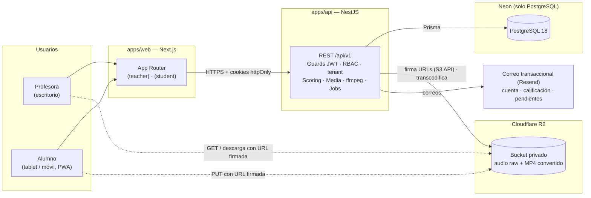
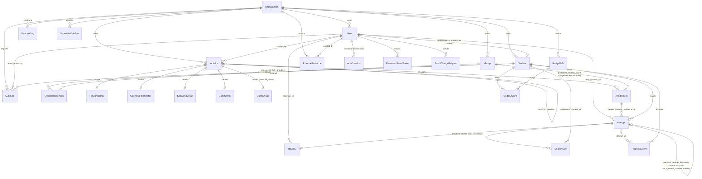
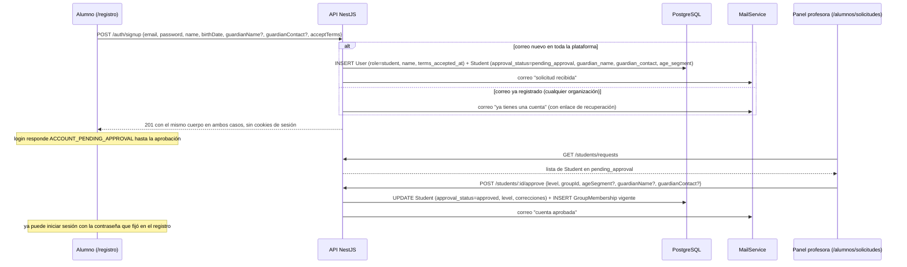

# Englove — Architecture Overview

> **Propósito.** Vista técnica de cómo se construye Englove: piezas, fronteras, flujos y reglas de implementación. Desarrolla lo que `.agents/CONTEXT.md` fija en §4, §6, §7, §10 y §11. Ante cualquier conflicto, manda `CONTEXT.md`.
>
> Estados usados en este documento:
>
> - **Decidido**: proviene de `CONTEXT.md` o fue aceptado en su §14. No se cambia sin nueva entrada allí.
> - **Propuesto**: detalle de implementación que este documento añade y aún no se ha confirmado (lista en §14).
> - **Pendiente**: requiere decisión humana.
>
> Documentos hermanos: [`sdd-process.md`](./sdd-process.md) (metodología), [`pbp-development.md`](./pbp-development.md) (etapas de construcción) y [`taskboard.md`](./taskboard.md) (tareas y estado). Las specs de `specs/` detallan cada capacidad a partir de este documento.
>
> Última actualización: 2026-10-21. SPEC-03 Implementada: decisiones 95–97 de CONTEXT §14 (restauración de actividades archivadas sin cancelar asignaciones, archivo de grupos solo sin miembros vigentes y reparto de pesos por mayor resto). SPEC-02 Verificada: verificación completa de identidad, sesiones, guards, extensión Prisma conectada en PrismaService con ciclo de vida completo y pruebas frontend de routing/proxy, higiene de almacenamiento y formularios (108/108 tests monorepo). Actualización anterior: 2026-10-20 (decisiones 93–94 de CONTEXT §14: delimitación de la API de alumnos en Etapa 2 y bloqueo sin enumeración).
>
> Actualización anterior (2026-10-08, Ronda 6): corrige tres incongruencias: `ValidationPipe` configurado solo con `whitelist: true` (campos no declarados se ignoran, no se rechazan con 400; A71), `MediaAsset.student_id` como propietario explícito del asset (A72) con diagrama ER y política `onDelete` actualizados, y aclaración de A28 en §8.1. Sin cambios de comportamiento ni nuevas decisiones de producto.
>
> Actualización anterior (Ronda 5): 2026-09-28 (decisión 67). §6 reescrito con el diagrama completo, `AuthSession`, `EmailChangeRequest.failed_attempts`, exámenes solo con ítems `fill_blank`, nueva forma de `ProgressEvent`, calificación única en `Attempt.score` / `graded_at` y `Review` solo como feedback, un solo grupo vigente por alumno, `Attempt.attempt_number`, `answer_key` en columna propia, `ScheduledJobRun`, `ApprovalStatus` sin `rejected`, revisión de índices, campos faltantes y política de `onDelete`. Los detalles nuevos se listan en §14.5. La propuesta de parámetros de organización con tipo no se adoptó.
>
> Actualización anterior (Ronda 4): 2026-09-28, `planning/decisiones-para-correccion-de-planeacion.md` (CONTEXT §14, decisión 57): cookies con `Domain=.<dominio>` (§8.2), correo globalmente único y registro sin enumeración de cuentas (§6.4, §7.2), tolerancia de 24 h y cierre efectivo (§7.5), `Attempt.retry_extend_until` y consumo atómico de la habilitación (§6.5, §7.7), OTP al correo nuevo (§7.4), cambio administrativo del correo con `AuditLog` (§7.3), una sola instancia con recuperación de la cola de transcodificación (§4.5, §11.4) y terminología de tipos de actividad y mecánicas de juego (§6.3). Los detalles nuevos se listan en §14.4; las decisiones menores pendientes, con su propuesta, en §15.
>
> Ronda 3: 2026-09-22, `planning/incongruencias-y-decisiones-definitivas.md` (decisión 34): sin `Guardian` ni consentimiento, Cloudflare R2, transcodificación de audios, timestamps en servidor, algoritmo de rachas, rate limiting, `age_segment`, denominador congelado, estados de error y notificación de actualizaciones de la PWA (§14.3).

---

## Índice

1. Vista general
2. Estructura del monorepo
3. Frontend (`apps/web`)
4. Backend (`apps/api`)
5. Paquete compartido y contrato de actividad
6. Modelo de datos
7. Flujos clave
8. Multi-tenant y seguridad
9. Gamificación y estadísticas
10. Offline, PWA y accesibilidad
11. Entornos, CI/CD y despliegue
12. Observabilidad y calidad
13. Convenciones de código y API
14. Decisiones añadidas por este documento
15. Preguntas abiertas de arquitectura

---

## 1. Vista general

Englove es una aplicación web con dos superficies (panel de la profesora y portal del alumno) servidas por una misma app Next.js, una API NestJS que concentra toda la lógica de negocio, Neon usado únicamente como PostgreSQL (decisión 82) y Cloudflare R2 como almacenamiento de archivos (Decidido, decisión 34 §21).



Despliegue (Decidido, CONTEXT §6, decisión 87): `apps/web` como **Cloudflare Worker** mediante `vinext` y Wrangler, `apps/api` en **Render**, ambos bajo el mismo dominio raíz (§11). Pages no forma parte de la topología. Archivos en **Cloudflare R2**.

**Principios que gobiernan el diseño (Decidido, CONTEXT §7.1):**

1. NestJS es el único backend de negocio. El frontend nunca habla con Postgres ni decide autorización.
2. Multi-tenant desde el esquema: `organization_id` en toda tabla de tenant, aunque el piloto tenga una sola organización.
3. `Activity` → `Assignment` → `Attempt` es el eje de todo flujo de aprendizaje.
4. Tabla base + tabla de detalle 1:1 por tipo de actividad (cinco tipos de actividad; el tipo `game` tiene cinco mecánicas de juego, §6.3).
5. Progreso como eventos append-only (`ProgressEvent`).
6. Puntaje calculado en servidor.
7. Feature flags por organización en base de datos.

**Lo que esta arquitectura no incluye en el piloto (Decidido, CONTEXT §2.4):** WebSockets, heartbeat, pantallas de `parent` y `admin`, Capacitor, muro social, Phaser, iframes de Educaplay, pagos, ni ninguna gestión de consentimiento legal de menores. Si una tarea parece necesitarlos, se detiene y se propone en CONTEXT §14.

---

## 2. Estructura del monorepo — Decidido (A1)

Herramientas: pnpm workspaces + Turborepo. Justificación: caché de builds y ejecución de tareas por paquete con configuración mínima, sin generadores de código ni capas adicionales.

```
englove/
├── .agents/CONTEXT.md          # fuente de verdad de producto y decisiones
├── planning/                   # este documento, proceso SDD, etapas, taskboard
├── specs/                      # especificaciones por capacidad (SPEC-01 … SPEC-10), ver sdd-process.md
├── apps/
│   ├── web/                    # Next.js: panel profesora + portal alumno + PWA
│   └── api/                    # NestJS: API REST, scoring, media, jobs programados
├── packages/
│   └── shared/                 # enums, esquemas Zod por tipo de actividad, contrato de actividad, tipos de API
├── tooling/                    # tsconfig, eslint y prettier compartidos
├── docker-compose.yml          # Postgres 18 local
├── pnpm-workspace.yaml
├── turbo.json
└── package.json
```

Reglas de dependencia:

- `apps/web` → `packages/shared`.
- `apps/api` → `packages/shared`.
- `packages/shared` no importa nada de `apps/*` ni de Prisma. Es TypeScript puro + Zod.
- No existe `packages/ui`. Los tokens y componentes viven en `apps/web` hasta que aparezca una segunda aplicación que los necesite. Capacitor (Fase 2) empaqueta la misma web, así que probablemente nunca haga falta.

---

## 3. Frontend (`apps/web`)

### 3.1 Estructura de rutas — Decidido

```
apps/web/src/app/
├── (public)/
│   ├── login/                  # profesora y alumno: correo + contraseña (la API resuelve el rol)
│   ├── registro/               # auto-registro del alumno: crea cuenta en pending_approval
│   ├── recuperar-contrasena/   # solicitar enlace de recuperación
│   └── restablecer/[token]/    # nueva contraseña con enlace de un solo uso
├── (teacher)/
│   ├── layout.tsx              # tema neutro, navegación lateral
│   ├── inicio/                 # dashboard: tarjetas de recordatorio (solicitudes pendientes, sin calificar > N días)
│   ├── actividades/            # gestor de contenidos
│   ├── asignaciones/
│   ├── revision/               # calificación y feedback: cola manual + intentos autocalificados + habilitar nuevo intento + descarga de audio
│   ├── alumnos/                # pestañas: Alumnos (edición, datos del acudiente, iniciar recuperación, cambio administrativo de correo) · Solicitudes · Bloqueados
│   ├── grupos/
│   ├── estadisticas/           # rendimiento y constancia por alumno y grupo + leaderboard privado (solo RBAC teacher)
│   └── contenido-extra/
└── (student)/
    ├── layout.tsx              # fija data-theme según age_segment
    ├── inicio/                 # asignaciones abiertas
    ├── actividad/[attemptId]/  # renderizador
    ├── juegos/                 # lista → juego
    ├── progreso/               # resumen → insignias / rachas
    ├── feedback/               # lista → detalle por actividad
    ├── extra/                  # contenido extra (flag extra_content)
    └── perfil/                 # cambio de correo con OTP · alternar Kids/Teens si can_switch_interface (acceso desde el avatar, no ocupa entrada de la barra)
```

`proxy.ts` de Next.js 16 (que sustituye a `middleware.ts`, decisión 81; ver §3.8) solo comprueba la presencia de la cookie de sesión y el rol para redirigir entre grupos de rutas. La autorización real la aplica la API en cada petición (Decidido, decisión 58). El `proxy.ts` ve la cookie porque se emite con `Domain=.<dominio>` (§8.2); lee el `role` del payload del access token sin verificarlo y sin tratarlo como prueba de autorización: un token manipulado solo cambia a qué pantalla se redirige, y la API responde 401/403 a todo lo demás. Si no encuentra `access_token` (caducó a los 15 min), no concluye que no hay sesión: redirige a `/login?next=…`, que primero intenta `POST /auth/refresh` en silencio y, si tiene éxito, vuelve a `next` sin mostrar el formulario.

**Sección de bloqueados (Decidido, decisión 34 §8):** la pestaña `alumnos/bloqueados` lista las cuentas de alumnos con `locked_until` vigente y ofrece desbloqueo manual en un clic (`POST /students/:id/unlock`). **Recordatorios del dashboard:** `inicio/` del panel muestra tarjetas minimalistas (contador + enlace directo) alimentadas por `GET /dashboard/reminders` (§4.1): solicitudes de registro pendientes y actividades sin calificar hace más de `ungraded_reminder_days` (3 por defecto). No sobrecargan el dashboard ni sustituyen al panel estadístico.

**Regla de navegación (Decidido, CONTEXT §5.2 y §14 decisión 29): entre 2 y 4 clics según la zona**, contando desde `inicio` y sin contar el login. Cada zona tiene un techo propio y la spec de la Etapa 5 lo verifica pantalla por pantalla:

| Zona                  | Destino final                                       | Clics máximos | Ruta típica                                                      |
| --------------------- | --------------------------------------------------- | ------------- | ---------------------------------------------------------------- |
| Actividades asignadas | Empezar una actividad                               | **2**         | `inicio` → tarjeta de asignación → renderizador                  |
| Juegos                | Empezar un microjuego                               | **3**         | `inicio` → `juegos` → juego                                      |
| Progreso              | Detalle de una insignia o de la racha               | **3**         | `inicio` → `progreso` → insignia                                 |
| Feedback              | Leer el comentario de la profesora sobre un intento | **3–4**       | `inicio` → `feedback` → actividad → intento (si hubo más de uno) |
| Contenido extra       | Abrir un enlace externo                             | **3**         | `inicio` → `extra` → enlace                                      |

Principios que mantienen la simpleza dentro del rango: la barra de navegación del alumno siempre visible con como máximo cinco entradas; sin menús anidados; ninguna pantalla intermedia que solo contenga un botón; el botón "volver" siempre lleva a la pantalla anterior de la misma zona.

### 3.2 Datos y estado — Decidido (A2)

- TanStack Query para todo acceso a la API: caché, reintentos, y `refetchInterval: 30_000` en estadísticas y cola de revisión (el "polling cada 30 s" de CONTEXT §2.4).
- Sin gestor de estado global adicional. El estado de una actividad en curso vive en el hook `useAttempt` y en la cola offline (§10).
- Formularios del panel con react-hook-form y resolvers de Zod, reutilizando los esquemas de `packages/shared`. El formulario de cada tipo de actividad se deriva de su esquema: un cambio en el esquema, un cambio en el formulario.

### 3.3 Sistema de diseño y temas — Decidido (CONTEXT §8 y decisión 20)

- Un solo conjunto de tokens con dos valores: `[data-theme="kids"]` y `[data-theme="teens"]` como CSS variables (`--color-*`, `--font-*`, `--space-*`, `--radius-*`, `--motion-*`, `--sound-*`). Tailwind los consume vía `theme.extend`.
- Los componentes del alumno se construyen una sola vez y leen el conjunto activo. Solo hay variantes estructurales donde la diferencia lo exige: layout de la zona de juegos y densidad de la home.
- El panel de la profesora usa shadcn/ui con un tema neutro y no participa del sistema Kids/Teens.
- Framer Motion sin restricción (Decidido). Las variantes de animación viven en `motion/kids.ts` y `motion/teens.ts` y se cargan con `next/dynamic` según el tema activo: cada audiencia descarga solo su bundle.
- Howler.js para efectos de sonido (activados por defecto en Kids, configurables en Teens) y canvas-confetti en celebraciones.

### 3.4 Renderizador de actividades

`ActivityRenderer` recibe `{ type, config, attemptToken }` y monta el componente del tipo correspondiente. Todos los componentes de actividad, fichas y microjuegos por igual, consumen `useAttempt()`, que implementa el contrato de actividad (§5): emite `started`, `answered` y `completed`, encola offline y reintenta. Ningún componente de actividad llama a la API directamente.

### 3.5 Speaking en el navegador — Decidido (decisión 34 §13 y §22)

Cada plataforma graba en un codec distinto y no todos los navegadores reproducen todos los formatos:

| Plataforma del alumno   | Formato grabado          |
| ----------------------- | ------------------------ |
| Chrome / Edge / Android | `audio/webm;codecs=opus` |
| Safari iOS / macOS      | `audio/mp4` (AAC)        |
| Firefox                 | `audio/ogg;codecs=opus`  |

La solución tiene **dos capas complementarias** que no cambian la arquitectura de R2 ni el contrato de la API.

**Capa 1 — Cliente: grabación óptima por dispositivo.** Antes de grabar, `useAttempt` detecta el formato soportado con `MediaRecorder.isTypeSupported()` en este orden de preferencia:

```ts
function getSupportedMimeType(): string {
  const types = [
    "audio/webm;codecs=opus",
    "audio/webm",
    "audio/mp4",
    "audio/ogg;codecs=opus",
    "audio/ogg",
  ];
  return types.find((t) => MediaRecorder.isTypeSupported(t)) ?? "";
}
```

El `mime_type` detectado viaja en `POST /media/upload-url` y se persiste en `MediaAsset.mime_type`. El alumno graba siempre en el codec nativo de su dispositivo, sin librerías de terceros ni encoders WASM (un WAV sin compresión pesaría ~10× más que MP4; con el tope de 5 minutos llegaría a ~50 MB, inviable en conexiones móviles). El blob se guarda en IndexedDB antes de intentar la subida; si falla, el intento queda "pendiente de envío" y se reintenta (§10).

**Capa 2 — Servidor: transcodificación a MP4/AAC para reproducción universal.** Al confirmar la subida (`MediaAsset.status = ready`), el módulo `media` encola una tarea asíncrona con `ffmpeg` (`fluent-ffmpeg`) que convierte el raw a `audio/mp4` (AAC, mono, 64 kbps) y lo guarda en R2 bajo la clave `<assetId>_converted.mp4`; al terminar actualiza `MediaAsset.converted_key` y elimina el raw. La profesora recibe siempre la URL firmada del archivo convertido, reproducible en Chrome, Safari, Firefox, Edge, iOS y Android. El alumno no reproduce audios.

```
Alumno graba → WebM | MP4 | OGG (nativo)
  → PUT a R2 (raw, clave <assetId>.<ext>)
  → complete → MediaAsset.status = ready
  → job de transcodificación → <assetId>_converted.mp4 en R2
  → MediaAsset.converted_key actualizado, raw eliminado
  → profesora reproduce o descarga el MP4 en cualquier navegador
```

Si la transcodificación falla, `converted_key` queda `null`, el raw se conserva y el panel muestra el raw como fallback con un aviso visual de que puede no reproducirse en todos los navegadores. El intento no se bloquea ni se pierde, y al alumno nunca se le muestra el fallo técnico. El job de retención (§4.5) borra raw y convertido al vencer `retention_until`.

**Una sola instancia y recuperación (Decidido, decisión 64).** La cola de conversión vive en memoria y solo es válida porque la API corre en una única instancia (§11.4). Una conversión interrumpida por un reinicio, despliegue o caída se detecta porque su `MediaAsset` queda con `status = ready` y `converted_key` nulo; al arrancar, la API ejecuta una **rutina de recuperación** que reprograma esas conversiones. La operación es idempotente: la clave del convertido es determinista (`<assetId>_converted.mp4`), se sobrescribe sin efectos si ya existía, y el raw solo se borra después de subir el convertido y guardar `converted_key`. Cada intento incrementa `MediaAsset.transcode_attempts` y un fallo se registra en el log con el `assetId` (sin datos personales). El número máximo de intentos a través de reinicios, el tratamiento definitivo de una conversión fallida (`transcode_failed_at`) y la reconversión manual son parte de la decisión 84: máximo 3 intentos en total; al agotarlos, `transcode_failed_at` y fallback definitivo al raw; sin reconversión manual en el piloto.

**Duración de los audios (Decidido, decisión 34 §13):**

| Parámetro                   | Valor     | Dónde vive                                          |
| --------------------------- | --------- | --------------------------------------------------- |
| Duración mínima             | 2 s, fija | `SpeakingDetail.min_duration_seconds` (no editable) |
| Duración máxima por defecto | 120 s     | `SpeakingDetail.max_duration_seconds`               |
| Duración máxima absoluta    | 300 s     | tope validado por el esquema Zod y por la API       |

La profesora ajusta la duración máxima por actividad dentro del rango 2 s – 300 s desde el formulario de speaking. El servidor mide la duración real con `ffprobe` al confirmar la subida: un audio menor de 2 s se rechaza con `AUDIO_IMPLAUSIBLE_DURATION`; uno mayor que el máximo configurado, con `AUDIO_EXCEEDS_MAX_DURATION`. El cliente detiene la grabación al alcanzar el máximo y muestra el tiempo restante.

### 3.6 Estados de error en el cliente — Decidido (decisión 34 §17)

Toda situación indeseada tiene un estado de error claro, amigable y contextual:

- `ErrorBoundary` global en `apps/web` y un `ErrorState` reutilizable por zona (`inicio`, `actividad`, `revision`, etc.) con variantes por tema: en Kids, visual y simpático (ilustración + frase corta + botón grande); en Teens y en el panel, directo y claro.
- Casos cubiertos: red o servidor (500, 503), acceso no autorizado (401, 403: "No tienes acceso a esta sección"), recurso no encontrado (404), actividad cerrada o expirada (`ATTEMPT_CLOSED`: "No fue posible tomar tu intento porque la actividad ya cerró. Comunícate con tu maestra para ver si hay opción de volver a habilitarla."; el mismo código cubre la entrega fuera de la tolerancia de 24 h, §7.5), actividad aún no abierta (`ATTEMPT_NOT_OPEN`, Decidido, decisión 84), intento ya existente sin habilitación (`ATTEMPT_ALREADY_EXISTS`), fallo en la subida de audio (con reintento), y un genérico para cualquier otro código.
- Los mensajes **nunca** muestran stack traces, códigos internos ni detalles técnicos. El `code` de la API (§13) se traduce a texto en español en un mapa único del cliente; lo no mapeado cae en el genérico.
- La captura de errores (§12) recibe el error con rol y versión, sin datos personales.

### 3.7 Actualizaciones de la PWA — Decidido (decisión 34 §4)

Cuando el service worker detecta una nueva versión del frontend (evento `waiting` de Serwist) o la API responde con el header `X-App-Min-Version` mayor que la versión cargada, la app muestra una **notificación in-app no bloqueante**: "Hay una actualización disponible. La aplicación necesita reiniciarse para aplicar los cambios." con un botón que ejecuta `skipWaiting` y recarga. Aplica al panel y al portal, con texto y estilo adaptados al tema (más simple y visual en Kids). Nunca se actualiza en silencio a mitad de un intento: si hay un intento en curso, la notificación espera a que termine o se abandone la pantalla.

### 3.8 Plataforma Next.js 16 — Decidido (decisiones 81, 85 y 88)

La versión del framework y sus convenciones son una decisión de arquitectura, no un detalle del scaffold:

| Aspecto | Decisión | Notas |
| --- | --- | --- |
| Versiones | Next.js 16.4 (App Router) + React 19.3; TypeScript 5.9; Node.js 24 LTS; pnpm 11 | Los parches exactos quedan fijados en el lockfile; no se usa Node Current en producción |
| Bundler | Turbopack por defecto en `next dev` y `next build` | Con `vinext` el build de producción lo hace Vite (ver adaptador); Turbopack aplica entonces al desarrollo local |
| Compilador | React Compiler: `reactCompiler: true` y `babel-plugin-react-compiler` como `devDependency` | No viene activado por defecto; el paquete compartido (`packages/shared`) no depende de él |
| Intercepción de rutas | **`proxy.ts`** (export `proxy`), nunca `middleware.ts` | Corre en runtime **Node.js**; el runtime Edge no se admite y la opción `runtime` lanza error. Mantiene la regla de §3.1 y de la decisión 58: solo redirige por rol (y a `/login?next=`, que intenta el refresco); no autoriza |
| Caché | Modelo explícito con la directiva `use cache` (a nivel de archivo, componente o función) y `cacheComponents: true`; `cacheLife` y `cacheTag` según haga falta | Nada se cachea por defecto. No se cachea ninguna respuesta autenticada (igual criterio que el service worker, §10.2): los datos del alumno y de la profesora son dinámicos |
| Imágenes | `next/image` con `unoptimized` (o Cloudflare Images si se contrata) | El optimizador propio de Next.js no existe en Workers |
| Arrastrar y soltar | `@atlaskit/pragmatic-drag-and-drop` en los microjuegos (Etapa 6), detrás del contrato de actividad (§5.2) | Usa el arrastre nativo del navegador: en iOS, iPadOS y Android la vista previa queda centrada bajo el dedo (limitación de la plataforma); se prueba en tablet real y SPEC-06 evalúa una alternativa sin arrastre. Ningún componente de actividad llama a la API directamente (§3.4) |

**Adaptador de Cloudflare: `vinext` (Decidido, decisión 85; verificado en ENG-140).** `vinext` es el adaptador recomendado por Cloudflare para Next.js en Workers; soporta `proxy.ts`, Server Actions, ISR y middleware; el build de producción lo hace Vite, no Turbopack. La compatibilidad de `proxy.ts` con la cookie `Domain=.<dominio>` y el refresco silencioso de §3.1 fue verificada en el PoC ENG-140. Si en el futuro se detecta una incompatibilidad, se registra una decisión nueva en CONTEXT §14 (decisión 82 (j)). Límites de Cloudflare verificados: bundle comprimido de 3 MB en Workers Free y 10 MB en Paid, 10 ms de CPU por petición en Free, `nodejs_compat` con `compatibility_date` >= 2024-09-23 y `wrangler.jsonc` con `assets`.

---

## 4. Backend (`apps/api`)

### 4.1 Módulos planos — Decidido (CONTEXT §6 y decisión 20)

Cada módulo es `controller` → `service` → Prisma. Sin repositorios genéricos, sin CQRS, sin eventos de dominio en el piloto.

| Módulo          | Responsabilidad                                                                                                                                                                                                                                                                                                                                   | Endpoints principales                                                                                                                                                                                                                                                                                                                        |
| --------------- | ------------------------------------------------------------------------------------------------------------------------------------------------------------------------------------------------------------------------------------------------------------------------------------------------------------------------------------------------- | -------------------------------------------------------------------------------------------------------------------------------------------------------------------------------------------------------------------------------------------------------------------------------------------------------------------------------------------- |
| `auth`          | login con correo y contraseña (todos los roles, sin organización: correo globalmente único), auto-registro del alumno (crea `User` + `Student`; respuesta uniforme si el correo ya existe), cookies con `Domain=.<dominio>`, refresh rotativo, logout, recuperación de contraseña, cambio de correo con OTP al correo nuevo, bloqueo por intentos | `POST /auth/login`, `POST /auth/signup`, `POST /auth/refresh`, `POST /auth/logout`, `POST /auth/forgot-password`, `POST /auth/reset-password`, `POST /me/email-change`, `POST /me/email-change/confirm`                                                                                                                                      |
| `students`      | alumnos, nivel, segmento, datos del acudiente (`guardian_name`, `guardian_contact`), aprobación de solicitudes, iniciar recuperación de contraseña, cambio administrativo del correo con `AuditLog` (§7.3), bloqueados y desbloqueo, cambio de interfaz, borrado en cascada                                                                       | `GET/PATCH/DELETE /students` (`PATCH` no modifica el correo), `GET /students/requests`, `POST /students/:id/approve`, `POST /students/:id/reject`, `POST /students/:id/reset-password` (envía el enlace al correo del alumno), `POST /students/:id/change-email`, `GET /students/locked`, `POST /students/:id/unlock`, `PATCH /me/interface` |
| `groups`        | grupos (archivables) y membresías con un solo grupo vigente por alumno (decisión 73)                                                                                                                                                                                                                                                              | `/groups`, `/groups/:id/members`, `PUT /students/:id/group`                                                                                                                                                                                                                                                                                  |
| `activities`    | CRUD de actividades y detalle por tipo, estados, versionado, normalización de pesos de examen, mínimo de ítems al publicar                                                                                                                                                                                                                        | `/activities`, `POST /activities/:id/publish`, `POST /activities/:id/restore` (decisión 95), `POST /activities/:id/duplicate`                                                                                                                                                                                                                                                              |
| `assignments`   | asignación a grupos con fechas; `historical_student_count`                                                                                                                                                                                                                                                                                        | `/assignments`, `GET /me/assignments`                                                                                                                                                                                                                                                                                                        |
| `attempts`      | ciclo start / events / complete, scoring, control de un intento por asignación con consumo atómico de la habilitación, validación del cierre efectivo sobre `started_at` del servidor, tolerancia de 24 h para completar                                                                                                                          | `POST /assignments/:id/attempts`, `POST /attempts/:id/events`, `POST /attempts/:id/complete`                                                                                                                                                                                                                                                 |
| `reviews`       | cola de revisión, calificación 0,0–5,0, feedback, correo de notificación al alumno (sin nota ni feedback), habilitar nuevo intento con `retry_extend_until` opcional                                                                                                                                                                              | `GET /reviews/queue`, `GET /reviews/graded`, `POST /attempts/:id/review`, `POST /attempts/:id/grant-retry`                                                                                                                                                                                                                                   |
| `progress`      | `ProgressEvent`, insignias, rachas                                                                                                                                                                                                                                                                                                                | `GET /me/progress`, `GET /students/:id/progress`                                                                                                                                                                                                                                                                                             |
| `stats`         | rendimiento y constancia por alumno y grupo; leaderboard privado. **Acceso solo por `RolesGuard('teacher')`, sin feature flags**                                                                                                                                                                                                                  | `GET /stats/students/:id`, `GET /stats/groups/:id`, `GET /stats/overview`, `GET /stats/leaderboard`                                                                                                                                                                                                                                          |
| `dashboard`     | contadores de pendientes de la profesora (solicitudes, sin calificar > N días); el mismo `PendingSummaryService` alimenta el correo cada 3 días (§4.5)                                                                                                                                                                                            | `GET /dashboard/reminders`                                                                                                                                                                                                                                                                                                                   |
| `media`         | URLs firmadas de subida, reproducción y descarga sobre R2 (S3 API), `MediaAsset`, validación de duración con `ffprobe`, transcodificación a MP4/AAC con `ffmpeg` (tarea interna disparada tras confirmar la subida, no expuesta a clientes) con rutina de recuperación al arrancar, retención                                                     | `POST /media/upload-url`, `GET /media/:id/url`, `GET /media/:id/download-url`                                                                                                                                                                                                                                                                |
| `resources`     | contenido extra (enlaces externos)                                                                                                                                                                                                                                                                                                                | `/resources`                                                                                                                                                                                                                                                                                                                                 |
| `feature-flags` | flags y configuración por organización                                                                                                                                                                                                                                                                                                            | `GET /feature-flags`                                                                                                                                                                                                                                                                                                                         |
| `health`        | liveness y conexión a base de datos                                                                                                                                                                                                                                                                                                               | `GET /health`                                                                                                                                                                                                                                                                                                                                |

No existe módulo `guardians` ni ningún endpoint de consentimiento (decisión 34 §1 y §2). No existe `POST /students`: la única vía de alta es `POST /auth/signup`.

**Entrega por etapas (decisión 93):** la tabla es el inventario del piloto, no el alcance íntegro de SPEC-02. Etapa 2 / ENG-023 entrega lista, ficha, edición y solicitudes con aprobación/rechazo; solo `POST /students/:id/reject` elimina solicitudes pendientes. `DELETE /students/:id` se entrega con la cascada completa de §8.4 en Etapa 5 / SPEC-05 / ENG-070, nunca como baja parcial por FK. Grupos y gestión visual/cambio administrativo conservan SPEC-03; perfil y alternancia, SPEC-05.

### 4.2 Validación en dos niveles — Decidido (A5)

CONTEXT pide DTOs con `class-validator` en todos los endpoints (§6) y esquemas Zod compartidos por tipo de actividad (§6, Repositorio). Conviven así:

- **class-validator** valida la forma de cada petición: campos obligatorios, tipos, longitudes, enums.
- **Zod** (desde `packages/shared`) valida el contenido específico de un tipo de actividad: el campo `config` al crear o editar una actividad, y el campo `answers` al enviar respuestas. Se aplica con un `ZodValidationPipe` que selecciona el esquema según `activity.type`.

Regla: nada específico de un tipo de actividad se valida con class-validator; nada de la envoltura HTTP se valida con Zod.

### 4.3 Guards y contexto de tenant — Decidido (A4)

Orden de ejecución: `JwtAuthGuard` → `RolesGuard` → `TenantContext`.

- El JWT contiene `sub` (user id), `role`, `org` (organization_id), `sid` (familia de sesión, `AuthSession.id`) y, para alumnos, `student_id` y `age_segment`. El login es el mismo endpoint para todos los roles; el rol sale de `User.role`, nunca del cliente.
- `JwtAuthGuard` rechaza el access token si su `AuthSession` está revocada (decisión 68). Con 100 alumnos la consulta por clave primaria en cada petición es despreciable.
- `TenantContext` expone `organization_id` durante toda la petición mediante AsyncLocalStorage.
- Una extensión de Prisma Client añade `where: { organization_id }` a todas las operaciones sobre modelos de tenant. Los servicios además filtran explícitamente. El doble filtro es deliberado: defensa en profundidad para el multi-tenant real de Fase 2.
- Un test de esquema verifica que toda tabla marcada como tenant tiene `organization_id`.

### 4.4 Scoring — Decidido (en servidor, A15; escala 0,0–5,0 por decisión 24)

`ScoringService` delega en una estrategia por tipo de actividad (y, en `game`, por mecánica de juego). Cada scorer produce una **fracción de acierto** entre 0 y 1; `ScoringService` la convierte a la **escala colombiana 0,0–5,0** con un decimal (`round(fraction × 5, 1)`) y la guarda en `Attempt.score`. Ningún scorer ni cliente escribe directamente en la escala.

| Tipo de actividad | Scorer (fracción de acierto)                                                                                                                                                                                                         | Resultado                     |
| ----------------- | ------------------------------------------------------------------------------------------------------------------------------------------------------------------------------------------------------------------------------------ | ----------------------------- |
| `fill_blank`      | ítems correctos / ítems totales, comparando `answers` con `answerKey`; un hueco sin respuesta cuenta como incorrecto                                                                                                                 | `graded`, corrección por ítem |
| `exam`            | media ponderada de sus ítems, que son exclusivamente `fill_blank` (decisión 70); cada ítem reutiliza el scorer de `fill_blank`; pesos normalizados en `ExamDetail`; un ítem no respondido aporta 0 y su peso entra en el denominador | `graded`                      |
| `game`            | por mecánica de juego (`match`, `order_words`, `drag_drop`, `memory`, `timed_choice`): aciertos, errores y tiempo según fórmula del esquema de la mecánica; valida duración plausible                                                | `graded`                      |
| `open_question`   | ninguno; la profesora introduce el `score` 0,0–5,0 en la revisión                                                                                                                                                                    | `pending_review`              |
| `speaking`        | ninguno; la profesora introduce el `score` 0,0–5,0 en la revisión                                                                                                                                                                    | `pending_review`              |

Reglas de la escala:

- `Attempt.score` es `numeric(2,1)` entre `0.0` y `5.0` (con `CHECK` en base de datos) y es la **única** columna de calificación: la revisión manual también escribe en ella, y `Review` no guarda nota (decisión 72). La API rechaza cualquier otro valor con `SCORE_OUT_OF_RANGE`.
- Umbral de aprobación `3.0` (Decidido), leído de `FeatureFlag`/configuración de la organización como `passing_score`. Determina el estado visual "aprobado / por mejorar" en el portal y en el panel; no bloquea nada.
- La interfaz muestra la coma decimal (`4,5`); la API y la base de datos usan punto (`4.5`).
- Las estrellas del alumno se derivan del `score`: 0–1 estrellas por debajo del umbral, 2 estrellas entre el umbral y 4,4, 3 estrellas de 4,5 en adelante (Decidido, A16).

Validación de plausibilidad: si `finished_at - started_at` es menor que un mínimo por tipo (por ejemplo, 3 s por ítem), el intento se califica igual pero se marca con `flags: ['implausible_duration']` para que la profesora lo vea. No se rechaza: un niño que responde rápido no debe perder su trabajo. El umbral vive en `Activity.min_plausible_seconds`, con valor por defecto por tipo en `packages/shared` (decisión 79). La única excepción es el audio de speaking menor de 2 s, que sí se rechaza (§3.5).

**Reloj del servidor (Decidido, decisión 34 §3).** `started_at` y `finished_at` (y `Attempt.graded_at`, `occurred_at`, `joined_at` / `left_at` de las membresías) los asigna la API en el momento en que recibe y procesa la petición (`new Date()` en NestJS o `now()` en PostgreSQL). El cliente nunca los envía; si los envía, `whitelist: true` los descarta. Es lo que hace fiables la validación de plausibilidad, las estadísticas de tiempo, las rachas y la regla de `due_at` (§7.5).

**Reglas de examen (Decidido, decisión 34 §11 y §12):**

- **Ítem no respondido = puntaje 0.** El peso del ítem entra en el denominador. No responder equivale a responder incorrectamente, para todos los tipos de ítem sin excepción.
- **Mínimo 2 ítems para publicar.** Se valida en `POST /activities/:id/publish` con `EXAM_MIN_ITEMS`, no al crear: la profesora puede guardar un examen incompleto como borrador sin restricciones.
- **Normalización automática de pesos.** Al guardar un examen (`POST`/`PATCH /activities`), si la suma de pesos no es exactamente 100 la API los ajusta proporcionalmente (`peso_i × 100 / suma`, aritmética decimal exacta; cada peso se trunca a una décima y las décimas restantes hasta 100,0 se asignan por mayor resto, con empate desde el último ítem, sin pesos negativos y con suma 100,0; decisión 97) y devuelve los valores efectivos. El formulario muestra siempre el peso real tras la normalización, con un mensaje que informa del ajuste. El resultado sigue en la escala 0,0–5,0 con umbral 3,0.

### 4.5 Tareas programadas — Decidido (decisiones 20, 27 y 32)

Con `@nestjs/schedule`:

- Nocturna: marcar `abandoned` los intentos `in_progress` cuyo **cierre efectivo + 24 h** ya pasó (el mismo margen del `attemptToken`, §7.5; Decidido, decisión 60). El cierre efectivo es `Assignment.due_at`, o el `retry_extend_until` del intento anterior cuando el intento es un nuevo intento habilitado con plazo (decisión 61). Un intento iniciado antes del cierre puede terminarse dentro de la tolerancia (decisión 34 §10); solo se abandona el que no se completó en esa ventana.
- Nocturna, **retención de audios** (Decidido, CONTEXT §9, decisiones 27 y 34 §6): borrar de R2 el raw y el `_converted.mp4` de los `MediaAsset` con `retention_until < now()` (`retention_until = Attempt.graded_at + 30 días`); borrar los `MediaAsset` en `pending_upload` creados hace más de `pending_upload_ttl_days` (7); reintentar los `pending_delete` que fallaron. Al borrar, el registro pasa a `deleted` y conserva `attempt_id`, `mime_type`, `duration_seconds` y `deleted_at` para trazabilidad; `Review` y `Attempt.score` no se tocan. Ambos plazos son configurables por organización.
- Nocturna: desbloquear cuentas cuyo bloqueo por intentos fallidos ya venció (limpieza; el desbloqueo real es por comparación de `locked_until` en el login).
- Nocturna — **limpieza de sesiones y tokens (decisión 68):** borrar las `AuthSession` caducadas o revocadas hace más de 30 días y los `PasswordResetToken` / `EmailChangeRequest` caducados.
- Semanal (lunes 00:05 America/Bogota): recalcular rachas con el algoritmo de §9.3 y emitir `streak_week` con `period_key` = semana ISO cerrada.
- **Mensual (día 1, 00:10 America/Bogota) — edad e interfaz (Decidido, decisión 34 §15):** recalcular la edad de cada `Student` desde `birth_date`; a quien haya cumplido 11 años se le activa `can_switch_interface = true`. No cambia `age_segment`: solo habilita la opción; el alumno elige desde su perfil.
- **Cada 3 días (08:00 America/Bogota) — pendientes de la profesora (Decidido, decisión 34 §18):** `PendingSummaryService` cuenta solicitudes de registro sin aprobar y actividades sin calificar con más de `ungraded_reminder_days` desde su cierre. Si hay al menos un pendiente, `MailService.sendTeacherPendingSummary` envía un correo con el detalle y un enlace directo a cada sección. Si no hay ninguno, no se envía nada.
- **Al confirmar una subida (tarea disparada, no cron) — transcodificación (Decidido, decisión 34 §22):** se encola una tarea `ffmpeg` que convierte el raw a MP4/AAC, sube `<assetId>_converted.mp4` a R2, actualiza `MediaAsset.converted_key` y borra el raw. Si falla, `converted_key` queda `null` y el raw se conserva (§3.5). Cola en memoria con reintento (3 intentos con backoff); sin Redis en el piloto (A14). Válida solo con una instancia (decisión 64).
- **Al arrancar la API (tarea disparada, no cron) — recuperación de transcodificaciones (Decidido, decisión 64):** busca los `MediaAsset` con `status = ready`, `converted_key` nulo y sin fallo definitivo (índice parcial de §6.5) y los vuelve a encolar. Límite de intentos y fallo definitivo: Decidido, decisión 84 (máximo 3 intentos, fallback definitivo al raw).

Todas las tareas son idempotentes: durante un despliegue Render puede mantener brevemente el proceso anterior y el nuevo a la vez, así que una tarea repetida no debe duplicar efectos (por ejemplo, el correo de pendientes no se reenvía si ya salió en la misma ventana de 3 días, y el borrado de retención tolera objetos ya borrados).

**Registro persistente de ejecución (Decidido, decisión 76).** Como la memoria del proceso no sobrevive a un reinicio, cada tarea periódica registra su ejecución en `ScheduledJobRun` (§6.4): al empezar inserta `(organization_id, job_key, period_key)` con `status = running` (`ON CONFLICT DO NOTHING`); si la fila ya existe en `done`, no hace nada; si está en `failed` o en `running` desde hace más de 1 hora, la retoma; al terminar la marca `done` o `failed`. `period_key`: fecha (nocturnas), semana ISO (semanal), mes (mensual) y ventana de 3 días (correo de pendientes). Los únicos `BadgeAward(student_id, badge_rule_id)` y `ProgressEvent(student_id, type, period_key)` impiden además duplicar insignias y eventos de racha aunque dos procesos coincidan. Las tareas disparadas (transcodificación y recuperación) se apoyan en `MediaAsset.transcode_attempts` y `transcode_failed_at`, no en esta tabla.

Ninguna tarea programada envía la nota ni el feedback por correo; la notificación de calificación la dispara `POST /attempts/:id/review` (§7.7).

### 4.6 Configuración y logging

- `@nestjs/config` con esquema de validación de variables de entorno. El proceso no arranca si falta un secreto.
- Logging JSON con `nestjs-pino`: `request_id`, `user_id`, `role`, `organization_id`, ruta, latencia, resultado. Nunca cuerpos de petición, contenido de respuestas abiertas, correos, contraseñas, tokens de recuperación ni rutas de audio. La auditoría de operaciones administrativas no va al log: vive en la tabla `AuditLog` (§6.4, decisión 63).
- Variables de sesión (decisión 58): `COOKIE_DOMAIN` (`.<dominio>` en staging y producción; vacía en `local`) y `COOKIE_PREFIX` (distinto por entorno, §8.2), validadas al arrancar.

---

## 5. Paquete compartido y contrato de actividad

### 5.1 Contenido de `packages/shared` — Decidido (decisión 20)

```
packages/shared/src/
├── enums.ts                # Role, Level, AgeSegment, ActivityType (5 tipos de actividad), GameMechanic (5 mecánicas de juego), AttemptStatus, ApprovalStatus, MediaAssetStatus, AuditAction... (sin ConsentStatus ni ConsentMethod; Role sin guardian)
├── contract.ts             # ActivityEvent, ActivityRuntimeProps, AttemptResult
├── activities/
│   ├── fill-blank.ts       # configSchema, answerKeySchema, answersSchema
│   ├── open-question.ts
│   ├── speaking.ts
│   ├── game.ts             # unión discriminada por mecánica de juego
│   ├── exam.ts
│   └── registry.ts         # ActivityType → esquemas + toPublicConfig()
└── api/                    # tipos de respuesta compartidos entre web y api
```

### 5.2 Contrato de actividad (Decidido en CONTEXT §7.3)

```ts
export type ActivityEvent =
  | { type: "started"; at: string }
  | {
      type: "answered";
      at: string;
      itemId: string;
      answer: unknown;
      clientEventId: string;
    }
  | { type: "completed"; at: string };

export interface ActivityRuntimeProps<TConfig> {
  attemptToken: string;
  config: TConfig; // validado por el esquema Zod del tipo
  onEvent: (event: ActivityEvent) => void;
}
```

- **Entrada:** `config` validado por su esquema Zod + `attemptToken`.
- **Salida:** eventos `started`, `answered`, `completed` hacia la API a través de `useAttempt`.
- El campo `at` de cada evento `ActivityEvent` es **estrictamente interno del cliente** (entre el renderizador de la actividad y el hook `useAttempt` para orden local y cola offline en IndexedDB). No forma parte de los DTOs HTTP enviados a la API: los esquemas DTO de `start`, `events` y `complete` en `packages/shared` no incluyen `at` ni ningún campo de timestamp. Toda marca de tiempo persistida es del reloj del servidor (decisión 34 §3). El servidor fija `started_at` y `finished_at`.
- El backend valida, califica y persiste `Attempt` y los `ProgressEvent` correspondientes.
- Phaser (Fase 2) implementa `ActivityRuntimeProps` como un componente más. Nada cambia en la API ni en el panel de la profesora.

### 5.3 Regla de la clave de respuestas — Decidido (A6)

El puntaje en servidor solo protege si la clave no viaja al cliente.

- Tipos calificados (`fill_blank`, `exam`): `registry.toPublicConfig()` elimina `answerKey` antes de responder al alumno. La corrección por ítem se devuelve en la respuesta de `complete`, no antes.
- Microjuegos (`game`): la mecánica necesita la clave para dar feedback inmediato (por ejemplo, saber si dos tarjetas emparejan). Se acepta que la clave viaje: son actividades de práctica de bajo riesgo, y el servidor recalcula el puntaje y valida duraciones.
- `speaking` y `open_question` no tienen clave.
- **Clave en columna propia (Decidido, decisión 75).** La clave se guarda en `answer_key`, separada de `config`, en `FillBlankDetail`, `GameDetail` y `ExamDetail`. Prisma Client la omite por defecto (`omit` global); solo `ScoringService` y el editor de la profesora la piden explícitamente. Así la regla tiene dos capas: la clave no se lee en las consultas del alumno y, si se leyera, `toPublicConfig()` no la serializa. En `game` el servicio la añade de forma explícita a la respuesta.

### 5.4 Añadir un tipo de actividad (Decidido en CONTEXT §16)

Tres piezas, siempre juntas: esquema Zod en `packages/shared/activities`, tabla de detalle 1:1 en `schema.prisma`, componente que implementa el contrato en `apps/web`. Si el tipo es autocalificable, una cuarta: su scorer en `apps/api`.

---

## 6. Modelo de datos

`schema.prisma` será la referencia autoritativa cuando exista (CONTEXT §7.2). Este apartado fija convenciones y relaciones para escribirlo.

### 6.1 Diagrama de relaciones

Completado por la decisión 67 (§12): muestra todas las relaciones. `Organization` se relaciona con **toda** tabla de tenant (§6.2); en el diagrama solo se dibujan sus relaciones de primer nivel para no saturarlo.



No existen `Guardian` ni `ConsentRecord` (decisión 34 §1 y §2). `Subscription` está reservada para Fase 3 y no se crea.

### 6.2 Convenciones — Decidido (A7, decisiones 20 y 67)

- Claves primarias `uuid`. `created_at` y `updated_at` en toda tabla; `timestamptz` en UTC.
- **Toda marca de tiempo en tablas de tenant se escribe en el servidor** (`now()` de PostgreSQL o `new Date()` de NestJS). Los campos de tiempo no son parte de ningún DTO de entrada (Decidido, decisión 34 §3). Las únicas fechas que entran por DTO son **plazos de negocio elegidos por la profesora** —`opens_at`, `due_at` y `retry_extend_until`—, que no registran cuándo ocurrió algo y se validan contra el reloj del servidor (por ejemplo, `retry_extend_until ≥ now()`).
- `organization_id` obligatorio en toda tabla de tenant. La única tabla sin él es `Organization`.
- La matriz de tablas de tenant es explícita: `User`, `AuthSession`, `PasswordResetToken`, `EmailChangeRequest`, `Student`, `Group`, `GroupMembership`, `Activity`, sus cinco tablas de detalle, `Assignment`, `Attempt`, `Review`, `ProgressEvent`, `BadgeRule`, `BadgeAward`, `MediaAsset`, `AuditLog`, `ScheduledJobRun`, `ExternalResource` y `FeatureFlag` llevan `organization_id` directo y obligatorio. Ninguna consulta puede inferir el tenant únicamente mediante relaciones.
- Identificadores en inglés: modelos en `PascalCase`, columnas en `snake_case` mediante `@map`.
- Borrado: `Student` se borra en cascada real (§8.4), congelando antes el denominador histórico de sus asignaciones. `Activity` con asignaciones no se borra; se archiva (`status = archived`). El archivo no cancela asignaciones y se revierte con `POST /activities/:id/restore`, que devuelve la actividad a `published` tras revalidarla (decisión 95). `Group` con historia no se borra; se archiva (`archived_at`).
- **Política de `onDelete` (Decidido, decisión 80).** Toda clave foránea declara su comportamiento:

| Relación                                                                                                                                              | `onDelete`                                                              |
| ----------------------------------------------------------------------------------------------------------------------------------------------------- | ----------------------------------------------------------------------- |
| `Organization` → cualquier tabla                                                                                                                      | `Restrict`                                                              |
| `User` (profesora) ← `Activity.created_by`, `Review.reviewer_id`, `Attempt.retry_granted_by`, `AuditLog.actor_user_id`, `ExternalResource.created_by` | `Restrict`                                                              |
| `User` → `Student`, `AuthSession`, `PasswordResetToken`, `EmailChangeRequest`                                                                         | `Cascade`                                                               |
| `Student` → `Attempt`, `GroupMembership`, `ProgressEvent`, `BadgeAward`, `MediaAsset`                                                                 | `Cascade` (red de seguridad; el borrado lo orquesta §8.4, R2 primero)   |
| `Attempt` → `Review`, `MediaAsset`, `ProgressEvent.attempt_id`                                                                                        | `Cascade` (ídem)                                                        |
| `Attempt.previous_attempt_id` → `Attempt`                                                                                                             | `NoAction` (se comprueba al final de la sentencia)                      |
| `AuditLog.target_student_id` → `Student`                                                                                                              | `SetNull` (Decidido, decisión 92: antes se redactan `details` y se conserva el evento técnico sin datos personales) |
| `Activity` ← `Assignment`; `Activity.parent_id` → `Activity`                                                                                          | `Restrict`                                                              |
| `Activity` → tablas de detalle                                                                                                                        | `Cascade`                                                               |
| `Group` ← `Assignment`, `GroupMembership`; `Assignment` ← `Attempt`; `BadgeRule` ← `BadgeAward`                                                       | `Restrict`                                                              |

- `Attempt.payload` guarda las respuestas crudas como JSON, cada una con su `clientEventId`. No hay tabla de eventos de intento en el piloto. **Escritura concurrente (decisión 67 §14):** `POST /attempts/:id/events` combina las respuestas nuevas con el JSON existente en una sola sentencia (`payload || $nuevas`, indexado por `itemId`) o bajo `SELECT … FOR UPDATE`, para que dos lotes simultáneos no se pisen.

### 6.3 Enums — Decidido (decisiones 20 y 67)

| Enum                | Valores                                                                                                                                      |
| ------------------- | -------------------------------------------------------------------------------------------------------------------------------------------- |
| `Role`              | `teacher`, `student`, `parent` (reservado, Fase 2), `admin` (reservado). No existe `guardian`                                                |
| `Level`             | `A1`, `A2`, `B1`, `B2`                                                                                                                       |
| `AgeSegment`        | `kids`, `teens`. Es la interfaz activa, no la edad: un alumno de 11+ puede tener `kids` si eligió quedarse en esa interfaz (decisión 34 §15) |
| `ActivityType`      | Los **cinco tipos de actividad**: `fill_blank`, `open_question`, `speaking`, `game`, `exam`                                                  |
| `ActivityStatus`    | `draft`, `published`, `archived`                                                                                                             |
| `GameMechanic`      | Las **cinco mecánicas de juego** del tipo `game`: `match`, `order_words`, `drag_drop`, `memory`, `timed_choice`                              |
| `AttemptStatus`     | `in_progress`, `pending_review`, `graded`, `abandoned`                                                                                       |
| `ApprovalStatus`    | `pending_approval`, `approved`. Sin `rejected`: rechazar borra la solicitud en el acto (decisión 77)                                         |
| `ProgressEventType` | `attempt_completed`, `audio_submitted`, `review_received`, `retry_granted`, `streak_week`, `badge_awarded`                                   |
| `MediaAssetStatus`  | `pending_upload`, `ready`, `pending_delete`, `deleted`                                                                                       |
| `AuditAction`       | `student_email_changed` (decisión 63). Se amplía solo con una decisión nueva                                                                 |
| `JobRunStatus`      | `running`, `done`, `failed` (decisión 76)                                                                                                    |

**Terminología (Decidido, decisión 66).** "Tipo de actividad" designa solo los cinco valores de `ActivityType`; "mecánica de juego", solo los cinco de `GameMechanic`. `fill_blank` y `exam` son tipos de actividad, no mecánicas. Las estadísticas agrupan por tipo de actividad y, dentro de `game`, por mecánica de juego. Specs, tareas y la interfaz usan estos términos.

Eliminados por la decisión 34: `ConsentStatus`, `ConsentMethod` (§2) y `RegistrationSource` (§1: el auto-registro es la única vía de alta, así que el origen ya no distingue nada). Eliminado por la decisión 77: el valor `rejected` de `ApprovalStatus`.

### 6.4 Campos que merecen nota

**Identidad y sesión**

- `User`: **`name` (obligatorio, para todos los roles; decisión 79)**, `email` **obligatorio y único en toda la plataforma** para todos los roles (Decidido, decisión 22 modificada por la decisión 59): la restricción única es sobre `email` solo, sin `organization_id`, y se compara normalizado (sin espacios, en minúsculas), `password_hash` (argon2id), `role`, `organization_id`, `failed_login_count`, `locked_until`, `terms_accepted_at`, `terms_version` (T&C convencional aceptado en el registro). `Student.user_id` es 1:1 obligatorio. El correo de acceso y el nombre del alumno viven en `User`. No existe `must_change_password`: no hay contraseñas temporales.
- **`AuthSession` (Decidido, decisión 68):** una fila por familia de sesión. `id` (es el `sid` del JWT), `organization_id`, `user_id`, `refresh_token_hash` (único; hash del refresh vigente, sustituido en cada rotación), `expires_at` (30 días profesora, 90 días alumno), `rotated_at`, `last_used_at`, `revoked_at`. El refresh lleva el `sid` y un secreto aleatorio: un `sid` existente con hash distinto es una reutilización y revoca la familia (§7.1). `JwtAuthGuard` rechaza un access token cuyo `sid` esté revocado. "Revocar todas las sesiones" fija `revoked_at` en todas las del usuario; "revocar las demás" excluye el `sid` actual. La limpieza nocturna borra las caducadas o revocadas hace más de 30 días (§4.5).
- `PasswordResetToken`: `user_id`, `token_hash`, `expires_at` (30 min), `used_at`. Se guarda el hash, nunca el token; un token usado o caducado no se reutiliza. Lo crea `POST /auth/forgot-password` o la profesora desde `POST /students/:id/reset-password`; en ambos casos el enlace va al correo del alumno.
- `EmailChangeRequest` (Decidido, decisiones 34 §1 y 69): `user_id`, `new_email`, `otp_hash` (6 dígitos), `expires_at` (10 min), `used_at`, **`failed_attempts` (smallint, 0 por defecto)**. `POST /me/email-change { newEmail, password }` valida la contraseña actual y que el correo nuevo sea globalmente único, y envía el OTP al correo nuevo (decisión 62); `POST /me/email-change/confirm { otp }` aplica el cambio, avisa al correo anterior con la plantilla `email-changed` y revoca las demás sesiones. Cada OTP incorrecto incrementa `failed_attempts`; al llegar a 3 la solicitud queda invalidada. Un cambio administrativo del correo (§7.3) invalida las solicitudes pendientes.
- `AuditLog` (Decidido, decisiones 63 y 92): `id`, `organization_id`, `actor_user_id` (la profesora), `action` (`AuditAction`), `target_student_id` nullable, `details` (JSON; para `student_email_changed` contiene los correos mientras exista el alumno), `created_at` (servidor). Append-only: ningún endpoint lo edita. Al borrar un alumno, una transacción redacta los correos de `details`, desvincula `target_student_id` y conserva el evento técnico sin datos personales. No hay pantalla de consulta en el piloto; el acceso es exclusivo del equipo técnico a petición de la profesora.

**Alumnos y grupos**

- `Student`: `birth_date`, **`guardian_name` (string, nullable)** y **`guardian_contact` (string, nullable; teléfono o correo)** capturados en el auto-registro y editables solo por la profesora (`PATCH /students/:id`; el alumno no los ve en su perfil como editables). Sin campo `name`: el nombre vive en `User.name` (decisión 79). `age_segment` se calcula al registrarse desde `birth_date`; **`can_switch_interface` (boolean, false por defecto)** se activa al registrarse si ya tiene 11 años o cuando el job mensual detecta que los cumplió. `PATCH /me/interface { ageSegment }` solo se acepta si `can_switch_interface = true`; el cambio reemite el access token con el nuevo `age_segment` para que el layout aplique el tema sin relogin.
- `Student.approval_status` (Decidido, decisiones 33 y 77): `pending_approval` al auto-registrarse; `approved` tras la revisión de la profesora. Rechazar borra la fila en el acto (§8.4), por eso no existe `rejected`. `Student.level` y la membresía de grupo son `null` / inexistentes mientras está `pending_approval`.
- **`GroupMembership` — un solo grupo vigente por alumno (Decidido, decisiones 73 y 90):** `organization_id`, `group_id`, `student_id`, `joined_at`, `left_at` (nullable), ambos del servidor. Único parcial `(student_id) WHERE left_at IS NULL`. La aprobación crea la membresía vigente (`groupId` singular); `PUT /students/:id/group { groupId }` cierra la vigente (`left_at = now()`) y abre la nueva en una transacción; un alumno aprobado nunca queda sin grupo. El alumno solo puede iniciar asignaciones del grupo vigente. Las asignaciones antiguas con un intento ya iniciado permanecen visibles en una zona de continuidad y ese intento puede completarse hasta su cierre efectivo + 24 horas; no se pueden iniciar intentos nuevos sobre ellas. **Alumnos obligados por una asignación:** los que tuvieron membresía en su grupo solapada con `[opens_at, due_at]`.
- `Group`: sin `classroom_code` (el acceso por código de aula fue descartado, decisión 22). **`archived_at` (nullable, decisión 79):** un grupo archivado no recibe alumnos ni asignaciones y conserva su historial. Solo se archiva sin miembros vigentes (`GROUP_HAS_ACTIVE_STUDENTS`, decisión 96) y no se restaura en el piloto.

**Actividades**

- `Activity`: `type`, `level`, `title`, `status`, `created_by`, `version`, `parent_id`, **`expected_duration_seconds` (int, nullable)** y **`min_plausible_seconds` (int, nullable)**, con valores por defecto por tipo en `packages/shared` (decisión 79). El primero recorta el tiempo en estadísticas (§9.4); el segundo es el umbral de `implausible_duration` (§4.4).
- `Activity.version` y `parent_id`: una actividad publicada **sin** intentos se edita en sitio; **con** intentos solo se duplica (nueva fila con `version + 1` y `parent_id`) o se archiva (sin cancelar asignaciones; restaurable, decisión 95). Las asignaciones siguen apuntando a la versión con la que se crearon. Así el historial de calificaciones nunca se reescribe.
- **Tablas de detalle: `config` y `answer_key` separados (Decidido, decisión 75).** `FillBlankDetail`, `GameDetail` (con `mechanic`) y `ExamDetail` guardan `config` (jsonb, pública) y `answer_key` (jsonb) en columnas distintas; `OpenQuestionDetail` y `SpeakingDetail` no tienen `answer_key`. Prisma Client omite `answer_key` por defecto; solo `ScoringService` y el editor de la profesora la seleccionan explícitamente (§5.3).
- `SpeakingDetail`: `prompt`, `example_url?`, `min_duration_seconds` (2, fijo), `max_duration_seconds` (120 por defecto, máximo 300). El esquema Zod compartido impone el rango (§3.5).
- **`ExamDetail` (Decidido, decisión 70):** los ítems son **exclusivamente de tipo `fill_blank`**. `config` contiene la lista de ítems (`id`, `weight` normalizado a suma 100 al guardar, configuración pública del ítem) y `answer_key` la clave indexada por `id` de ítem (§4.4). Otros subtipos en un examen requieren una decisión nueva.

**Asignaciones, intentos y calificación**

- `Assignment.historical_student_count` (Decidido, decisión 34 §14): `null` mientras nadie ha sido borrado; al borrar un alumno se fija, para cada asignación a la que estaba obligado, el número de alumnos obligados en ese momento (regla de solape de `GroupMembership`; si ya estaba fijado, no se reduce). Las estadísticas usan este valor congelado como denominador para datos históricos (§9.4).
- **Un intento por asignación con habilitación por la profesora (Decidido, decisiones 25, 61 y 74).** No existe `Assignment.max_attempts`. `Attempt` lleva **`attempt_number` (smallint, 1 para el primer intento)**, `retry_granted_at`, `retry_granted_by`, **`retry_extend_until` (timestamptz, nullable)** y `previous_attempt_id`. `POST /assignments/:id/attempts` solo crea un intento si el alumno no tiene ninguno para esa asignación (`attempt_number = 1`), o si su último intento (`MAX(attempt_number)`) tiene `retry_granted_at` no nulo; el hijo toma `attempt_number + 1` y enlaza al anterior con `previous_attempt_id`. El único de §6.5 garantiza la atomicidad. Para estadísticas y progreso cuenta **el último intento calificado**; el historial completo queda visible para la profesora.
- `Attempt.retry_extend_until` (Decidido, decisión 61): vive en el intento que **concede** la autorización y guarda la fecha límite efectiva para iniciar el intento hijo, que todavía no existe. `null` → el hijo usa `Assignment.due_at`; con valor → el hijo usa esa fecha como cierre efectivo (§7.5). Solo se fija junto con `retry_granted_at`, y nunca con un valor anterior al momento de conceder (`RETRY_EXTEND_INVALID`). La autorización se consume al insertar el hijo.
- **`Attempt.score` y `Attempt.graded_at` — fuente única de la calificación (Decidido, decisión 72):** `score` `numeric(2,1)` en escala 0,0–5,0 con `CHECK (score BETWEEN 0 AND 5)` (§4.4); `graded_at` del servidor, fijado en `complete` (autocalificados) o en `POST /attempts/:id/review` (revisión manual).
- **`Review` — solo feedback (Decidido, decisión 72):** `attempt_id` (único), `reviewer_id`, `comment`, `stickers`, `created_at`, `updated_at`. Sin `score` ni `graded_at`. `stickers` es `text[]` con códigos del catálogo `STICKERS` de `packages/shared`; la API rechaza códigos desconocidos (decisión 79).
- `Attempt.started_at` y `Attempt.finished_at`: los fija el servidor al crear y al completar el intento (decisión 34 §3). `started_at` frente al cierre efectivo decide la validez del intento, y `finished_at` debe caer dentro de cierre efectivo + 24 h (§7.5, decisión 60).
- `Attempt.flags`: array de texto para marcas como `implausible_duration` u `offline_sync`.
- `MediaAsset`: `key` (raw en R2), **`converted_key` (string, nullable)** con el MP4/AAC transcodificado (decisión 34 §22), `mime_type` detectado en el cliente, `duration_seconds` medido con `ffprobe`, `size_bytes`, `status`, **`attempt_id` (FK a `Attempt`, `onDelete: Cascade`)** y **`student_id` (FK a `Student`, `onDelete: Cascade`)** como propietario del asset (el alumno que grabó el audio; necesario para operaciones de borrado en cascada cuando el alumno se da de baja sin depender de la cadena `Student → Attempt → MediaAsset`). Un intento tiene como máximo un `MediaAsset` en `ready` (§6.5). `retention_until` se fija al calificar como `Attempt.graded_at + retention_days` (30 por defecto). `created_at` gobierna el borrado de `pending_upload` (7 días por defecto). **`transcode_attempts` (int, 0 por defecto)** y **`transcode_failed_at` (timestamptz, nullable)** registran los reintentos y el fallo de la conversión y permiten que la rutina de recuperación al arrancar distinga una conversión interrumpida de una fallida (decisión 64; límite y tratamiento definitivo: Decidido, decisión 84 — máximo 3 intentos y fallback definitivo al raw). Ver §3.5 y §4.5.

**Gamificación, configuración y operación**

- **`ProgressEvent` (Decidido, decisión 71):** `organization_id`, `student_id`, `type`, `value` (numeric(6,1), nullable; solo magnitudes: calificación, `1`, semanas), `attempt_id` (nullable, FK a `Attempt`), `payload` (jsonb, nullable; estado de racha en `streak_week`, `badge_award_id` en `badge_awarded`), `period_key` (text, nullable; semana ISO en `streak_week`), `occurred_at` (servidor). Sin `source`. Detalle por evento en §9.1.
- **`BadgeRule` por organización (decisión 79):** `organization_id`, `key` (único por organización), `name`, `description`, `icon`, `rule` (JSON), `active`. `BadgeAward`: `student_id`, `badge_rule_id`, `awarded_at`; único `(student_id, badge_rule_id)` (decisión 76).
- **`ScheduledJobRun` (Decidido, decisión 76):** `organization_id`, `job_key`, `period_key`, `status` (`JobRunStatus`), `started_at`, `finished_at`; único `(organization_id, job_key, period_key)`. Registro persistente de ejecución de las tareas periódicas (§4.5).
- **`ExternalResource` (decisión 79):** `organization_id`, `title`, `url` (https), `description` (nullable), `level` (nullable), `position`, `created_by`. Interfaz en SPEC-10.
- `FeatureFlag(organization_id, key, enabled, config json)`: claves iniciales **`games`, `extra_content`** (sin `stats` ni `leaderboard`: el panel estadístico se controla solo por RBAC, decisión 34 §7); configuración `passing_score = 3.0`, `retention_days = 30`, `pending_upload_ttl_days = 7`, `ungraded_reminder_days = 3` (umbral de los recordatorios y del correo de pendientes, §8 y §18). Se mantiene así: la propuesta de moverlos a columnas con tipo en `Organization` no se adoptó (decisión 67 §15).

### 6.5 Índices iniciales — Decidido (decisiones 20 y 78)

- **Unicidad de intentos (Decidido, decisiones 61 y 74):** único `Attempt(assignment_id, student_id, attempt_number)`, expresado con `@@unique` de Prisma. Dos inicios simultáneos de un primer intento chocan en `attempt_number = 1`; como solo el último intento puede conceder una habilitación, dos consumos de la misma autorización chocan en `n + 1`. La perdedora recibe `ATTEMPT_ALREADY_EXISTS`. Sustituye a los dos únicos parciales de A50 y al índice `Attempt(assignment_id, student_id, created_at)`.
- `Attempt(student_id, finished_at)`; índice parcial `Attempt(status) WHERE status = 'pending_review'`; `Attempt(previous_attempt_id)`.
- `Assignment(group_id, opens_at, due_at)`; `Assignment(activity_id)`.
- `ProgressEvent(student_id, occurred_at)`; `ProgressEvent(attempt_id)`; único parcial `ProgressEvent(student_id, type, period_key) WHERE period_key IS NOT NULL`.
- `GroupMembership(group_id, student_id)` (no único: un alumno puede volver a un grupo); único parcial `GroupMembership(student_id) WHERE left_at IS NULL`.
- `Activity(organization_id, level, type, status)`.
- `Student(organization_id, approval_status)` para la bandeja de solicitudes.
- `User(email)` único global (decisión 59; sustituye a `User(organization_id, email)`); `User(organization_id, role)`.
- `AuthSession(refresh_token_hash)` único; `AuthSession(user_id)`; `AuthSession(expires_at)` para la limpieza.
- `AuditLog(organization_id, target_student_id, created_at)`.
- `PasswordResetToken(token_hash)` único; `PasswordResetToken(user_id)`; `PasswordResetToken(expires_at)` para la limpieza. `EmailChangeRequest(user_id, expires_at)`.
- `Review(attempt_id)` único.
- `MediaAsset(attempt_id)`; único parcial `MediaAsset(attempt_id) WHERE status = 'ready'`; `MediaAsset(status, created_at)` y `MediaAsset(retention_until)` para el job de retención; índice parcial `MediaAsset(status) WHERE converted_key IS NULL AND status = 'ready' AND transcode_failed_at IS NULL` para la cola de transcodificación y la rutina de recuperación al arrancar.
- `BadgeAward(student_id, badge_rule_id)` único; `BadgeRule(organization_id, key)` único.
- `ScheduledJobRun(organization_id, job_key, period_key)` único.
- Retirados por la decisión 78 (innecesarios con 100 alumnos): `User(locked_until)` y `Student(organization_id, birth_date)`.

---

## 7. Flujos clave

### 7.1 Login y sesión (profesora y alumno) — Decidido (A3, decisiones 22, 23 y 94)

Un único flujo para todos los roles.

1. `POST /auth/login` con correo y contraseña, **sin identificador de organización**: como el correo es globalmente único (decisión 59), identifica una sola cuenta y la organización sale de `User.organization_id`. Hash con argon2id. Correo inexistente o contraseña incorrecta devuelven siempre el mismo `401 AUTH_INVALID_CREDENTIALS`, incluso si la cuenta real está bloqueada (decisión 94). Solo tras verificar la contraseña se comprueba bloqueo y, después, aprobación; no se emiten cookies hasta superar ambos.
2. La API responde con dos cookies `HttpOnly; Secure; SameSite=Lax; Domain=.<dominio>` (Decidido, decisión 58; §8.2): `access_token` (15 min, `Path=/`) y `refresh_token` (`Path=/api/v1/auth/refresh`, rotativo) con duración según rol: **30 días profesora, 90 días alumno**. Con `Domain=.<dominio>`, el `access_token` también llega a `app.<dominio>`, donde el `proxy.ts` lo usa solo para redirigir; el `refresh_token`, por su `Path`, solo viaja al endpoint de refresh de la API. El "Recuérdame" de CONTEXT §4 es implícito para el alumno.
3. El login crea una `AuthSession` (decisión 68): su `id` es el `sid` del JWT y guarda el hash del refresh emitido, que lleva el `sid` y un secreto aleatorio. El frontend nunca lee los tokens. Al expirar el acceso, llama a `POST /auth/refresh`; la API emite un par nuevo, sustituye `refresh_token_hash` y fija `rotated_at`.
4. Reutilización de un refresh ya rotado (el `sid` existe pero el hash no coincide con el vigente) → se fija `revoked_at` en toda la familia de sesión y se exige login de nuevo.
5. `POST /auth/logout` revoca la familia (`revoked_at`) y borra las cookies.
6. El frontend redirige según `role` de la respuesta: `(teacher)` o `(student)`.
7. **Cuenta `pending_approval` (Decidido, CONTEXT §4.1 y decisiones 33 y 94):** con contraseña correcta y sin bloqueo activo, si el `Student` tiene `approval_status = pending_approval`, el login responde `403 ACCOUNT_PENDING_APPROVAL`, sin emitir cookies. Una solicitud rechazada ya no existe (se borra en el acto, decisión 77), así que su login responde `AUTH_INVALID_CREDENTIALS` como cualquier cuenta inexistente.

**Bloqueo por intentos fallidos (Decidido, decisiones 23 y 94):** antes de evaluar un nuevo login, un bloqueo vencido (`locked_until <= now()`) se limpia y reinicia el contador, sin esperar al cron. Fuera de bloqueo activo, cada contraseña incorrecta incrementa atómicamente `User.failed_login_count`; el décimo fallo persiste contador **10** y `locked_until = now() + 10 min`, pero responde el mismo **401** uniforme. Durante el bloqueo, ni contador ni plazo cambian: contraseña incorrecta → `401 AUTH_INVALID_CREDENTIALS`; correcta → `423 AUTH_ACCOUNT_LOCKED` con segundos restantes en `Retry-After`, sin sesión. Al vencer, el primer fallo del ciclo nuevo cuenta 1; el acierto deja contador cero/bloqueo null y permite login si está aprobada. El bloqueo activo precede al estado pendiente, siempre después de verificar la contraseña. Misma política para profesora y alumno; solo alumnos admiten desbloqueo administrativo. El rate limiting HTTP (`429`, §8.3) se aplica por separado.

### 7.2 Auto-registro del estudiante y aprobación por la profesora — Decidido (CONTEXT §4.1 y decisión 33)

**Única vía de alta** de un alumno en el piloto (decisión 34 §1). No existe alta directa por la profesora ni contraseñas temporales.



1. `POST /auth/signup { email, password, name, birthDate, guardianName?, guardianContact?, acceptTerms }`. Sin autenticación previa (endpoint público); throttler estricto de **10 registros por hora por IP** (§8.3). `acceptTerms` debe ser `true`: es el checkbox de los Términos y Condiciones convencionales, con enlace al documento.
2. La API valida la forma de los datos y los **requisitos de contraseña: 8 a 16 caracteres, sin espacios** (§7.4); estos errores (`PASSWORD_POLICY`, validación) sí se devuelven porque no dependen de que el correo exista. Después comprueba que el correo sea **globalmente único** (decisión 59): si ya existe en cualquier organización, no crea nada, envía al dueño de ese correo la plantilla `signup-existing-account` (aviso de que ya tiene cuenta, con enlace a `recuperar-contrasena/`) y responde exactamente igual que en el caso nuevo, sin `EMAIL_TAKEN`, para no enumerar cuentas. Si es nuevo, crea en una transacción solo dos filas: `User` (rol `student`, con `name`, la contraseña que el alumno ya fijó, `terms_accepted_at` y `terms_version`; decisión 79) y `Student` (`approval_status = pending_approval`, `level = null`, sin grupo, `guardian_name` y `guardian_contact` como campos propios). No se crea ninguna entidad separada. `age_segment` se calcula desde `birthDate` (`kids` hasta los 10 años, `teens` desde los 11) y `can_switch_interface` se activa si ya tiene 11 o más.
3. La API responde `201` sin emitir cookies: el alumno no queda dentro de la sesión aunque la cuenta exista. Se envía un correo de "solicitud recibida" (no bloqueante para el flujo). La pantalla dice "Recibimos tu solicitud. Revisa tu correo." en ambos casos del paso 2. La carrera entre dos registros simultáneos con el mismo correo la resuelve el índice único de `User(email)`: el segundo se trata como correo ya registrado.
4. `GET /students/requests` (solo `teacher`) lista los `Student` en `pending_approval` con los datos capturados en el registro.
5. `POST /students/:id/approve { level, groupId, ageSegment?, guardianName?, guardianContact? }`: fija `level`, crea la **única membresía vigente** del alumno en `groupId` (decisión 73; el grupo no puede estar archivado), permite corregir `age_segment` (solo si la fecha de nacimiento era errónea) y los datos del acudiente directamente en el `Student`, y pasa `approval_status` a `approved`. No hay ningún otro control previo a la aprobación.
6. `POST /students/:id/reject`: solo sobre `pending_approval`, borra `User`, `Student` y dependientes de identidad sin huérfanos (§8.4). Sobre aprobado responde `409 STUDENT_NOT_PENDING`, sin borrar. Se entrega en Etapa 2 (decisión 93); no sustituye la baja general de Etapa 5. No hay "correo de rechazo": simplemente la cuenta deja de existir.
7. Al aprobar, `MailService` envía el correo "cuenta aprobada"; el alumno inicia sesión con la contraseña que fijó en el paso 1.
8. **Cambio de grupo (Decidido, decisión 73):** `PUT /students/:id/group { groupId }` (solo `teacher`) cierra la membresía vigente (`left_at = now()`) y abre la nueva en una transacción. Desde ese momento el alumno ve e inicia solo las asignaciones del grupo nuevo; los intentos que ya tenía se conservan y pueden completarse dentro de su ventana.

### 7.3 Recuperación de contraseña iniciada por la profesora y cambio administrativo del correo — Decidido (decisiones 34 §1 y 63)

Sustituye al antiguo flujo alterno de alta directa y a las contraseñas temporales, que quedan eliminados. Ante bloqueo o pérdida de contraseña, la profesora pulsa "Enviar enlace de recuperación" en la ficha del alumno: `POST /students/:id/reset-password` (solo `teacher`) crea el mismo `PasswordResetToken` de §7.4 y envía el enlace **al correo registrado del alumno**. La profesora no ve ni fija la contraseña. Si el alumno perdió el acceso a ese correo, primero lo cambia desde su perfil (§7.4, cambio de correo con OTP al correo nuevo); si tampoco puede entrar, la profesora usa el cambio administrativo del correo.

**Cambio administrativo del correo (Decidido, decisión 63).** Operación excepcional, con endpoint propio para que `PATCH /students/:id` nunca toque el correo:

1. En la ficha del alumno, "Cambiar correo de acceso" abre un diálogo que muestra el correo actual y el nuevo y exige confirmación explícita ("Confirmo que verifiqué la identidad del alumno"). La verificación de identidad ocurre fuera de la aplicación y es responsabilidad operativa de la profesora.
2. `POST /students/:id/change-email { newEmail }` — solo `@Roles('teacher')` y el alumno debe pertenecer a la organización de la profesora (`TenantContext`; si no, `404`). El correo nuevo debe ser globalmente único (`EMAIL_TAKEN`; aquí se devuelve porque el endpoint es autenticado y exclusivo de la profesora).
3. En una transacción: actualiza `User.email`, inserta `AuditLog(action = student_email_changed, actor_user_id, target_student_id, details = { old_email, new_email })` con `created_at` del servidor, invalida los `PasswordResetToken` y `EmailChangeRequest` pendientes del alumno y **revoca todas sus familias de sesión** (`revoked_at` en todas sus `AuthSession`).
4. Tras confirmar la transacción, `MailService` envía `email-changed` al correo nuevo y al anterior (este último "cuando sea posible": un fallo de entrega se registra y no revierte el cambio).
5. El alumno inicia sesión con el correo nuevo y su contraseña de siempre. Si tampoco la recuerda, la profesora envía después el enlace de recuperación, que ya llega al correo nuevo.

La profesora nunca ve ni fija la contraseña. El `AuditLog` no se expone por API en el piloto (Decidido, decisión 84).

### 7.4 Recuperación de contraseña y cambio de correo — Decidido (decisiones 22, 32, 34 §1, 59 y 62)

Un único `MailService` sobre Resend, con un solo remitente y dominio verificado, envía todos los correos de la plataforma: solicitud recibida, aviso de cuenta existente (§7.2), cuenta aprobada, recuperación de contraseña, OTP de cambio de correo, aviso de correo cambiado (§7.3 y paso 5), notificación de calificación (§7.7) y resumen de pendientes a la profesora (§4.5). Ninguna otra parte del sistema envía correo.

1. `POST /auth/forgot-password { email }`. La API responde siempre `202` con el mismo mensaje exista o no el correo (no revela cuentas). Límite: **5 solicitudes por hora por IP y por correo** (§8.3).
2. Si existe, crea `PasswordResetToken` (token aleatorio de 32 bytes, se guarda su hash, caduca a los **30 minutos**) y envía por correo transaccional un enlace a `app.<dominio>/restablecer/<token>`.
3. `POST /auth/reset-password { token, newPassword }`. Verifica hash, caducidad y no uso; fija la nueva contraseña; marca `used_at`; **revoca todas las familias de sesión** del usuario (`AuthSession.revoked_at`); responde `200`.
4. **Requisitos de contraseña (Decidido, decisión 34 §1): mínimo 8 caracteres, máximo 16, sin espacios.** Sin requisitos de complejidad que un niño no pueda recordar; para Kids la pantalla sugiere una frase corta memorable que cumpla el rango. Los mismos requisitos aplican en el auto-registro (§7.2) y en el restablecimiento (§7.3). Código de error: `PASSWORD_POLICY`.
5. **Cambio de correo del alumno con OTP (Decidido, decisión 62):** desde `perfil/`, `POST /me/email-change { newEmail, password }` verifica la contraseña actual y que el correo nuevo sea globalmente único; crea `EmailChangeRequest` con un OTP de 6 dígitos de un solo uso (hash, 10 min) y lo envía **al correo nuevo** (así se comprueba que el alumno controla la nueva dirección). `POST /me/email-change/confirm { otp }` aplica el cambio, envía la plantilla `email-changed` **al correo anterior** (aviso informativo: el correo anterior no autoriza ni puede bloquear el cambio) y revoca las demás sesiones. Cada OTP incorrecto incrementa `EmailChangeRequest.failed_attempts`; al tercero la solicitud queda invalidada y hay que pedir otra (decisión 69). Cubre el caso del alumno que se registró con el correo del acudiente y luego quiere el suyo. Este endpoint es autenticado y limitado a 5 por hora (§8.3), por eso puede responder `EMAIL_TAKEN`.
6. `MailService` tiene una única implementación (Resend) con ocho plantillas que comparten remitente, diseño y pie: `signup-received`, `signup-existing-account`, `approved`, `password-reset`, `email-change-otp`, `email-changed`, `grading-notification` y `teacher-pending-summary`. En `local` no envía: registra solo plantilla, resultado e identificador operativo; nunca destinatario, cuerpo, enlace, token ni OTP (CONTEXT §16, SPEC-01 RF-16 y §8.5).

### 7.5 Intento de actividad y puntaje en servidor

```mermaid
sequenceDiagram
  participant S as Portal alumno (useAttempt)
  participant A as API NestJS
  participant DB as PostgreSQL
  S->>A: POST /assignments/:id/attempts
  A->>A: membresía vigente en el grupo de la asignación ? sigue : 404
  A->>A: cierre_efectivo = retry_extend_until del intento anterior ?? due_at
  A->>A: now() <= cierre_efectivo ? sigue : 409 ATTEMPT_CLOSED
  A->>DB: INSERT Attempt (in_progress, attempt_number = n + 1, started_at = now() del servidor) — único de §6.5
  A-->>S: attemptId, attemptToken (exp = cierre_efectivo + 24 h), config sin answerKey
  loop por cada respuesta
    S->>S: guarda answered en IndexedDB
    S->>A: POST /attempts/:id/events [answered...]
    A->>DB: UPDATE Attempt.payload = payload || nuevas (una sentencia; ignora clientEventId repetidos)
  end
  S->>A: POST /attempts/:id/complete
  A->>A: now() <= cierre_efectivo + 24 h ? sigue : 409 ATTEMPT_CLOSED
  A->>A: ScoringService según type
  A->>DB: UPDATE Attempt (score 0.0–5.0, status, finished_at y graded_at = now() del servidor) + INSERT ProgressEvent + BadgeAward
  A-->>S: score, corrección por ítem, insignias nuevas
```

Notas:

- **Un intento por asignación (Decidido, decisión 25).** `POST /assignments/:id/attempts` responde `ATTEMPT_ALREADY_EXISTS` si el alumno ya tiene un intento para esa asignación y no tiene un nuevo intento habilitado (§7.7). Si lo tiene, crea el nuevo `Attempt` con `attempt_number` del anterior + 1 y `previous_attempt_id`, y consume la habilitación.
- **Solo el grupo vigente (Decidido, decisión 73).** El alumno solo puede iniciar intentos sobre asignaciones del grupo en el que tiene la membresía vigente; si no, `404`. `events` y `complete` de un intento ya creado no exigen la membresía vigente: basta con que el intento sea del alumno y esté dentro de su ventana.
- **Consumo atómico (Decidido, decisiones 61 y 74).** La habilitación se consume en el mismo `INSERT` que crea el intento hijo: el único `Attempt(assignment_id, student_id, attempt_number)` de §6.5 garantiza que dos peticiones simultáneas (dos pestañas, reintento de red) creen un solo intento. La que pierde recibe `ATTEMPT_ALREADY_EXISTS` y el cliente recupera el intento ya creado. Lo mismo protege el primer intento.
- **Cierre efectivo.** Para un primer intento es `Assignment.due_at`. Para un nuevo intento habilitado es el `retry_extend_until` del intento anterior si tiene valor, o `due_at` si es `null` (decisión 61).
- **Regla de `due_at` (Decidido, decisión 34 §10).** La validez la decide el **momento de inicio en el servidor**, no el de finalización:
  - Intento con `started_at` **anterior o igual** al cierre efectivo → **válido**, aunque se termine después.
  - Petición de inicio posterior al cierre efectivo → **rechazada** con `409 ATTEMPT_CLOSED`; no se crea ningún `Attempt`. El portal muestra: "No fue posible tomar tu intento porque la actividad ya cerró. Comunícate con tu maestra para ver si hay opción de volver a habilitarla."
- **Tolerancia máxima de 24 horas (Decidido, decisión 60).** Un intento válido puede completarse hasta **cierre efectivo + 24 h**. Después, `events` y `complete` responden `409 ATTEMPT_CLOSED`, el `attemptToken` ya no es válido y el job nocturno marca el intento `abandoned` (§4.5). La tolerancia nunca permite iniciar un intento después del cierre. En la tarjeta y en el renderizador, el alumno ve el cierre efectivo y, antes de empezar, el aviso "Si empiezas antes del cierre, tendrás hasta 24 horas más para terminar"; con el intento en curso después del cierre, la hora límite para entregarlo.
- **Inicio antes de `opens_at` (Decidido, decisión 84):** `409 ATTEMPT_NOT_OPEN` sin crear el intento, con la fecha de apertura en el mensaje (§3.6).
- **Reloj del servidor (Decidido, decisión 34 §3).** `started_at` se fija al crear el intento y `finished_at` al procesar `complete`, ambos con la hora de la API. Los DTOs no aceptan ningún timestamp; el `at` de los eventos del contrato es solo informativo (§5.2).
- El `attemptToken` es un JWT corto con `attempt_id`, `student_id` y expiración en **cierre efectivo + 24 h**, para permitir sincronización offline tardía de un intento ya iniciado. La API comprueba además la ventana contra su propio reloj, sin depender solo de la expiración del token.
- `POST /attempts/:id/events` acepta lotes. Cada `answered` lleva `clientEventId`; los duplicados se ignoran (idempotencia para reintentos offline). La combinación con el `payload` existente se hace en una sola sentencia o bajo `SELECT … FOR UPDATE` (§6.2).
- `complete` calcula el puntaje, fija `finished_at` y, en los autocalificados, `graded_at` (decisión 72), emite `ProgressEvent(attempt_completed, attempt_id)` y evalúa insignias en la misma transacción.
- Ningún endpoint acepta `score` desde el cliente (Decidido, CONTEXT §5.3 y §16).

### 7.6 Speaking: grabación, subida, confirmación y transcodificación — Decidido (A9, decisión 34 §13, §21 y §22)

```mermaid
sequenceDiagram
  participant S as Portal alumno
  participant A as API NestJS
  participant R2 as Cloudflare R2
  S->>S: getSupportedMimeType() → MediaRecorder → Blob → IndexedDB
  S->>A: POST /media/upload-url { attemptId, mimeType, sizeBytes }
  A->>A: verifica que el intento es del alumno, tipo speaking, límites
  A->>A: INSERT MediaAsset (pending_upload, mime_type)
  A-->>S: mediaId, uploadUrl (10 min)
  S->>R2: PUT uploadUrl (Blob)
  S->>A: POST /attempts/:id/complete { mediaId }
  A->>R2: HEAD objeto (existe y tamaño coincide)
  A->>A: ffprobe → duration_seconds; valida 2 s ≤ d ≤ max_duration_seconds
  A->>A: MediaAsset ready, Attempt pending_review, ProgressEvent audio_submitted
  A-->>S: ok
  A->>A: encola transcodificación (ffmpeg → MP4/AAC)
  A->>R2: PUT <assetId>_converted.mp4; DELETE raw
  A->>A: MediaAsset.converted_key actualizado
```

- Límite de tamaño por archivo: 10 MB. Duración mínima 2 s (fija) y máxima según `SpeakingDetail.max_duration_seconds` (120 por defecto, tope 300). El servidor mide la duración real con `ffprobe`; fuera de rango responde `AUDIO_IMPLAUSIBLE_DURATION` o `AUDIO_EXCEEDS_MAX_DURATION`, marca el `MediaAsset` como `pending_delete` y el intento sigue `in_progress` para que el alumno vuelva a grabar.
- Claves en R2: raw `{organization_id}/{student_id}/{attempt_id}/{assetId}.{ext}` y convertido `{organization_id}/{student_id}/{attempt_id}/{assetId}_converted.mp4`. Bucket privado; nadie lista el bucket desde el cliente.
- URL de subida: 10 min. URL de reproducción y de descarga (`GET /media/:id/download-url`, con `Content-Disposition: attachment`): 5 min, emitidas solo tras verificar que quien pide es la profesora de la organización. El alumno no reproduce ni descarga audios. La URL apunta a `converted_key` cuando existe; si es `null`, al raw con aviso visual en el panel (§3.5).
- El audio nunca pasa por la API en la subida: va directo del navegador a R2 con la URL firmada. Solo la transcodificación lo descarga al proceso de la API de forma asíncrona.
- La confirmación del alumno no espera a la conversión: si la API se reinicia entre `complete` y el fin de la conversión, el intento ya está `pending_review` y la rutina de recuperación al arrancar retoma el audio (§3.5, decisión 64).
- SDK: `@aws-sdk/client-s3` y `@aws-sdk/s3-request-presigner` contra el endpoint de R2 (`https://<R2_ACCOUNT_ID>.r2.cloudflarestorage.com`). Variables: `R2_ACCOUNT_ID`, `R2_ACCESS_KEY_ID`, `R2_SECRET_ACCESS_KEY`, `R2_BUCKET_NAME`, `R2_PUBLIC_URL`.

### 7.7 Calificación, feedback y nuevo intento — Decidido (decisiones 24 y 25)

El área `revision/` del panel tiene dos pestañas sobre el mismo componente de detalle de intento:

- **Pendientes:** `GET /reviews/queue` devuelve intentos `pending_review` (audio o pregunta abierta) con filtros por grupo, tipo y fecha. Polling de 30 s.
- **Calificados:** `GET /reviews/graded` devuelve intentos `graded`, incluidos los autocalificados (fichas, exámenes, microjuegos), con los mismos filtros. Aquí la profesora comenta un intento automático o habilita un nuevo intento.

Flujo de revisión manual:

1. La profesora reproduce el audio (URL firmada del MP4 convertido, §7.6) o lee la respuesta, asigna la **calificación 0,0–5,0**, escribe el comentario personal (obligatorio en la revisión manual) y elige stickers (opcionales). En los intentos autocalificados de la pestaña "Calificados", el comentario es opcional (Decidido, decisión 84). Junto al reproductor hay un botón **"Descargar audio"** (`GET /media/:id/download-url`) para conservar el archivo en su dispositivo antes de que venza la retención (decisión 34 §6).
2. `POST /attempts/:id/review { score, comment, stickers, allowRetry, retryExtendUntil? }` escribe en una transacción la calificación en el intento —`Attempt.score`, `Attempt.graded_at = now()` del servidor y `Attempt.status = graded`— y el feedback en `Review` (`reviewer_id`, `comment`, `stickers`); emite `ProgressEvent(review_received)` con `value = score` y `attempt_id`, y fija `MediaAsset.retention_until = Attempt.graded_at + retention_days`. `Review` no guarda nota (decisión 72).
3. Si `allowRetry = true`, en la misma transacción se fija `Attempt.retry_granted_at / retry_granted_by`, `retry_extend_until` si se indicó `retryExtendUntil`, y se emite `ProgressEvent(retry_granted, attempt_id)`. Aplican las mismas reglas que `grant-retry` (abajo).

**Feedback sobre un intento autocalificado (pestaña "Calificados").** El mismo endpoint sin `score`: `score` no se acepta porque la nota ya la fijó el servidor en `complete` (`SCORE_NOT_EDITABLE`). Crea o actualiza el `Review` con el comentario y los stickers, y puede habilitar un nuevo intento. El comentario es opcional en autocalificados (Decidido, decisión 84). 4. **Correo de notificación (Decidido, decisión 34 §5):** tras confirmar la transacción, `MailService.sendGradingNotification(studentEmail, activityTitle, feedbackUrl)` envía al alumno un correo que dice únicamente que su actividad ya fue calificada y enlaza a `feedback/` de la app. **El correo no contiene la nota ni el comentario**: ambos se ven solo dentro de la aplicación. El envío es asíncrono y no bloquea la respuesta; si falla se registra y se reintenta una vez.

Habilitar nuevo intento sobre un intento ya calificado (manual o automático): `POST /attempts/:id/grant-retry { retryExtendUntil? }`. Reglas (Decidido, decisiones 25 y 61):

- Solo `teacher` de la organización del intento; solo si el intento es el último del alumno para esa asignación y no tiene ya una habilitación sin consumir (`RETRY_ALREADY_GRANTED`). La concesión es un `UPDATE … WHERE retry_granted_at IS NULL`, de modo que dos concesiones simultáneas no producen dos autorizaciones.
- La habilitación no cambia `Assignment.due_at`. `retryExtendUntil` es **opcional** y se guarda en `Attempt.retry_extend_until` del intento que concede la autorización:
  - vacío (`null`) → el nuevo intento usa el `due_at` original como cierre efectivo;
  - con valor → esa fecha es el cierre efectivo para iniciar el nuevo intento, y la tolerancia de 24 h para completarlo se cuenta desde ella (§7.5);
  - no puede ser anterior al momento de conceder (`now()` del servidor): si lo es, `422 RETRY_EXTEND_INVALID`.
- Es un plazo de negocio elegido por la profesora, no una marca de tiempo de evento, así que sí entra por DTO (§6.2).
- Si la asignación ya cerró y la profesora deja el plazo vacío, el formulario le advierte: "La actividad ya cerró. Sin una nueva fecha, el alumno no podrá empezar el intento." La interfaz del panel muestra siempre el límite efectivo resultante.
- La autorización se consume al crear el nuevo intento (§7.5, consumo atómico). El nuevo intento conserva el historial mediante `previous_attempt_id`.
- El alumno ve en la tarjeta de la actividad "Tu profesora te habilitó un nuevo intento" con el límite efectivo para empezarlo, y puede hacerlo desde `inicio` en 2 clics. El intento anterior y su feedback siguen visibles.
- El nuevo intento pasa por el ciclo completo (§7.5) y, si es de revisión manual, vuelve a la cola. Para estadísticas y progreso cuenta el último intento calificado.

El alumno ve el comentario y los stickers en la vista de esa actividad y en `/feedback`. Sin notificaciones push en el piloto: el correo de notificación le avisa y el feedback aparece al entrar.

### 7.8 Estadísticas con polling — Decidido (A14; foco por decisión 28)

El panel consulta `GET /stats/students/:id`, `GET /stats/groups/:id`, `GET /stats/overview` y `GET /stats/leaderboard` cada 30 s. Todas son lecturas agregadas sobre `Attempt` y `ProgressEvent` con los índices de §6.5. Si alguna supera 500 ms con 100 alumnos, se materializa una vista diaria (`daily_student_activity`) refrescada por el job nocturno. No se introduce caché externa (Redis) en el piloto. El contenido de cada vista se define en §9.4.

---

## 8. Multi-tenant y seguridad

### 8.1 Mapa de controles (CONTEXT §10 → implementación)

| Control (Decidido)                                                  | Implementación                                                                                                                                        |
| ------------------------------------------------------------------- | ----------------------------------------------------------------------------------------------------------------------------------------------------- |
| Refresh tokens rotativos en cookie `httpOnly`; nunca `localStorage` | §7.1; familia de sesión con detección de reutilización; bloqueo 10 intentos / 10 min                                                                  |
| Cuenta bloqueada hasta aprobación en el auto-registro               | §7.2; `ACCOUNT_PENDING_APPROVAL`, sin cookies hasta aprobar                                                                                           |
| Recuperación de contraseña sin revelar cuentas ni tokens            | §7.4; respuesta uniforme, hash del token, un solo uso, 30 min, revocación de sesiones; la profesora solo dispara el envío, nunca ve la contraseña     |
| Cambio de correo verificado                                         | §7.4; OTP al correo nuevo, aviso al anterior, contraseña actual requerida, revocación de sesiones (decisión 62)                                       |
| Cambio administrativo del correo auditado                           | §7.3; solo `teacher` de la misma organización, correo único global, `AuditLog`, revocación de todas las sesiones, aviso a ambos correos (decisión 63) |
| Sin enumeración de cuentas en endpoints públicos                    | §7.1, §7.2, §7.4; respuestas uniformes en login, signup y forgot-password (decisión 59)                                                               |
| Cookies compartidas solo entre subdominios controlados              | §8.2; `Domain=.<dominio>`, prefijo por entorno; el `proxy.ts` no autoriza (decisiones 58 y 81)                                                               |
| URLs firmadas de expiración corta emitidas por el backend           | §7.6; verificación de derechos antes de firmar; R2 privado                                                                                            |
| Puntaje y calificación en servidor                                  | §4.4; `score` nunca es campo de entrada de ningún DTO                                                                                                 |
| Reloj del servidor para toda marca de tiempo                        | §4.4, §6.2, §7.5; `started_at`/`finished_at` nunca son campos de entrada (decisión 34 §3)                                                             |
| DTOs validados en todos los endpoints                               | `ValidationPipe` global con `whitelist: true` (campos no declarados se ignoran, no se rechazan) + `ZodValidationPipe`                                 |
| Rate limiting por endpoint y global                                 | §8.3 (decisión 34 §20)                                                                                                                                |
| RBAC en Guards; `organization_id` en toda consulta                  | §4.3; extensión de Prisma + filtro explícito + test de esquema; panel estadístico solo por `RolesGuard('teacher')`                                    |
| Borrado en cascada probado antes de la función                      | §8.4; congela el denominador histórico antes de borrar                                                                                                |
| Secretos solo en variables de entorno                               | `.env.example` sin valores; validación al arrancar; secretos del CI en el proveedor                                                                   |
| Errores sin detalles técnicos hacia el cliente                      | §13, §3.6; `{ statusCode, code, message }` sin stack traces ni datos internos                                                                         |

### 8.2 Cookies, dominios y CORS — Decidido (A13 y decisión 58)

Las cookies de sesión requieren que frontend y API compartan dominio registrable: `app.<dominio>` (Cloudflare) y `api.<dominio>` (Render). Así `SameSite=Lax` funciona y las peticiones `fetch` entre subdominios llevan la cookie. Una cookie host-only emitida por `api.<dominio>` no sería visible para `app.<dominio>`, y el `proxy.ts` de Next.js necesita verla para redirigir por rol (§3.1); por eso **las cookies se comparten entre los subdominios del mismo entorno** (decisión 58), sin BFF ni rewrite obligatorio. Configuración:

- Atributos: `Domain=.<dominio>`, `Secure`, `HttpOnly`, `SameSite=Lax` (más el `Path` de cada cookie, §7.1). En `local` no se fija `Domain`: las cookies host-only de `localhost` ya se comparten entre los puertos de web y API.
- **Separación entre entornos.** Staging (`app-staging.` / `api-staging.`) y producción (`app.` / `api.`) cuelgan de la misma raíz, así que una cookie con `Domain=.<dominio>` de un entorno también viajaría al otro. Para que no choquen, el nombre de cada cookie lleva un prefijo por entorno (`COOKIE_PREFIX`, por ejemplo `stg_access_token` en staging y `access_token` en producción) y cada entorno firma sus JWT con secretos distintos, de modo que un token de un entorno nunca es válido en el otro.
- **Subdominios bajo control.** El dominio raíz y todos sus subdominios son del proyecto. No se publica ningún subdominio no controlado (por ejemplo, un CNAME a un servicio de terceros que permita alojar contenido ajeno): una vulnerabilidad en otro subdominio pondría en riesgo una cookie compartida. Cualquier subdominio nuevo se registra en la tarea de dominio (ENG-003).
- **La autorización no depende de la cookie en el frontend.** El `proxy.ts` solo redirige; la API valida en cada petición JWT, rol, familia de sesión (`sid`) y tenant (§4.3).
- CORS con allowlist explícita (`https://app.<dominio>` en producción, `https://app-staging.<dominio>` en staging) y `credentials: true`.
- La API rechaza peticiones mutantes cuyo encabezado `Origin` no esté en la allowlist. Es la defensa CSRF adicional a `SameSite=Lax`, y sigue siendo obligatoria con la cookie compartida.
- Plan B si algo falla en el dominio: rewrite de Next.js `/api/*` → API, que deja todo en un solo origen a costa de un salto extra por petición. No es obligatorio.
- Las URLs de vista previa de Cloudflare (`*.pages.dev` o `*.workers.dev`) no comparten dominio con la API y por tanto no tienen sesión: sirven solo para revisar interfaz estática, salvo que en el futuro se cree un entorno específico con su propio subdominio.

### 8.3 Endurecimiento HTTP y rate limiting — Decidido (decisiones 20, 23 y 34 §20)

`helmet`; límite de cuerpo JSON de 1 MB (los audios no pasan por la API en la subida); `Cache-Control: no-store` en respuestas autenticadas.

**Política de rate limiting** con `@nestjs/throttler` (almacenamiento en memoria; una sola instancia en el piloto, A14). Los límites son moderados: bloquean ataques automatizados sin afectar el uso normal.

**Restricción de instancia única (Decidido, decisión 64).** El almacenamiento en memoria solo es aceptable porque la API corre en una única instancia: todos los usuarios comparten el mismo proceso y los contadores son globales. Consecuencias aceptadas: los contadores se reinician con cada reinicio o despliegue. Si alguna vez se despliegan varias instancias, el rate limiting en memoria deja de ser global y debe migrarse antes a un almacén compartido (Redis o el propio Postgres), con una decisión nueva en CONTEXT §14.

| Endpoint / grupo             | Límite por defecto       | Clave                                                                |
| ---------------------------- | ------------------------ | -------------------------------------------------------------------- |
| `POST /auth/login`           | 10 intentos / 15 minutos | por IP (además del bloqueo por cuenta de 10 intentos / 10 min, §7.1) |
| `POST /auth/signup`          | 10 registros / hora      | por IP                                                               |
| `POST /auth/forgot-password` | 5 solicitudes / hora     | por IP **y** por correo                                              |
| `POST /me/email-change`      | 5 solicitudes / hora     | por usuario                                                          |
| API general autenticada      | 120 peticiones / minuto  | por usuario (`sub` del JWT)                                          |
| API general no autenticada   | 30 peticiones / minuto   | por IP                                                               |

Al superar un límite la API responde `429 RATE_LIMITED` con `Retry-After`. Los valores viven en configuración con estos defaults. Además, todo formulario de entrada se valida estrictamente con `class-validator` (envoltura HTTP) y Zod (contenido) para prevenir inyecciones y datos malformados (§4.2).

### 8.4 Borrado en cascada de un alumno — Decidido (test primero)

`DELETE /students/:id` se entrega en **Etapa 5 / SPEC-05 / ENG-070** (decisión 93), con el procedimiento completo, no una versión parcial en Etapa 2:

1. **Congela el denominador histórico (Decidido, decisiones 34 §14 y 73):** para cada `Assignment` a la que el alumno estaba obligado (grupos con membresía suya solapada con `[opens_at, due_at]`, vigente o pasada), si `historical_student_count` es `null` se fija con el número de alumnos obligados en ese momento (incluido el que se va a borrar). Si ya estaba fijado, no se toca.
2. Marca los `MediaAsset` del alumno como `pending_delete`.
3. Borra los objetos de R2 (raw y `_converted.mp4`).
4. En una transacción redacta los datos personales (`details`) de los `AuditLog` cuyo `target_student_id` es el alumno y los desvincula (`target_student_id = null`, `onDelete: SetNull`; Decidido, decisión 92: se conserva el evento técnico sin PII), y borra `Attempt`, `Review`, `ProgressEvent`, `BadgeAward`, `GroupMembership` (vigente e históricas), `MediaAsset`, `AuthSession`, `PasswordResetToken`, `EmailChangeRequest`, `Student` y su `User`.
5. Si el paso 3 falla a mitad, el job nocturno reintenta los `pending_delete` y la transacción del paso 4 no se ejecuta hasta que el bucket quede limpio.

El test de integración se escribe antes que el endpoint y comprueba que no queda ninguna fila ni objeto huérfano, y que el denominador congelado no cambia después del borrado. Las claves foráneas con `Cascade` de §6.2 son solo una red de seguridad: el orden (R2 primero, filas después) lo impone este servicio. La autorreferencia `Attempt.previous_attempt_id` es `NoAction`, así que el borrado conjunto de todos los intentos del alumno en una sentencia no falla.

**Rechazo de una solicitud de auto-registro (Etapa 2 / SPEC-02, decisión 93):** `POST /students/:id/reject` elimina exclusivamente un `Student` en `pending_approval` y su `User`, con sus dependientes de identidad (`AuthSession`, `PasswordResetToken`, `EmailChangeRequest`) sin huérfanos. Nunca tuvo membresías ni historial pedagógico/multimedia; no requiere adelantar integración R2. No admite aprobados (`409 STUDENT_NOT_PENDING`) ni sustituye `DELETE /students/:id`.

### 8.5 Datos personales en logs y errores

Ningún log ni reporte de error incluye nombre, correo, respuesta, audio, contraseña ni token de recuperación. Solo identificadores. La captura de errores del frontend (§12) se configura con envío de datos personales desactivado.

La auditoría del cambio administrativo del correo (decisión 63) necesita guardar el correo anterior y el nuevo; por eso vive en la tabla `AuditLog`, con acceso restringido, y no en los logs de la aplicación. El log solo registra `request_id`, `actor_user_id`, `target_student_id` y el resultado.

---

## 9. Gamificación y estadísticas

### 9.1 `ProgressEvent` como fuente única (Decidido, CONTEXT §5.4)

Todo lo que el alumno ve (estrellas, insignias, rachas) se deriva de `ProgressEvent`. Nunca se edita un contador. Si cambian las reglas, se recalcula desde los eventos.

Eventos del piloto y quién los emite (forma de la entidad por decisión 71; `value` solo guarda magnitudes, las referencias van en `attempt_id` o `payload`):

| Evento              | Emisor                                    | `value`                        | `attempt_id`        | `payload` / `period_key`                           |
| ------------------- | ----------------------------------------- | ------------------------------ | ------------------- | -------------------------------------------------- |
| `attempt_completed` | `complete` (tipos autocalificados)        | calificación 0,0–5,0           | intento completado  | —                                                  |
| `audio_submitted`   | `complete` de speaking                    | 1                              | intento completado  | —                                                  |
| `review_received`   | `POST /attempts/:id/review`               | calificación 0,0–5,0           | intento calificado  | —                                                  |
| `retry_granted`     | `review` con `allowRetry` o `grant-retry` | —                              | intento que concede | `{ retry_extend_until }`                           |
| `streak_week`       | job semanal                               | número de semanas consecutivas | —                   | estado de racha; `period_key` = semana ISO (único) |
| `badge_awarded`     | motor de insignias                        | —                              | —                   | `{ badge_award_id }`                               |

**Reparto de lecturas (Decidido, decisión 71).** Las estadísticas de **rendimiento** (serie de calificaciones, promedios, último intento calificado) se calculan sobre `Attempt` (`score`, `graded_at`, `attempt_number`), que es la fuente única de la calificación (decisión 72). Las de **constancia** (semanas activas, rachas) y toda la gamificación se calculan sobre `ProgressEvent`. Cuando un alumno tiene varios intentos de una misma asignación, el rendimiento usa solo el **último intento calificado** (`MAX(attempt_number)` con `status = graded`); el resto queda en el historial.

### 9.2 Motor de insignias — Decidido (decisión 20)

`BadgeRule` es una fila **de cada organización** (decisión 79) con `organization_id`, `key` (único por organización), `name`, `description`, `icon`, `rule` (JSON) y `active`. Una regla retirada se desactiva, no se borra. `BadgeAward` es único por `(student_id, badge_rule_id)`: cada insignia se gana una sola vez, aunque el motor se ejecute dos veces (decisión 76). Ejemplos de `rule`:

```json
{ "type": "count", "event": "attempt_completed", "threshold": 1 }
{ "type": "count", "event": "audio_submitted", "threshold": 1 }
{ "type": "streak_weeks", "threshold": 4 }
{ "type": "tenure_years", "threshold": 5 }
```

Se evalúa tras cada `ProgressEvent` nuevo y en el job semanal. Añadir una insignia es insertar una fila, no desplegar código (Decidido: las reglas viven en tabla, no en código).

### 9.3 Rachas semanales y perdonables — Decidido (regla en CONTEXT §5.4; algoritmo vinculante por decisión 34 §9, sustituye a A11)

- Semana activa: al menos un `attempt_completed` o `audio_submitted` en la semana ISO, zona America/Bogota.
- Estado por alumno derivado de los eventos: `streak_weeks` (racha vigente), `forgiveness_available` (booleano) y `active_weeks_since_forgiveness_used` (contador para recuperar el perdón).

**Algoritmo de cuatro reglas**, evaluado en el job semanal para la semana que acaba de cerrar:

1. **Solo las semanas activas cuentan para la racha.** Una semana perdonada es neutra: no suma ni rompe.
2. **El perdón solo se puede usar con una racha activa.** Si `streak_weeks = 0` (el alumno no ha iniciado o perdió su racha), una semana inactiva no consume perdón: no hay racha que perdonar.
3. **Recuperación del perdón:** tras usarlo, el alumno debe completar **dos semanas activas consecutivas** para recuperar el derecho a un nuevo perdón.
4. **No acumulable:** el máximo disponible en cualquier momento es **uno**. Completar más semanas activas no suma perdones adicionales.

Pseudocódigo del job para cada alumno:

```
si semana_activa:
    streak_weeks += 1
    si not forgiveness_available:
        active_weeks_since_forgiveness_used += 1
        si active_weeks_since_forgiveness_used >= 2: forgiveness_available = true
si no (semana inactiva):
    si streak_weeks > 0 y forgiveness_available:
        forgiveness_available = false           # perdón usado; la racha se conserva
        active_weeks_since_forgiveness_used = 0
    si no:
        streak_weeks = 0                        # la racha se rompe (o ya era 0)
        active_weeks_since_forgiveness_used = 0 # racha nueva empieza sin deuda; el perdón, si estaba disponible, se mantiene
emitir ProgressEvent(streak_week, value = streak_weeks, period_key = semana ISO,
                     payload = {forgiveness_available, active_weeks_since_forgiveness_used, forgiven: <bool>})
```

Consecuencias: dos semanas inactivas seguidas siempre rompen la racha (solo hay un perdón); un alumno nuevo empieza con `forgiveness_available = true` pero no puede gastarlo hasta tener al menos una semana activa. Se registra como `streak_week`; el job lee el estado de la semana anterior del `payload` del último `streak_week` del alumno, y el único `(student_id, type, period_key)` impide emitir dos veces la misma semana. Las insignias de 4, 8 y 12 semanas se disparan desde ese evento. Tests unitarios obligatorios (ENG-068): racha 0 sin perdón posible, perdón usado y recuperado tras 2 semanas activas, no acumulación, dos inactivas rompen.

### 9.4 Estadísticas del panel: rendimiento y constancia — Decidido (CONTEXT §13, decisión 28)

La profesora quiere ver **cómo ha avanzado cada estudiante**. No hay métrica global de éxito; las vistas se diseñan directamente sobre dos ejes.

**Vista por estudiante** (`GET /stats/students/:id`):

- _Rendimiento:_ serie temporal de calificaciones (0,0–5,0) por intento calificado, con línea del promedio del grupo; promedio por tipo de actividad y por nivel; distribución respecto al umbral de aprobación.
- _Constancia:_ calendario de semanas activas (últimas 12–24 semanas), racha vigente y mejor racha, actividades completadas por semana, tasa de finalización de lo asignado (`graded` o `pending_review` sobre asignaciones abiertas para ese alumno), tiempo dedicado por semana.
- Filtros por rango de fechas, tipo de actividad y nivel.

**Vista por grupo** (`GET /stats/groups/:id`): tabla con una fila por alumno y columnas de ambos ejes (promedio del periodo, tendencia respecto al periodo anterior, semanas activas, racha, finalización), ordenable por cualquier columna; permite detectar quién baja o deja de entrar.

**Vista general** (`GET /stats/overview`): promedio y finalización por nivel y por grupo; alumnos sin actividad en las dos últimas semanas.

Reglas de cálculo:

- Rendimiento sobre `Attempt.score` y `Attempt.graded_at`; constancia sobre `ProgressEvent` (§9.1).
- Tiempo por actividad: `finished_at - started_at` (ambos del servidor), recortado a `Activity.expected_duration_seconds × 3` (valor por defecto por tipo si es `null`; decisión 79) para no contar pestañas olvidadas. Agregados diario, semanal y mensual.
- **Alumnos obligados (Decidido, decisión 73):** una asignación obliga a los alumnos que tuvieron membresía en su grupo solapada con `[opens_at, due_at]`. Un alumno que cambia de grupo cuenta en las asignaciones del grupo anterior que se solapan con su estancia y no en las anteriores a su llegada al nuevo. Como cada alumno tiene un solo grupo vigente, una actividad asignada a varios grupos no se cuenta dos veces para el mismo alumno salvo que haya cambiado de grupo entre ambas asignaciones.
- Tasa de finalización: intentos `graded` o `pending_review` sobre alumnos obligados, por asignación, nivel y grupo.
- **Denominador congelado (Decidido, decisión 34 §14):** para asignaciones ya cerradas (`due_at < now()`) el denominador es `Assignment.historical_student_count` si no es `null`; en caso contrario, y para asignaciones abiertas, se usa el conteo de alumnos obligados según la regla anterior. Borrar un alumno no altera retroactivamente los promedios ni las tasas de participación de actividades pasadas.
- Con varios intentos por asignación cuenta el último calificado (§9.1).
- **Plazos extendidos (Decidido, decisión 61):** un nuevo intento iniciado antes de su `retry_extend_until` es tan válido como uno iniciado antes de `due_at`; las estadísticas de finalización y puntualidad evalúan cada intento contra su cierre efectivo, no contra el `due_at` original. La vista por estudiante marca los intentos hechos con plazo extendido.
- Agrupación: por tipo de actividad (los cinco valores de `ActivityType`) y, dentro de `game`, por mecánica de juego (decisión 66).
- Leaderboard: promedio de calificación del periodo y número de actividades completadas, en la ventana elegida.
- **Control de acceso (Decidido, decisión 34 §7):** todo el módulo `stats` (leaderboard, dashboard estadístico, vistas de rendimiento y constancia) se protege únicamente con `@Roles('teacher')`: `teacher` entra, cualquier otro rol recibe `403`. No hay feature flags `stats` ni `leaderboard`; una doble capa sería sobreingeniería cuando la profesora es la única usuaria del panel en toda la vida del piloto. Test obligatorio: un `student` recibe 403 en `GET /stats/leaderboard` por el `RolesGuard`.
- Las gráficas concretas se fijan en SPEC-08 siguiendo estas vistas.

---

## 10. Offline, PWA y accesibilidad

### 10.1 Tolerancia a conexión débil — Decidido (requisito en CONTEXT §5.2; diseño A10)

- Cola en IndexedDB con dos colecciones: `pendingEvents` (eventos del contrato) y `pendingUploads` (blobs de audio con su `attemptId`).
- `useAttempt` escribe primero en la cola y después intenta enviar. Al reconectar (evento `online`) o al abrir la app, se vacía la cola en orden.
- Idempotencia por `clientEventId`; el servidor tolera reenvíos.
- El `attemptToken` vive hasta **cierre efectivo + 24 h** (decisión 60, §7.5). Si expira, la app muestra "esta actividad ya cerró" y la profesora ve el intento como `abandoned` con `flags: ['offline_sync']`.
- Sin Background Sync API (no existe en iOS). El reintento ocurre con la app abierta.

### 10.2 PWA — Decidido (A10)

Serwist como service worker: precache del shell de la app, estrategia `NetworkFirst` para la API, sin cachear respuestas autenticadas más allá de la sesión. Manifest con un solo icono de producto; los temas Kids/Teens no necesitan iconos distintos.

**Gestión de actualizaciones (Decidido, decisión 34 §4).** El SW se registra con `skipWaiting` desactivado por defecto. Cuando hay un SW nuevo en estado `waiting`, o la API devuelve `X-App-Min-Version` mayor que la versión en ejecución, la app muestra la notificación in-app de §3.7 con el botón "Reiniciar y actualizar", que envía `SKIP_WAITING` al SW y recarga cuando toma el control (`controllerchange`). Nunca se fuerza la recarga sin acción del usuario ni a mitad de un intento en curso. La versión de la app (`NEXT_PUBLIC_APP_VERSION`) se inyecta en build y se etiqueta en Sentry (§12).

### 10.3 Accesibilidad — Decidido (requisitos en CONTEXT §5.2; medidas por decisión 20)

- Texto a voz en consignas Kids con Web Speech API (`speechSynthesis`): voz `en-US` para contenido en inglés y `es-CO` para instrucciones.
- Contraste mínimo AA verificado en ambos temas con axe en CI.
- Objetivos táctiles de al menos 48 × 48 px en `(student)`.
- Foco visible y navegación por teclado en el panel de la profesora.

---

## 11. Entornos, CI/CD y despliegue

### 11.1 Entornos — Decidido (decisión 20)

| Entorno      | Web                       | API                                           | Base de datos                | Archivos (Cloudflare R2)                           | Correo                     | Uso                          |
| ------------ | ------------------------- | --------------------------------------------- | ---------------------------- | -------------------------------------------------- | -------------------------- | ---------------------------- |
| `local`      | `next dev`                | `nest start --watch` (con `ffmpeg` instalado) | Postgres 18 en Docker        | bucket R2 `englove-dev` (o MinIO local por S3 API) | log sanitizado (plantilla/resultado/ID) | desarrollo diario            |
| `staging`    | Cloudflare Free (rama `main`) | Render Free (rama `main`)                 | proyecto Neon Free staging   | bucket R2 `englove-staging`                        | Resend, dominio de pruebas | CI, E2E, **demo** (~11 personas, $0) |
| `production` | Cloudflare Workers Paid (promoción manual) | Render Starter (promoción manual) | proyecto Neon Launch producción | bucket R2 `englove-prod`                  | Resend, dominio real       | piloto inicial (~10; preparado para ~30 activos, ~$16–19/mes) |

Supabase Storage no se usa en ningún entorno (Decidido, decisión 34 §21). Los planes de cada entorno son los de la decisión 82; el paso de la demo al piloto cambia planes, no arquitectura.

### 11.2 Pipeline — Decidido (decisión 20)

1. En cada PR: `pnpm lint`, `pnpm typecheck`, `pnpm test`. Cloudflare genera una vista previa de `apps/web` (sin sesión, ver §8.2).
2. Al fusionar en `main`: build (con el adaptador de §3.8), `prisma migrate deploy` contra Neon staging (conexión directa, `MIGRATION_DATABASE_URL`), despliegue de API (Render) y web (`wrangler deploy` en Cloudflare) en staging, suite E2E (Playwright) de los tres flujos de CONTEXT §11.
3. Promoción a producción manual con un clic: `prisma migrate deploy` contra producción y despliegue de ambos servicios desde el mismo commit.
4. `prisma db push` está prohibido fuera de `local` (Decidido). Un check de CI falla si aparece en scripts.
5. La plantilla de PR exige enlazar la spec y los RF que cubre (sdd-process §8).

### 11.3 Hosting — Decidido (CONTEXT §6, decisiones 26 y 82)

- **Frontend en Cloudflare Workers mediante `vinext`.** Proyecto apuntando a `apps/web` dentro del monorepo, con Turborepo para construir solo lo necesario; configuración en `wrangler.jsonc` (`nodejs_compat`, `compatibility_date` >= 2024-09-23, `assets`). Dominio propio `app.<dominio>`; las previews usan el mismo pipeline de Worker cuando estén habilitadas. Cloudflare Pages no forma parte de la topología. Workers Free tiene un bundle máximo de 3 MB comprimido; si el bundle no cabe, la demo no despliega en el plan gratuito y se pasa a Workers Paid. Sustituye a Vercel (decisiones 82 y 87).
- **Backend en Render.** Web Service con Docker desde `apps/api` (la imagen incluye `ffmpeg`/`ffprobe` para la transcodificación y la medición de duración de §3.5), dominio propio `api.<dominio>`, health check en `GET /health`, variables de entorno como secretos del servicio (incluidas las `R2_*`, `COOKIE_DOMAIN` y `COOKIE_PREFIX`). Un servicio para staging y otro para producción. Los cron jobs corren dentro del propio proceso con `@nestjs/schedule` (§4.5); Render Free duerme la instancia a los 15 minutos sin tráfico (~60 s de arranque, y los jobs no corren dormida): se acepta **solo en `staging` y la demo**; en producción se usa Render Starter ($7/mes, 0,5 CPU y 512 MB, siempre activo) antes del piloto, porque los jobs nocturnos, la transcodificación y el polling de la profesora no toleran arranques en frío. Con 512 MB la cola de transcodificación debe ser **serial** (una conversión a la vez); dos en paralelo pueden agotar la memoria. Los audios nunca pasan por la API: la subida es directa a R2 con URL firmada (el workspace Hobby de Render incluye solo 5 GB de ancho de banda al mes y suspende los servicios gratuitos al agotarlo).
- **Una sola instancia (Decidido, decisión 64).** El servicio de la API se configura con **una instancia**, sin autoescalado ni escalado manual a más de una; en producción, siempre activa. Es condición de la cola de transcodificación en memoria (§4.5), del rate limiting en memoria (§8.3) y de los jobs de `@nestjs/schedule`, que se ejecutarían una vez por instancia.
- **Archivos en Cloudflare R2.** Un bucket privado por entorno, credenciales con permiso solo sobre su bucket, sin acceso público (`R2_PUBLIC_URL` solo se usa si en el futuro se sirven recursos estáticos). Capa gratuita suficiente para el piloto (10 GB), que fue el motivo del cambio desde Supabase Storage (decisión 34 §21).
- Los tres proveedores aceptan dominio propio o API estándar y despliegan o configuran desde Git y variables de entorno, lo que cumple la restricción de §8.2.

### 11.4 Topología de despliegue

- `app.<dominio>` → Next.js 16.4 como Cloudflare Worker mediante `vinext` (SSR ligero, assets estáticos, service worker, `proxy.ts`).
- `api.<dominio>` → NestJS en contenedor en Render, **una sola instancia activa** (Decidido, decisión 64). Las sesiones viven en la base de datos, pero la API sí tiene estado en memoria: la cola de transcodificación y los contadores de rate limiting, y los jobs programados corren en el propio proceso. **El piloto no garantiza escalado horizontal transparente:** antes de habilitar varias instancias hay que externalizar la cola de trabajos y el rate limiting a un almacén compartido (Redis o Postgres) y asegurar que cada job programado se ejecute una sola vez, con una decisión nueva en CONTEXT §14.
- Neon Postgres con connection pooling (PgBouncer del propio Neon, host `-pooler`) porque Prisma abre varias conexiones: `DATABASE_URL` apunta al pooler y se limita `connection_limit` en Prisma; `MIGRATION_DATABASE_URL` es la conexión directa, solo para `prisma migrate deploy` en CI. Render y Neon deben estar en la misma región o en regiones cercanas (por ejemplo, ambos en `us-east`) para mantener la latencia de consulta baja. El cómputo de Neon Free se suspende a los 5 minutos de inactividad y despierta en cientos de milisegundos (más tras 7 días); en producción (Launch) el scale-to-zero se desactiva en horario de clase.
- Cloudflare R2 con un bucket privado por entorno, accedido solo por la API (firma de URLs, transcodificación, retención).
- Resend para correo transaccional (cuenta, calificación y pendientes), con dominio de envío verificado (SPF y DKIM).

### 11.5 Compuerta de plataforma: PoC go/no-go (ENG-140) — Decidido (decisiones 81 y 82)

Antes de que el líder apruebe SPEC-01, una prueba desechable de 1–2 días (sdd-process §6: prototipo declarado como tal, no código de producción) responde con evidencia a estas siete comprobaciones sobre `staging` gratuito. **Todas en verde = go; cualquier rojo = decisión nueva en CONTEXT §14**, no ajuste silencioso.

| # | Comprobación | Criterio de aprobación |
| --- | --- | --- |
| 1 | Compatibilidad del adaptador: `npx vinext check` y/o build de OpenNext sobre una app Next.js 16 con App Router, `proxy.ts` y `use cache` | Sin errores bloqueantes; se elige el adaptador (§3.8) y se anota por qué |
| 2 | `proxy.ts` con cookie compartida: login contra `api-staging.<dominio>` desde `app-staging.<dominio>`, redirección por rol y `/login?next=` con refresco silencioso | La cookie `Domain=.<dominio>` es visible para el `proxy.ts` y la redirección funciona; CORS con credenciales y `Origin` validados |
| 3 | Tamaño de bundle: `wrangler` muestra el tamaño comprimido del Worker, con React Compiler activo | <= 3 MB para el plan Free; si no, <= 10 MB y se confirma Workers Paid ($5) como requisito de la demo |
| 4 | `ffmpeg` en Render Free: transcodificar un audio de 300 s con la cola serial | Sin cierre por memoria (OOM); se anota el tiempo y el pico de memoria; la rutina de recuperación de la decisión 64 re-encola tras un reinicio forzado |
| 5 | Conexiones: 30 inicios de sesión simultáneos de prueba contra el pooler de Neon con `connection_limit` bajo en Prisma | Sin `too many clients` ni tiempos de espera; p95 de login ≤ 2,1 s documentado |
| 6 | Despertar de Neon Free: primera consulta tras 5+ minutos de inactividad | Latencia medida y aceptable para la demo; anotada para el protocolo de calentamiento |
| 7 | Restauración: `pg_dump` a R2 y restauración en un proyecto Neon vacío, y restauración al punto en el tiempo de Neon | Datos recuperados completos; pasos documentados (CONTEXT §11.2) |

Resultado: un informe breve en [`planning/poc-eng-140-informe.md`](./poc-eng-140-informe.md) con cada comprobación, la evidencia y el veredicto (**Completado 2026-10-10: 7 de 7 comprobaciones en VERDE, Veredicto GO, decisión 85**). El PoC no creó CRUD, pantallas ni esquema de producción.

---

## 12. Observabilidad y calidad

- Logs JSON (§4.6) recogidos por el proveedor de hosting; retención mínima de 14 días.
- Errores de frontend: Sentry con `sendDefaultPii: false`, `release` igual a la versión de la app y etiqueta `role` (Decidido, A12; alternativa autoalojada: GlitchTip). Alertas al equipo por correo o chat. Esto cumple CONTEXT §11: los niños no reportan bugs, dejan de entrar.
- `GET /health` comprueba la conexión a Postgres; monitor externo cada 5 minutos.
- Backups: Neon conserva 6 h de historial en Free y hasta 7 días en Launch; además, `pg_dump` semanal a un bucket de R2 programado fuera del proceso de la API, y ensayar una restauración en staging antes del lanzamiento (Decidido, ampliado por la decisión 82).
- Rendimiento: prueba manual en una tablet Android real de gama media o baja antes del lanzamiento (Decidido, control de higiene; no restringe Framer Motion).
- Pirámide de pruebas: unitarias (scorers, conversión a escala 0,0–5,0, motor de insignias, rachas, cálculo del cierre efectivo y de la tolerancia de 24 h), integración (guards, tenant, cascada, bloqueo por intentos, recuperación de contraseña, registro con correo existente sin enumeración, cambio administrativo del correo con auditoría y revocación de sesiones, inicios simultáneos con una sola habilitación, recuperación de transcodificaciones al arrancar), E2E (los tres flujos de CONTEXT §11). En staging se verifica además que el `proxy.ts` de `app-staging.` ve la cookie emitida por `api-staging.` y que las cookies de staging y producción no se pisan (§8.2).
- Las pruebas se nombran por el requisito de la spec que verifican (`RF-n: …`), según sdd-process §8.

---

## 13. Convenciones de código y API — Decidido (decisión 20)

- Prefijo `/api/v1` para todos los endpoints de negocio (Decidido, decisiones 20 y 83). Excepción explícita para endpoints operacionales (decisión 83): `GET /health` y `GET /docs` se exponen en la raíz sin prefijo de versión (`/health` y `/docs`). `GET /docs` (Swagger UI) queda deshabilitado en producción (`APP_ENV === 'production'`) respondiendo `404`. Por legibilidad, este documento y las specs citan con frecuencia las rutas relativas sin prefijo (ej. `POST /auth/login`, `POST /attempts/:id/review`); en tiempo de ejecución todas llevan el prefijo `/api/v1`. JSON. Fechas ISO-8601 en UTC; el frontend muestra en `America/Bogota`.
- Calificaciones: número con un decimal en la API (`4.5`); la interfaz lo muestra con coma (`4,5`).
- Errores: `{ statusCode, code, message }` con `code` estable por caso (`AUTH_INVALID_CREDENTIALS`, `AUTH_ACCOUNT_LOCKED`, `ACCOUNT_PENDING_APPROVAL`, `PASSWORD_POLICY`, `EMAIL_TAKEN`, `OTP_INVALID`, `RATE_LIMITED`, `ATTEMPT_CLOSED`, `ATTEMPT_ALREADY_EXISTS`, `RETRY_ALREADY_GRANTED`, `RETRY_EXTEND_INVALID`, `SCORE_OUT_OF_RANGE`, `SCORE_NOT_EDITABLE` (decisión 72), `GROUP_ARCHIVED` (decisión 79), `ACTIVITY_HAS_ATTEMPTS`, `EXAM_MIN_ITEMS`, `AUDIO_IMPLAUSIBLE_DURATION`, `AUDIO_EXCEEDS_MAX_DURATION`, `INTERFACE_SWITCH_NOT_ALLOWED`, `ATTEMPT_NOT_OPEN` (Decidido, decisión 84)). `EMAIL_TAKEN` solo lo devuelven endpoints autenticados (`POST /me/email-change`, `POST /students/:id/change-email`); ningún endpoint público revela si un correo existe (decisión 59). **Ningún error devuelve datos técnicos internos** (stack traces, consultas, rutas de archivo, identificadores de infraestructura): `message` es un texto neutro y el detalle queda solo en el log del servidor (Decidido, decisión 34 §17). El cliente traduce `code` a mensajes en español por interfaz (§3.6).
- Concreciones del catálogo para identidad (SPEC-02 §5): `AUTH_UNAUTHORIZED` (401, sesión inválida), `FORBIDDEN` (403), `VALIDATION_ERROR` (400), `PAYLOAD_TOO_LARGE` (413), `PASSWORD_RESET_INVALID` (400) y `STUDENT_NOT_PENDING` (409). `NOT_FOUND` (404) e `INTERNAL_ERROR` (500) conservan SPEC-01. En login, credenciales inválidas dan 401 uniforme; `AUTH_ACCOUNT_LOCKED` (423) y `ACCOUNT_PENDING_APPROVAL` (403) solo tras contraseña correcta, con precedencia del bloqueo (decisión 94). Estos detalles no añaden endpoints ni capacidades.
- Concreciones del catálogo para SPEC-03 (§5, todas 409): `ACTIVITY_NOT_EDITABLE`, `ACTIVITY_DELETE_NOT_ALLOWED`, `ACTIVITY_NOT_ARCHIVED` (decisión 95), `GROUP_HAS_HISTORY`, `GROUP_HAS_ACTIVE_STUDENTS` (decisión 96) y `STUDENT_NOT_APPROVED`.
- Paginación por `offset` y `limit`. Suficiente para 100 alumnos.
- Textos de interfaz en español directamente en los componentes; sin librería i18n en el piloto. El contenido pedagógico es en inglés y lo escribe la profesora.
- Todo cambio de comportamiento pasa primero por su spec en `specs/` (CONTEXT §11.1).

---

## 14. Decisiones añadidas por este documento

### 14.1 Aceptadas el 2026-09-21 (CONTEXT §14, decisión 20) — Decidido

| #   | Propuesta                                                                                                                                        | Sección     |
| --- | ------------------------------------------------------------------------------------------------------------------------------------------------ | ----------- |
| A1  | pnpm workspaces + Turborepo; sin `packages/ui`                                                                                                   | §2          |
| A2  | TanStack Query + react-hook-form con resolvers Zod                                                                                               | §3.2        |
| A3  | Ambos tokens en cookies `httpOnly`: acceso 15 min; refresh 30 días profesora / 90 días alumno. El frontend nunca lee tokens                      | §7.1        |
| A4  | Extensión de Prisma para filtro de tenant + filtro explícito en servicios                                                                        | §4.3        |
| A5  | Validación en dos niveles: class-validator (envoltura HTTP) + Zod (`config`, `answers`)                                                          | §4.2        |
| A6  | La clave de respuestas no viaja al cliente en tipos calificados; sí en microjuegos                                                               | §5.3        |
| A7  | `Attempt.payload` con `clientEventId`; sin tabla de eventos de intento                                                                           | §6.2        |
| A8  | Versionado de actividades por duplicación cuando existen intentos                                                                                | §6.4        |
| A9  | Subida de audio directa al bucket con URL firmada y confirmación en `complete`                                                                   | §7.6        |
| A10 | Serwist para PWA; cola offline en IndexedDB; sin Background Sync                                                                                 | §10         |
| A11 | Rachas: una semana inactiva perdonada, dos consecutivas rompen. **Sustituida por el algoritmo de 4 reglas de la decisión 34 §9**                 | §9.3        |
| A12 | Sentry sin PII para errores de frontend                                                                                                          | §12         |
| A13 | Subdominios `app.` y `api.` bajo el mismo dominio como restricción de hosting. **Precisada por la decisión 58: cookies con `Domain=.<dominio>`** | §8.2        |
| A14 | Sin Redis ni caché externa en el piloto. **Válida solo con una instancia de la API (decisión 64)**                                               | §7.8, §11.4 |
| A15 | Intentos con duración implausible se califican y se marcan, no se rechazan                                                                       | §4.4        |

### 14.2 Aceptadas el 2026-09-21 (CONTEXT §14, decisión 32) — Decidido

| #   | Decisión                                                                                                                                                                                                                                                                                                          | Sección                  |
| --- | ----------------------------------------------------------------------------------------------------------------------------------------------------------------------------------------------------------------------------------------------------------------------------------------------------------------- | ------------------------ |
| A16 | Conversión de fracción de acierto a escala 0,0–5,0 con `round(fraction × 5, 1)`; umbral `passing_score = 3.0`; estrellas por tramos                                                                                                                                                                               | §4.4                     |
| A17 | Recuperación de contraseña: token de 32 bytes, hash en base de datos, 30 min, un solo uso, revoca sesiones. **La contraseña temporal por la profesora queda eliminada por la decisión 34 §1**: la profesora solo dispara el envío del enlace                                                                      | §7.3, §7.4               |
| A18 | Bloqueo 10 intentos / 10 min implementado con `failed_login_count` y `locked_until` en `User`; desbloqueo anticipado por la profesora para alumnos; misma regla para la profesora                                                                                                                                 | §7.1                     |
| A19 | Nuevo intento: `retry_granted_at / retry_granted_by / previous_attempt_id` en `Attempt`; endpoint `grant-retry`; `extendUntil` opcional; cuenta el último intento calificado. **El plazo opcional pasa a ser `Attempt.retry_extend_until` (parámetro `retryExtendUntil`) por la decisión 61**                     | §6.4, §7.7               |
| A20 | Retención: `retention_days = 30`, `pending_upload_ttl_days = 7`, configurables por organización; el registro `MediaAsset` se conserva como `deleted`                                                                                                                                                              | §4.5                     |
| A21 | Resend como correo transaccional; `MailService` con salida al log en `local`                                                                                                                                                                                                                                      | §7.4, §11                |
| A22 | Techos de clics por zona (2 / 3 / 3 / 3–4 / 3) y principios de simpleza de navegación                                                                                                                                                                                                                             | §3.1                     |
| A23 | Render con instancia siempre activa antes del piloto; misma región que Neon (antes Supabase, decisión 82)                                                                                                                                                                                                                                   | §11.3                    |
| A24 | El mismo proveedor y remitente envía el correo de bienvenida del alta directa (token `welcome` de 72 h) y el de recuperación (`reset` de 30 min). Aclaración del líder del proyecto a la decisión 30. **El correo `welcome` y el alta directa desaparecen con la decisión 34 §1**; el remitente único se mantiene | §7.4                     |
| A25 | Registro autónomo del estudiante con aprobación de la profesora (`pending_approval` → `approved`; el rechazo borra la solicitud y el valor `rejected` se eliminó por la decisión 77). **El alta directa como flujo alterno queda eliminada por la decisión 34 §1**                                                | §4.1 CONTEXT, §7.2, §7.3 |

### 14.3 Aplicadas el 2026-09-22 (CONTEXT §14, decisión 34) — Decidido

Detalles de implementación que este documento añade al aplicar `planning/incongruencias-y-decisiones-definitivas.md`:

| #   | Detalle                                                                                                                                                                                                                                       | Sección                      |
| --- | --------------------------------------------------------------------------------------------------------------------------------------------------------------------------------------------------------------------------------------------- | ---------------------------- |
| A26 | `Student.guardian_name` / `guardian_contact` en lugar de `Guardian`; `EmailChangeRequest` con OTP de 6 dígitos y 10 min; contraseña 8–16 sin espacios (`PASSWORD_POLICY`); `POST /students/:id/reset-password` solo envía el enlace al alumno | §6.4, §7.2–§7.4              |
| A27 | `User.terms_accepted_at` / `terms_version` como único registro de acuerdo (T&C convencional)                                                                                                                                                  | §6.4                         |
| A28 | `whitelist: true` descarta cualquier timestamp enviado por el cliente; `at` del contrato es informativo                                                                                                                                       | §4.4, §5.2, §6.2             |
| A29 | Notificación de actualización: SW `waiting` + header `X-App-Min-Version`; botón que hace `SKIP_WAITING`; nunca a mitad de un intento                                                                                                          | §3.7, §10.2                  |
| A30 | `MailService.sendGradingNotification` asíncrono tras la transacción de `review`; plantillas `grading-notification` y `teacher-pending-summary`                                                                                                | §7.4, §7.7, §4.5             |
| A31 | Módulo `dashboard` con `GET /dashboard/reminders` y `PendingSummaryService` compartido con el job de 3 días; config `ungraded_reminder_days = 3`                                                                                              | §3.1, §4.1, §4.5, §6.4       |
| A32 | `GET /students/locked` y `POST /students/:id/unlock`; pestaña `alumnos/bloqueados`                                                                                                                                                            | §3.1, §4.1                   |
| A33 | Estado de racha derivado: `streak_weeks`, `forgiveness_available`, `active_weeks_since_forgiveness_used`; pseudocódigo del job                                                                                                                | §9.3                         |
| A34 | `ATTEMPT_CLOSED` (409) al iniciar tras `due_at`; el job nocturno abandona solo los `in_progress` cerrados hace más de 24 h                                                                                                                    | §4.5, §7.5                   |
| A35 | `EXAM_MIN_ITEMS` en `publish`; normalización proporcional con reparto del residuo por mayor resto (decisión 97)                                                                                                                                        | §4.4                         |
| A36 | `SpeakingDetail.min_duration_seconds` (2, fijo) y `max_duration_seconds` (120, tope 300); `ffprobe` al confirmar; `AUDIO_IMPLAUSIBLE_DURATION` / `AUDIO_EXCEEDS_MAX_DURATION`                                                                 | §3.5, §6.4, §7.6             |
| A37 | `Assignment.historical_student_count` fijado en el paso 1 del borrado en cascada; regla de denominador por asignación cerrada vs. abierta                                                                                                     | §6.4, §8.4, §9.4             |
| A38 | `Student.can_switch_interface`; job mensual día 1; `PATCH /me/interface` reemite el access token con el nuevo `age_segment`; `perfil/` accesible desde el avatar                                                                              | §3.1, §4.5, §6.4             |
| A39 | `ErrorBoundary` global y `ErrorState` por zona; mapa único `code → mensaje` por interfaz                                                                                                                                                      | §3.6, §13                    |
| A40 | Rate limits con `@nestjs/throttler` en memoria y `429 RATE_LIMITED` con `Retry-After`                                                                                                                                                         | §8.3                         |
| A41 | Cloudflare R2 vía `@aws-sdk/client-s3` + presigner; bucket por entorno; variables `R2_*`; imagen Docker de la API con `ffmpeg`                                                                                                                | §7.6, §11                    |
| A42 | `getSupportedMimeType()` en el cliente; transcodificación a MP4/AAC mono 64 kbps con cola en memoria y 3 reintentos; `converted_key`; fallback al raw con aviso; `GET /media/:id/download-url`                                                | §3.5, §4.5, §6.4, §7.6, §7.7 |
| A43 | `RegistrationSource` eliminado: sin alta directa, el origen no distingue nada                                                                                                                                                                 | §6.3                         |

### 14.4 Aplicadas el 2026-09-28 (CONTEXT §14, decisión 57) — Decidido

Detalles de implementación que este documento añade al aplicar `planning/decisiones-para-correccion-de-planeacion.md`:

| #   | Detalle                                                                                                                                                                                                                                                          | Sección                |
| --- | ---------------------------------------------------------------------------------------------------------------------------------------------------------------------------------------------------------------------------------------------------------------- | ---------------------- |
| A44 | Cookies con `Domain=.<dominio>` (vacío en `local`); prefijo de nombre por entorno (`COOKIE_PREFIX`) y secretos JWT distintos para que staging y producción no se pisen; allowlist CORS por entorno; subdominios nuevos solo vía ENG-003                          | §4.6, §8.2, §11.3      |
| A45 | `proxy.ts` (antes `middleware.ts`, decisión 81) lee el `role` del access token sin verificarlo, solo para redirigir; sin `access_token`, `/login?next=` intenta un refresh silencioso antes de mostrar el formulario                                                                             | §3.1                   |
| A46 | Índice único `User(email)` sin `organization_id`, comparado en forma normalizada (sin espacios, minúsculas); login sin organización                                                                                                                              | §6.4, §6.5, §7.1       |
| A47 | Signup sin enumeración: con correo existente no crea nada, responde igual y envía `signup-existing-account`; `EMAIL_TAKEN` solo en endpoints autenticados                                                                                                        | §7.2, §13              |
| A48 | Cierre efectivo = `retry_extend_until` del intento anterior ?? `due_at`; inicio válido si `now() ≤ cierre efectivo`; `events`/`complete` hasta cierre efectivo + 24 h; `attemptToken` con esa expiración; job nocturno de abandono sobre la misma ventana        | §4.5, §7.5, §10.1      |
| A49 | `Attempt.retry_extend_until`; parámetro `retryExtendUntil` en `review` y `grant-retry`; `RETRY_EXTEND_INVALID` si es anterior a `now()`; concesión con `UPDATE … WHERE retry_granted_at IS NULL`                                                                 | §6.4, §7.7             |
| A50 | Índices únicos parciales `Attempt(assignment_id, student_id) WHERE previous_attempt_id IS NULL` y `Attempt(previous_attempt_id) WHERE previous_attempt_id IS NOT NULL` para el consumo atómico. **Sustituido por A62** (único con `attempt_number`, decisión 74) | §6.5, §7.5             |
| A51 | Plantilla `email-changed` (aviso al correo anterior en el cambio por el alumno; a ambos en el cambio por la profesora); `MailService` con ocho plantillas                                                                                                        | §7.3, §7.4             |
| A52 | `POST /students/:id/change-email` con transacción que actualiza `User.email`, escribe `AuditLog`, invalida tokens de recuperación y solicitudes de cambio pendientes y revoca todas las sesiones; `PATCH /students/:id` no modifica el correo                    | §4.1, §7.3             |
| A53 | Tabla `AuditLog` append-only y enum `AuditAction` (`student_email_changed`); fuera de los logs de la aplicación                                                                                                                                                  | §6.3, §6.4, §8.5       |
| A54 | `MediaAsset.transcode_attempts` y `transcode_failed_at`; rutina de recuperación al arrancar sobre `ready` sin `converted_key` ni fallo definitivo; clave de convertido determinista; raw borrado solo tras guardar `converted_key`                               | §3.5, §4.5, §6.4, §6.5 |
| A55 | Render con una instancia, sin autoescalado; todas las tareas idempotentes por el solapamiento breve de procesos durante un despliegue                                                                                                                            | §4.5, §11.3, §11.4     |

### 14.5 Aplicadas el 2026-09-28 (CONTEXT §14, decisión 67) — Decidido

Detalles de implementación que este documento añade al aplicar `planning/decisiones-modelo-de-datos.md`:

| #   | Detalle                                                                                                                                                                                                                                                    | Sección                            |
| --- | ---------------------------------------------------------------------------------------------------------------------------------------------------------------------------------------------------------------------------------------------------------- | ---------------------------------- |
| A56 | `AuthSession` (una fila por familia; `id` = `sid`; `refresh_token_hash` único sustituido en cada rotación; `revoked_at`); reutilización = `sid` existente con hash distinto; `JwtAuthGuard` rechaza sesiones revocadas; limpieza nocturna a los 30 días    | §4.3, §4.5, §6.4, §7.1             |
| A57 | `EmailChangeRequest.failed_attempts`; tercer OTP incorrecto invalida la solicitud                                                                                                                                                                          | §6.4, §7.4                         |
| A58 | `ExamDetail` con ítems exclusivamente `fill_blank` en `config` y clave por ítem en `answer_key`; scorer de examen = scorer de `fill_blank` por ítem + media ponderada                                                                                      | §4.4, §6.4                         |
| A59 | `ProgressEvent` con `value numeric(6,1)` solo para magnitudes, `attempt_id`, `payload`, `period_key`; sin `source`; rendimiento sobre `Attempt`, constancia y gamificación sobre `ProgressEvent`                                                           | §6.4, §9.1, §9.4                   |
| A60 | `Attempt.score` (con `CHECK`) y `Attempt.graded_at` como fuente única de la calificación; `Review` solo feedback (sin `score` ni `graded_at`); `SCORE_NOT_EDITABLE` al enviar nota sobre un autocalificado                                                 | §4.4, §6.4, §7.5, §7.7, §13        |
| A61 | `GroupMembership` con `joined_at` / `left_at` y único parcial de membresía vigente; `approve` con `groupId`; `PUT /students/:id/group`; inicio de intentos solo en el grupo vigente; regla de alumnos obligados por solape con `[opens_at, due_at]`        | §4.1, §6.4, §7.2, §7.5, §8.4, §9.4 |
| A62 | `Attempt.attempt_number` con único `(assignment_id, student_id, attempt_number)` en `@@unique`; sustituye a A50                                                                                                                                            | §6.4, §6.5, §7.5                   |
| A63 | `config` y `answer_key` en columnas separadas en las tablas de detalle con clave; `omit` global de `answer_key` en Prisma Client                                                                                                                           | §5.3, §6.4                         |
| A64 | `ScheduledJobRun` con único `(organization_id, job_key, period_key)` y estados `running` / `done` / `failed`; `period_key` por tarea; únicos `BadgeAward(student_id, badge_rule_id)` y `ProgressEvent(student_id, type, period_key)`                       | §4.5, §6.4, §9.2, §9.3             |
| A65 | `ApprovalStatus` sin `rejected`                                                                                                                                                                                                                            | §6.3, §7.1                         |
| A66 | Índices en claves foráneas; único parcial `MediaAsset(attempt_id) WHERE status = 'ready'`; retirados `User(locked_until)` y `Student(organization_id, birth_date)`                                                                                         | §6.5                               |
| A67 | `Activity.expected_duration_seconds` y `min_plausible_seconds` con valores por defecto por tipo en `packages/shared`                                                                                                                                       | §4.4, §6.4, §9.4                   |
| A68 | `User.name` para todos los roles; sin `Student.name`; `BadgeRule` por organización; `Review.stickers` como códigos del catálogo `STICKERS`; campos de `ExternalResource`; `Group.archived_at` y `GROUP_ARCHIVED`                                           | §6.4, §9.2, §13                    |
| A69 | Política de `onDelete` por relación (`Restrict` para autoría, organización, actividades asignadas y grupos con historia; `Cascade` como red de seguridad bajo el alumno; `NoAction` en `previous_attempt_id`)                                              | §6.2, §8.4                         |
| A70 | Combinación del `payload` del intento en una sola sentencia o bajo `SELECT … FOR UPDATE`                                                                                                                                                                   | §6.2, §7.5                         |
| A71 | `ValidationPipe` global con `whitelist: true` únicamente: campos no declarados en el DTO se ignoran silenciosamente; se elimina `forbidNonWhitelisted: true` (que los rechazaba con 400, rompiendo la regla de CONTEXT §10 de ignorar campos desconocidos) | §4.4, §8.1                         |
| A72 | `MediaAsset.student_id` (FK a `Student`, `onDelete: Cascade`) como propietario explícito del asset; el diagrama ER y la política de `onDelete` de §6.2 reflejan la relación directa `Student → MediaAsset`                                                 | §6.1, §6.2, §6.4                   |

### 14.6 Aplicadas el 2026-10-10 (CONTEXT §14, decisiones 81 y 82) — Decidido

Detalles de implementación que este documento añade al formalizar Next.js 16 y el despliegue de bajo coste:

| #   | Detalle | Sección |
| --- | ------- | ------- |
| A73 | Next.js 16.4 + React 19.3, TypeScript 5.9, Node.js 24 LTS y pnpm 11; `engines` y `.nvmrc` en el monorepo | §3.8 |
| A74 | Turbopack por defecto y React Compiler (`reactCompiler: true`, `babel-plugin-react-compiler`); con `vinext` el build de producción es de Vite | §3.8 |
| A75 | `proxy.ts` sustituye a `middleware.ts` (runtime Node.js, sin Edge); misma regla: solo redirige y nunca autoriza. Sustituye a A45 en el nombre del archivo, no en el comportamiento | §3.1, §3.8, §8.2 |
| A76 | Caché explícito con `use cache` y `cacheComponents: true`; sin respuestas autenticadas en caché; `next/image` con `unoptimized` | §3.8 |
| A77 | `@atlaskit/pragmatic-drag-and-drop` sustituye a `@dnd-kit` en los microjuegos de arrastrar y soltar; prueba en tablet real y evaluación de alternativa sin arrastre en SPEC-06 | §3.8 |
| A78 | Cloudflare Workers mediante `vinext` sustituye a Vercel; adaptador `vinext` (Decidido, decisión 85); `wrangler.jsonc` con `nodejs_compat` | §3.8, §11.3 |
| A79 | Neon sustituye a Supabase: `DATABASE_URL` por el pooler y `MIGRATION_DATABASE_URL` directa; `pg_dump` semanal a R2; estas dos variables sustituyen a la mención de Supabase/Prisma del scaffold | §11.3, §11.4, §12 |
| A80 | `staging` y demo con planes gratuitos ($0); `production` con Cloudflare Workers Paid, Render Starter y Neon Launch (~$16–19/mes); cola de transcodificación serial en 512 MB; compuerta ENG-140 de siete comprobaciones | §11.1, §11.3, §11.5 |
| A81 | `/health` y `/docs` fuera del prefijo `/api/v1`; `/docs` 404 en producción; `games.config` como ubicación canónica de los 4 parámetros organizacionales (decisión 83) | §6.4, §13 |
| A82 | Cierre formal de P-1 a P-5: `ATTEMPT_NOT_OPEN`, feedback autocalificado opcional, transcode máx 3 intentos y fallback raw, `AuditLog` conservado con `target_student_id` en `SetNull` y `details` redactado al borrar al alumno (decisión 92, que actualiza P-4), y multi-org diferido a Fase 2 (decisiones 84 y 92) | §3.5, §3.6, §4.5, §6.4, §7.5, §7.7, §8.4 |
| A83 | Adaptador de Cloudflare: `vinext` elegido (decisión 85, verificado en ENG-140) | §3.8 |

---

## 15. Preguntas abiertas de arquitectura

- ~~¿La profesora necesita exportar datos (CSV) en el piloto?~~ Cerrada: fuera del alcance del piloto (CONTEXT §2.4). Si la profesora lo pide, se evalúa como mejora post-piloto.
- Sin endpoints para cambio de contraseña desde perfil autenticado (`POST /me/change-password`): decisión consciente de diseño; el cambio de contraseña se gestiona únicamente a través del flujo de recuperación (`POST /auth/forgot-password` y `POST /auth/reset-password`).
- Re-registro tras rechazo: ratificado como comportamiento previsto; al rechazar un alumno en `pending_approval` se eliminan completamente sus datos (`Student` y `User`), por lo que ese correo queda habilitado para registrarse nuevamente si fue un error (decisiones 59 y 77).
- Cerradas el 2026-10-20 (decisiones 93 y 94, SPEC-02): Q-01 delimita rechazo de pendientes en Etapa 2 y baja general completa en Etapa 5; Q-02 precisa credenciales inválidas uniformes, bloqueo solo tras contraseña correcta y reinicio del ciclo al vencer (§7.1, §8.4). No quedan preguntas funcionales bloqueantes de SPEC-02; sus prerrequisitos operativos se siguen en su §11.
- Cerradas el 2026-10-21 (decisiones 95 a 97, SPEC-03): Q-01 el archivo de actividades no cancela asignaciones y admite restauración al catálogo (la cancelación de asignaciones la define SPEC-04); Q-02 un grupo solo se archiva sin miembros vigentes; Q-03 pesos de examen por mayor resto (§4.4, §6.4, §13).
- Cerradas el 2026-10-10 (decisiones 83 y 84): pendientes de CONTEXT §15 formalizados por el líder del proyecto:
  - **P-1 — Inicio antes de `opens_at`** (cierra SPEC-05): `409 ATTEMPT_NOT_OPEN` sin crear el intento, con la fecha de apertura en el mensaje (§3.6, §7.5).
  - **P-2 — Comentario en autocalificados** (cierra SPEC-07): obligatorio solo en revisión manual; opcional en fichas, exámenes y microjuegos (§7.7).
  - **P-3 — Recuperación de transcodificación** (cierra SPEC-05): máximo 3 intentos en total en `transcode_attempts`; al agotarlos, `transcode_failed_at` y fallback definitivo al raw; sin reconversión manual en el piloto (§3.5, §4.5).
  - **P-4 — Auditoría administrativa** (cerrado por decisiones 84 y 92): `AuditLog` conserva el evento técnico al borrar al alumno desvinculando `target_student_id` (`onDelete: SetNull`) y redactando los correos de `details`; sin pantalla de consulta; acceso solo del equipo técnico a petición de la profesora (§6.4, §8.4).
  - **P-5 — Identidad multi-organización** (compuerta de Fase 2): una sola organización en el piloto; modelo de membresías postergado a la compuerta de Fase 2.
  - **Q-1 y Q-2 (scaffold):** excepción para `/health` y `/docs` en la raíz; configuración canónica en `games.config` con `enabled: false`.
- Cerradas el 2026-10-10 (decisiones 81 y 82): versión del framework y convenciones de Next.js 16, hosting del frontend (Cloudflare) y motor SQL (Neon), con la compuerta ENG-140 como único condicionante.
- Cerradas el 2026-09-28 (decisión 67, Ronda 5): persistencia de sesiones, contador de OTP, subtipos de ítem de examen, forma de `ProgressEvent`, fuente única de la calificación, un alumno en varios grupos (un solo grupo vigente), unicidad de intentos sin índices parciales, ubicación de la clave de respuestas, idempotencia de tareas tras reinicios, estado `rejected`, índices, campos faltantes y política de `onDelete`. No adoptada: parámetros de organización con tipo.
- Cerradas el 2026-09-28 (decisión 57): visibilidad de la cookie de sesión para el middleware, unicidad del correo, tolerancia para completar intentos, representación del plazo del nuevo intento, destino del OTP, cambio administrativo del correo, estado en memoria con una sola instancia.
- Cerradas el 2026-09-21: retención de audios y plazos, política de reintentos, acceso del alumno, hosting, umbral de aprobación, tramos de estrellas, bloqueo para la profesora, Resend.
- Cerradas el 2026-09-22 (decisión 34): reproducción de WebM/Opus en Safari (resuelta con transcodificación), almacenamiento de archivos (R2), reloj de los intentos, algoritmo de rachas, `due_at`, ítems sin respuesta y pesos de examen, duración de audios, denominador histórico, `age_segment`, rate limiting, estados de error, actualizaciones de la PWA.

Riesgos residuales conocidos y aceptados: instancia gratuita de Render que se duerme y cómputo de Neon Free que se suspende (aceptados solo en `staging` y demo; en producción, Render Starter y Neon Launch antes del piloto, A23 y A80); límites de Neon (0,5 GB por proyecto en Free; el piloto de ~30 alumnos usa unas decenas de MB, y se monitorea); compatibilidad de `proxy.ts` y del bundle de Next.js 16 con el adaptador de Cloudflare (se valida en ENG-140 y, si falla, hay decisión nueva); arrastre nativo de `@atlaskit/pragmatic-drag-and-drop` en tablets de gama baja (prueba real en la Etapa 6); bots en `POST /auth/signup` (throttler de 10 por hora por IP como primera línea; CAPTCHA posible en Etapa 2 sin cambios de arquitectura); `MediaRecorder` irregular en iOS Safari (probar en dispositivo real en la primera semana de la Etapa 5); una sola instancia de la API (decisión 64): un reinicio pierde la cola de conversión en memoria (mitigado por la rutina de recuperación), reinicia los contadores de rate limiting y deja la API sin servicio mientras arranca; escalar exige externalizar antes cola y rate limiting; cookie compartida entre subdominios (decisión 58): exige mantener bajo control todo subdominio de la raíz.
