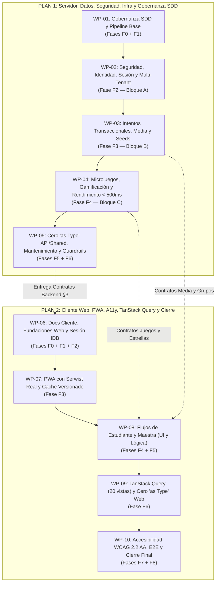

# Hoja de Ruta de Remediación por Paquetes de Trabajo (WP-01 a WP-10) — Englove

- **Documento rector de ejecución:** Basado estrictamente en [`planning/auditoria-post-spec-11.md`](auditoria-post-spec-11.md), [`plan-implementacion-auditoria-1-servidor-y-fundacion.md`](plan-implementacion-auditoria-1-servidor-y-fundacion.md) y [`plan-implementacion-auditoria-2-cliente-y-cierre.md`](plan-implementacion-auditoria-2-cliente-y-cierre.md).
- **Decisiones vinculantes:** Decisiones 1 a 137 de [`.agents/CONTEXT.md §14`](../.agents/CONTEXT.md) y decisiones de auditoría `QA-01` a `QA-08` (cerradas el 2026-11-09).
- **Estrategia operativa:** Para erradicar la sobrecarga de atención, evitar atajos sintéticos y garantizar la verificación empírica real (sin mocks engañosos), la ejecución se subdivide en **10 Paquetes de Trabajo Atómicos (WP-01 a WP-10)**. Cada paquete se ejecuta en una sesión/chat independiente, terminando obligatoriamente con salida `Exit 0` en sus compuertas de verificación antes de avanzar al siguiente.

---

## 1. Diagrama de Dependencias y Secuencia de Ejecución



---

## 2. Catálogo Detallado de Paquetes de Trabajo

### PLAN 1 — SERVIDOR, INFRAESTRUCTURA Y GOBERNANZA

---

### `[WP-01]` Gobernanza SDD y Pipeline Base
- **Objetivo:** Alinear formalmente las fuentes de verdad documentales con las decisiones `QA-01`..`QA-08` y estabilizar el pipeline de compilación e infraestructura básica para que `typecheck` y las herramientas no fallen.
- **Fases del Plan 1 que cubre:** Fase F0 (Tareas T0.1 a T0.9) y Fase F1 (Tareas T1.1 a T1.8).
- **Hallazgos que resuelve:** `P1-15` (`typecheck` y tests Windows), `P2-07` (MinIO sin `mc anonymous`), `P2-09` (Docker no root, CI a ramas reales, wrangler staging/prod), `P2-02` (validación `COOKIE_DOMAIN`, fallback `JWT_SECRET`), `QA-08` (soporte HTTPS local).
- **Archivos a modificar:**
  - `.agents/CONTEXT.md` (§14 incorporar decisiones QA, corregir §4.2, §6, §7, §9).
  - `specs/SPEC-11-calidad-y-correcciones.md` (quitar `(Propuesto)`, alinear §4.3, §5.3, corregir §12).
  - `specs/SPEC-01`, `SPEC-02`, `SPEC-04`, `SPEC-05` (alinear según Plan 1 T0.4–T0.7 y registrar fila en §12).
  - `package.json` (añadir `"postinstall": "pnpm --filter @englove/api db:generate"`).
  - `turbo.json` (dependencia `db:generate` en `typecheck`/`build`, `test.dependsOn: ["build", "^build"]`).
  - `render.yaml` (`plan: free` en staging, retirar `MIGRATION_DATABASE_URL` de runtime, prefijo `englove_stg_`).
  - `docker-compose.yml` (retirar `mc anonymous set download`, documentar/unificar puerto `5433`).
  - `apps/api/Dockerfile` (`USER node`, `.dockerignore`, `pnpm prune --prod`, heap 320 MB).
  - `.github/workflows/ci.yml` (apuntar a `develop`/`master`, añadir `pnpm build`, check worker `<= 3 MB`).
  - `apps/web/wrangler.jsonc` (añadir `env.staging` y `env.production`).
  - `apps/api/src/config/env.validation.ts` (validar `COOKIE_DOMAIN`, exigir `JWT_SECRET` fuera de `local`).
  - `README.md` (corregir puerto local PostgreSQL a `5433`).
  - Skills: actualizar `englove-spec` (`check-spec.mjs`, `SKILL.md`) en sus 3 copias.
- **Compuerta de salida (Criterios de verificación):**
  1. `node .agents/skills/englove-spec/scripts/check-spec.mjs` sin errores sobre las specs tocadas.
  2. `pnpm db:generate && pnpm lint && pnpm typecheck` ejecuta con **`Exit 0`** en todos los paquetes.

> **Prompt sugerido para el Chat de WP-01:**
> ```text
> Hola. Vamos a ejecutar el paquete de trabajo WP-01 (Gobernanza SDD y Pipeline Base) del proyecto Englove, conforme a planning/hoja-de-ruta-paquetes-de-trabajo.md y planning/plan-implementacion-auditoria-1-servidor-y-fundacion.md (Fases F0 y F1, tareas T0.1 a T0.9 y T1.1 a T1.8).
> 
> Tu tarea consiste en:
> 1. Registrar las decisiones QA-01 a QA-08 en .agents/CONTEXT.md §14 y corregir inconsistencias del servidor (§4.2, §6, §7, §9).
> 2. Alinear SPEC-11 (quitar '(Propuesto)', §12 real), SPEC-01, SPEC-02, SPEC-04, SPEC-05 con su respectiva fila en §12 Registro de cambios, y actualizar README.md (puerto 5433).
> 3. Actualizar la skill englove-spec en sus 3 copias (.agents, .claude, .kiro).
> 4. Reparar package.json (postinstall db:generate), turbo.json (dependencias de build/test sin colisión en Windows), render.yaml (plan: free, sin MIGRATION_DATABASE_URL en runtime), docker-compose.yml (sin mc anonymous), apps/api/Dockerfile (USER node, prune), .github/workflows/ci.yml y apps/api/src/config/env.validation.ts (COOKIE_DOMAIN y JWT_SECRET).
> 
> Al finalizar, corre las compuertas: check-spec.mjs, pnpm db:generate, pnpm lint y pnpm typecheck. No des por terminado hasta obtener Exit 0 en todas.
> ```

---

### `[WP-02]` Seguridad, Identidad, Sesión y Multi-Tenant (Bloque A)
- **Objetivo:** Resolver las brechas críticas de seguridad en OTP, sesión de 30/90 días (backend), aislamiento multi-tenant en Prisma y fuga de credenciales en logs.
- **Fases del Plan 1 que cubre:** Fase F2 (Tareas T2.1 a T2.9).
- **Hallazgos que resuelve:** `P0-01` (OTP rollback bug), `P0-02` (servidor: `session_hint`), `P0-03` (servidor: `GET /auth/session`, refresh path `/api/v1/auth`), `P1-01` (redacción de tokens y queries en logs), `P1-12` (logout con organization_id, typ estricto, locked_until, extensiones de mutación en TenantPrismaExtension), `P2-01` (oráculo de timing y mitigación DoS Argon2id), `P2-02` (cookies con `secure: appEnv !== 'local'`).
- **Archivos a modificar:**
  - `apps/api/src/auth/auth.service.ts` (retirar `throw` de `$transaction` en `confirmEmailChange`; emitir `session_hint=1`; ampliar path de refresh a `/api/v1/auth`; implementar logout revocado; verificar `locked_until`).
  - `apps/api/src/auth/auth.controller.ts` (endpoint `GET /api/v1/auth/session` de solo lectura).
  - `apps/api/src/common/guards/jwt-auth.guard.ts` (rechazar sin `typ: 'access'`, validar `locked_until`).
  - `apps/api/src/common/tenant/tenant-prisma.extension.ts` (interceptar `create`, `update`, `delete`, `upsert`, `$queryRaw`, `$executeRaw`; bloquear `organization_id` truthy sin contexto).
  - `apps/api/src/app.module.ts` (`pinoHttp` redacción de `x-attempt-token` y query strings).
  - `apps/api/src/common/all-exceptions.filter.ts` (saneado de query strings en log de errores).
  - `apps/api/test/auth.spec.ts` y tests de tenant dedicados.
- **Compuerta de salida (Criterios de verificación):**
  1. Tests de regresión reales con PostgreSQL activo en `:5433` (el 3.er intento de OTP falla y bloquea, verificación de sesión y cookie `Secure` según `APP_ENV`).
  2. `pnpm --filter @englove/api test` en verde sin timeouts.

> **Prompt sugerido para el Chat de WP-02:**
> ```text
> Hola. Vamos a ejecutar el paquete de trabajo WP-02 (Seguridad, Identidad, Sesión y Multi-Tenant) del proyecto Englove, conforme a planning/hoja-de-ruta-paquetes-de-trabajo.md y planning/plan-implementacion-auditoria-1-servidor-y-fundacion.md (Fase F2, tareas T2.1 a T2.9).
> 
> Tu tarea consiste en:
> 1. Corregir P0-01 en auth.service.ts: devolver resultado discriminado en $transaction y lanzar UnprocessableEntityException fuera del bloque para que failed_attempts persista en PostgreSQL.
> 2. Implementar sesión continua en servidor (QA-02, QA-08): emitir session_hint=1 con secure: appEnv !== 'local', ampliar path de refresh_token a '/api/v1/auth', crear endpoint GET /api/v1/auth/session y corregir logout para filtrar por id, user_id y organization_id.
> 3. Endurecer JwtAuthGuard con claim typ obligatorio y verificación de locked_until.
> 4. Blindar TenantPrismaExtension interceptando mutaciones (create, update, delete, upsert, queryRaw) y auditando TenantContext.runBypass.
> 5. Configurar redacción de logs en pinoHttp y AllExceptionsFilter para x-attempt-token y query strings (P1-01).
> 6. Mitigar oráculo temporal en signup y reset-password (P2-01).
> 7. Añadir pruebas de regresión reales con PostgreSQL ejecutándose en el puerto 5433.
> 
> Al finalizar, corre pnpm typecheck y las pruebas de auth y tenant en apps/api. Todo debe dar Exit 0.
> ```

---

### `[WP-03]` Intentos Transaccionales, Multimedia y Grupos (Bloque B)
- **Objetivo:** Asegurar la integridad transaccional de entregas, crear el endpoint dedicado de multimedia con validación `ffprobe` real, blindar `ffmpeg` y corregir seeds y traslados.
- **Fases del Plan 1 que cubre:** Fase F3 (Tareas T3.1 a T3.14).
- **Hallazgos que resuelve:** `P0-09` (servidor: `AllExceptionsFilter` preserva `details`, limpieza de reintentos `retry_granted_at` al confirmar traslado), `P1-02` (`probeDuration` sin fallback simulado `sizeBytes / 8000`), `P1-03` (endpoint `POST /media/:id/confirm`, drenaje `stderr` y `SIGKILL` en `ffmpeg`, reencolado), `P1-04` (validación Zod de `config.items` y JSONB en `attempts`), `P1-06` (bloqueo transaccional `SELECT ... FOR UPDATE` en `completeAttempt` y `submitReview`), `P1-07` (servidor: `open_question` multi-pregunta con UUID), `P1-09` (reparar seed `Midterm Exam A1`), `P2-03` (cascada de eliminación de alumno y retiro de `@Optional()`), `P2-04` (`correction` en reintentos idempotentes), `P2-06` (bloqueo en `archiveGroup` y tope de recursos).
- **Archivos a modificar:**
  - `apps/api/src/attempts/attempts.service.ts` (`completeAttempt` transaccional con `FOR UPDATE`; validación Zod de `items` y respuestas; `buildExistingCompletionView` con `answer_key: true`).
  - `apps/api/src/media/media.service.ts` (`confirmUpload` / `POST /confirm` dedicado con `ffprobe` real de `[2s, max]`; `runFfmpeg` con drenaje de `stderr` y `SIGKILL`; cuotas de subida).
  - `apps/api/src/media/media.controller.ts` (nuevo endpoint `POST /media/:id/confirm`).
  - `apps/api/src/media/dto/media.dto.ts` (DTOs de confirmación y subida acotada).
  - `apps/api/src/reviews/reviews.service.ts` (`submitReview` con `FOR UPDATE` para autocalificados y docentes; no contaminar texto en multi-pregunta).
  - `apps/api/src/students/students.service.ts` (`changeGroup` limpia `retry_granted_at = null` y `retry_extend_until = null` al enviar `confirmLostRetries: true` — `QA-07`; cascada de borrado ordenada).
  - `apps/api/src/groups/groups.service.ts` (`archiveGroup` con `FOR UPDATE`).
  - `apps/api/src/resources/resources.service.ts` (tope 200 y posición transaccional).
  - `apps/api/src/common/all-exceptions.filter.ts` (conservar `details` en respuestas `409`).
  - `apps/api/prisma/seeds/seed-dev.ts` y `seed-volume.ts` (corregir `Midterm Exam A1` con `items[]` y UUIDs válidos).
  - `apps/api/test/media.spec.ts` (pruebas de regresión `AUDIO-01`).
- **Compuerta de salida (Criterios de verificación):**
  1. Tests `AUDIO-01` pasando en `media.spec.ts`.
  2. Pruebas de concurrencia de entregas de intentos y revisiones pasando contra PostgreSQL real.
  3. Ejecución limpia de `pnpm seed:dev` sin errores `500`.

> **Prompt sugerido para el Chat de WP-03:**
> ```text
> Hola. Vamos a ejecutar el paquete de trabajo WP-03 (Intentos Transaccionales, Multimedia y Grupos) del proyecto Englove, conforme a planning/hoja-de-ruta-paquetes-de-trabajo.md y planning/plan-implementacion-auditoria-1-servidor-y-fundacion.md (Fase F3, tareas T3.1 a T3.14).
> 
> Tu tarea consiste en:
> 1. Blindar completeAttempt con $transaction y FOR UPDATE para evitar duplicidad de ProgressEvent (P1-06).
> 2. Asegurar que buildExistingCompletionView seleccione answer_key para devolver correction en reintentos (P2-04).
> 3. Validar config.items y tamaño de JSONB en submitEvents y completeAttempt con Zod (P1-04).
> 4. Implementar POST /api/v1/media/:id/confirm (QA-05) con x-attempt-token, ffprobe real sin fallback sizeBytes / 8000, FOR UPDATE de assets ready previos y corte de stream a 10 MiB.
> 5. Estabilizar ffmpeg drenando stderr y escalando a SIGKILL tras timeout (P1-03), y añadir pruebas AUDIO-01 a media.spec.ts.
> 6. Soportar open_question multi-pregunta validando items[].id en intentos y revisiones (P1-07).
> 7. Preservar details en AllExceptionsFilter y limpiar retry_granted_at / retry_extend_until en students.service.ts ante confirmLostRetries (QA-07, P0-09).
> 8. Reparar seed-dev.ts (Midterm Exam A1) y seed-volume.ts (P1-09), y retirar @Optional() residuales.
> 
> Al finalizar, corre pnpm typecheck, las pruebas de media, attempts, students y reviews en apps/api, y verifica que pnpm seed:dev corra sin errores.
> ```

---

### `[WP-04]` Microjuegos, Gamificación y Rendimiento Estadísticas (Bloque C)
- **Objetivo:** Restaurar la gamificación en microjuegos autónomos, implementar el cálculo exacto de estrellas de práctica, excluir partidas con duración inverosímil del ranking y garantizar el presupuesto de latencia `< 500 ms`.
- **Fases del Plan 1 que cubre:** Fase F4 (Tareas T4.1 a T4.7).
- **Hallazgos que resuelve:** `P0-10` (restaurar `ProgressEvent` en microjuegos para rachas e insignias), `P1-05` (servidor: `scoreToGameStars` con tramos `0/1/2/3`, 10 mensajes motivadores, no exponer notas al niño), `P1-11` (cálculo de `groupAverageScore`, `order_words` en `computeGamesPractice`, exclusión de `implausible_duration` en `games-leaderboard` — `QA-06`, caché de `Intl.DateTimeFormat` para presupuesto `< 500 ms`), `P3-01` (limpiar código muerto de asignaciones en `AttemptsService`).
- **Archivos a modificar:**
  - `packages/shared/src/activities/scoring.ts` (`scoreToGameStars` con tramos normativos `0.0`, `0.1–2.9`, `3.0–4.4`, `4.5–5.0`; `getGameMotivationMessage` con los 10 mensajes).
  - `apps/api/src/attempts/attempts.service.ts` (`startGameAttempt` elimina intentos `in_progress` previos y acota `attemptToken`; `completeAttempt` invoca `recordAttemptCompleted` para `game`; `GET /me/games`, `/attempts/:id` y `/complete` no devuelven `score`/`bestScore` al alumno).
  - `apps/api/src/gamification/gamification.service.ts` (cachear instancia de `Intl.DateTimeFormat`).
  - `apps/api/src/stats/stats.service.ts` (`groupAverageScore` indexado por `assignment_id` y `student_id`; `computeGamesPractice` incluye `order_words`; `games-leaderboard` excluye intentos con `'implausible_duration'` de todas las métricas — `QA-06`; caché de `Intl.DateTimeFormat`).
  - `apps/api/src/stats/stats.controller.ts` (código `403 AUTH_FORBIDDEN` para alumnos).
  - `apps/api/test/stats.performance.spec.ts` y `test/games-leaderboard-and-practice.spec.ts`.
- **Compuerta de salida (Criterios de verificación):**
  1. `apps/api/test/stats.performance.spec.ts` ejecuta y pasa en **`< 500 ms`**.
  2. Tests de microjuegos y ranking docente pasando en verde con las reglas de `QA-06`.

> **Prompt sugerido para el Chat de WP-04:**
> ```text
> Hola. Vamos a ejecutar el paquete de trabajo WP-04 (Microjuegos, Gamificación y Rendimiento Estadísticas) del proyecto Englove, conforme a planning/hoja-de-ruta-paquetes-de-trabajo.md y planning/plan-implementacion-auditoria-1-servidor-y-fundacion.md (Fase F4, tareas T4.1 a T4.7).
> 
> Tu tarea consiste en:
> 1. En attempts.service.ts (startGameAttempt), eliminar intentos previos in_progress sin lanzar 409 y acotar la duración de attemptToken (T4.1).
> 2. Restaurar ProgressEvent en microjuegos autónomos invocando gamificationService.recordAttemptCompleted en completeAttempt para alimentar rachas e insignias (P0-10).
> 3. Ajustar scoreToGameStars en packages/shared a los tramos 0.0 -> 0⭐, 0.1-2.9 -> 1⭐, 3.0-4.4 -> 2⭐, 4.5-5.0 -> 3⭐, e implementar getGameMotivationMessage con los 10 mensajes normativos (P1-05).
> 4. Asegurar que las respuestas de endpoints de juegos para alumnos no expongan score ni bestScore numéricos (solo estrellas y mensajes).
> 5. Corregir groupAverageScore y añadir order_words en computeGamesPractice (P1-11).
> 6. En games-leaderboard, excluir intentos con 'implausible_duration' de todas las métricas de la fila del ranking (QA-06).
> 7. Cachear Intl.DateTimeFormat en gamification.service.ts y stats.service.ts para que stats.performance.spec.ts baje a < 500 ms (P1-11.4).
> 8. Usar código 403 AUTH_FORBIDDEN ante accesos de alumnos a endpoints docentes.
> 
> Al finalizar, corre pnpm typecheck, stats.performance.spec.ts y games-leaderboard-and-practice.spec.ts. Deben arrojar Exit 0.
> ```

---

### `[WP-05]` Cero `as Type` en API/Shared, Mantenimiento y Guardrails del Servidor
- **Objetivo:** Erradicar las 173 aserciones ciegas `as Type` en el servidor y shared, corregir cron jobs de mantenimiento, hacer honestos los tests de PostgreSQL y actualizar la skill `englove-guardrails`.
- **Fases del Plan 1 que cubre:** Fases F5 (Tareas T5.1 a T5.5) y F6 (Tareas T6.1 a T6.5).
- **Hallazgos que resuelve:** `P1-14` (parte API/shared: eliminar 155 `as Type` en `apps/api` y 18 en `packages/shared`), `P2-05` (`MaintenanceService` Bogotá, abandono de juegos), `P2-08` (parte API: tests PostgreSQL honestos sin `return` silencioso), `P3-01` (código muerto API), `P3-02` (códigos HTTP exactos `422 SCORE_OUT_OF_RANGE`, `AUTH_FORBIDDEN`), `P3-06` (hashes en `skills-lock.json`), actualización de reglas `G-A06`, `G-C10`, `G-B10`.
- **Archivos a modificar:**
  - `packages/shared/src/**/*.ts` (18 `as Type` eliminados con narrowing/Zod).
  - `apps/api/src/**/*.ts` (155 `as Type` eliminados).
  - `apps/api/src/maintenance/maintenance.service.ts` (abandonar juegos `in_progress`; zona horaria `America/Bogota` en revisión mensual de edad; no marcar `ScheduledJobRun` como `done` si falló el correo).
  - `apps/api/src/reviews/dto/reviews.dto.ts` (`422 SCORE_OUT_OF_RANGE`).
  - `apps/api/test/*.postgres.spec.ts` y `test/e2e-*.spec.ts` (reemplazar retornos silenciosos por `describe.skipIf` apuntando por defecto al puerto `5433`).
  - `.agents/skills/englove-guardrails/` (y copias en `.claude/` y `.kiro/`: reglas `G-A06`, `G-C10`, `G-B10` y test del script).
  - `skills-lock.json` (recalcular hash de `englove-guardrails` y `englove-spec`).
- **Compuerta de salida (Criterios de verificación):**
  1. `pnpm db:generate && pnpm lint && pnpm typecheck && pnpm test && pnpm build` terminan en **`Exit 0`** en todo el monorepo.
  2. `node .agents/skills/englove-guardrails/scripts/check-guardrails.mjs --all` arroja **0 errores** en reglas de servidor.
  3. Ningún test de PostgreSQL se salta de forma silenciosa ni arroja falsos positivos.

> **Prompt sugerido para el Chat de WP-05:**
> ```text
> Hola. Vamos a ejecutar el paquete de trabajo WP-05 (Cero as Type en API/Shared, Mantenimiento y Guardrails del Servidor) del proyecto Englove, conforme a planning/hoja-de-ruta-paquetes-de-trabajo.md y planning/plan-implementacion-auditoria-1-servidor-y-fundacion.md (Fases F5 y F6, tareas T5.1 a T5.5 y T6.1 a T6.5).
> 
> Tu tarea consiste en:
> 1. Eliminar las 155 aserciones 'as Type' en apps/api y las 18 en packages/shared sustituyéndolas por Zod y type guards (T5.1).
> 2. Ajustar maintenance.service.ts para abandonar juegos in_progress, aplicar America/Bogota en runMonthlyAgeReview y verificar entrega de correos antes de registrar ScheduledJobRun done (P2-05).
> 3. Usar códigos HTTP exactos: 422 SCORE_OUT_OF_RANGE y AUTH_FORBIDDEN (T5.4).
> 4. Convertir los return silenciosos de los 7 tests de PostgreSQL en apps/api/test en describe.skipIf honestos apuntando a :5433 (T5.5).
> 5. Actualizar la skill englove-guardrails en sus 3 copias (.agents, .claude, .kiro) implementando las reglas G-A06, G-C10 y G-B10, y crear el test del script (T6.1, T6.2).
> 6. Recalcular skills-lock.json (T6.3).
> 
> Al finalizar, con Docker activo en :5433, ejecuta la verificación completa del Plan 1: pnpm db:generate, pnpm lint, pnpm typecheck, pnpm test, pnpm build y check-guardrails.mjs --all. Todo debe arrojar Exit 0.
> ```

---

### PLAN 2 — CLIENTE WEB, PWA, ACCESIBILIDAD, TANSTACK QUERY Y CIERRE

---

### `[WP-06]` Docs Cliente, Fundaciones Web y Sesión IDB
- **Objetivo:** Alinear especificaciones restantes del cliente, dotar al cliente web de manejo de errores uniforme (`details`), estabilizar modales, unificar IndexedDB y habilitar la sesión continua de 30/90 días en navegador.
- **Fases del Plan 2 que cubre:** Fase F0 (Tareas T0.1 a T0.9), Fase F1 (Tareas T1.1 a T1.5) y Fase F2 (Tareas T2.1 a T2.8).
- **Hallazgos que resuelve:** `P0-02` (cliente: `session_hint` y `trySilentRefresh`), `P0-03` (cliente: `navigator.locks` en refresh y `setSharedSession`), `P0-04` (runner y `offline-queue` tolerantes a 401/422), `P0-05` (higiene IDB con `deleteDatabase` y `userId` obligatorio), `P0-06` (`AccessibleModal` con foco estable), `P0-07` (mensajes de error de login/registro), `P0-09` (`ApiError` conserva `details`), alineación documental de `SPEC-03`, `06`, `07`, `08`, `09`, `10` y `planning/`.
- **Archivos a modificar:**
  - `specs/SPEC-03`, `SPEC-06`, `SPEC-07`, `SPEC-08`, `SPEC-09`, `SPEC-10` (parches de `SPEC-11 §11.3` con fila en §12).
  - `planning/architecture-overview.md`, `sdd-process.md`, `taskboard.md` e informes históricos.
  - `apps/web/src/lib/api.ts` (`ApiError` conserva `details`; `apiFetch` valida con Zod).
  - `apps/web/src/lib/auth-errors.ts` y `login-client.tsx`, `registro-client.tsx` (consumir `code`).
  - `apps/web/src/components/ui/modal.tsx` (`AccessibleModal` foco inicial estable sin robar foco en cada tecla).
  - `apps/web/src/lib/offline-queue.ts` (base IndexedDB única con `openOfflineDb()`, tolerancia a 401).
  - `apps/web/src/lib/auth-session.ts` (`fetchSharedSession` a `/api/v1/auth/session`, `navigator.locks`).
  - `apps/web/src/lib/auth-hygiene.ts` (`deleteDatabase('englove_offline')` al logout; limpieza de singletons).
  - `apps/web/src/app/(public)/login/login-client.tsx` (revisar `session_hint` y refresco silencioso).
  - `apps/web/src/app/inicio/inicio-client.tsx` (refresh ante 401 y banner offline).
- **Compuerta de salida (Criterios de verificación):**
  1. `check-spec.mjs` sin errores en todas las specs.
  2. Tests unitarios de `apps/web` pasando; escribir en un `<input>` dentro de `AccessibleModal` no pierde el foco de teclado.

> **Prompt sugerido para el Chat de WP-06:**
> ```text
> Hola. Vamos a ejecutar el paquete de trabajo WP-06 (Docs Cliente, Fundaciones Web y Sesión IDB) del proyecto Englove, conforme a planning/hoja-de-ruta-paquetes-de-trabajo.md y planning/plan-implementacion-auditoria-2-cliente-y-cierre.md (Fases F0, F1 y F2, tareas T0.1 a T0.9, T1.1 a T1.5 y T2.1 a T2.8).
> 
> Tu tarea consiste en:
> 1. Alinear SPEC-03, SPEC-06, SPEC-07, SPEC-08, SPEC-09 y SPEC-10 con fila en §12, y actualizar architecture-overview, sdd-process y taskboard (Fase F0).
> 2. Asegurar que ApiError conserve details y que apiFetch valide con Zod en vez de 'as T' (T1.1).
> 3. Corregir mensajes de error en login y registro pasando errorBody.code a getAuthErrorMessage (P0-07).
> 4. Estabilizar AccessibleModal guardando onClose en useRef y ligando el foco inicial únicamente a [isOpen] para que escribir en un input no robe el foco (P0-06).
> 5. Unificar todo acceso a IndexedDB a través de openOfflineDb() y configurar deleteDatabase('englove_offline') en auth-hygiene.ts al hacer logout (P0-05).
> 6. Implementar sesión continua en cliente: login-client lee session_hint y ejecuta trySilentRefresh(); auth-session.ts coordina POST /refresh con navigator.locks y consulta GET /auth/session; student-shell e inicio-client toleran 401 sin desmontar (P0-02, P0-03, P0-04).
> 7. Requerir userId en saveLocalRecording y purgar datos de otros alumnos en login (P0-05).
> 
> Al finalizar, corre check-spec.mjs, pnpm typecheck y pnpm --filter @englove/web test. Todo debe dar Exit 0.
> ```

---

### `[WP-07]` PWA con Serwist Real y Cache Versionado
- **Objetivo:** Ejecutar el spike real e instalar Serwist con `vinext`, retirando el `sw.js` manual estático y los plugins regex artesanales de Vite.
- **Fases del Plan 2 que cubre:** Fase F3 (Tareas T3.1 a T3.5).
- **Hallazgos que resuelve:** `P0-08` (instalar Serwist real), `RF-7`, `QA-01`, `P2-10` (banners según segmento de usuario).
- **Archivos a modificar:**
  - `apps/web/package.json` (instalar `serwist` y `@serwist/vite` o integración Vite oficial compatible con `vinext`).
  - `apps/web/vite.config.ts` (retirar `swPrecachePlugin` con regex; integrar plugin de Serwist).
  - `apps/web/public/sw.js` (retirar archivo manual con `CACHE_VERSION = 'englove-static-v1'`).
  - `apps/web/src/sw.ts` (Service Worker real con precache versionado por hash, `NetworkOnly` en `/api/*` y fallback de navegación a `/offline`).
  - `apps/web/src/components/pwa-update-banner.tsx`, `offline-status-banner.tsx`, `offline-client.tsx` (copy adaptado a Kids/Teens/Teacher en vez de asumir Kids).
- **Compuerta de salida (Criterios de verificación):**
  1. Build de producción de `apps/web` genera el manifiesto de precache de Serwist sin superar el límite de tamaño (`<= 3 MB`).
  2. `pnpm --filter @englove/web build` termina en **`Exit 0`**.

> **Prompt sugerido para el Chat de WP-07:**
> ```text
> Hola. Vamos a ejecutar el paquete de trabajo WP-07 (PWA con Serwist Real y Cache Versionado) del proyecto Englove, conforme a planning/hoja-de-ruta-paquetes-de-trabajo.md y planning/plan-implementacion-auditoria-2-cliente-y-cierre.md (Fase F3, tareas T3.1 a T3.5, QA-01).
> 
> Tu tarea consiste en:
> 1. Probar en un spike e instalar serwist y @serwist/vite en apps/web/package.json (T3.1, T3.2). (Si existiera incompatibilidad bloqueante con vinext, aplicar la salvaguarda de SPEC-11 §11.4.2 registrando la decisión en CONTEXT §14).
> 2. Configurar el service worker en apps/web/src/sw.ts con precaching versionado por hash de Vite, NetworkOnly en /api/*, fallback a /offline y ciclo waiting -> SKIP_WAITING.
> 3. Eliminar apps/web/public/sw.js manual y retirar swPrecachePlugin de vite.config.ts (T3.3).
> 4. Ajustar PwaUpdateBanner y banners offline para mostrar el copy según el segmento real del usuario (Kids, Teens, Profesora) (T3.4).
> 
> Al finalizar, corre pnpm --filter @englove/web build y verifica que el build termine con Exit 0 y emita el service worker precacheado.
> ```

---

### `[WP-08]` Flujos de Estudiante y Maestra (UI y Lógica)
- **Objetivo:** Desbloquear los flujos funcionales del estudiante y de la maestra: subida de audio confirmada inmediatamente, auto-corte en `speaking`, modal de confirmación de traslado de grupo, editor multi-oración preservando UUIDs, coma decimal y microjuegos sin notas al niño.
- **Fases del Plan 2 que cubre:** Fases F4 (Tareas T4.1 a T4.9) y F5 (Tareas T5.1 a T5.8).
- **Hallazgos que resuelve:** `P0-09` (cliente: modal `confirmLostRetries`), `P1-03` (cliente: temporizador `speaking` sin clausura obsoleta y confirmación con `media/:id/confirm`), `P1-05` (cliente: UI de juegos sin nota y botón "Jugar de nuevo"), `P1-07` (cliente: runner `open_question` multi-pregunta con UUID), `P1-08` (editor multi-oración sin truncar preservando UUIDs — `QA-03`; estado de publicación), `P1-10` (calificación con coma decimal `4,5`), `P2-10` (retirar `game` del selector docente), `P3-03` (formato coma decimal), `P3-04` (aviso borrador en `/terminos`), `P3-01` (retirar `src/lib/motion/*`).
- **Archivos a modificar:**
  - `apps/web/src/app/(student)/actividad/[attemptId]/actividad-runner.tsx` (temporizador `speaking` sin clausura obsoleta; confirmar audio con `POST /media/:id/confirm` antes de terminar; `open_question` multi-pregunta con `items[].id`; botón «Jugar de nuevo»; formato coma decimal; `<label>` de `fill_blank` sin UUID expuesto).
  - `apps/web/src/components/activities/GameRenderer.tsx` (usar `scoreToGameStars` y `getGameMotivationMessage`; no mostrar `/ 5.0` al niño; banner de modo prueba docente).
  - `apps/web/src/app/(student)/juegos/juegos-client.tsx` (mostrar estrellas y mensajes, sin notas).
  - `apps/web/src/app/(teacher)/alumnos/[id]/alumno-detail-client.tsx` (capturar `UNCONSUMED_RETRY_WARNING`, mostrar modal de confirmación y reenviar `confirmLostRetries: true` — `QA-07`).
  - `apps/web/src/app/(teacher)/revision/revision-client.tsx` (soporte de coma decimal `4,5`; no contaminar respuestas en `open_question`).
  - `apps/web/src/app/(teacher)/actividades/activity-editor.tsx` (`fill_blank` y `exam` con múltiples oraciones `items[]` y múltiples huecos **preservando UUIDs existentes** — `QA-03`).
  - `apps/web/src/app/(teacher)/actividades/[id]/actividad-detail-client.tsx` (actualizar estado tras «Publicar»).
  - `apps/web/src/app/(teacher)/asignaciones/nueva/nueva-asignacion-client.tsx` (retirar `game` del selector).
  - `apps/web/src/app/(public)/terminos/page.tsx` (aviso visible de texto provisional).
  - Eliminar código muerto en `apps/web/src/lib/motion/*`.
- **Compuerta de salida (Criterios de verificación):**
  1. Tests unitarios de componentes de actividades pasando.
  2. Verificación de carga y guardado en `activity-editor.tsx` comprobando que los UUIDs originales no se regeneran.
  3. `pnpm typecheck` en verde.

> **Prompt sugerido para el Chat de WP-08:**
> ```text
> Hola. Vamos a ejecutar el paquete de trabajo WP-08 (Flujos de Estudiante y Maestra: UI y Lógica) del proyecto Englove, conforme a planning/hoja-de-ruta-paquetes-de-trabajo.md y planning/plan-implementacion-auditoria-2-cliente-y-cierre.md (Fases F4 y F5, tareas T4.1 a T4.9 y T5.1 a T5.8).
> 
> Tu tarea consiste en:
> 1. En actividad-runner.tsx: reparar temporizador speaking (sin clausura obsoleta y cortando en maxDurationSeconds), llamar a POST /api/v1/media/:id/confirm apenas sube el audio antes de terminar, enviar items[].id correcto en open_question multi-pregunta, habilitar botón 'Jugar de nuevo' hacia POST /activities/:id/attempts y formatear notas con coma decimal (P1-03, P1-07, P1-08, P3-03).
> 2. En GameRenderer.tsx y juegos-client.tsx: usar scoreToGameStars y getGameMotivationMessage, no mostrar 'Nota: X.X / 5.0' al niño y añadir banner de modo prueba en vista previa docente (P1-05).
> 3. En alumno-detail-client.tsx: capturar UNCONSUMED_RETRY_WARNING y mostrar modal para confirmar pérdida definitiva de reintentos con confirmLostRetries: true (P0-09, QA-07).
> 4. En revision-client.tsx: soportar coma decimal '4,5' con normalización y no rellenar preguntas vacías en open_question (P1-10).
> 5. En activity-editor.tsx: soportar múltiples oraciones (items[]) y múltiples huecos por oración en fill_blank y exam preservando estrictamente UUIDs existentes (item.id, blank.id, option.id) (QA-03, P1-08).
> 6. Actualizar estado local tras 'Publicar' en actividad-detail-client.tsx y retirar 'game' de nueva-asignacion-client.tsx (P1-08, P2-10).
> 7. Añadir aviso de borrador legal provisional en terminos/page.tsx (P3-04) y retirar src/lib/motion/* (P3-01).
> 
> Al finalizar, corre pnpm typecheck y los tests de web. Todo debe dar Exit 0.
> ```

---

### `[WP-09]` Migración Integral a TanStack Query y Cero `as Type` en Web
- **Objetivo:** Migrar las 20 vistas interactivas con API a TanStack Query (`useQuery` + `useMutation` + `invalidateQueries`), eliminar todas las aserciones `as Type` en `apps/web`, y activar las reglas de guardrails correspondientes.
- **Fases del Plan 2 que cubre:** Fase F6 (Tareas T6.1 a T6.5).
- **Hallazgos que resuelve:** `P1-14` (migración completa a TanStack Query y cero `as Type` en web), `QA-04`, `RF-13`, `P3-01` (retirar `next.config.ts`), reglas `G-B04`, `G-C12`, `G-C13` en `check-guardrails.mjs`.
- **Archivos a modificar:**
  - `apps/web/src/app/**/*-client.tsx` (las 20 vistas con `useEffect + apiFetch` migradas a TanStack Query).
  - `apps/web/src/**/*.ts*` (erradicar las 168+ aserciones `as Type` usando Zod y narrowing).
  - Eliminar archivo vestigial `next.config.ts`.
  - `.agents/skills/englove-guardrails/` (y copias en `.claude/` y `.kiro/`: activar `G-C12` para runtime, `G-B04` para `*-client.tsx` y `G-C13` para Serwist).
  - `skills-lock.json` (recalcular hashes).
- **Compuerta de salida (Criterios de verificación):**
  1. `node .agents/skills/englove-guardrails/scripts/check-guardrails.mjs --all` arroja **0 errores**.
  2. `pnpm typecheck` ejecuta con **`Exit 0`** sin ninguna aserción ciega en runtime.

> **Prompt sugerido para el Chat de WP-09:**
> ```text
> Hola. Vamos a ejecutar el paquete de trabajo WP-09 (TanStack Query y Cero as Type en Web) del proyecto Englove, conforme a planning/hoja-de-ruta-paquetes-de-trabajo.md y planning/plan-implementacion-auditoria-2-cliente-y-cierre.md (Fase F6, tareas T6.1 a T6.5, QA-04).
> 
> Tu tarea consiste en:
> 1. Listar e inventariar las 20 vistas *-client.tsx en apps/web que aún usan useEffect + useState + fetch/apiFetch manual (T6.1).
> 2. Migrar las 20 vistas (y useMutation en revision-client.tsx) a useQuery + useMutation + queryClient.invalidateQueries (T6.2, QA-04).
> 3. Eliminar todas las aserciones 'as Type' (168+) en apps/web/src usando schemas de Zod y type guards (T6.3).
> 4. Eliminar next.config.ts vestigial y código muerto web (T6.5).
> 5. Actualizar check-guardrails.mjs en sus 3 copias (.agents, .claude, .kiro) activando G-C12 (error ante 'as Type' en runtime), G-B04 (prohibir useEffect con fetch en *-client.tsx) y G-C13 (verificar Serwist y bloquear sw.js manual) (T6.4).
> 6. Recalcular skills-lock.json.
> 
> Al finalizar, corre pnpm typecheck, pnpm --filter @englove/web build y check-guardrails.mjs --all. Todo debe arrojar 0 errores.
> ```

---

### `[WP-10]` Accesibilidad WCAG 2.2 AA, E2E y Cierre Final
- **Objetivo:** Resolver el contraste en tema Teens y botones ámbar, reparar landmarks y teclado en juegos, auditar con `axe` `wcag22aa`, estabilizar la suite E2E completa, actualizar conteos en documentos y emitir el informe de cierre final.
- **Fases del Plan 2 que cubre:** Fases F7 (Tareas T7.1 a T7.4) y F8 (Tareas T8.1 a T8.10).
- **Hallazgos que resuelve:** `P1-13` (accesibilidad WCAG 2.2 AA), `RF-14`, `P2-08` (web: specs Playwright E2E), `P3-05` (longitud de specs), `P3-06` (hashes finales), cierre de la Etapa 12.
- **Archivos a modificar:**
  - `apps/web/src/components/activities/games/MatchGame.tsx`, `juegos-client.tsx`, `progreso-client.tsx`, etc. (contraste en `Teens` y botones ámbar `>= 4.5:1`).
  - `apps/web/src/app/layout.tsx` (navegación fuera de `<main id="main-content">`, `SkipLink` real).
  - Microjuegos (`MemoryGame`, `TimedChoiceGame`, `DragDropGame`: foco de teclado estable, objetivos táctiles `>= 24x24 px` y `aria-live`).
  - `apps/web/e2e/*.spec.ts` (reparar specs E2E 03/04, 06, 08; retirar test vacuo en 09; incluir tag `'wcag22aa'` en todas las rutas autenticadas).
  - `.agents/CONTEXT.md` (§1 conteo exacto de tests: 566; §8 y `AGENTS.md` estado de Serwist; §11.1).
  - `specs/SPEC-11-calidad-y-correcciones.md` (§12 registro de verificación con evidencia real).
  - `planning/informe-etapa-12.md` (cerrar informe reflejando la remediación real).
  - `skills-lock.json` (recálculo final).
- **Compuerta de salida (Criterios de verificación):**
  1. `pnpm db:generate && pnpm lint && pnpm typecheck && pnpm test && pnpm build` con **`Exit 0`** en todo el monorepo.
  2. `check-guardrails.mjs --all` y `check-spec.mjs` con **0 errores**.
  3. Suite Playwright E2E ejecutando y pasando limpia con auditoría `axe` en tag `'wcag22aa'` sin violaciones.

> **Prompt sugerido para el Chat de WP-10:**
> ```text
> Hola. Vamos a ejecutar el paquete de trabajo WP-10 (Accesibilidad WCAG 2.2 AA, E2E y Cierre Final) del proyecto Englove, conforme a planning/hoja-de-ruta-paquetes-de-trabajo.md y planning/plan-implementacion-auditoria-2-cliente-y-cierre.md (Fases F7 y F8, tareas T7.1 a T7.4 y T8.1 a T8.10).
> 
> Tu tarea consiste en:
> 1. Corregir contrastes ilegibles en tema Teens y botones ámbar en juegos y perfiles (T7.1).
> 2. Ajustar landmarks en layout.tsx (navegación fuera de main, SkipLink funcional) (T7.2).
> 3. Mejorar teclado, aria-live y áreas táctiles (>= 24x24 px) en microjuegos (T7.3).
> 4. Auditar con axe incluyendo tag 'wcag22aa' en todas las rutas autenticadas (T7.4).
> 5. Reparar las 3 specs E2E rotas y eliminar el test condicional vacuo de spec-09 (T8.1, T8.2).
> 6. Corregir conteos de pruebas y estado de Serwist en CONTEXT.md (§1, §8, §11.1) y AGENTS.md (T8.4).
> 7. Dejar SPEC-11 §12 y planning/informe-etapa-12.md fieles al estado real con la evidencia adjunta (T8.5).
> 8. Recalcular skills-lock.json (T8.8).
> 
> Al finalizar, corre la suite completa de verificación: pnpm db:generate, pnpm lint, pnpm typecheck, pnpm test, pnpm build, check-guardrails.mjs --all, check-spec.mjs y la suite Playwright E2E. Adjunta las salidas con Exit 0.
> ```

---

## 3. Resumen de Ejecución y Checklist de Progreso

| Paquete | Capa | Alcance principal | Estado | Compuerta de verificación |
|---|---|---|---|---|
| **`WP-01`** | Servidor / Infra | Gobernanza SDD (QA-01..08), `turbo.json`, `render.yaml`, `Dockerfile`, CI | Completado | `check-spec.mjs`, `pnpm typecheck` (`Exit 0`) |
| **`WP-02`** | Servidor / Seguridad | OTP sin rollback (`P0-01`), sesión 30/90d, `TenantPrismaExtension` | Completado | Tests de Auth y Tenant en Postgres real (`:5433`) (`Exit 0`) |
| **`WP-03`** | Servidor / Media | `completeAttempt` transaccional, `POST /media/:id/confirm`, seeds, grupos | Completado | `media.spec.ts` (`AUDIO-01`), seeds limpias |
| **`WP-04`** | Servidor / Gamificación | `ProgressEvent` en juegos, estrellas y mensajes, stats `< 500 ms` | Completado | `stats.performance.spec.ts` (`< 500 ms`) |
| **`WP-05`** | Servidor / Calidad | 173 `as Type` eliminados, `MaintenanceService`, guardrails servidor | Completado | Monorepo servidor en verde, `check-guardrails.mjs` 0 errores |
| **`WP-06`** | Cliente / Sesión | Specs cliente, `AccessibleModal` foco estable, higiene IDB, sesión web | Completado | Tests web en verde, modal sin saltos de foco |
| **`WP-07`** | Cliente / PWA | Spike e instalación Serwist real con `vinext`, retiro de `sw.js` | Completado | Build worker `<= 3 MB`, `pnpm build` web (`Exit 0`) |
| **`WP-08`** | Cliente / UI | Flujos estudiante y maestra, editor UUIDs, coma decimal, microjuegos | Completado | 232 tests web en verde (`Exit 0`), editor UUIDs verificado |
| **`WP-09`** | Cliente / TanStack | 20 vistas a TanStack Query, 168+ `as Type` fuera, guardrails web | Pendiente | `check-guardrails.mjs` 0 errores (`G-B04`, `G-C12`, `G-C13`) |
| **`WP-10`** | Cliente / Cierre | Contraste Teens, axe `wcag22aa`, Playwright E2E, cierre documental | Pendiente | Monorepo 100% verde + E2E + informe final |

---
*Fin de la Hoja de Ruta de Remediación por Paquetes de Trabajo.*
