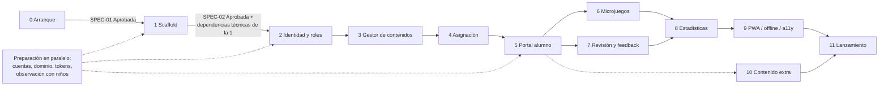

# Englove — Desarrollo etapa por etapa (PBP Development)

> **Propósito.** Plan de construcción del piloto en etapas secuenciales, con objetivo, alcance, entregables, criterios de salida, dependencias, riesgos y tamaño de cada una. Sigue el orden de construcción **Decidido** en `.agents/CONTEXT.md` §12, la arquitectura de [`architecture-overview.md`](./architecture-overview.md) y la metodología SDD de [`sdd-process.md`](./sdd-process.md). Las tareas concretas y su estado están en [`taskboard.md`](./taskboard.md).
>
> **Terminología.** _Fase_ = horizonte de producto (Piloto, Fase 2 Academia, Fase 3 SaaS; CONTEXT §2). _Etapa_ = bloque de construcción dentro del piloto. Las etapas se numeran igual que CONTEXT §12 para mantener trazabilidad; la Etapa 0 agrupa lo que debe ocurrir antes del primer código (SPEC-00 y SPEC-01) y la preparación que puede avanzar en paralelo sin bloquear (cuentas, dominio, tokens, observación). _Tipo de actividad_ = uno de los cinco valores de `ActivityType`; _mecánica de juego_ = una de las cinco variantes de `game` (CONTEXT §14, decisión 66).
>
> Estados: **Decidido**, **Propuesto**, **Pendiente**, como en CONTEXT.
>
> Última actualización: 2026-10-20. SPEC-01 figura Verificada por solicitud del líder (véase su §9/§12); SPEC-02 Aprobada tras aceptar las decisiones 93–94 (alcance de alumnos en Etapa 2 y bloqueo sin enumeración). Su redacción/aprobación está completada, sin iniciar implementación ni dar por entregadas las compuertas operativas (SPEC-02 §11).
>
> Ronda 4: 2026-09-28. Incorpora la decisión 57 de CONTEXT §14 (aplicación de `decisiones-para-correccion-de-planeacion.md`): Etapas 0 → 1 → 2 en secuencia según la aprobación de SPEC-01 y SPEC-02 y calendario corregido (§2), cookies con `Domain=.<dominio>` y correo globalmente único (Etapa 2), cambio administrativo del correo con auditoría (Etapa 3), tolerancia de 24 h y recuperación de transcodificaciones con una sola instancia (Etapa 5), `retry_extend_until` (Etapa 7) y terminología de tipos de actividad y mecánicas de juego. Las decisiones menores pendientes (CONTEXT §15, P-1 a P-5) se asignan a la etapa cuya spec debe cerrarlas.
>
> Actualización anterior: 2026-09-22. Incorpora la decisión 34 de CONTEXT §14 (aplicación de `incongruencias-y-decisiones-definitivas.md`): sin `Guardian` ni consentimiento legal, auto-registro como única vía de alta, Cloudflare R2, transcodificación de audios, timestamps en servidor, algoritmo de rachas, rate limiting, `age_segment`, recordatorios y correo de pendientes, estados de error, notificación de actualizaciones de la PWA, seeds operativos y manual de la profesora.

---

## Índice

1. Principios de ejecución
2. Mapa de etapas e hitos
3. Definición de Hecho
4. Etapas del piloto (0 a 11)
5. Observaciones al orden decidido
6. Después del piloto: Fase 2 y Fase 3
7. Riesgos transversales

---

## 1. Principios de ejecución

1. **La profesora entra primero** (Decidido, CONTEXT §2.1). Recibe acceso al panel en staging al cerrar la Etapa 3, no al final. Cada semana que carga contenido antes del lanzamiento es una semana ganada.
2. **Cortes verticales.** Cada etapa entrega algo usable de punta a punta (API + interfaz + prueba), no una capa técnica aislada.
3. **Nada de CONTEXT §2.4.** Si una etapa parece necesitarlo, se para y se propone en CONTEXT §14.
4. **Las pruebas E2E se escriben al cerrar el flujo que cubren** (Etapas 4, 5 y 7), no todas al final. En la Etapa 11 solo se ejecuta la suite completa.
5. **Los pendientes de CONTEXT §15 no bloquean el arranque.** Cada etapa indica qué decisión necesita y qué se hace mientras no llega.
6. **Toda tarea cumple la Definición de Hecho** (§3) antes de moverse a Hecho en el taskboard.
7. **Spec antes que código (SDD, Decidido, CONTEXT §11.1).** Cada etapa empieza con la redacción y aprobación de su spec (`SPEC-NN`), que se escribe durante la etapa anterior. Ninguna tarea `ENG` pasa a "En curso" sin su spec Aprobada: la aprobación es la compuerta de inicio de cada etapa, también de las Etapas 1 y 2 respecto de la Etapa 0 (decisión 65). Proceso completo en [`sdd-process.md`](./sdd-process.md).

---

## 2. Mapa de etapas e hitos

### 2.1 Secuencia y paralelismo

Las líneas discontinuas indican trabajo que puede ejecutarse en paralelo con la etapa a la que apuntan. Las Etapas 6 y 7 comparten dependencia (la 5) y pueden solaparse si hay más de una persona.

**Secuencia de arranque (Decidido, CONTEXT §14, decisión 65).** La Etapa 0 no es paralela a las Etapas 1 y 2 en lo que respecta a sus dependencias obligatorias:

1. **Etapa 0** redacta la plantilla de specs (SPEC-00) y SPEC-01, y deja el repositorio listo.
2. **La Etapa 1 empieza cuando SPEC-01 está Aprobada.**
3. **La Etapa 2 empieza cuando SPEC-02 está Aprobada** (se redacta durante la Etapa 1) **y las dependencias técnicas de la Etapa 1 están entregadas**: web y API base (ENG-011, ENG-012), esquema y migración (ENG-013), paquete compartido (ENG-014), CI con despliegue de staging (ENG-015) y correo transaccional (ENG-019).

Lo que sí avanza en paralelo, sin bloquear el inicio de ninguna etapa, es la preparación: cuentas de Neon y R2 (necesarias para ENG-015), dominio y proyectos de Cloudflare y Render (necesarios para el despliegue de staging de la Etapa 1), el PoC de compatibilidad ENG-140 (necesario antes de aprobar SPEC-01), tokens de diseño y observación con niños (necesarios antes de la Etapa 5). El taskboard refleja esta secuencia.

Ritmo SDD: mientras se implementa la etapa N, se redacta la spec de la etapa N+1 (calendario en `sdd-process.md` §7). La redacción de una spec cabe en el tamaño estimado de la etapa anterior; no se suma al total.

### 2.2 Tamaño estimado — Propuesto

Supuesto: una persona full-stack senior a tiempo completo. Con dos personas, las Etapas 6 y 7 se solapan y el total baja entre 1,5 y 2 semanas (la duración de la etapa más corta de las dos). Son rangos orientativos para ordenar expectativas, no compromisos.

| Etapa | Nombre                       | Tamaño | Semanas                    |
| ----- | ---------------------------- | ------ | -------------------------- |
| 0     | Arranque                     | M      | 1–2: ~1 en la ruta crítica (SPEC-00, SPEC-01, repositorio) antes de la Etapa 1; el resto, preparación en paralelo |
| 1     | Scaffold                     | S      | 1                          |
| 2     | Identidad y roles            | M      | 2                          |
| 3     | Gestor de contenidos         | XL     | 3–4                        |
| 4     | Asignación                   | S      | 0.5–1                      |
| 5     | Portal del estudiante        | XL     | 3–4                        |
| 6     | Microjuegos                  | L      | 2–3                        |
| 7     | Calificación, feedback y nuevo intento | M | 1.5–2                   |
| 8     | Estadísticas y leaderboard   | M      | 1–1.5                      |
| 9     | PWA, offline y accesibilidad | M      | 1.5–2                      |
| 10    | Contenido extra              | S      | 0.5                        |
| 11    | Lanzamiento                  | M      | 1–2                        |
|       | **Total**                    |        | **18–24 semanas (una persona)** |

La redacción de specs (SDD) no añade semanas a partir de SPEC-02: se hace en paralelo con la etapa anterior y su coste ya está dentro de estos rangos. SPEC-00 y SPEC-01 sí están en la ruta crítica, dentro de la semana de Etapa 0 que precede a la Etapa 1.

**Corrección del calendario (2026-09-28, decisión 65).** El total anterior, "12–13 semanas (3 meses)", trataba la Etapa 0 como completamente paralela y además no coincidía con la suma de las filas de esta tabla (17–23 semanas para las Etapas 1 a 11), ni con el riesgo de §7 ("total 17–24 semanas" con una persona). El total corregido suma las Etapas 1 a 11 (17–23) más la semana de Etapa 0 en la ruta crítica: **18–24 semanas con una persona; aproximadamente 16,5–22 con dos personas** solapando las Etapas 6 y 7. Los tamaños por etapa no cambian.

### 2.3 Hitos

| Hito                                        | Significado                                                             | Se alcanza al cerrar |
| ------------------------------------------- | ----------------------------------------------------------------------- | -------------------- |
| **H1 — La profesora puede crear contenido** | Recibe acceso al panel en staging y empieza a cargar actividades reales | Etapa 3              |
| **H2 — Un alumno completa una actividad**   | El ciclo Activity → Assignment → Attempt funciona de punta a punta      | Etapa 5              |
| **H3 — Ciclo pedagógico completo**          | Grabar → calificar → recibir feedback, el corazón del producto          | Etapa 7              |
| **H4 — Listo para el piloto**               | Condiciones de CONTEXT §12.11 cumplidas; decisión go/no-go              | Etapa 11             |

---

## 3. Definición de Hecho

Una tarea o etapa está Hecha cuando:

- [ ] La spec que cubre la tarea estaba **Aprobada** antes de empezar a implementar, y la tarea implementa solo lo que la spec pide. Si apareció algo no cubierto, quedó anotado en la spec (preguntas abiertas o registro de cambios).
- [ ] El PR enlaza la spec y los requisitos (RF) que cubre.
- [ ] El código está revisado por otra persona (o, si el equipo es una sola persona, autorevisado con la checklist de PR) y fusionado en `main`.
- [ ] Tiene pruebas del nivel que le corresponde, nombradas por el RF que verifican: unitarias para lógica (scorers, conversión a 0,0–5,0, reglas de insignias), integración para guards y consultas, E2E si cierra uno de los tres flujos de CONTEXT §11.
- [ ] Las migraciones de Prisma están en el repositorio y pasaron por CI contra staging. Nunca `db push`.
- [ ] Toda consulta a datos de tenant filtra por `organization_id`.
- [ ] Ningún puntaje ni calificación se acepta desde el cliente; toda calificación está en la escala 0,0–5,0.
- [ ] No construye nada de CONTEXT §2.4.
- [ ] Interfaz en español, identificadores en inglés.
- [ ] Si cerró un pendiente de CONTEXT §15 o cambió una decisión de §14, CONTEXT se actualizó en el mismo cambio.
- [ ] El taskboard refleja el nuevo estado y, si era la última tarea de una spec, la spec pasó a Implementada (y a Verificada cuando sus pruebas pasan en CI).

---

## 4. Etapas del piloto

### Etapa 0 — Arranque

**Objetivo.** Dejar listas las decisiones, cuentas y materiales que no son código pero condicionan todo lo demás. **No es paralela a las Etapas 1 y 2 en sus dependencias obligatorias** (Decidido, decisión 65): SPEC-00, SPEC-01 y el repositorio van antes de la Etapa 1; el resto es preparación que avanza en paralelo, con fechas límite distintas (criterios de salida escalonados).

**Alcance.**

- Repositorio git con remoto (el local y el remoto ya existen a 2026-09-28; faltan la protección de la rama principal y la plantilla de PR).
- Arranque de SDD: carpeta `specs/` con plantilla e índice (SPEC-00) y redacción de SPEC-01 (Scaffold). A 2026-10-20, SPEC-00 está Hecho; SPEC-01 fue aprobada por el líder y figura Verificada por su solicitud (trazabilidad en su §9/§12). Este seguimiento no cierra ENG-001 ni otras dependencias operativas del tablero.
- **PoC go/no-go de plataforma (ENG-140, decisiones 81 y 82):** antes de aprobar SPEC-01, una prueba de 1–2 días con siete comprobaciones (architecture §11.5) que valida Next.js 16.4 sobre Cloudflare Workers, Neon y Render: adaptador `vinext` (Decidido, decisión 85), `proxy.ts`, React Compiler, tamaño de bundle, `ffmpeg` en Render Free, 30 logins simulados contra el pooler de Neon y despertar de Neon. Si falla, se registra una decisión nueva en CONTEXT §14; no se ajusta el código en silencio.
- Cuentas en Cloudflare y Render (hosting Decidido, CONTEXT §6, decisión 82) con proyectos de staging y producción apuntando al repositorio; dominio provisional con `app.`, `api.`, `app-staging.` y `api-staging.`. **Todos los subdominios de la raíz quedan bajo control del proyecto** y no se publica ninguno no controlado, porque las cookies de sesión se comparten con `Domain=.<dominio>` (Decidido, decisión 58). El servicio de Render de la API se crea con una sola instancia, sin autoescalado (decisión 64).
- Proyectos Neon de staging y producción (solo PostgreSQL, pooler y conexión directa; plan Free en staging, Launch en producción al iniciar el piloto). Cuenta de Cloudflare R2 con un bucket privado por entorno y credenciales con alcance a su bucket (Decidido, decisión 34 §21).
- Texto de los Términos y Condiciones convencionales de uso que el alumno acepta al registrarse, más un procedimiento operativo externo para autorización de participación de menores, solicitudes de privacidad y borrado coordinado en Neon y R2. La plataforma no implementa consentimiento legal ni módulos de acudientes; la responsabilidad operativa corresponde a la clienta y a la profesora antes de incorporar estudiantes.
- Especificación de tokens de diseño (dos conjuntos, Kids y Teens) y prototipo navegable del portal del alumno con la navegación de 2–4 clics por zona (architecture §3.1).
- Sesiones de observación con 3 niños reales por segmento (CONTEXT §8).

Cerrado antes de esta versión: hosting, UX de acceso del alumno, retención de audios, política de reintentos y métrica del piloto (2026-09-21); las 22 incongruencias de la decisión 34 (2026-09-22); las nueve correcciones de la decisión 57 (2026-09-28). Ya no forman parte de la etapa.

**Entregables.** Repositorio, cuentas (Neon, Cloudflare con R2 y Workers, Render), informe del PoC ENG-140, `specs/` con plantilla y SPEC-01 Aprobada, texto de T&C, especificación de tokens, informe de la observación con niños.

**Criterios de salida escalonados** (secuencia de §2.1).

- **Compuerta de la Etapa 1 (bloqueante):** SPEC-00 hecha, SPEC-01 Aprobada y repositorio listo (ENG-001), porque ENG-010, la primera tarea de la Etapa 1, depende de ambos. El PoC ENG-140 en verde es condición para que el líder apruebe SPEC-01 (decisión 82).
- Durante la Etapa 1, antes de la tarea que lo necesita: cuentas de Neon y R2 (ENG-004) y dominio con proyectos de Cloudflare y Render (ENG-003), ambos requeridos por ENG-015 para el despliegue de staging.
- **Compuerta de la Etapa 2 (bloqueante):** SPEC-02 Aprobada (se redacta durante la Etapa 1) y dependencias técnicas de la Etapa 1 entregadas (§2.1); texto de T&C listo para enlazarlo desde `/registro`.
- Antes de la Etapa 5: tokens especificados y observación con niños realizada.

**Dependencias.** Ninguna técnica. Depende de la disponibilidad de niños para la observación.

**Riesgos.** La observación con niños no ocurre: el tema Kids se diseña a ciegas; mitigación: hacerla con hijos de conocidos aunque sea informal. Tentación de saltarse SPEC-01 por parecer "solo infraestructura": la spec del scaffold fija el esquema núcleo y las convenciones que todas las demás heredan; no se salta. Tentación de empezar el scaffold "mientras se aprueba" SPEC-01: contradice SDD y la decisión 65; se espera la aprobación.

**Tamaño.** M, 1–2 semanas de trabajo: alrededor de una en la ruta crítica antes de la Etapa 1 y el resto repartido en el calendario.

**Tareas.** SPEC-00, SPEC-01, ENG-001, ENG-003, ENG-004, ENG-007, ENG-008, ENG-140. (ENG-002, ENG-005 y ENG-009 quedaron Hechas por decisión el 2026-09-21; ENG-006 se eliminó el 2026-09-22 por la decisión 34 §2.)

---

### Etapa 1 — Scaffold (CONTEXT §12.1)

**Objetivo.** Monorepo funcionando con web, API, paquete compartido, esquema núcleo y CI que ejecuta migraciones.

**Alcance.**

- pnpm 11 + Turborepo 2 con `apps/web`, `apps/api`, `packages/shared` y `tooling`, sobre Node.js 24 LTS (campo `engines` y `.nvmrc`).
- **Next.js 16.4** con App Router, **React 19.3**, Turbopack, React Compiler (`reactCompiler: true`), `cacheComponents: true`, TypeScript 5.9 estricto, Tailwind, shadcn/ui y grupos de rutas vacíos (Decidido, decisión 81); `proxy.ts` (no `middleware.ts`) y despliegue en Cloudflare con el adaptador elegido en ENG-140 (`wrangler.jsonc` con `nodejs_compat`);  `ErrorBoundary` global y componentes de estado de error reutilizables por zona e interfaz (Decidido, decisión 34 §17; architecture §3.6).
- NestJS con configuración validada (incluidas las variables `R2_*`, `DATABASE_URL` por el pooler y `MIGRATION_DATABASE_URL` directa), `health`, Swagger automático y logging pino; imagen Docker con `ffmpeg`/`ffprobe`.
- `schema.prisma` con todas las entidades de CONTEXT §7.2 aunque muchas no se usen aún (incluidas `PasswordResetToken`, `EmailChangeRequest`, `AuditLog`, los campos de bloqueo en `User`, `guardian_name` / `guardian_contact` / `can_switch_interface` en `Student`, `historical_student_count` en `Assignment`, `converted_key`, `transcode_attempts` y `transcode_failed_at` en `MediaAsset` y los de nuevo intento en `Attempt`, incluido `retry_extend_until`), y lo que añade la auditoría del modelo de datos (decisión 67): `AuthSession`, `ScheduledJobRun`, `EmailChangeRequest.failed_attempts`, `User.name` (sin `Student.name`), `GroupMembership` con `joined_at` / `left_at`, `Group.archived_at`, `Attempt.attempt_number` y `Attempt.graded_at`, `Review` sin nota, `ProgressEvent` con `attempt_id` / `payload` / `period_key`, `config` y `answer_key` separados en las tablas de detalle, `Activity.expected_duration_seconds` / `min_plausible_seconds` y `BadgeRule` por organización; enums (con `AuditAction` y `JobRunStatus`; `ApprovalStatus` sin `rejected`; sin `guardian`, `ConsentStatus`, `ConsentMethod` ni `RegistrationSource`), `organization_id`, `onDelete` declarado en toda clave foránea según architecture §6.2, índices de architecture §6.5 (incluidos el único global de `User(email)`, el único `Attempt(assignment_id, student_id, attempt_number)` y el de membresía vigente, decisiones 59, 73 y 74); migración inicial.
- **Seeds (Decidido, decisión 34 §16):** `seed.ts` mínimo (organización piloto y profesora), `seed-dev.ts` con datos operativos realistas (al menos 10 alumnos con distintos niveles, segmentos, estados de aprobación, intentos en varios estados y rachas activas y perdonadas; una actividad publicada de cada uno de los cinco tipos de actividad y de cada una de las cinco mecánicas de juego; asignaciones abiertas, cerradas, próximas y una con nuevo intento habilitado con `retry_extend_until`) y `seed-volume.ts` para rendimiento (100 alumnos, 3 meses de intentos).
- `packages/shared` con enums, tipos del contrato de actividad y registro de esquemas Zod vacío. Los DTOs de intento no llevan campos de timestamp (decisión 34 §3).
- CI: lint, typecheck, tests, `prisma migrate deploy` en staging y un check que prohíbe `db push`. Despliegue automático de staging en Cloudflare (`build` del adaptador + `wrangler deploy`) y Render desde `main`; `prisma migrate deploy` contra Neon con la conexión directa.
- Docker compose con PostgreSQL 18, `.env.example` (con variables de R2 y de Neon, sin Supabase Storage) y README de arranque con Node.js 24 LTS y pnpm 11.
- Test de esquema: toda tabla de tenant tiene `organization_id`.
- Tabla `FeatureFlag` con servicio en la API y carga en el frontend al iniciar sesión; flags `games` y `extra_content`; configuración inicial `passing_score`, `retention_days`, `pending_upload_ttl_days`, `ungraded_reminder_days`. Sin flags `stats` ni `leaderboard` (decisión 34 §7).
- Cuenta de correo transaccional (Resend, Decidido) con dominio verificado y `MailService` con las ocho plantillas (`signup-received`, `signup-existing-account`, `approved`, `password-reset`, `email-change-otp`, `email-changed`, `grading-notification`, `teacher-pending-summary`), lista para la Etapa 2.
- Servicio de Render de staging con una sola instancia (decisión 64) y variables `COOKIE_DOMAIN` / `COOKIE_PREFIX` validadas al arrancar (decisión 58).
- Redacción de SPEC-02 (Identidad y sesión) en paralelo. A 2026-10-20 está Aprobada por el líder, con Q-01/Q-02 cerradas (decisiones 93–94); este criterio de salida está cumplido. El cierre técnico de ENG-010 a ENG-019 y la aprobación del contrato no acreditan por sí solos todos los prerrequisitos operativos: véase SPEC-02 §11.

**Fuera de alcance.** Cualquier pantalla funcional.

**Entregables.** `pnpm dev` levanta web y API en local; `/health` y `/docs` responden; CI verde con la migración inicial aplicada en staging; `/health` responde en `api-staging.<dominio>` y la web vacía carga en `app-staging.<dominio>`; `pnpm seed:dev` deja una base con datos operativos.

**Criterios de salida.**

- Un desarrollador nuevo arranca el proyecto siguiendo el README en menos de 30 minutos.
- El esquema completo existe y migró en staging.
- El check de `db push` falla si se introduce en un script.
- `seed-dev.ts` y `seed-volume.ts` corren sin errores contra una base vacía.
- SPEC-02 Aprobada.

**Dependencias.** SPEC-01 Aprobada: es la compuerta de inicio de la etapa (decisión 65). ENG-001 (repositorio) antes de empezar; ENG-004 (Neon y R2) y ENG-003 (dominio) antes del despliegue de staging (ENG-015); ENG-140 (PoC) en verde antes de aprobar SPEC-01.

**Riesgos.** Sobreingeniería del scaffold. Mitigación: nada que no se use en la Etapa 2 o 3. Instancia gratuita de Render que se duerme y cómputo de Neon Free que se suspende: aceptables en staging y demo; en producción se usan Render Starter siempre activo y Neon Launch antes del piloto (architecture §11.3). Compatibilidad de Next.js 16 (`proxy.ts`, React Compiler, bundle de 3 MB en Workers Free) con el adaptador de Cloudflare: se valida en ENG-140 antes de empezar.

**Tamaño.** S, 1 semana.

**Tareas.** ENG-010 a ENG-019, SPEC-02.

---

### Etapa 2 — Identidad y roles (CONTEXT §12.2)

**Objetivo.** El alumno puede auto-registrarse y la profesora puede iniciar sesión; la API aplica RBAC, aislamiento de tenant, rate limiting y el bloqueo de cuentas `pending_approval` en cada petición; existen `Organization`, `User` y `Student` (con los datos del acudiente como campos propios).

**Alcance.**

- Login único con correo y contraseña para todos los roles (Decidido, CONTEXT §4), **sin identificador de organización porque el correo es globalmente único** (decisión 59): argon2id, cookies `httpOnly`, refresh rotativo (30 días profesora, 90 días alumno), detección de reutilización y logout.
- **Cookies compartidas entre subdominios (Decidido, decisión 58):** `Domain=.<dominio>`, `Secure`, `HttpOnly`, `SameSite=Lax`, con prefijo de nombre por entorno para que staging y producción no se pisen; `proxy.ts` (decisión 81) que redirige por rol sin autorizar y `/login?next=` con refresh silencioso (architecture §3.1 y §8.2).
- **Auto-registro del estudiante (Decidido, CONTEXT §4.1, decisiones 33 y 34 §1):** `POST /auth/signup` y pantalla `/registro`; crea solo `User` + `Student` en `pending_approval` con `guardian_name` y `guardian_contact` en el propio `Student`, checkbox de T&C convencional y contraseña de 8–16 caracteres sin espacios; el login de una cuenta `pending_approval` no entra aunque la contraseña sea correcta (una solicitud rechazada ya no existe, decisión 77). **Es la única vía de alta:** no hay alta directa por la profesora ni contraseñas temporales. **Sin enumeración de cuentas (decisión 59):** si el correo ya existe en cualquier organización no se crea nada, la respuesta es idéntica y el dueño del correo recibe `signup-existing-account`.
- Bloqueo de cuenta tras 10 intentos fallidos durante 10 minutos (decisiones 23 y 94): credenciales inválidas siempre dan 401 uniforme, incluido décimo fallo y bloqueo activo; solo contraseña correcta revela bloqueo (423), sin extenderlo ni modificar el contador. Al vencer se reinicia el ciclo antes del siguiente login, sin esperar al cron. API de listado/desbloqueo de alumnos (`GET /students/locked`, `POST /students/:id/unlock`); misma política de bloqueo para profesora, sin desbloqueo administrativo. La interfaz llega en Etapa 3.
- Correos con el mismo proveedor y remitente: solicitud recibida, cuenta aprobada, recuperación de contraseña (enlace de un solo uso de 30 minutos, revocación de sesiones) y OTP de cambio de correo. `POST /students/:id/reset-password` permite a la profesora disparar el envío del enlace al correo del alumno.
- **Cambio de correo del alumno con OTP** (`POST /me/email-change`, `POST /me/email-change/confirm`), para quien se registró con el correo del acudiente y quiere el suyo: el OTP va al correo nuevo y, tras el cambio, el correo anterior recibe el aviso `email-changed` (Decidido, decisión 62).
- Guards `JwtAuthGuard`, `RolesGuard`, `TenantContext` y extensión de Prisma para el filtro de tenant.
- Lista, ficha y edición de `Student` (`User` asociado con correo obligatorio y globalmente único, nivel, segmento, `guardian_name`, `guardian_contact`, `approval_status`, `can_switch_interface`) y API `requests` / `approve` / `reject`. El alta es solo `signup`; la única eliminación aquí es rechazo de pendientes. `DELETE /students/:id` con cascada completa queda en SPEC-05 / ENG-070 / Etapa 5 (decisión 93), nunca como baja parcial por FK. `PATCH /students/:id` no modifica el correo; el cambio administrativo llega en Etapa 3.
- Pantallas de login, registro, recuperación y restablecimiento de contraseña; redirección por rol.
- **Endurecimiento HTTP y rate limiting (Decidido, decisión 34 §20):** helmet, CORS con allowlist, comprobación de `Origin` y la tabla de límites de architecture §8.3 (login 10 / 15 min por IP; signup 10 / hora por IP; forgot-password 5 / hora por IP y correo; 120 / min autenticado; 30 / min anónimo). Contadores en memoria, válidos solo con una instancia (decisión 64).
- Pruebas de integración de auth, auto-registro, bloqueo, recuperación, cambio de correo, rate limiting y aislamiento de tenant.
- Redacción de SPEC-03 en paralelo (incluye la bandeja de solicitudes de registro, bloqueados, recordatorios y el cambio administrativo del correo con auditoría; P-4 ya decidido, decisiones 84 y 92).

**Fuera de alcance.** Baja general de alumnos (`DELETE /students/:id`, SPEC-05 / ENG-070, decisión 93). Pantallas de `parent` y `admin`; el enum existe (Decidido). Aprobación o rechazo de solicitudes desde el panel (necesita grupos, Etapa 3; aquí solo se construye la API sin interfaz). Acceso por código de aula, PIN o avatar: descartado (decisión 22). Alta directa por la profesora y contraseñas temporales: eliminadas (decisión 34 §1). Cualquier entidad de acudiente o de consentimiento: eliminadas (decisión 34 §1 y §2).

**Entregables.** Un alumno se registra en `/registro` y su cuenta queda pendiente; la profesora entra en `app-staging.<dominio>` con la cookie emitida por `api-staging.<dominio>` y el `proxy.ts` la redirige a su panel vacío; un intento de login del alumno pendiente es rechazado con `ACCOUNT_PENDING_APPROVAL`; un alumno recupera su contraseña desde el correo en staging; un alumno cambia su correo con OTP; una petición con JWT de otra organización recibe 403 o resultados vacíos; el undécimo login fallido desde la misma IP en 15 minutos recibe `429`.

**Criterios de salida.**

- Test que demuestra que un refresh reutilizado revoca la familia de sesión (`AuthSession.revoked_at`) y que un access token de una sesión revocada recibe 401 (decisión 68).
- Test que demuestra que un `student` recibe 403 en un endpoint de `teacher`.
- Test de aislamiento de tenant sobre al menos dos modelos.
- Test: el décimo fallo responde 401 uniforme y bloquea 10 minutos; durante el bloqueo solo contraseña correcta da 423, sin variar contador/plazo. Al vencer, el siguiente fallo cuenta 1 y el acierto deja cero; bloqueo precede a aprobación tras contraseña correcta (decisión 94), también para profesora. HTTP 429 se prueba separadamente.
- Test: un token de recuperación usado o caducado es rechazado; el restablecimiento revoca las sesiones abiertas.
- Test: `POST /auth/signup` crea `User` + `Student` (y ninguna otra fila) en `pending_approval`, rechaza contraseñas fuera de 8–16 caracteres o con espacios, y el login subsecuente es rechazado con `ACCOUNT_PENDING_APPROVAL` hasta que `approval_status` cambie a `approved`.
- Test: un OTP incorrecto tres veces invalida la solicitud de cambio de correo; el OTP se envía al correo nuevo; el OTP correcto cambia `User.email`, revoca las demás sesiones y envía `email-changed` al correo anterior.
- Test: `POST /auth/signup` con un correo ya registrado en cualquier organización no crea filas, responde con el mismo código y cuerpo que un registro nuevo y envía `signup-existing-account`; `User(email)` rechaza un duplicado a nivel de base de datos aunque cambie `organization_id`.
- Verificación en staging: las cookies llevan `Domain=.<dominio>`, `Secure`, `HttpOnly` y `SameSite=Lax`; el `proxy.ts` de `app-staging.` las ve y redirige por rol; una petición mutante con `Origin` fuera de la allowlist recibe 403; las cookies de staging no interfieren con las de producción (prefijo por entorno).
- Test: cada límite de la tabla de rate limiting responde `429` al superarse.
- Test: el correo de solicitud recibida y el de recuperación salen del mismo remitente.
- SPEC-03 Aprobada.

**Dependencias.** Compuerta de inicio (decisión 65): SPEC-02 Aprobada y dependencias técnicas de la Etapa 1 entregadas (ENG-011 a ENG-015 y ENG-019; §2.1). ENG-019 (correo transaccional) es además necesario para la recuperación en staging.

**Riesgos.** Cookies entre `app.` y `api.` mal configuradas en Cloudflare o Render. Mitigación: cookies con `Domain=.<dominio>` (decisión 58); probar el login y la redirección del `proxy.ts` en staging en la primera semana; plan B con rewrite de Next (architecture §8.2), no obligatorio. Un subdominio de la raíz apuntando a un servicio no controlado expondría la cookie compartida; mitigación: inventario de subdominios en ENG-003. Alumnos pequeños sin correo propio: se registran con el correo del acudiente y, cuando tengan el suyo, lo cambian desde el perfil con OTP.

**Tamaño.** M, 2 semanas.

**Tareas.** ENG-020, ENG-021, ENG-023 a ENG-029, SPEC-03. (ENG-022 se eliminó el 2026-09-22 por la decisión 34 §1.)

---

### Etapa 3 — Gestor de contenidos (CONTEXT §12.3) → Hito H1

**Objetivo.** La profesora crea actividades de los cinco tipos de actividad (con las cinco mecánicas de juego) por nivel MCER y gestiona la bandeja de solicitudes de registro, alumnos (con los datos de su acudiente y, excepcionalmente, su correo de acceso), grupos y cuentas bloqueadas, con recordatorios en su dashboard. Es la etapa más grande y la que decide si el piloto tendrá contenido.

**Alcance.**

- Esquemas Zod completos por tipo de actividad con separación `config` / `answerKey`: `fill_blank`, `open_question`, `speaking` (con `min_duration_seconds` fijo en 2 y `max_duration_seconds` entre 2 y 300, 120 por defecto), `game` con sus cinco mecánicas de juego, `exam` (pesos normalizados).
- Tablas de detalle 1:1 y migración.
- Endpoints `activities`: CRUD, estados `draft` / `published` / `archived`, duplicar, versionado por duplicación; **normalización automática de pesos al guardar un examen y mínimo de 2 ítems validado en `publish`** (Decidido, decisión 34 §11 y §12).
- Panel: layout, navegación, dashboard `inicio/` con tarjetas de recordatorio, lista de actividades con filtros por nivel y tipo de actividad. El selector de creación muestra las cinco opciones principales (los cinco tipos de actividad); la mecánica se elige después de escoger "Microjuego".
- Formularios: fill in the blanks (editor de oraciones con huecos y opciones), pregunta abierta, speaking (con duración máxima configurable), microjuegos (uno por mecánica de juego, derivados del esquema Zod), examen (composición de ítems `fill_blank` con pesos, decisión 70; muestra el peso ajustado tras la normalización con un mensaje del ajuste).
- CRUD de grupos (archivables) y membresías con **un solo grupo vigente por alumno** (decisión 73): cambio de grupo con `PUT /students/:id/group`, que cierra la membresía vigente y abre la nueva conservando el historial.
- **Bandeja de solicitudes de registro (Decidido, CONTEXT §4.1, decisión 33):** interfaz sobre `GET /students/requests`, `POST /students/:id/approve` y `POST /students/:id/reject`, con asignación de nivel y un único grupo (`groupId`, decisión 73) y corrección de `guardian_name`, `guardian_contact` y `age_segment` al aprobar. Es la única vía de alta.
- Gestión de alumnos: edición de nivel, segmento y datos del acudiente (solo la profesora), botón para enviar el enlace de recuperación de contraseña al alumno; **pestaña "Bloqueados"** con desbloqueo en un clic (Decidido, decisión 34 §8).
- **Cambio administrativo del correo (Decidido, decisión 63):** `POST /students/:id/change-email` y acción "Cambiar correo de acceso" en la ficha del alumno, con diálogo de confirmación explícita; correo globalmente único, `AuditLog` en la misma transacción, invalidación de tokens pendientes, revocación de todas las sesiones del alumno y aviso `email-changed` al correo nuevo y al anterior (architecture §7.3). Retención y acceso a la auditoría: Decidido, decisiones 84 y 92 (`AuditLog` sin pantalla de consulta; al borrar al alumno se conserva el evento técnico con `target_student_id` en `SetNull` y `details` redactado).
- **Recordatorios del dashboard (Decidido, decisión 34 §8):** `GET /dashboard/reminders` y tarjetas de solicitudes pendientes y actividades sin calificar más de `ungraded_reminder_days` (esta segunda se llena con datos reales desde la Etapa 7).
- Sesión cronometrada de onboarding: la profesora crea su primera actividad en menos de 10 minutos (CONTEXT §5.1).
- Redacción de SPEC-04 y SPEC-05 en paralelo.

**Fuera de alcance.** Vista previa con el renderizador del alumno (llega en la Etapa 5; hasta entonces, resumen textual de la actividad). Educaplay embebido. Cualquier pantalla de acudiente o de consentimiento (eliminadas, decisión 34 §1 y §2).

**Entregables.** Panel en staging con acceso para la profesora. Actividades reales cargadas por ella. Al menos una solicitud de auto-registro aprobada de punta a punta en staging. Un alumno bloqueado desbloqueado desde la pestaña.

**Criterios de salida.**

- Los cinco tipos de actividad (y las cinco mecánicas de juego dentro de `game`) se crean, editan, publican y archivan desde el panel.
- Una actividad publicada con intentos no se puede editar en sitio; solo duplicar o archivar (test).
- Un examen con un solo ítem no se puede publicar (`EXAM_MIN_ITEMS`) pero sí guardar como borrador (test). Guardar un examen con pesos 30/30/30 devuelve 33,3/33,3/33,4 y el formulario muestra el ajuste (test).
- El formulario de speaking rechaza una duración máxima mayor de 300 s o menor de 2 s (test del esquema Zod).
- La profesora creó una actividad de cada tipo sin ayuda en la sesión cronometrada, y la primera en menos de 10 minutos. Si no se cumple, se itera el formulario antes de seguir. No es negociable: CONTEXT dice que el piloto fracasa por falta de contenido antes que por bugs.
- Todo alumno aprobado tiene correo de acceso único, nivel y exactamente una membresía de grupo vigente (test: la base de datos rechaza una segunda membresía vigente; el cambio de grupo conserva la anterior con `left_at`); `guardian_name` y `guardian_contact` son editables solo por la profesora (test de 403 para el alumno).
- Aprobar una solicitud activa la cuenta y el alumno puede iniciar sesión de inmediato con la contraseña que fijó en el registro (test).
- Rechazar una solicitud borra la cuenta sin dejar filas huérfanas (test).
- La tarjeta de solicitudes pendientes muestra el contador correcto y enlaza a la bandeja (test).
- El cambio administrativo del correo: rechaza un correo ya usado en cualquier organización (`EMAIL_TAKEN`), da 404 para un alumno de otra organización y 403 para un `student`; al aplicarse escribe exactamente un `AuditLog` con correo anterior y nuevo, revoca todas las sesiones del alumno (su refresh deja de funcionar), invalida sus tokens de recuperación pendientes y envía `email-changed` a ambos correos; ningún log de la aplicación contiene los correos (tests).
- SPEC-04 Aprobada; SPEC-05 al menos En revisión.

**Dependencias.** SPEC-03 Aprobada (P-4 cerrado, decisiones 84 y 92). Etapa 2.

**Riesgos.** Uso del cambio administrativo del correo como atajo habitual en lugar del flujo con OTP; mitigación: la acción está en la ficha, no en la lista, exige confirmación explícita y el manual de la profesora (DOC-06) explica cuándo usarla. Formularios de microjuego demasiado abstractos para la profesora; mitigación: plantillas de ejemplo por mecánica y texto de ayuda en cada campo. El editor de huecos es el componente más complejo de la etapa; mitigación: empezar con una sintaxis simple en texto (`[correcta|distractor|distractor]`) y sumar un editor visual solo si la profesora lo pide.

**Tamaño.** XL, 3–4 semanas.

**Tareas.** ENG-030 a ENG-041, ENG-043 a ENG-046, SPEC-04, SPEC-05. (ENG-042 se eliminó el 2026-09-22 por la decisión 34 §2; ENG-045 es nueva: recordatorios del dashboard; ENG-046 es nueva el 2026-09-28: cambio administrativo del correo con auditoría, decisión 63.)

---

### Etapa 4 — Asignación (CONTEXT §12.4)

**Objetivo.** La profesora asigna una actividad publicada a uno o varios grupos con fecha de apertura y de cierre.

**Alcance.**

- Modelo y endpoints `assignments` con `opens_at`, `due_at` y `historical_student_count` (nullable; lo fija el borrado en cascada de la Etapa 5). Regla de un intento por asignación (Decidido, decisión 25); la habilitación de un nuevo intento llega en la Etapa 7.
- Semántica de `due_at` (Decidido, decisiones 34 §10 y 60): el cierre se compara con el `started_at` del servidor al iniciar el intento; un intento iniciado a tiempo puede terminarse hasta 24 horas después del cierre. La validación se implementa en la Etapa 5 con el ciclo de intento; aquí se documenta en la interfaz ("los alumnos pueden empezar hasta esta hora; quien haya empezado tendrá hasta 24 horas más para terminar").
- Interfaz de asignación y vista por grupo; fechas en zona America/Bogota.
- Validaciones: solo actividades `published`; `opens_at < due_at`; no duplicar una asignación activa del mismo par actividad-grupo.
- E2E flujo 1: la profesora crea y asigna una actividad.
- Cierre de SPEC-05 en paralelo.

**Entregables.** Asignaciones creadas y visibles por grupo. Primer test E2E en CI.

**Criterios de salida.**

- El E2E del flujo 1 pasa en CI contra staging.
- Un borrador no se puede asignar (test).
- SPEC-05 Aprobada.

**Dependencias.** SPEC-04 Aprobada. Etapa 3.

**Riesgos.** Bajo. La etapa es pequeña; el riesgo es dejarla incompleta por parecer obvia.

**Tamaño.** S, 0.5–1 semana.

**Tareas.** ENG-050 a ENG-053.

---

### Etapa 5 — Portal del estudiante (CONTEXT §12.5) → Hito H2

**Objetivo.** Un alumno entra, ve sus asignaciones abiertas, completa fichas de Classroom (fill in the blanks, pregunta abierta, speaking) y ve su progreso personal.

**Alcance.**

- Layout del alumno con tokens por `age_segment`; navegación de 2 a 4 clics según la zona (architecture §3.1): actividades a 2, resto hasta 3–4.
- Home con asignaciones abiertas ordenadas por `due_at`; cada tarjeta muestra el cierre efectivo y, antes de empezar, el aviso de que quien empieza a tiempo tiene hasta 24 horas más para terminar (decisión 60).
- Ciclo de intento en la API: start con `attemptToken` (rechaza un segundo intento sin habilitación; rechaza con `ATTEMPT_CLOSED` si `now()` del servidor ya pasó el cierre efectivo), eventos por lotes idempotentes, complete; estados y `flags`. **`started_at` y `finished_at` los fija el servidor** y los DTOs no aceptan timestamps (Decidido, decisión 34 §3 y §10).
- **Tolerancia de 24 horas (Decidido, decisión 60):** inicio válido si `started_at ≤ cierre efectivo`; `events` y `complete` aceptados hasta cierre efectivo + 24 h, después `ATTEMPT_CLOSED`; `attemptToken` con esa misma expiración; el job nocturno marca `abandoned` los `in_progress` fuera de la ventana. El cierre efectivo ya contempla `retry_extend_until` (se escribe en la Etapa 7, pero la regla de lectura vive aquí).
- **Consumo atómico del intento (Decidido, decisiones 61 y 74):** único `Attempt(assignment_id, student_id, attempt_number)` para que dos inicios simultáneos creen un solo intento (architecture §6.5). El alumno solo inicia intentos en asignaciones de su grupo vigente (decisión 73).
- Inicio antes de `opens_at`: Decidido, decisión 84: `409 ATTEMPT_NOT_OPEN` sin crear el intento, con la fecha de apertura en el mensaje.
- Runtime del contrato en el cliente: `ActivityRenderer` y `useAttempt`.
- `ScoringService` con conversión de fracción de acierto a la escala 0,0–5,0 y umbral de aprobación configurable; ítem no respondido = 0 con su peso en el denominador (decisión 34 §11).
- Fill in the blanks: renderizador, scorer en servidor y corrección por ítem en `complete`.
- Pregunta abierta → `pending_review`.
- Módulo `media` sobre **Cloudflare R2** (S3 API): URLs firmadas de subida, reproducción y descarga, `MediaAsset` con `converted_key`, verificación de derechos, límite de 10 MB, medición de duración con `ffprobe` y rechazo fuera de 2 s – máximo configurado, **transcodificación asíncrona a MP4/AAC con `ffmpeg`** y fallback al raw si falla (Decidido, decisión 34 §13, §21 y §22). **Rutina de recuperación al arrancar** que reprograma las conversiones interrumpidas (`ready` sin `converted_key`), operación idempotente, `transcode_attempts` / `transcode_failed_at` y raw conservado hasta confirmar la conversión (Decidido, decisión 64); límite de intentos y tratamiento definitivo: Decidido, decisión 84 (máximo 3 intentos, fallback definitivo al raw, sin reconversión manual).
- Speaking: `getSupportedMimeType()` + `MediaRecorder`, tope de grabación según `max_duration_seconds`, blob en IndexedDB, subida firmada, confirmación en `complete`.
- `ProgressEvent` (con `attempt_id`, `payload` y `period_key`, decisión 71), motor de insignias con `BadgeRule` por organización y rachas semanales con el **algoritmo de 4 reglas** de architecture §9.3; seed de reglas iniciales (primera tarea, primer audio, 4/8/12 semanas, 5 años).
- Vista de progreso personal: estrellas, insignias, rachas.
- **Perfil del alumno** (`perfil/`): cambio de correo con OTP (API de la Etapa 2) y alternar Kids/Teens si `can_switch_interface`; **job mensual** que recalcula la edad y activa `can_switch_interface` a los 11 años (Decidido, decisión 34 §15).
- Borrado en cascada de alumno, con el test escrito antes; congela `Assignment.historical_student_count` antes de borrar (decisión 34 §14) y conserva los `AuditLog` técnicos redactando sus `details` y desvinculando `target_student_id` (`SetNull`, decisión 92).
- Texto a voz en consignas Kids; objetivos táctiles grandes.
- Vista previa de actividad en el panel reutilizando el renderizador (cierra ENG-039, nacida en la Etapa 3).
- E2E flujo 2: el alumno completa una actividad.
- Redacción de SPEC-06 y SPEC-07 en paralelo (P-2 ya decidido, decisión 84: comentario opcional en autocalificados).

**Fuera de alcance.** Microjuegos (Etapa 6). Feedback de la profesora y nuevo intento (Etapa 7). Cola offline completa (Etapa 9): en esta etapa el blob de audio ya se persiste localmente, pero el reintento automático llega después.

**Entregables.** Portal usable en tablet con los dos temas. Un audio grabado en Chrome/Android se reproduce en Safari de escritorio gracias al MP4 convertido. Segundo E2E en CI.

**Criterios de salida.**

- Un alumno Kids y uno Teens ven temas distintos con los mismos componentes (verificación visual y test de `data-theme`). Un alumno de 11+ alterna de interfaz desde su perfil y el tema cambia sin relogin; uno de 9 años no ve la opción (tests).
- El scorer de fill in the blanks tiene pruebas unitarias con casos límite: respuesta vacía, ítem faltante (puntaje 0, peso en el denominador), duplicados; la conversión a 0,0–5,0 tiene pruebas de redondeo y de rango.
- Cada zona del portal respeta su techo de clics (revisión contra la tabla de architecture §3.1 en la spec).
- Un segundo `POST /assignments/:id/attempts` del mismo alumno responde `ATTEMPT_ALREADY_EXISTS`, también cuando las dos peticiones llegan a la vez: solo se crea un intento (tests, incluido uno concurrente). Iniciar tras `due_at` responde `ATTEMPT_CLOSED`; iniciar exactamente en `due_at` es válido; un intento iniciado antes y completado 23 h después del cierre se califica normalmente; completarlo 25 h después responde `ATTEMPT_CLOSED` y el job nocturno lo marca `abandoned` (tests con reloj simulado).
- Un DTO de `start`, `events` o `complete` con `startedAt` o `finishedAt` ignora los timestamps del cliente (`whitelist: true` sin `forbidNonWhitelisted`, según A71) y usa exclusivamente el reloj del servidor (test).
- Un audio grabado con la red cortada a mitad de subida no se pierde: queda en IndexedDB y se puede reintentar manualmente.
- Un audio de 1 s es rechazado con `AUDIO_IMPLAUSIBLE_DURATION`; uno que supera el máximo de la actividad, con `AUDIO_EXCEEDS_MAX_DURATION` (tests). Tras confirmar una subida, `converted_key` queda fijado y el raw desaparece de R2; si `ffmpeg` falla, `converted_key` es `null` y el raw sigue (tests). Si la API se reinicia con una conversión en cola, al arrancar la rutina de recuperación la retoma y termina sin duplicar objetos en R2; `transcode_attempts` refleja los intentos (test de integración).
- El motor de rachas pasa los tests de las 4 reglas: racha 0 no consume perdón, perdón usado se recupera tras 2 semanas activas, no acumulación, dos inactivas rompen.
- El test de borrado en cascada pasa, no deja objetos en R2, conserva los `AuditLog` desvinculados (`target_student_id = null`) con `details` redactado (decisión 92) y el `historical_student_count` de las asignaciones cerradas del alumno queda fijado.
- El job mensual activa `can_switch_interface` a quien cumplió 11 años y no cambia `age_segment` (test con reloj simulado).
- El E2E del flujo 2 pasa en CI.
- SPEC-06 y SPEC-07 Aprobadas.

**Dependencias.** SPEC-05 Aprobada (con los pendientes P-1 y P-3 cerrados). Etapa 4. ENG-007 y ENG-008 (tokens y observación con niños) de la Etapa 0. `ffmpeg` en la imagen de la API (Etapa 1).

**Riesgos.** `MediaRecorder` en iOS Safari tiene permisos distintos e irregularidades; mitigación: `getSupportedMimeType()` y probar en un iPhone o iPad real en la primera semana de la etapa. Transcodificación lenta en la instancia gratuita de Render; mitigación: audios de máximo 5 minutos, AAC mono 64 kbps, cola con reintentos y fallback al raw. Conversiones perdidas por reinicios o despliegues de la instancia única; mitigación: rutina de recuperación al arrancar (decisión 64). Los niños no entienden la navegación; mitigación: la observación con niños de la Etapa 0 debe haber ocurrido; si no, hacerla con el primer build de esta etapa.

**Tamaño.** XL, 3–4 semanas.

**Tareas.** ENG-060 a ENG-073, ENG-039, SPEC-06, SPEC-07. (ENG-073 es nueva: perfil del alumno y job mensual de `age_segment`.)

---

### Etapa 6 — Microjuegos (CONTEXT §12.6)

**Objetivo.** Las cinco mecánicas de juego del tipo de actividad `game`, en React puro detrás del contrato de actividad, con puntaje en servidor y validación de duración.

**Alcance.**

- Emparejar (`match`), ordenar palabras (`order_words`), arrastrar y soltar (`drag_drop`, `@atlaskit/pragmatic-drag-and-drop`, decisión 81), memoria de tarjetas (`memory`), elección múltiple con temporizador (`timed_choice`).
- Scorers de servidor por mecánica de juego, con fórmula de fracción de acierto definida en el esquema de cada mecánica y salida en 0,0–5,0; validación de duraciones plausibles.
- Sonido (Howler) y confeti por tema; carga diferida de los bundles de animación Kids y Teens.
- Zona "Juegos" en el portal, a 3 clics del juego (architecture §3.1).
- Redacción de SPEC-08 en paralelo.

**Fuera de alcance.** Phaser (Fase 2). Mecánicas de juego adicionales.

**Entregables.** Las cinco mecánicas de juego jugables en tablet, configurables desde el panel, calificados en servidor en la escala 0,0–5,0.

**Criterios de salida.**

- Cada mecánica implementa `ActivityRuntimeProps` sin llamar a la API directamente (revisión de código y regla de lint que prohíbe importar el cliente HTTP desde `activities/`).
- El bundle inicial del portal no incluye las animaciones del tema inactivo (verificación con el analizador de bundle).
- Un intento con duración implausible queda marcado con `flags` y visible para la profesora.
- Prueba táctil de las cinco mecánicas de juego en una tablet Android real.
- SPEC-08 Aprobada.

**Dependencias.** SPEC-06 Aprobada. Etapa 5 (runtime del contrato). Puede solaparse con la Etapa 7 si hay dos personas.

**Riesgos.** Arrastrar y soltar en pantallas táctiles pequeñas; mitigación: `@atlaskit/pragmatic-drag-and-drop` usa el arrastre nativo del navegador, con limitaciones conocidas en iOS, iPadOS y Android (la vista previa del arrastre queda centrada bajo el dedo y el arrastre exige una pulsación sostenida); objetivos de al menos 48 px, prueba en tablet real desde el primer día y SPEC-06 evalúa si hace falta una alternativa sin arrastre (accesibilidad o fallo del arrastre nativo en gama baja); si implica alcance nuevo, se propone en CONTEXT §14 antes de construirla.

**Tamaño.** L, 2–3 semanas.

**Tareas.** ENG-080 a ENG-087, SPEC-08.

---

### Etapa 7 — Calificación, feedback y nuevo intento (CONTEXT §12.7) → Hito H3

**Objetivo.** La profesora califica audios y respuestas abiertas en la escala 0,0–5,0 con comentario personal y stickers, decide si un estudiante puede hacer un nuevo intento, y el alumno recibe el feedback. Cierra el ciclo pedagógico.

**Alcance.**

- Endpoint de cola (`pending_review`) y de calificados (incluidos los autocalificados) con filtros por grupo, tipo y fecha; polling de 30 s en el panel. La tarjeta "sin calificar hace más de N días" del dashboard (Etapa 3) pasa a mostrar datos reales.
- Interfaz de calificación y feedback con dos pestañas: reproducir audio con URL firmada del MP4 convertido (o del raw con aviso si `converted_key` es `null`), **botón de descarga del audio** (Decidido, decisión 34 §6), leer respuesta, calificar 0,0–5,0, comentar (obligatorio en revisión manual; en autocalificados opcional (Decidido, decisión 84)), stickers, y el campo **"Habilitar nuevo intento"** (Decidido, decisión 25) con una fecha límite opcional para iniciarlo (`retry_extend_until`, decisión 61) y el límite efectivo resultante siempre visible.
- La revisión escribe la nota y `graded_at` del servidor en `Attempt` y el feedback (comentario y stickers) en `Review`, que no guarda nota (decisión 72); emite `ProgressEvent(review_received)`, fija `retention_until` del audio (`Attempt.graded_at + retention_days`) y **envía al alumno el correo de notificación de calificación, sin nota ni feedback** (Decidido, decisión 34 §5).
- Endpoint `grant-retry` para intentos ya calificados, con `retryExtendUntil` opcional que se guarda en `Attempt.retry_extend_until` del intento que concede la autorización (Decidido, decisión 61): `null` usa el `due_at` original; con valor es el cierre efectivo del nuevo intento; no puede ser anterior al momento de conceder (`RETRY_EXTEND_INVALID`); no se concede otra autorización mientras haya una sin consumir; el consumo es atómico al crear el nuevo intento. El alumno ve la habilitación y su límite efectivo en su home, y el nuevo intento enlaza al anterior con `previous_attempt_id`.
- Job nocturno de retención de audios: borrado en R2 del raw y del convertido de los calificados vencidos (30 días) y de las subidas no confirmadas (7 días) (architecture §4.5). Nace en la Etapa 11 y se adelanta aquí porque la política ya está decidida.
- Vista de feedback en el portal del alumno, por actividad y agregada en `/feedback` (3–4 clics); es el destino del enlace del correo.
- E2E flujo 3: la profesora califica y el alumno ve el feedback.
- Redacción de SPEC-08 (si no se cerró en la 6) en paralelo.

**Entregables.** Área de calificación operativa; feedback visible para el alumno; correo de notificación recibido en staging; nuevo intento funcionando de punta a punta; audios calificados se borran al vencer el plazo en staging. Tercer E2E en CI.

**Criterios de salida.**

- Cada intento calificado manualmente tiene un comentario (Decidido: feedback personal por intento; el campo es obligatorio, los stickers son opcionales). En autocalificados el comentario es opcional (Decidido, decisión 84).
- Una calificación fuera de 0,0–5,0 es rechazada (test).
- Al calificar se envía exactamente un correo al alumno cuyo cuerpo no contiene la nota ni el comentario, solo el aviso y el enlace a `/feedback` (test sobre el `MailService` en modo log).
- Habilitar un nuevo intento permite exactamente un intento más, también con dos inicios simultáneos; un segundo `grant-retry` sin usar el anterior es rechazado con `RETRY_ALREADY_GRANTED`; las estadísticas usan el último intento calificado (tests).
- `retry_extend_until`: sin valor, el nuevo intento no puede iniciarse después del `due_at` original; con valor, puede iniciarse hasta esa fecha y completarse hasta 24 h después; una fecha anterior al momento de conceder responde `RETRY_EXTEND_INVALID` (tests con reloj simulado).
- Una URL firmada de audio caduca a los 5 minutos (test). La URL de descarga lleva `Content-Disposition: attachment` (test).
- Un alumno no puede pedir la URL del audio de otro alumno ni la suya propia: solo la profesora reproduce y descarga (test).
- El job de retención borra raw y `_converted.mp4` de R2 y conserva `Review` y `Attempt.score` (test de integración con reloj simulado).
- El E2E del flujo 3 pasa en CI.

**Dependencias.** SPEC-07 Aprobada (P-2 cerrado, decisión 84). Etapa 5. Independiente de la Etapa 6.

**Riesgos.** Confusión entre "comentar un intento automático" y "habilitar nuevo intento"; mitigación: el campo de habilitación es un interruptor explícito con texto de confirmación. Habilitar un nuevo intento sobre una asignación cerrada sin fijar plazo, que el alumno no podrá iniciar; mitigación: el formulario lo advierte y muestra el límite efectivo. Correos de calificación que terminan en spam; mitigación: dominio verificado (SPF, DKIM) y asunto estable. La reproducción de WebM/Opus en Safari dejó de ser riesgo con la transcodificación de la Etapa 5 (decisión 34 §22).

**Tamaño.** M, 1.5–2 semanas.

**Tareas.** ENG-090 a ENG-096 (incluye las antiguas ENG-133 y ENG-134, renumeradas).

---

### Etapa 8 — Estadísticas y leaderboard (CONTEXT §12.8)

**Objetivo.** Panel estadístico centrado en **rendimiento y constancia por estudiante** (Decidido, CONTEXT §13), con polling de 30 s y leaderboard privado para la profesora.

**Alcance.**

- Consultas agregadas: serie de calificaciones por alumno, promedios por tipo, nivel y grupo, semanas activas y rachas, finalización de lo asignado, tiempo por actividad con recorte de valores implausibles; agregados diario, semanal y mensual; índices; regla del último intento calificado; rendimiento sobre `Attempt` y constancia sobre `ProgressEvent` (decisión 71); **alumnos obligados** por solape de membresía con `[opens_at, due_at]` (decisión 73); **denominador congelado** (`Assignment.historical_student_count`) para asignaciones cerradas y conteo de alumnos obligados para las abiertas (Decidido, decisión 34 §14); tiempo recortado con `Activity.expected_duration_seconds` (decisión 79); cada intento se evalúa contra su cierre efectivo, que reconoce `retry_extend_until` (decisión 61); agrupación por tipo de actividad y, dentro de `game`, por mecánica de juego (decisión 66).
- Vista por estudiante (línea de tiempo de rendimiento + calendario de constancia), vista por grupo (tabla de ambos ejes) y vista general, según architecture §9.4.
- Panel con polling. Acceso **solo por RBAC** (`@Roles('teacher')`), sin feature flags (Decidido, decisión 34 §7).
- Leaderboard solo para `teacher`, con test de 403 para alumnos por el `RolesGuard`.
- **Correo de pendientes a la profesora cada 3 días** (Decidido, decisión 34 §18): job que reutiliza el `PendingSummaryService` del dashboard y envía `teacher-pending-summary` solo si hay solicitudes sin aprobar o actividades sin calificar más de `ungraded_reminder_days`.
- Redacción de SPEC-09 en paralelo.

**Entregables.** Panel estadístico funcional con las tres vistas; leaderboard privado; correo de pendientes recibido en staging con datos de prueba.

**Criterios de salida.**

- Ninguna consulta de estadísticas supera 500 ms con `seed-volume.ts` (100 alumnos, 3 meses de intentos).
- Un `student` recibe 403 en el leaderboard y en todo `GET /stats/*` (test).
- Borrar un alumno no cambia el promedio ni la tasa de finalización de una asignación ya cerrada (test).
- El job de pendientes no envía correo cuando no hay pendientes y envía uno con ambas secciones cuando las hay (test con reloj simulado y `MailService` en modo log).
- La profesora, en sesión de validación en staging, identifica sin ayuda para un alumno concreto si mejora o empeora y si entra con constancia. Si no lo consigue, se iteran las vistas antes de cerrar la etapa.
- SPEC-09 Aprobada.

**Dependencias.** SPEC-08 Aprobada. Etapas 6 y 7 (datos de todos los tipos).

**Riesgos.** Gráficas bonitas que no responden a "¿cómo va este alumno?". Mitigación: cada gráfica de la spec se justifica con una pregunta concreta de la profesora; lo que no responde a una pregunta no se construye.

**Tamaño.** M, 1–1.5 semanas.

**Tareas.** ENG-100 a ENG-104, SPEC-09. (ENG-104 es nueva: correo de pendientes.)

---

### Etapa 9 — PWA, offline y accesibilidad (CONTEXT §12.9)

**Objetivo.** El portal se instala como PWA, tolera conexión débil sin perder trabajo y pasa un control de accesibilidad.

**Alcance.**

- Manifest, iconos, service worker (Serwist), instalación.
- **Notificación de actualizaciones (Decidido, decisión 34 §4):** detección de nueva versión del SW (`waiting`) o del header `X-App-Min-Version` de la API, notificación in-app no bloqueante con botón "Reiniciar y actualizar", texto adaptado a Kids, Teens y panel; nunca a mitad de un intento (architecture §3.7 y §10.2).
- Cola offline en IndexedDB para eventos y audios con reintento automático al reconectar y al abrir la app.
- Pase de accesibilidad: contraste AA en ambos temas (axe en CI), foco, tamaños táctiles, texto a voz.
- Prueba de rendimiento en una tablet Android real de gama media o baja.

**Entregables.** PWA instalable; pruebas de red cortada documentadas; informe de accesibilidad y rendimiento; un despliegue nuevo en staging muestra la notificación de actualización en un dispositivo con la versión anterior abierta.

**Criterios de salida.**

- Escenario probado: el alumno completa una ficha en modo avión y las respuestas llegan al servidor al reconectar, sin duplicados (test con `clientEventId`).
- Escenario probado: un audio grabado sin red se sube solo al recuperar la conexión.
- Escenario probado: tras publicar una versión nueva, la app abierta muestra la notificación y el botón aplica la actualización; con un intento en curso, la notificación espera.
- axe no reporta violaciones de contraste en las pantallas del alumno.
- El portal carga y los juegos responden en la tablet de control sin bloqueos perceptibles.

**Dependencias.** SPEC-09 Aprobada. Etapas 5 y 6.

**Riesgos.** Service worker que cachea respuestas autenticadas de otro usuario en un dispositivo compartido; mitigación: estrategia `NetworkFirst` para la API y limpieza de caché en logout.

**Tamaño.** M, 1.5–2 semanas.

**Tareas.** ENG-110 a ENG-113, SPEC-10.

---

### Etapa 10 — Contenido extra (CONTEXT §12.10)

**Objetivo.** La profesora publica enlaces externos (Educaplay u otros) y el alumno los abre fuera del flujo de calificación.

**Alcance.** CRUD de `ExternalResource` en API y panel; sección en el portal con enlaces que abren en pestaña nueva. Sin iframe (Decidido).

**Entregables.** Sección visible en ambos lados, controlada por el flag `extra_content`.

**Criterios de salida.** Ningún enlace se embebe; ningún recurso genera `Attempt` ni `ProgressEvent`.

**Dependencias.** SPEC-10 Aprobada. Etapa 5. Puede hacerse en cualquier hueco posterior.

**Tamaño.** S, 0.5 semanas.

**Tareas.** ENG-120 y ENG-121.

---

### Etapa 11 — Lanzamiento del piloto (CONTEXT §12.11) → Hito H4

**Objetivo.** Cumplir las condiciones previas de CONTEXT §12.11 y decidir go/no-go.

**Alcance.**

- Suite E2E completa (tres flujos) ejecutándose en CI contra staging.
- Captura de errores de frontend con rol y versión, con alertas al equipo.
- Verificación del historial de restauración de Neon, respaldo semanal con `pg_dump` a R2 y ensayo de restauración en staging.
- Cambio de planes a producción (decisión 82): Cloudflare Workers Paid, Render Starter y Neon Launch con scale-to-zero desactivado en horario de clase; simulacro de clase (20 inicios de sesión en un minuto, 10 audios y polling de 30 s) con p95 de login ≤ 2,1 s y transcodificación sin OOM.
- Producción en Cloudflare (web y R2) y Render (API) con dominio propio, **una sola instancia de Render siempre activa y sin autoescalado** (decisión 64), cookies con `Domain=.<dominio>` y prefijo de producción (decisión 58), inventario de subdominios revisado, correo transaccional con dominio real verificado.
- Contenido inicial cargado por la profesora: checklist por nivel A1–B2 con un mínimo acordado de actividades por nivel y tipo.
- **Manual de uso de la profesora (Decidido, decisión 34 §19):** documento en español, tono casual y conversacional, que cubre alumnos (incluido cuándo usar el cambio administrativo del correo), grupos, actividades, asignaciones (con la tolerancia de 24 h), calificación, feedback, nuevo intento con plazo, estadísticas, bloqueados y configuración, con capturas o descripciones de cada flujo; entregado como `.md` o como sección de ayuda del panel.
- Alumnos activos auto-registrados y aprobados desde la bandeja antes del primer día; prueba de login de una muestra en producción.
- Checklist de lanzamiento y reunión go/no-go.
- Todas las specs SPEC-01 a SPEC-10 en estado Verificada.

**Entregables.** Producción desplegada; manual entregado; checklist firmada.

**Criterios de salida** (condiciones de CONTEXT §12.11).

- Contenido cargado según la checklist.
- Estadísticas de rendimiento y constancia operativas y validadas por la profesora (Etapa 8).
- Manual de uso revisado por la profesora.
- Restauración de backup ensayada con éxito al menos una vez.
- Los tres E2E verdes en la versión que se despliega.
- Captura de errores recibiendo eventos de producción.
- Ninguna spec en estado distinto de Verificada u Obsoleta.

**Dependencias.** Todas las anteriores.

**Riesgos.** Alumnos que no consiguen entrar el primer día por contraseñas olvidadas; mitigación: la profesora envía el enlace de recuperación a un clic desde la ficha del alumno y tiene la pestaña de bloqueados visible. Nombre definitivo del producto sin decidir: se lanza con "Englove" como provisional (CONTEXT §15).

**Tamaño.** M, 1–2 semanas, más el tiempo de carga de contenido de la profesora, que empieza en H1.

**Tareas.** ENG-130 a ENG-132, ENG-135, ENG-137 a ENG-139, DOC-06. (ENG-136 se eliminó el 2026-09-22 por la decisión 34 §2; DOC-06 es nueva: manual de la profesora.)

---

## 5. Observaciones al orden decidido

El orden de CONTEXT §12 es Decidido y este documento lo respeta. Las siguientes observaciones quedan para que el equipo las evalúe; si se aceptan, se registran en CONTEXT §14.

1. **Intercambiar las Etapas 6 y 7.** Se propuso adelantar la calificación y el feedback (7) antes que los microjuegos (6) para acercar el Hito H3. **Rechazada el 2026-09-21 (CONTEXT §14, decisión 31):** el orden de CONTEXT §12 se mantiene, microjuegos primero. Consecuencia: H3 llega tras la Etapa 7 según el calendario de §2.2; si hay dos personas, ambas etapas pueden solaparse porque dependen solo de la 5.
2. **Acceso de la profesora en H1, no al final.** Ya está reflejado en la Etapa 3 y es consecuencia directa de la Decisión 8 de CONTEXT. Se menciona para que nadie lo posponga con el argumento de que "no está terminado".
3. **E2E por flujo, no al final.** Reflejado en las Etapas 4, 5 y 7. No contradice §12; §11 pide los tres E2E y no dice cuándo.
4. **Feature flags y test de `organization_id` en la Etapa 1.** Ambos son baratos y evitan retrabajo; encajan en el "schema núcleo" de §12.1.
5. **Vista previa de actividad (ENG-039)** se entrega en la Etapa 5 aunque nace en la 3, porque reutiliza el renderizador del alumno. Construirla antes duplicaría código.

---

## 6. Después del piloto: Fase 2 y Fase 3

Solo horizonte, sin plan detallado. Se planifica cuando el piloto lo justifique.

### 6.1 Compuerta hacia Fase 2

- La profesora confirma, con las estadísticas de rendimiento y constancia, que sus alumnos usan la plataforma de forma sostenida y avanzan; el periodo de observación se acuerda con ella al lanzar.
- Al menos una academia o un segundo profesor con intención real de uso.
- Deuda del piloto saldada: nombre definitivo del producto.
- Identidad multi-organización (Decidido, decisión 84: diferido a Fase 2): con el correo globalmente único, una persona en varias organizaciones requiere un modelo de membresías, nunca usuarios duplicados (decisión 59).
- Si se prevé más de una instancia de la API: cola de trabajos y rate limiting externalizados y jobs programados con ejecución única, con decisión en CONTEXT §14 (decisión 64).

### 6.2 Fase 2 — Academia (CONTEXT §2.2)

Bloques en orden orientativo:

1. Multi-tenant real: segunda `Organization`, onboarding de profesores, rol `admin` con pantallas.
2. Muro privado de actividades presenciales: fotos sin metadatos EXIF, URLs firmadas en R2, acceso restringido al grupo.
3. Phaser detrás del contrato de actividad, sin cambios en API ni panel.
4. Capacitor y publicación en tiendas.

Un rol de acudiente con pantallas (el valor `parent` del enum queda reservado) o cualquier gestión de consentimiento dentro de la plataforma requieren una decisión nueva en CONTEXT §14 (decisión 34 §1 y §2); no están planificados.

### 6.3 Fase 3 — SaaS (CONTEXT §2.3)

1. `Organization` y `Subscription` activas; pasarela de pagos (Wompi o ePayco para Colombia; Stripe si hay expansión internacional).
2. Rango de edad 5–18: nuevo segmento o ajuste de tokens.
3. Catálogo ampliado de minijuegos.

---

## 7. Riesgos transversales

| Riesgo                              | Señal temprana                                                  | Mitigación                                                                                                   |
| ----------------------------------- | --------------------------------------------------------------- | ------------------------------------------------------------------------------------------------------------ |
| Falta de contenido al lanzar        | La profesora no ha creado actividades dos semanas después de H1 | Sesión de onboarding cronometrada (ENG-043); iterar formularios antes de seguir; acordar un mínimo por nivel |
| Código sin spec ("luego la escribo") | Un PR sin enlace a spec; una prueba sin RF                       | La plantilla de PR y la Definición de Hecho lo exigen; el revisor devuelve el PR                             |
| Specs que se escriben todas al inicio | SPEC-05 redactada antes de terminar la Etapa 2                 | Calendario de sdd-process §7: una etapa por delante                                                          |
| Cookies entre Cloudflare y Render   | Las cookies no llegan a la API en staging o el `proxy.ts` no las ve | Dominio propio en ambas capas y cookies con `Domain=.<dominio>` (architecture §8.2, decisión 58); probar en la Etapa 2; plan B con rewrite de Next |
| Subdominio no controlado bajo la raíz | Un CNAME a un servicio de terceros o un subdominio olvidado     | Inventario de subdominios en ENG-003; ningún subdominio se publica fuera de esa tarea (decisión 58)          |
| Arranque en paralelo sin spec aprobada | Código del scaffold con SPEC-01 aún en revisión              | La aprobación de SPEC-01 y SPEC-02 es la compuerta de las Etapas 1 y 2 (§2.1, decisión 65)                  |
| Escalar la API a varias instancias  | Alguien sube el número de instancias en Render por rendimiento  | Una sola instancia es condición de la cola y del rate limiting en memoria (decisión 64); antes de escalar, externalizarlos con decisión en CONTEXT §14 |
| Formatos de audio entre navegadores | `converted_key` queda `null` en muchos `MediaAsset`             | Resuelto por diseño: detección de codec en cliente + transcodificación a MP4/AAC en servidor (decisión 34 §22); vigilar la tasa de fallos de `ffmpeg` en staging |
| Niños abandonan por fricción        | Bajada de semanas activas tras la primera semana                | Observación con niños en la Etapa 0; 2–4 clics según zona; sesión de 90 días; captura de errores activa; estados de error amigables |
| Alumnos que olvidan la contraseña   | Bloqueos frecuentes en el panel; alumnos que dejan de entrar    | Enlace de recuperación enviado por la profesora a un clic; pestaña de bloqueados; frases memorables de 8–16 caracteres en Kids |
| Abuso del auto-registro (endpoint público) | Solicitudes falsas o repetidas en la bandeja de la profesora | Throttling de 10 por hora por IP en `signup` (architecture §8.3); rechazo borra en cascada sin dejar rastro; la profesora nunca aprueba sin reconocer al alumno; CAPTCHA posible en Etapa 2 |
| Almacenamiento de audios se desborda | Uso de R2 cerca del límite de la capa gratuita                 | Retención de 30 / 7 días; MP4 comprimido y raw borrado tras convertir; tope de 5 minutos por audio; alerta de uso del bucket |
| Scope creep hacia CONTEXT §2.4      | Aparece una tarea de WebSockets, Phaser, pagos o muro           | Detener y proponer en CONTEXT §14; el taskboard no admite tareas de §2.4                                     |
| Una sola persona en el equipo       | Las Etapas 6 y 7 no se solapan; total 18–24 semanas (§2.2)      | Aceptar el calendario (el intercambio de etapas fue rechazado, decisión 31) o sumar una segunda persona en la Etapa 6 |
