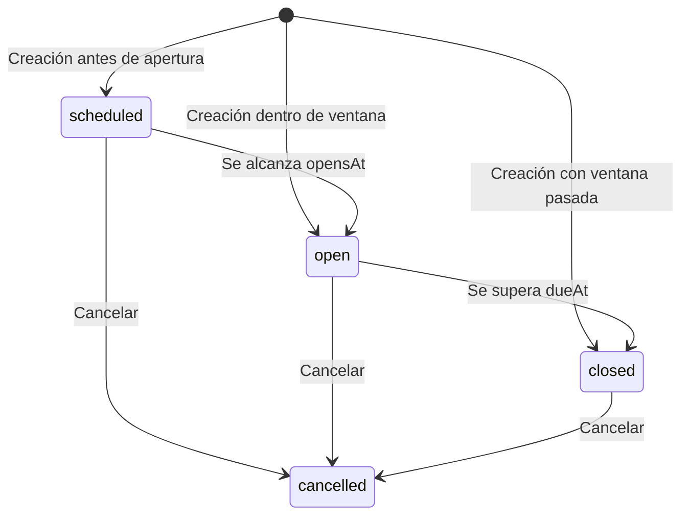

# SPEC-04 — Asignación

| Campo | Valor |
| --- | --- |
| Estado | Verificada |
| Etapa | 4 — Asignación |
| Tareas | ENG-050, ENG-051, ENG-052, ENG-053 |
| Referencias | CONTEXT §5.1, §7.1–§7.2, §10, §11.2, §14–§16 · architecture §3.1–§3.2, §3.6, §4.1–§4.3, §6.2–§6.5, §7.5, §7.7, §8, §9.4, §13 · pbp §3 y Etapa 4 · decisiones 25, 37, 44, 48, 60–61, 73–75, 79–80, 89–90, 95–96, 98–99 |
| Aprobada por / fecha | Líder del proyecto / 2026-10-22 (Aprobada y Verificada) |

## 1. Contexto y objetivo

Tras [SPEC-03](./SPEC-03-gestor-de-contenidos.md), asignar contenido publicado a grupos con fechas ([CONTEXT §5.1](../.agents/CONTEXT.md#51-panel-de-la-profesora-se-construye-primero)) cierra el primer E2E: **la profesora crea y asigna una actividad**.

Entrega gestión docente, no ejecución del alumno; el cierre limita el inicio. Q-01/Q-02 cerradas por decisiones 98/99. Aprobada para implementación.

## 2. Alcance

- **Incluye:** actividad publicada y grupos activos; creación multigrupo atómica; fechas; validaciones/concurrencia; lista/detalle por grupo con historial; cancelación; comunicación de plazos; pruebas docentes.
- **No incluye:** editar/reprogramar/restaurar/borrar asignaciones, destinatarios individuales ni recurrencia. Corregir una asignación requiere cancelar y crear otra (decisiones 98/99).
- **Otras etapas:** catálogo, publicación y grupos conservan SPEC-03; `GET /me/assignments`, inicio/eventos/finalización, continuidad y baja general de alumnos corresponden a SPEC-05; ejecución de microjuegos a SPEC-06; habilitación de nuevos intentos a SPEC-07; indicadores a SPEC-08; PWA/offline a SPEC-09.
- Aplican [CONTEXT §2.4](../.agents/CONTEXT.md#24-explícitamente-fuera-del-piloto--decidido) y §10; no se acredita SPEC-05 aquí.

## 3. Requisitos funcionales

**RF-1 — Selección de destinatarios y contenido.** ENG-051; CONTEXT §5.1, architecture §6.4.

- **Dado** una profesora **Cuando** abre «Nueva asignación» **Entonces** puede seleccionar una actividad de `GET /api/v1/activities?status=published` y uno o varios grupos de `GET /api/v1/groups?archived=false`, recorriendo sus páginas. Ve título, tipo, nivel y versión de la actividad y nombre de cada grupo; no selecciona alumnos individualmente.
- **Dado** un grupo activo sin alumnos **Cuando** lo selecciona **Entonces** puede asignarle contenido; no se inventa un nivel de grupo ni se excluyen destinatarios por su nivel individual. El nivel pertenece a la actividad y sirve para filtrar el catálogo.

**RF-2 — Creación multigrupo atómica.** ENG-050; pbp Etapa 4.

- **Dado** una entrada válida de §5 con N grupos distintos **Cuando** crea **Entonces** recibe `201` con N asignaciones, cada una con ID propio, la misma actividad y ventana y `historicalStudentCount: null`; todas pertenecen al tenant de la sesión. Persisten tras recargar; sin intentos ni eventos de progreso.
- **Dado** un error en cualquier grupo **Cuando** termina **Entonces** no se crea ninguna asignación del lote.

**RF-3 — Referencias asignables verificadas en servidor.** ENG-050; decisiones 79, 89 y 95.

- **Dado** una actividad `draft`/`archived` o un grupo archivado **Cuando** intenta asignarlos directamente por API **Entonces** recibe respectivamente `409 ACTIVITY_NOT_ASSIGNABLE` o `409 GROUP_ARCHIVED`, sin escrituras. IDs inexistentes o de otra organización, incluso dentro de un lote, producen `404 NOT_FOUND`.
- **Dado** un archivo/borrado de actividad o grupo concurrente **Cuando** compite con la creación **Entonces** las operaciones quedan serializadas: la asignación solo se confirma si sus referencias eran propias y asignables en ese orden; nunca queda huérfana ni se omite la validación por una lectura previa.

**RF-4 — Ventana coherente.** ENG-050; pbp Etapa 4, architecture §6.2.

- **Dado** fechas ISO-8601 con zona explícita **Cuando** crea **Entonces** persiste los instantes equivalentes en UTC si `opensAt < dueAt`. Apertura igual/posterior al cierre, fecha inexistente o fecha sin zona producen `400 VALIDATION_ERROR`, sin filas. No desplaza fechas ni agrega automáticamente tiempo de tolerancia a `dueAt`.
- **Dado** una apertura pasada **Cuando** define el cierre posterior a ella **Entonces** no se rechaza por la apertura pasada. También se permiten ventanas completamente pasadas: nacen cerradas, sin permitir iniciar intentos.

**RF-5 — Sin duplicados activos, incluso por carrera.** ENG-050; pbp Etapa 4; decisión 99.

- **Dado** otra asignación del mismo tenant, `activityId` concreto y `groupId`, no cancelada y con `dueAt ≥ T` (hora del servidor de la operación) **Cuando** crea otra, aunque sus ventanas no se solapen **Entonces** recibe `409 ASSIGNMENT_ALREADY_ACTIVE`; no se crea ninguna fila del lote. Una cerrada o cancelada permite otra con nuevo ID y su propio intento inicial.
- **Dado** dos creaciones concurrentes para el mismo par sin activa, con cierres no vencidos al evaluar ambas **Cuando** terminan **Entonces** solo una confirma; la otra recibe ese `409`, incluso en lotes parcialmente coincidentes. No garantiza idempotencia general de ventanas ya cerradas.

**RF-6 — Consulta y disponibilidad.** ENG-052; architecture §3.1, pbp Etapa 4.

- **Dado** asignaciones propias **Cuando** lista o consulta una **Entonces** obtiene el contrato de §5 y disponibilidad del servidor (§4); puede filtrar por grupo y disponibilidad. Vacío devuelve `200` con `items: []`; detalle o filtro de grupo ajeno/inexistente, `404 NOT_FOUND`.
- **Dado** una asignación no cancelada en el instante exacto de apertura/cierre **Cuando** consulta **Entonces** la disponibilidad es `open`; después del cierre es `closed`, sin cron. Si está cancelada, prevalece `cancelled` (decisión 98).

**RF-7 — Fechas comprensibles para la profesora.** ENG-051/052; decisión 60, architecture §13.

- **Dado** el navegador en otra zona horaria **Cuando** crea o consulta **Entonces** los campos y resultados mantienen `America/Bogota`, indican «Hora de Colombia» y muestran fecha y hora completas. El texto obligatorio de §7 aparece junto al cierre y en el resumen previo a guardar.
- **Dado** cierre `2026-11-04T23:00:00.000Z` **Cuando** lo visualiza **Entonces** muestra 4 de noviembre, 6:00 p. m., y explica que quien empezó a tiempo podrá terminar hasta el 5 de noviembre, 6:00 p. m.; no presenta esa tolerancia como permiso para empezar tarde.

**RF-8 — Archivar no cancela.** ENG-050/052; decisión 95, SPEC-03 RF-11/RF-24.

- **Dado** una asignación existente **Cuando** la actividad se archiva o restaura **Entonces** la asignación conserva ID, actividad, ventana y cancelación previa; sigue consultable y su disponibilidad no depende del estado del catálogo. Archivar la actividad no llama a la cancelación ni modifica intentos. No se puede crear otra asignación mientras siga archivada.

**RF-9 — Historia del grupo conservada.** ENG-052; decisiones 73, 80, 90 y 96.

- **Dado** un grupo con asignaciones, ya sin miembros vigentes y luego archivado **Cuando** la profesora filtra por ese grupo **Entonces** sigue viendo sus asignaciones y su estado de archivo. No se trasladan asignaciones ni se borran intentos al cambiar alumnos de grupo; las ventanas se conservan.

**RF-10 — Denominador reservado al borrado de alumnos.** ENG-050; decisiones 48 y 73.

- **Dado** una asignación nueva **Cuando** se crea, pasa el cierre, se consulta o se archiva su actividad/grupo **Entonces** `historicalStudentCount` sigue siendo `null`; no se congela con los miembros actuales ni al cerrar. Un valor ya fijado por el borrado de SPEC-05 nunca se reemplaza desde estas operaciones.

**RF-11 — Cancelación explícita e idempotente.** ENG-050/051/052; decisiones 95 y 98.

- **Dado** una asignación propia, próxima, abierta o cerrada **Cuando** la profesora confirma «Cancelar asignación» **Entonces** `POST /api/v1/assignments/:id/cancel` devuelve `200`, fija `cancelledAt` con hora del servidor y muestra `cancelled`. No cambia `opensAt`/`dueAt` ni borra la fila. Repetir devuelve la misma cancelación, sin renovar su fecha. Es definitiva e individual: no hay restauración ni cancelación de los demás grupos.

**RF-12 — Cancelar no destruye trabajo previo.** ENG-050; decisión 98.

- **Dado** intentos, notas, progreso, feedback o audios asociados **Cuando** cancela **Entonces** conserva esos datos, la retención ordinaria de audios y `historicalStudentCount`. Los intentos existentes siguen consultables; su finalización conserva el cierre efectivo previo a cancelar + 24 h, sin acortar ni reiniciar el plazo. No marca intentos `abandoned`, no emite progreso, no envía correos ni elimina objetos R2.
Los efectos decididos sobre nuevos inicios, habilitaciones y cumplimiento se implementan en SPEC-05/07/08 (§10), sin ampliar la entrega de esta etapa.

**RF-13 — Autorización y aislamiento.** ENG-050; CONTEXT §16, architecture §4.3 y §8.

- **Dado** cualquier ruta de §5 **Cuando** falta sesión válida o se usa sesión revocada **Entonces** responde `401 AUTH_UNAUTHORIZED`; con rol `student`, `parent` o `admin`, `403 FORBIDDEN`; con `teacher` y referencias ajenas, `404 NOT_FOUND`, sin datos ni efectos ajenos. Listas y totales solo cuentan el tenant autenticado.

**RF-14 — Entrada limitada al contrato.** ENG-050; decisiones 37 y 89, architecture §4.2.

- **Dado** una entrada con campos extra de tenant, autor, nota, cancelación, conteo histórico o timestamps de hechos **Cuando** se valida **Entonces** se ignoran por whitelist y no controlan la persistencia. Tipos/UUID/arrays/paginación inválidos dan `400 VALIDATION_ERROR`; exceso de cuerpo, `413 PAYLOAD_TOO_LARGE`; exceso autenticado, `429 RATE_LIMITED` con `Retry-After`.

**RF-15 — Estados de interfaz y teclado.** ENG-051/052; architecture §3.6 y §10.3.

- **Dado** cada pantalla de §7 **Cuando** carga, está vacía, falla o confirma **Entonces** muestra el estado y texto previstos; conserva el formulario ante error y evita reenvíos mientras espera. Un conflicto refresca datos antes de ofrecer reintento. Selección multigrupo, fechas y confirmación pueden completarse con teclado, foco visible y errores anunciados.

**RF-16 — Flujo docente de punta a punta.** ENG-053; CONTEXT §11.2, pbp Etapa 4.

- **Dado** la profesora autenticada, un grupo activo y ningún contenido preparado para la prueba **Cuando** crea una actividad `fill_blank`, la publica, la asigna y recarga la vista del grupo **Entonces** la prueba Playwright contra la API real verifica título, versión, fechas y exactamente una asignación persistida. No simula la creación/publicación/asignación ni necesita un portal del alumno.

## 4. Reglas de negocio

### Identidad y tiempo

`Assignment`: **actividad concreta para un grupo**; sin buscar última versión ni copiar contenido/snapshot. Edición sin intentos: SPEC-03. Un intento por asignación; habilitaciones en SPEC-07 (decisiones 25, 61 y 74).

Disponibilidad derivada, no columna de estado: `scheduled` si `T < opensAt`; `open` si `opensAt ≤ T ≤ dueAt`; `closed` si `T > dueAt`. `cancelledAt != null` tiene prioridad y produce `cancelled` (decisión 98). Un instante del servidor por operación. Fechas elegidas: plazos de negocio, excepción a timestamps del servidor.

**Frontera con SPEC-05/07, ya decidida:** sin cancelación, el primer intento empieza en `[opensAt, dueAt]`; un nuevo intento habilitado usa `retryExtendUntil ?? dueAt` como cierre efectivo. Se completa hasta cierre efectivo + 24 h inclusive; después `ATTEMPT_CLOSED`. La tolerancia no habilita inicios tardíos ni constituye 24 h desde el inicio. En esta etapa se comunica; no se crean tokens ni jobs de abandono (decisiones 44, 60, 61 y 84; architecture §7.5).

### Integridad e historia

- Duplicado activo: RF-5, decisión 99, independiente del archivo de la actividad. Distintos IDs/versiones de actividad son distintos pares; no se compara el título.
- Creación, comprobación de duplicados y referencias son atómicas; publicación/archivo/borrado/cancelación concurrentes respetan el mismo orden de serialización (99). No basta con consultar y después insertar, ni con deshabilitar el botón. Los lotes no admiten éxito parcial.
- Sin jobs de apertura/cierre ni `ScheduledJobRun`: estados según reloj. Futuras tareas periódicas: architecture §4.5.
- Destinatarios históricos: alumnos distintos cuya membresía se solapa con `[opensAt, dueAt]`, no una foto de miembros al asignar. Para concretar el solape con membresías `[joinedAt, leftAt)`: `joinedAt ≤ dueAt`, (`leftAt == null` o `leftAt > opensAt`) y (`leftAt == null` o `joinedAt < leftAt`); se excluyen estancias de duración cero y un regreso al grupo no duplica al alumno. Su conteo/congelación, incluidos esos casos de prueba, se implementa en SPEC-05 y su uso estadístico en SPEC-08, sin filtrar por nivel ni ampliar la ventana con las 24 h (decisión 73).
- La pertenencia vigente rige nuevos inicios; no es requisito para leer/finalizar un intento propio anterior. Ni traslado ni archivo de grupo/actividad revocan ese derecho (decisiones 90 y 95). Cancelar también conserva ese derecho (98).

## 5. Contrato de API

Rutas exclusivas de **`teacher`**: JWT/sesión → roles → contexto de tenant; Origin en mutaciones y 120/min/usuario. HTTP JSON camelCase; contratos únicos en `packages/shared` derivados de §5. `class-validator` para envoltura con whitelist/transform; sin configuración pedagógica ni esquema Zod de actividad.

**Entrada de creación:** `{ activityId, groupIds, opensAt, dueAt }`. IDs UUID; `groupIds` array no vacío de UUID distintos, sin coerción de string a array; su tamaño queda acotado por el límite HTTP de 1 MB, sin inventar un máximo de grupos del producto. Fechas strings ISO-8601 con `Z` u offset explícito, normalizadas a UTC; fechas civiles imposibles no se normalizan silenciosamente. Reglas en RF-4. Campos obligatorios no admiten `null`.

**Respuesta:** `AssignmentView = { id, activity: { id, title, type, level, version, status }, group: { id, name, archivedAt }, opensAt, dueAt, cancelledAt: string | null, historicalStudentCount, availability, createdAt, updatedAt }`. El conteo y `archivedAt` son nullable; fechas ISO UTC; metadatos del recurso referenciado, sin `config`, claves ni datos de alumnos. Disponibilidad según §4, incluido `cancelled` (98).

| Método y ruta | Entrada | Éxito / errores propios |
| --- | --- | --- |
| `POST /api/v1/assignments` | Cuerpo de creación | `201 { items: AssignmentView[] }`, en orden de `groupIds`; `409 ACTIVITY_NOT_ASSIGNABLE`, `GROUP_ARCHIVED`, `ASSIGNMENT_ALREADY_ACTIVE` (99) |
| `GET /api/v1/assignments` | `groupId?`, `availability?`, `offset`, `limit` | `200 { items, total, offset, limit }`; sin filtros incluye todo el historial, también canceladas por defecto |
| `GET /api/v1/assignments/:id` | UUID; sin cuerpo | `200 AssignmentView` |
| `POST /api/v1/assignments/:id/cancel` | Sin cuerpo | `200 AssignmentView`; repetición inocua |

Lista: offset entero ≥0/default 0, limit entero 1–100/default 20; orden `due_at DESC, id ASC`. `availability` acepta los valores de §4; filtros se combinan con AND y el total usa los mismos. Grupo propio sin resultados no es error. Primero se valida formato; después todas las referencias por tenant, estado asignable y duplicados, en ese orden. No se devuelven IDs ajenos ni detalles del fallo de un lote.

Errores `{ statusCode, code, message }`: comunes de SPEC-02 §5 (`VALIDATION_ERROR`, `AUTH_UNAUTHORIZED`, `FORBIDDEN`, `NOT_FOUND`, `PAYLOAD_TOO_LARGE`, `RATE_LIMITED`, `INTERNAL_ERROR`). Códigos: `409 ACTIVITY_NOT_ASSIGNABLE` («Solo puedes asignar actividades publicadas») y `409 ASSIGNMENT_ALREADY_ACTIVE` («La actividad ya tiene una asignación activa en uno de los grupos seleccionados»). Los tres códigos de asignación quedan catalogados en architecture §13; el siguiente se implementa en otra etapa. Fallos internos nunca exponen SQL, trazas o infraestructura.

No se entrega API de alumno aquí. Contrato decidido (98), diferido a SPEC-05/07: `409 ASSIGNMENT_CANCELLED` al iniciar o habilitar un intento en una cancelada; se comprueba tras pertenencia/propiedad y antes de apertura/cierre, sin revelar recursos ajenos. No es endpoint ni prueba entregados por ENG-050.

## 6. Modelo de datos

Se reutiliza `Assignment` de [schema.prisma](../apps/api/prisma/schema.prisma) (SPEC-01): UUID, tenant directo, actividad/grupo, fechas `timestamptz`, conteo nullable y tiempos del servidor. Conservar índices `(group_id, opens_at, due_at)` y `(activity_id)` y `onDelete: Restrict` hacia organización/actividad/grupo y desde intentos. No añadir listas de alumnos, nivel de grupo, copia de contenido ni estado temporal persistido.

**Cambio decidido (98), pendiente de implementación tras aprobar esta spec:** `Assignment.cancelled_at`, nullable `timestamptz`, default null y escrito solo por servidor; conserva la primera fecha de cancelación. Sin FK, enum ni tabla nuevos; registros existentes quedan no cancelados. La futura implementación usa una migración Prisma Migrate nueva, nunca altera la inicial. No se modifica ahora el schema ni se genera migración.

Duplicados (99): comprobación/inserción serializadas por par y tenant, coordinadas con archivo/cancelación; no un único permanente por par, que impediría reasignar. Transacciones breves, filtro explícito de tenant y orden consistente de recursos contra interbloqueos. Pruebas concurrentes con PostgreSQL real, no solo mocks.

## 7. Interfaz

Panel neutro docente; RSC y hojas cliente; TanStack Query, sin caché compartida autenticada. Actividad/grupos de SPEC-03; sin variantes Kids/Teens ni páginas del alumno.

| Ruta | Contenido y estados |
| --- | --- |
| `/asignaciones` | Lista con filtro de grupo (incluye archivados para consultar historia) y disponibilidad; actividad/versión, grupo, apertura/cierre y estado. Vacío: «Aún no tienes asignaciones»; filtrado vacío: «No hay asignaciones con estos filtros». Acción «Nueva asignación». |
| `/asignaciones/nueva` | Selector de actividad publicada con filtros nivel/tipo, selección multigrupo, apertura/cierre y resumen. Sin actividades: «Publica una actividad para poder asignarla», enlace al catálogo. Sin grupos activos: «Crea un grupo activo para poder asignar», enlace a grupos. |
| `/asignaciones/:id` | Resumen, fechas y estado de actividad/grupo; cancelación con confirmación (98). No muestra respuestas, notas, roster ni progreso. |

Desde inicio: lista en un clic; formulario/detalle en dos (objetivos docentes, no techos del portal, architecture §3.1). Guardar vuelve a lista y anuncia «Asignación creada» o «Asignaciones creadas en N grupos»; invalidar las consultas afectadas. La ficha de grupo enlaza a `/asignaciones?groupId=…`.

**Plazos:** «Apertura», «Cierre para empezar», «Hora de Colombia (America/Bogota)». Texto obligatorio junto al cierre: **«los alumnos pueden empezar hasta esta hora; quien haya empezado tendrá hasta 24 horas más para terminar»**. Resumen: «Última hora para terminar si empezó a tiempo: [fecha y hora]». Plazo original; prórrogas individuales en SPEC-07, no aquí.

**Cancelación (98):** diálogo «¿Cancelar esta asignación?»; «No se podrán empezar nuevos intentos. Quienes ya empezaron podrán terminar dentro de su plazo. Se conservarán los trabajos y las calificaciones». Botones «Volver»/«Cancelar asignación»; al confirmar «Asignación cancelada». Solo afecta al grupo de esa fila; canceladas sin acción de restauración.

Cargando: «Cargando asignaciones…»/«Cargando opciones…». Envío: «Guardando…», sin doble envío ni reintento automático de creación. Red/servidor: «No pudimos guardar. Revisa las asignaciones antes de volver a intentarlo»; conservar formulario y consultar servidor: respuesta perdida no demuestra rollback. Consulta fallida: «No pudimos cargar las asignaciones», botón «Reintentar»; no confundir con lista vacía.

Errores: fechas «La apertura debe ser anterior al cierre»; formato «Revisa la fecha y la hora»; grupos repetidos «Selecciona cada grupo una sola vez»; actividad no asignable/duplicado usan textos de §5; `GROUP_ARCHIVED`: «Uno de los grupos fue archivado. Elige un grupo activo»; 403 «No tienes acceso a esta sección»; 404 «No encontramos esta asignación o alguno de los recursos seleccionados»; 429 «Espera un momento antes de volver a intentarlo». Mensaje dependiente `ASSIGNMENT_CANCELLED`: «Tu maestra canceló esta actividad. Si ya la habías empezado, puedes continuar dentro de tu plazo»; adaptación visual Kids en SPEC-05.

Teclado completo, etiquetas y errores asociados, foco al primer error, confirmación accesible con retorno de foco al cerrar, selección multigrupo sin arrastre, contraste AA y anuncios de éxito/error; escritorio prioritario y sin desbordamiento inutilizable en tablet.

## 8. Seguridad y privacidad

Aplican [architecture §8.1–§8.5](../planning/architecture-overview.md#8-multi-tenant-y-seguridad): NestJS autoriza, `proxy.ts` solo redirige. En cada consulta/mutación/total y dentro de transacciones se exige `organization_id` del JWT; se comprueba también el tenant de actividad y **todos** los grupos. Ni los IDs UUID ni las FK sustituyen esa validación. SQL, si se necesita, parametrizado y con tenant; la extensión Prisma es defensa adicional, no garantía universal.

DTOs no declaran tenant, autor, `score`, timestamps de hechos ni conteo histórico. `opensAt`/`dueAt` son los únicos plazos de entrada. JSON máximo 1 MB; Origin allowlist en POST; `Cache-Control: no-store`; límites y sesiones de SPEC-02. Sin endpoints públicos nuevos, feature flags adicionales ni autorización dependiente del frontend.

Estas pantallas no necesitan nombres/correos/nacimientos/contactos de alumnos, respuestas, claves ni URLs de audio: no se seleccionan ni se devuelven. Logs/Sentry solo IDs, rol, versión y resultado; no cuerpos ni contenido pedagógico. Cancelar no firma URLs ni elimina archivos, no revoca sesiones y no amplía `AuditAction`. Conservar la limpieza de caché/IndexedDB al logout de SPEC-02/03 en equipos compartidos.

## 9. Pruebas

Plan de verificación, **no evidencia ejecutada de implementación**. Cada prueba usa el prefijo `SPEC-04 RF-n:` para evitar confundir RF entre specs.

| RF | Nivel | Prueba y comprobación principal |
| --- | --- | --- |
| RF-1 | Integración/UI | RF-1: selectores paginados solo publicados/activos; grupo vacío y niveles mixtos sin veto |
| RF-2 | Integración PostgreSQL | RF-2: N filas con IDs distintos, orden de respuesta, persistencia y rollback íntegro por fallo de un grupo |
| RF-3 | Integración PostgreSQL | RF-3: borrador/archivada/grupo archivado/IDs ajenos; carreras de asignación con archivo y borrado sin huérfanos |
| RF-4 | Unitaria/integración | RF-4: igualdad/inversión/fecha imposible/sin zona/null rechazadas; offsets equivalentes, apertura pasada y ventana pasada aceptadas |
| RF-5 | Integración PostgreSQL | RF-5: activa incluso futura no solapada y `dueAt = T`; cerrada/cancelada permiten nueva ID; misma actividad concreta/tenant/grupo; dos conexiones y lotes coincidentes con cierres no vencidos dejan una ganadora sin éxito parcial; ventanas ya cerradas no tienen esa garantía |
| RF-6 | Unitaria/integración | RF-6: paginación/filtros/total/orden; canceladas incluidas por defecto; bordes exactos no cancelados y prioridad de cancelación con reloj controlado |
| RF-7 | UI | RF-7: zona del navegador distinta, conversión UTC/Bogotá y cierre +24 h de los ejemplos sin depender del reloj cliente |
| RF-8 | Integración | RF-8: archivo/restauración no cambian asignaciones/intentos; lista conserva la actividad archivada |
| RF-9 | Integración/UI | RF-9: traslado y posterior archivo permiten consultar historia sin mover asignaciones ni intentos |
| RF-10 | Integración | RF-10: creación/cierre/consulta/archivo conservan null; valor previamente congelado no se altera |
| RF-11 | Integración/UI | RF-11: cancelación individual próxima/abierta/cerrada, repetida y concurrente conserva primera fecha, ventanas e historial |
| RF-12 | Integración | RF-12: fixtures de intentos/plazos, notas, progreso, revisiones, assets/retención y conteo sin mutaciones; cero llamadas R2/mail |
| RF-13 | Integración | RF-13: todas las rutas con 401/403/404, dos tenants, IDs mezclados y totales aislados |
| RF-14 | Integración | RF-14: extras ignorados, entradas malformadas, 413 y 429 con Retry-After sin persistencia indebida |
| RF-15 | UI | RF-15: vacío/carga/error/éxito, respuesta perdida seguida de consulta, formulario conservado, multiselección y diálogo con teclado |
| RF-16 | E2E Playwright | RF-16: login docente → crear → publicar → asignar → recargar y verificar grupo, versión, fechas y una sola fila |

Fixtures aisladas, sin datos reales. Carreras: dos conexiones sincronizadas, sin esperas arbitrarias. E2E: selectores accesibles/datos únicos, sin mocks de negocio; CI en staging controlado, nunca producción. Limpiar solo registros de prueba, sin endpoints auxiliares. Evidencia: commit/CI/staging y revisión docente de plazos. Formulario: tablet/teclado; grabación/juegos táctiles: SPEC-05/06.

## 10. Fuera de alcance y decisiones diferidas

Sin notificaciones/correo, cancelación masiva, recurrencia, duplicación automática, edición de fechas, restauración, eliminación física ni veto por nivel alumno/actividad. Incorporarlas requiere SDD.

Obligaciones decididas (98), con implementación y pruebas en sus specs: SPEC-05 entregará membresía vigente, ventana/tolerancia, tokens y abandono; bloqueará nuevos inicios en canceladas, incluso con reintento habilitado, conservando lectura/finalización propia dentro del plazo previo (RF-12). SPEC-07 entregará habilitaciones/plazos individuales y rechazará nuevas concesiones en canceladas. SPEC-08 excluirá canceladas de **ambos numerador y denominador del cumplimiento**, sin retirar notas/progreso ni reescribir `historicalStudentCount`. No son entregables de ENG-050–053.

Sin tiempo real, heartbeat, pantallas parent/admin, consentimiento legal, exportaciones ni capacidades de Fase 2/3. No se modifican hosting, colas, almacenamiento o mecanismos de autenticación existentes. La lista de CONTEXT §2.4 sigue siendo vinculante.

## 11. Preguntas abiertas

Ninguna pregunta bloqueante ni P-n abierto del piloto (CONTEXT §15). Q-01/Q-02 cerradas por el líder el 2026-10-22:

| Pregunta cerrada | Decisión aceptada | Aplicada en |
| --- | --- | --- |
| Q-01 — Cancelación e historial | **98:** cancelación definitiva individual, primera fecha idempotente; preservación del trabajo/plazos; bloqueo de nuevos inicios/habilitaciones; exclusión de ambos términos del cumplimiento | RF-11/RF-12, §4–§7, §9–§10 |
| Q-02 — Duplicado activo | **99:** mismo tenant/actividad concreta/grupo, no cancelada y `due_at ≥ ahora`; incluye futuras no solapadas; lote serializado sin parcialidad | RF-2/RF-5, §4–§6, §9 |

**Aprobación integral:** Estado Aprobada por el líder del proyecto el 2026-10-22 tras auditoría de contratos, modelo, UI y plan de pruebas. Q-01 y Q-02 formalizadas en decisiones 98 y 99; autoriza el inicio de la implementación de la Etapa 4 (ENG-050 a ENG-053).

**Verificación técnica:** Estado Verificada el 2026-10-22 tras la implementación completa y verificación de las tareas ENG-050 a ENG-053 (248/248 tests en monorepo: 54 shared, 145 api, 49 web; suite E2E de asignación; guardrails sin errores; typecheck, lint y build limpios).

**Seguimiento de Etapa 3/H1:** SPEC-03 sigue Verificada y sus ENG técnicos Hecho; con SPEC-04 Verificada, el cierre global de Etapa 3/H1 queda pendiente de **SPEC-05 al menos En revisión y evidencia operativa de staging/onboarding**, incluidos los prerrequisitos de SPEC-02 §11 (CONTEXT §15, pbp Etapa 3, SPEC-03 §9/§11).

## 12. Registro de cambios

| Fecha | Cambio | Motivo |
| --- | --- | --- |
| 2026-10-22 | Creación del borrador: 16 RF, contratos docentes, límites entre etapas y plan de pruebas; Q-01/Q-02 pendientes | Tarea SPEC-04; incorporar la cancelación exigida por decisión 95 sin inventar su aprobación ni adelantar producción |
| 2026-10-22 | Revisión semántica y concisión: garantía concurrente solo con cierres no vencidos, exclusión de membresías vacías y separación de obligaciones futuras | Corregir casos límite, respetar etapas y mantener lectura inferior a 20 minutos |
| 2026-10-22 | Borrador → En revisión; Q-01/Q-02 cerradas por decisiones 98/99, contratos/modelo y pruebas alineados; seguimiento de H1 corregido | Aceptación de recomendaciones sin aprobación integral ni implementación; preservar cierre técnico e identificar compuertas globales pendientes |
| 2026-10-22 | Estado En revisión → Aprobada tras auditoría integral | Aprobación formal por el líder del proyecto; contratos de API, modelo de datos, UI y plan de pruebas validados para iniciar implementación de la Etapa 4 (ENG-050 a ENG-053) |
| 2026-10-22 | Estado Aprobada → Verificada tras implementación completa de ENG-050 a ENG-053 | Verificación automatizada con 248/248 tests en monorepo, suite E2E docente, guardrails en verde y builds exitosos |
