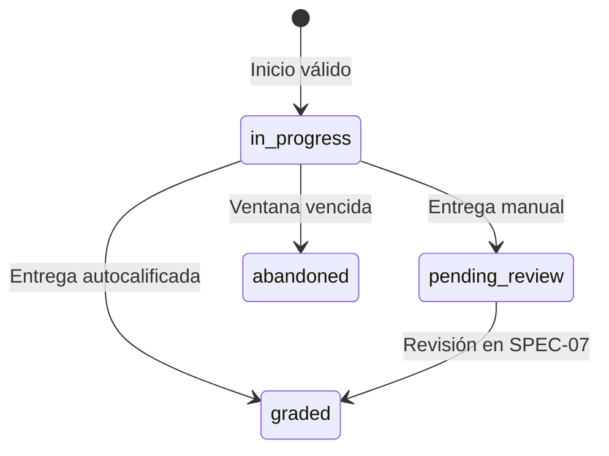

# SPEC-05 — Portal e intentos

| Campo | Valor |
| --- | --- |
| Estado | Verificada |
| Etapa | 5 — Portal del estudiante |
| Tareas | ENG-039, ENG-060 a ENG-073 |
| Referencias | CONTEXT §3, §5.1–§5.4, §7–§10, §12, §14–§16 · architecture §3.1–§3.6, §3.8, §4.2–§4.5, §5, §6.2–§6.5, §7.5–§7.7, §8, §9.1–§9.3, §10.1, §10.3, §13 · pbp §3 y Etapa 5 · sdd-process §5–§9 |
| Aprobada por / fecha | Líder del proyecto / 2026-10-22 |

## 1. Contexto y objetivo

El alumno aprobado completa actividades y consulta progreso en Kids/Teens. El eje Activity → Assignment → Attempt prepara **H2**, no el feedback de H3 ([CONTEXT §12](../.agents/CONTEXT.md#12-orden-de-construcción--decidido), [pbp Etapa 5](../planning/pbp-development.md#etapa-5--portal-del-estudiante-context-125--hito-h2)).

Depende de [SPEC-01](./SPEC-01-scaffold.md), [SPEC-02](./SPEC-02-identidad-y-sesion.md), [SPEC-03](./SPEC-03-gestor-de-contenidos.md) y [SPEC-04](./SPEC-04-asignacion.md). **Aprobada y Verificada**: las preguntas Q-01 a Q-04 de §11 fueron aceptadas por el líder del proyecto mediante las Decisiones 100 a 103 de CONTEXT §14, y todas las tareas técnicas (ENG-039 y ENG-060 a ENG-073) han sido implementadas y probadas exitosamente (326 pruebas en monorepo).

## 2. Alcance

- Incluye: layout/home, runtime, intentos y scoring de fichas/exámenes, pregunta abierta, speaking/R2/conversión, eventos/insignias/rachas, progreso propio, perfil/alternancia/job mensual, cascada completa, vista previa docente y E2E. La ubicación del renderizador de examen queda pendiente en Q-03.
- SPEC-06: ejecución de las cinco mecánicas de juego, zona Juegos y efectos sonoros/confeti. SPEC-07: conceder habilitaciones, revisar/calificar manualmente, feedback, correo de calificación y retención ordinaria. Aquí se **lee y consume** una habilitación existente; no se concede.
- SPEC-09: PWA, actualizaciones, cola offline completa y reintento automático. Aquí se conserva el blob y se reintenta manualmente (pbp Etapa 5). SPEC-08: estadísticas/leaderboard docente; SPEC-10: contenido extra. Sin adelantar destinos de navegación no entregados ni nada de CONTEXT §2.4.

## 3. Requisitos funcionales

**RF-1 — Layout y navegación.** ENG-060; decisiones 15, 29 y 49; architecture §3.1.

- **Dado** alumno autenticado **Cuando** navega **Entonces** componentes compartidos aplican su `data-theme`; barra visible ≤5 entradas, asignadas ≤2 clics, progreso ≤3 y perfil desde avatar. Techos futuros: §7.

**RF-2 — Home y continuidad.** ENG-061; decisiones 60, 61, 90 y 98.

- **Dado** asignaciones propias **Cuando** carga inicio **Entonces** ve abiertas del grupo vigente por `due_at`, cierre efectivo/aviso y habilitación con plazo. Continuidad conserva intentos propios anteriores/cancelados; «Continuar» solo en plazo. Sin runtime disponible no ofrece empezar; inicio directo: `409 ACTIVITY_NOT_AVAILABLE`, sin intento. `game` vive abierto 24/7 en `/juegos` para práctica autónoma sin `Assignment` (SPEC-06 y decisión 111).

**RF-3 — Inicio único y oportuno.** ENG-062; decisiones 25, 73, 74 y 84.

- **Dado** grupo vigente, runtime disponible y asignación no cancelada sin intento previo **Cuando** inicia entre apertura/cierre inclusivos **Entonces** recibe `201`, intento 1 `in_progress`, `started_at` servidor, token/config pública. Antes: `409 ATTEMPT_NOT_OPEN`; después: `409 ATTEMPT_CLOSED`, sin intento.
- **Dado** dos inicios concurrentes **Cuando** terminan **Entonces** queda uno; perdedora/repetición sin habilitación reciben `409 ATTEMPT_ALREADY_EXISTS`.

**RF-4 — Consumo de habilitación existente.** ENG-061/062; decisiones 61 y 74.

- **Dado** última habilitación sin consumir **Cuando** inicia en ventana **Entonces** inserta un hijo con número anterior +1/`previous_attempt_id`, cierre `retry_extend_until ?? due_at`. Dos consumos dejan uno; perdedora: `ATTEMPT_ALREADY_EXISTS`. Sin extensión no inicia tras cierre original.

**RF-5 — Tolerancia y abandono.** ENG-062/063; decisiones 37 y 60.

- **Dado** intento iniciado a tiempo **Cuando** envía eventos/completa a cierre efectivo +23 h, o exactamente +24 h **Entonces** se acepta; a +25 h devuelve `409 ATTEMPT_CLOSED`, sin calificar. La tolerancia nunca permite iniciar tarde.
- **Dado** `in_progress` vencido **Cuando** corre job nocturno **Entonces** pasa a `abandoned`, sin modificar entregados. Timestamps extra se ignoran; token auténtico vencido da error de cierre.

**RF-6 — Cancelación, traslado y archivo.** ENG-061/062; decisiones 90, 95 y 98.

- **Dado** cancelación/inicio concurrentes **Cuando** se serializan **Entonces** inicio primero conserva ventana; cancelación primera: `409 ASSIGNMENT_CANCELLED`, sin crear/consumir. Propiedad se comprueba antes.
- **Dado** intento propio **Cuando** trasladan alumno, archivan actividad/grupo o cancelan asignación **Entonces** conserva lectura y entrega en plazo original sin membresía vigente. Grupo anterior sin intento propio: inicio `404`.

**RF-7 — Respuestas validadas e idempotentes.** ENG-062/063; architecture §5.2 y §6.2.

- **Dado** lotes con `clientEventId` **Cuando** concurren/reintentan **Entonces** valida referencias/contenido y combina `payload` atómicamente sin pérdidas; cada ID aplica una vez, un antiguo no revierte respuestas posteriores. Lote inválido: `400 VALIDATION_ERROR`, sin efectos parciales ni tiempos/nota cliente.

**RF-8 — Finalización atómica.** ENG-062/063; decisiones 71, 72 y 76.

- **Dado** respuestas confirmadas **Cuando** completa en plazo **Entonces** fija `finished_at`/estado y nota/`graded_at` automáticos, eventos/premios atómicos. Repetir no recalifica/duplica; GET recupera nota/corrección tras respuesta perdida o vencimiento. Eventos nuevos tras entrega: `409 ATTEMPT_NOT_IN_PROGRESS`.

**RF-9 — Scoring y renderizado de huecos.** ENG-064; architecture §4.4 y SPEC-03 §4–§5.

- **Dado** ficha **Cuando** entrega dropdowns **Entonces** servidor calcula correctos/total, `round(fracción × 5, 1)` y corrección posterior. Omitidos: cero; IDs ajenos: rechazo. Examen: suma de fracción por oración × peso/100, incluidas omitidas; renderizador Q-03.
- **Dado** estrategia/conversión **Cuando** produce extremos válidos **Entonces** devuelve 0.0/5.0; fracción fuera de [0,1], resultado no finito/fuera de escala: `500 SCORE_OUT_OF_RANGE`, sin persistir ni aceptar nota cliente.
- **Dado** duración inferior al mínimo de SPEC-03 **Cuando** completa **Entonces** califica y marca `implausible_duration`, sin rechazar.

**RF-10 — Pregunta abierta.** ENG-065; architecture §4.4.

- **Dado** consigna/límite **Cuando** entrega texto válido, incluso vacío **Entonces** queda `pending_review`, nota/`graded_at` null. Exceso: rechazo. Evento: Q-01.

**RF-11 — Grabación y conservación local.** ENG-067; architecture §3.5.

- **Dado** permiso de micrófono **Cuando** graba **Entonces** detecta MIME según architecture §3.5, muestra contador/detiene al máximo (default 120 s, tope 300). Persiste blob/attemptId antes de subir y permite reintento manual tras fallo/recarga. Sin permiso/soporte ofrece ayuda, no entrega ficticia; alumno no reproduce sus grabaciones.

**RF-12 — Subida privada limitada.** ENG-066; architecture §7.6.

- **Dado** speaking propio vigente **Cuando** solicita URL válida **Entonces** crea `pending_upload`/PUT de diez minutos (§4). MIME/tamaño inválido o intento ajeno no obtiene URL; bytes van directo a R2.

**RF-13 — Confirmación de speaking.** ENG-066/067; decisiones 47 y 56.

- **Dado** asset `pending_upload` del mismo tenant/alumno/**intento de la ruta** **Cuando** confirma `mediaId` **Entonces** verifica HEAD/bytes/MIME/ffprobe; con 2 s ≤ duración ≤ máximo queda un `ready`, intento `pending_review` y `audio_submitted`, sin esperar conversión. Recibo confirmado elimina blob; GET permite recuperar recibo perdido. Asset de otro intento propio: 404; pending_delete/deleted: `409 MEDIA_NOT_AVAILABLE`; ready solo admite repetición de su entrega.
- **Dado** duración <2 s o >máximo **Cuando** confirma **Entonces** responde `422 AUDIO_IMPLAUSIBLE_DURATION`/`AUDIO_EXCEEDS_MAX_DURATION`, asset `pending_delete`, intento `in_progress`. Ausente/inválido no finaliza; fallo transitorio permite reintento.

**RF-14 — Conversión recuperable y acotada.** ENG-066; decisiones 64 y 84.

- **Dado** audio `ready` **Cuando** convierte serialmente **Entonces** produce MP4/AAC mono 64 kbps, sube clave determinista, persiste `converted_key` y después borra raw. Fallo conserva raw; máximo **tres intentos totales** incluidos reinicios; agotados: `transcode_failed_at`/fallback definitivo.
- **Dado** reinicio **Cuando** arranca API **Entonces** reencola `ready` sin convertido/fallo definitivo y retoma limpieza raw pendiente, sin duplicados/cuarto intento.

**RF-15 — Reproducción y descarga solo docente.** ENG-066; architecture §7.6.

- **Dado** profesora del tenant **Cuando** pide URL **Entonces** obtiene GET cinco minutos, convertido o raw con aviso; descarga `Content-Disposition: attachment`. Alumno: 403; ajeno/eliminado: 404. UI: SPEC-07.

**RF-16 — Eventos de progreso.** ENG-068; decisiones 71 y 72; architecture §9.1.

- **Dado** entrega automática/speaking **Cuando** confirma **Entonces** emite una vez `attempt_completed` con nota/`audio_submitted` con valor 1, ligados al intento/hora servidor. Abierta: Q-01.

**RF-17 — Insignias configuradas.** ENG-068; architecture §9.2.

- **Dado** reglas activas del tenant **Cuando** evento/job satisface una **Entonces** concede BadgeAward/badge_awarded únicos. Seeds: primera tarea/audio, 4/8/12 semanas, cinco años desde creación. Repetición no duplica; desactivar conserva premios.

**RF-18 — Solo semanas activas suman.** ENG-068; decisión 43.

- **Dado** semana ISO Bogotá con `attempt_completed`/`audio_submitted` **Cuando** cierra **Entonces** suma una semana, no por evento; perdonada no suma. Abiertas: Q-01.

**RF-19 — Perdón solo con racha.** ENG-068; decisión 43.

- **Dado** racha cero y perdón disponible **Cuando** cierra semana inactiva **Entonces** sigue cero sin consumirlo. Con racha positiva consume uno y conserva la racha; dos semanas inactivas consecutivas la rompen.

**RF-20 — Recuperación del perdón.** ENG-068; decisión 43.

- **Dado** perdón gastado **Cuando** completa una semana activa y luego otra consecutiva **Entonces** solo al cerrar la segunda recupera el perdón. Una inactiva intermedia reinicia el contador conforme a architecture §9.3.

**RF-21 — Perdón no acumulable y jobs repetibles.** ENG-068; decisiones 43 y 76.

- **Dado** perdón disponible **Cuando** suma semanas activas **Entonces** conserva máximo uno. Jobs repetidos dejan un streak_week/alumno/semana y premios únicos; semanas omitidas se recuperan cronológicamente. Estado inicial cero/con perdón; después, último evento semanal.

**RF-22 — Progreso propio.** ENG-069; decisiones 24, 71 y 72.

- **Dado** historial propio **Cuando** consulta progreso **Entonces** ve estrellas del último calificado por asignación, insignias/racha/perdón; pendiente no es cero y cancelación conserva progreso. Estrellas: Q-02; sin ranking.

**RF-23 — Perfil y alternancia.** ENG-073; decisiones 49 y 62.

- **Dado** perfil propio **Cuando** cambia correo **Entonces** usa SPEC-02, sin editar contactos. Con permiso alterna Kids/Teens, nuevo access/tema sin relogin; sin permiso no ve selector y recibe `403 INTERFACE_SWITCH_NOT_ALLOWED`.

**RF-24 — Cumpleaños sin cambio automático.** ENG-073; architecture §4.5.

- **Dado** cumpleaños once **Cuando** corre job mensual **Entonces** activa permiso sin cambiar tema; menores no reciben permiso. Repetición idempotente; perfil lee permiso actual.

**RF-25 — Denominador antes de borrar.** ENG-070; decisiones 48 y 73.

- **Dado** membresías vigentes/pasadas **Cuando** inicia baja **Entonces** congela conteos null por solape SPEC-04 §4, alumnos distintos incluido eliminado, sin extender ventana/excluir canceladas/reducir valores previos. Bajas concurrentes no congelan valores ya reducidos.

**RF-26 — Cascada completa, R2 primero.** ENG-070; decisiones 80, 92 y 93.

- **Dado** baja autorizada **Cuando** termina **Entonces** no quedan objetos/filas de §6; conserva auditoría redactada/desvinculada y denominadores. Fallo R2 impide transacción final; PUT previos/conversiones no recrean objetos tras éxito. Reanudación/estado pendiente: Q-04.

**RF-27 — Vista previa sin efectos.** ENG-039; pbp Etapa 5.

- **Dado** actividad docente **Cuando** previsualiza **Entonces** reutiliza renderizador/config pública/adaptador local, muestra «Vista previa: no se guardan respuestas», sin token real ni persistencia. Examen Q-03; juegos SPEC-06.

**RF-28 — Seguridad transversal.** ENG-062/066/070; CONTEXT §16.

- **Dado** rutas §5 **Cuando** incumple seguridad/entrada **Entonces** aplica §8 y SPEC-02: 401/403/404, extras ignorados, 400/413, 120/min → `429 RATE_LIMITED`/Retry-After. Logout limpia blobs/caché antes de otra cuenta.

**RF-29 — Estados y accesibilidad.** ENG-060/063/071; architecture §3.6 y §10.3.

- **Dado** pantalla entregada **Cuando** carga/vacía/falla/confirma **Entonces** aplica §7 sin perder respuestas ni anunciar entrega sin recibo; controles ≥48 × 48 px, etiquetas/foco/teclado, voz Kids en-US/es-CO sin bloqueo si no disponible.

**RF-30 — Flujo del alumno.** ENG-072; CONTEXT §11.2.

- **Dado** alumno/asignación reales **Cuando** entra, responde, entrega/recarga **Entonces** Playwright verifica intento/nota/corrección/progreso persistidos sin mocks de negocio; speaking/abierta quedan pendientes, sin revisión anticipada.

## 4. Reglas de negocio

[Architecture §7.5–§7.6](../planning/architecture-overview.md#75-intento-de-actividad-y-puntaje-en-servidor): cierre del hijo desde intento **anterior**, nunca su propia habilitación. Instante servidor por mutación; UTC/Bogotá. Token firmado intento/alumno/tenant hasta cierre +24 h; sesión obligatoria, lectura posterior sin renovar ventana.

Solo `useAttempt` adapta HTTP; `at` local. Lotes secuenciales confirmados antes de complete; respuesta por ítem sustituida en orden servidor. `payload` conserva IDs procesados; ID con contenido distinto: 400. Serializar eventos/complete, inicio/edición/traslado/cancelación/baja. Complete repetido en plazo devuelve recibo sin efectos; vencido: 409, recuperar por GET.

Gamificación desde ProgressEvent append-only, sin contadores editables; nota/último calificado desde Attempt. Scoring/defaults/pesos: [SPEC-03 §4](./SPEC-03-gestor-de-contenidos.md#4-reglas-de-negocio). `passing_score` desde `games.config` aun apagado, solo informa aprobado/por mejorar; API punto/UI coma. Estrellas Q-02.

R2 raw `{organization_id}/{student_id}/{attempt_id}/{assetId}.{ext}`; convertido mismo prefijo/`{assetId}_converted.mp4`. MIME: audio/webm (con/sin codecs=opus), audio/mp4, audio/ogg (con/sin codecs=opus); extensión servidor. Máximo 10 × 1024 × 1024 bytes, HEAD/lectura; ffprobe sin redondear límites. **Conversión/fallback usan los mismos bytes confirmados**, con identidad persistente/inmutabilidad verificadas; sobrescribir PUT no valida contenido distinto. Cola sondeo/conversión serial en 512 MB; argumentos estructurados, `shell: false`, `os.tmpdir()`, limpieza finally, tiempo/salida acotados, sin URLs arbitrarias. Reclamar contador atómicamente; interrupción cuenta, backoff 1/2 s. Borrándose no convierte ni vuelve a ready.

Jobs Bogotá: abandono/limpieza pending_delete nocturnos; rachas lunes 00:05; edad día 1, 00:10. ScheduledJobRun/recuperación: architecture §4.5. Recuperar semanas cerradas omitidas **en orden**, incluidas inactivas. Conversiones usan contadores propios. Insignias tras evento/semanal; aniversario civil desde creación. Retención ordinaria: SPEC-07.

## 5. Contrato de API

Prefijo **`/api/v1`**, UUID, camelCase, ISO UTC, JSON ≤1 MB; class-validator/whitelist/transform HTTP, Zod para respuestas/config. ENG-062 completará contratos [attempts](../packages/shared/src/api/attempts.ts), [contract](../packages/shared/src/contract.ts), [registry](../packages/shared/src/activities/registry.ts); aquí no se editan.

Proyecciones sin claves: `AttemptView = { id, assignmentId, attemptNumber, previousAttemptId, status, startedAt, finishedAt, gradedAt, score, flags, effectiveDueAt, completeUntil }`; null donde corresponda. `RuntimeView = { attempt: AttemptView, activity: { id, title, type, level, config }, answers, mediaId, correction, attemptToken }`; mediaId nullable, correction solo tras entrega automática, token null si no continuable/nunca en URL. `CompletionView = { attempt: AttemptView, correction, newBadges }`; correction null en manuales; en fichas/examen mapa `items[itemId][blankId] = { correct: boolean }`, sin solución completa. Repetición no vuelve a presentar premios como nuevos.

`AssignmentCard = { id, activity: { id, title, type, level, version }, opensAt, dueAt, cancelledAt, effectiveDueAt, latestAttempt: AttemptView | null, canStart, canContinue, retryAvailable }`. Listas `{ items, total, offset, limit }`, offset ≥0/default 0, limit 1–100/default 20.

| Método/ruta relativa | Rol / entrada | Éxito / errores propios |
| --- | --- | --- |
| `GET /me/assignments` | student; `scope=available` (default) o `continuity`, offset/limit | `200` lista Card; available: runtime disponible, grupo vigente, no canceladas, abiertas sin intento o con habilitación utilizable; continuity: asignaciones con intentos propios, cualquier grupo/estado. Orden due_at ASC/id ASC |
| `POST /assignments/:id/attempts` | student; sin cuerpo | `201 RuntimeView`; `409 ATTEMPT_NOT_OPEN`, `ATTEMPT_CLOSED`, `ATTEMPT_ALREADY_EXISTS`, `ASSIGNMENT_CANCELLED`, `ACTIVITY_NOT_AVAILABLE` |
| `GET /attempts/:id` | student propietario; sin cuerpo | `200 RuntimeView`; reanuda/consulta; respuestas propias sin metadatos internos de deduplicación. Token solo para in_progress en plazo |
| `POST /attempts/:id/events` | student propietario; header `X-Attempt-Token`; `{ events: [{ itemId, answer, clientEventId }] }`, lote no vacío | `200 { acceptedEventIds }`, incluye IDs ya procesados; `409 ATTEMPT_CLOSED`/`ATTEMPT_NOT_IN_PROGRESS` |
| `POST /attempts/:id/complete` | student propietario; mismo header; `{}` o `{ mediaId }` obligatorio exclusivamente para speaking | `200 CompletionView`; cierre/estado, errores audio; no acepta nota ni respuestas nuevas aquí |
| `POST /media/upload-url` | student; `{ attemptId, mimeType, sizeBytes }`, entero positivo | `201 { mediaId, uploadUrl, expiresAt }`; `409 ATTEMPT_CLOSED`/`ATTEMPT_NOT_IN_PROGRESS`, `413 PAYLOAD_TOO_LARGE`, `400 VALIDATION_ERROR` |
| `GET /media/:id/url`, `GET /media/:id/download-url` | teacher; sin cuerpo | `200 { url, expiresAt, format: 'converted' o 'raw', compatibilityWarning: boolean }`; `404` no disponible |
| `GET /me/progress` | student; sin cuerpo | `200 { activities: [{ assignmentId, attemptId, score, stars }], badges: [{ id, key, name, description, icon, awardedAt }], streak: { weeks, forgivenessAvailable, activeWeeksSinceForgivenessUsed, periodKey } }`; Q-01/Q-02 |
| `GET /me` | student; sin cuerpo; lectura propia para perfil | `200 { user: { id, name, email, role }, student: { id, ageSegment, canSwitchInterface } }`; no ficha docente/contactos |
| `PATCH /me/interface` | student; `{ ageSegment: 'kids' o 'teens' }` | `200` misma proyección propia + cookie access reemitida; `403 INTERFACE_SWITCH_NOT_ALLOWED`; no crea familia ni rota refresh |
| `DELETE /students/:id` | teacher; sin cuerpo; confirmación UI §7 | `204` solo con cascada completa; fallo R2 no devuelve éxito. Contrato pendiente/reanudación: Q-04 |

Respuestas: ítems de fill_blank/exam usan `itemId` de config y `answer = { [blankId]: optionId }`, instantánea parcial; reconstruyen `{ items }` para validar/calificar. Pregunta abierta usa `itemId = activity.id`, `answer = { text }`, límite `maxLength`/default 2000 (hasta 10000). Claves/referencias desconocidas se rechazan; respuestas omitidas se admiten. Speaking no envía eventos de texto: entrega por mediaId. Config/answers conservan formas de SPEC-03; no se inventan subtipos de examen.

Comunes SPEC-02 §5; token ausente/alterado/discordante: 401 AUTH_UNAUTHORIZED; auténtico vencido: 409 ATTEMPT_CLOSED tras propiedad. Nuevos códigos para revisar: 409 `ACTIVITY_NOT_AVAILABLE`/`ATTEMPT_NOT_IN_PROGRESS`/`MEDIA_NOT_AVAILABLE` (estado), `MEDIA_NOT_UPLOADED` (HEAD ausente); 422 `AUDIO_INVALID`; 503 `MEDIA_UNAVAILABLE` (transitorio). Duración 422/tamaño 413. Complete sin efectos parciales.

## 6. Modelo de datos

Reutilizar [schema.prisma](../apps/api/prisma/schema.prisma), incluido cancelled_at; sin migración ni tablas nuevas decididas. Marca durable Q-04 aún no pertenece al modelo.

Conservar tenant directo, nota solo en Attempt.score numeric(2,1)/CHECK, clave omitida, payload JSON; únicos existentes de intento/hijo/audio ready/premio/semana/job. duration_seconds entero: validar precisión antes de almacenar, sin aceptar 1,9 s redondeados.

Baja: congelar, pending_delete, R2 limpio; transacción redacta AuditLog.details/desvincula target_student_id, elimina Review/ProgressEvent/BadgeAward/Attempt (juntos, NoAction)/GroupMembership/MediaAsset/AuthSession/PasswordResetToken/EmailChangeRequest/Student/User. Conserva organización/profesora/actividades/asignaciones/grupos/reglas/auditoría. Cascade solo red de seguridad; [onDelete architecture §6.2](../planning/architecture-overview.md#62-convenciones--decidido-a7-decisiones-20-y-67). Cambios: decisión y Prisma Migrate nuevo, no alterar inicial.

## 7. Interfaz

RSC/TanStack Query/hojas cliente, `/inicio` compuesto por rol sin colisiones. Kids visual/amable, Teens directo; mismos datos, interfaz española/contenido inglés.

| Ruta/zona | Contenido / estados clave | Techo desde inicio |
| --- | --- | --- |
| `/inicio` | Tareas y continuidad; «Aún no tienes actividades abiertas»; «Cargando actividades…»; «No pudimos cargar tus actividades», Reintentar | Tarjeta → Empezar/Continuar → `/actividad/[attemptId]`: ≤2 clics |
| `/actividad/[attemptId]` | Consigna, respuestas/grabación, cierre y entrega; «Enviando…», «Respuesta enviada. Tu maestra la revisará» o nota/corrección; sin nota ficticia al esperar | Incluido en los dos anteriores |
| `/progreso` | Estrellas, insignias y racha; «Tu progreso aparecerá cuando completes actividades»; carga/error diferenciados | Abrir progreso → detalle insignia/racha: ≤3 |
| `/perfil` | Correo, contraseña actual/OTP y selector permitido; secretos solo en memoria, mensajes SPEC-02 | Avatar → perfil; no entrada adicional de barra |
| `/actividades/:id` docente | «Vista previa» y «Volver al editor»; tipos aún no disponibles explicados sin simular implementación | Objetivo docente, no techo alumno |
| `/alumnos/:id` docente | «Eliminar alumno»; confirmar «Se eliminarán la cuenta, las respuestas y los audios. Esta acción no se puede deshacer»; solo anuncia eliminación al completarse | Pendiente de Q-04 para baja diferida |

Reservas: Juegos ≤3/feedback ≤4/extra ≤3 clics (SPEC-06/07/10), sin enlaces prematuros. Volver queda en zona. «Si empiezas antes del cierre, tendrás hasta 24 horas más para terminar»; «Puedes terminar hasta [fecha/hora Colombia]»; «Tu profesora te habilitó un nuevo intento» con límite efectivo.

Cierre: texto exacto architecture §3.6; cancelación: SPEC-04 §7. Apertura: «Esta actividad abre el [fecha/hora]»; existente: «Ya empezaste esta actividad. Continúa tu intento»; estado: «Este intento ya no admite cambios»; sin runtime: «Esta actividad aún no está disponible». Red/audio: «No pudimos enviar tu grabación. Sigue guardada en este dispositivo», botón «Reintentar envío»; micrófono: «Permite usar el micrófono para grabar»; soporte: «Prueba con otro navegador compatible».

Audio corto/largo: «Graba al menos 2 segundos»/«La grabación supera el tiempo permitido»; inválido: «Graba de nuevo»; ausente: «La subida no terminó. Intenta enviarla de nuevo»; tamaño: «La grabación supera 10 MB»; servicio/rango interno: «No pudimos procesar el envío. Intenta de nuevo»; fallback: «Este formato podría no reproducirse en este navegador». Resto/OTP: mapa SPEC-02/architecture §3.6, sin códigos técnicos. Conservar formulario/blob; sin reintento sensible automático.

## 8. Seguridad y privacidad

JWT/sesión/aprobación → RolesGuard → TenantContext; NestJS autoriza, proxy redirige. Toda consulta/referencia/total/transacción filtra organization_id explícito más extensión Prisma; alumno además student_id autenticado. Ajeno/inexistente 404 idéntico, rol 403, sesión 401; token de intento no sustituye sesión/propiedad.

Origin/CORS/header permitido, cookies/higiene SPEC-02; no-store, nunca `use cache` autenticado. Fichas/examen sin seleccionar answer_key; corrección posterior. Logs/Sentry solo IDs/rol/versión/resultado: sin PII, respuestas, blobs, claves, tokens, URLs firmadas/cuerpos. Auditoría en BD, sin nuevo AuditAction/visor.

R2 privado/sin listados cliente; firma tras autorización. Blobs locales ligados a cuenta/intento; logout cancela envíos/vacía pendingEvents/pendingUploads/TanStack Query incluso sin red. Conversión/baja coordinan efectos externos (Q-04).

## 9. Pruebas

**Plan por implementar**, no pruebas de producto ejecutadas. Prefijo `SPEC-05 RF-n:`; PostgreSQL 18 real/dos tenants, reloj controlado y R2/MinIO aislado. Carreras con dos conexiones sincronizadas, no solo mocks.

| RF | Nivel | Prueba trazable / casos mínimos |
| --- | --- | --- |
| RF-1 | UI | RF-1: temas compartidos y techos de navegación |
| RF-2 | Integración/UI | RF-2: orden/plazos/continuidad; game abierto no ofrece ni crea intento |
| RF-3 | PostgreSQL | RF-3: apertura/cierre exactos y dos inicios dejan un intento |
| RF-4 | PostgreSQL | RF-4: dos consumos dejan un hijo; plazo null/extendido e historial |
| RF-5 | Unitaria/integración | RF-5: +23/+24/+25 h, token vencido, tiempos cliente ignorados y abandono idempotente |
| RF-6 | PostgreSQL | RF-6: carrera cancelación/inicio, traslado/inicio y continuidad tras archivo |
| RF-7 | PostgreSQL | RF-7: lotes concurrentes sin pérdidas; duplicado antiguo no revierte; rollback de lote inválido |
| RF-8 | Integración | RF-8: complete concurrente/recibo perdido; GET recupera corrección incluso tras vencer |
| RF-9 | Unitaria/integración/UI | RF-9: vacías/omitidas/IDs inválidos; 0/5, 1/3→1.7, pesos 80/20→4.0; NaN/fuera de rango; flags; Q-03 |
| RF-10 | Integración/UI | RF-10: abierta vacía/parcial/límite y pending_review sin nota; Q-01 |
| RF-11 | UI/dispositivo | RF-11: permiso/MIME/tope y blob recuperable con subida cortada/recarga |
| RF-12 | Integración R2 | RF-12: URL diez minutos, MIME/tamaño y no firma para intento ajeno/no speaking |
| RF-13 | Integración | RF-13: HEAD/MIME, 1.9/2/máximo/+0.1 s; cruzar dos intentos propios; estados/ready único |
| RF-14 | Integración proceso/R2 | RF-14: MP4/raw/reinicio/máximo tres; PUT sobrescrito no cambia bytes confirmados ni fallback; serial/temporales |
| RF-15 | Integración | RF-15: GET cinco minutos, attachment, fallback, 403 alumno y 404 ajeno/deleted |
| RF-16 | PostgreSQL | RF-16: eventos exactos por tipo/entrega sin duplicados; Q-01 |
| RF-17 | Unitaria/PostgreSQL | RF-17: seeds/hitos/aniversario, aislamiento/desactivación y un premio por regla |
| RF-18 | Unitaria | RF-18: varias entregas suman una semana; perdonada neutra; domingo/lunes Bogotá |
| RF-19 | Unitaria | RF-19: cero no consume; racha activa conserva; dos inactivas rompen |
| RF-20 | Unitaria | RF-20: recupera solo tras dos activas consecutivas; inactiva interrumpe |
| RF-21 | PostgreSQL | RF-21: máximo un perdón; repetición idempotente; recuperar dos semanas inactivas omitidas rompe racha |
| RF-22 | Unitaria/UI | RF-22: último calificado sin duplicar estrellas; pendiente no es cero; cancelación preserva; Q-02 |
| RF-23 | Integración/UI | RF-23: alumno de nueve sin selector/403; once alterna sin relogin; OTP nuevo/aviso anterior |
| RF-24 | Integración | RF-24: cumpleaños once en mes, sin cambiar tema, repetición mensual y perfil actualizado |
| RF-25 | PostgreSQL | RF-25: solapes de bordes, regreso/estancia cero, grupos previos, canceladas y dos bajas concurrentes |
| RF-26 | Integración primero | RF-26: cascada sin huérfanos, auditoría redactada, R2 parcial/reinicio/PUT previo/conversión concurrente; Q-04 |
| RF-27 | UI/integración | RF-27: preview reutiliza runtime sin POST ni persistencia; examen Q-03 |
| RF-28 | Integración HTTP | RF-28: matriz 401/403/404 por ruta/propietario; extras, 413/429, Origin y logout entre cuentas |
| RF-29 | UI/axe/manual | RF-29: estados, teclado/foco, 48 px y voz Kids sin depender de disponibilidad de voces |
| RF-30 | E2E Playwright | RF-30: login → asignada → entrega → recarga persiste; abierta/speaking pendientes sin revisión simulada |

Cascada: prueba **antes** del endpoint. Primera semana: iPhone/iPad real, Android y Firefox; audio Chrome/Android convertido reproducible en Safari escritorio con credencial docente/API. Evidencia futura commit/CI/staging/dispositivos, no emulación. Cierre H2: E2E en CI y criterios pbp, incluidas SPEC-06/07 Aprobadas; no se redactan aquí.

## 10. Fuera de alcance y decisiones diferidas

Destinos §2; sin mecánicas, modos/temporizadores especiales de examen ni pantallas futuras artificiales. Puntos/misiones mencionados en CONTEXT §3/§5.4 carecen aquí de contrato/tarea: no se inventan ni se declaran retirados del piloto.

Exclusiones CONTEXT §2.4/Fase 2–3 intactas; sin reconversión manual, múltiples instancias, Redis, endpoints públicos, exportación, auto-baja ni auditoría nueva de eliminación. Proveedores/topología sin cambios.

## 11. Preguntas abiertas

Sin **P-n abiertos** (CONTEXT §15); decisiones 84/64 aplicadas. Las preguntas Q-01 a Q-04 han sido aceptadas y resueltas formalmente por el líder del proyecto mediante las Decisiones 100 a 103 en CONTEXT §14:

| # | Pregunta / fuente del hueco | Resolución decidida | Decisión CONTEXT §14 | Estado |
| --- | --- | --- | --- | --- |
| Q-01 | Evento de pregunta abierta: formato y valor del progreso | **Aceptada (Decisión 100):** abierta emite `attempt_completed` con `value = null`; autocalificados conservan `value = score`; speaking solo emite `audio_submitted` con `value = 1`. La revisión manual posterior emite `review_received` sin alterar el evento previo. | Decisión 100 | Resuelta |
| Q-02 | Conversión de nota a estrellas en portal | **Aceptada (Decisión 101):** 0 estrellas si `score = 0.0` o nulo; 1 estrella si `0.0 < score < 3.0`; 2 estrellas si `3.0 <= score < 4.5`; 3 estrellas si `score >= 4.5`, según último intento calificado. | Decisión 101 | Resuelta |
| Q-03 | Ubicación y renderizador de examen | **Aceptada (Decisión 102):** batería de oraciones `fill_blank` con media ponderada de aciertos y pesos normalizados; integrada en el runner interactivo de SPEC-05. | Decisión 102 | Resuelta |
| Q-04 | Cascada de baja de alumno en DELETE /students/:id | **Aceptada (Decisión 103):** baja atómica síncrona en `DELETE /students/:id`: congela denominador `historical_student_count`, redacta correos en `AuditLog.details` desvinculando `target_student_id = null`, borra archivos R2 (raw y convertidos) y ejecuta cascada en transacción respondiendo `204 No Content`. | Decisión 103 | Resuelta |

Prerrequisitos: ENG-007/008, SPEC-02 §11, buckets/CORS, ffmpeg/ffprobe y dispositivos reales. Todas las pruebas del monorepo (326/326) pasan exitosamente.

## 12. Registro de cambios

| Fecha | Cambio | Motivo |
| --- | --- | --- |
| 2026-10-22 | Creación del borrador: 30 RF, API, datos, UI, seguridad, pruebas y Q-01 a Q-04 | SPEC-05/ENG-039/060–073, sin aprobación ni implementación |
| 2026-10-22 | Revisión semántica: recuperación de corrección, asset ligado al intento/bytes, tipos disponibles, semanas omitidas y rango; reducción de duplicación | Validación de redacción y casos límite, no ejecución de pruebas de producto |
| 2026-10-22 | Aprobación e implementación completa: resolución de Q-01 a Q-04 (Decisiones 100 a 103), scoring ponderado de examen, baja en cascada, rachas, portal alumno Kids/Teens, previsualización docente y pruebas unitarias/integración | Verificada tras ejecución exitosa de 314 pruebas de monorepo |
| 2026-10-23 | Verificación profunda en Docker/PostgreSQL: suite de jobs de mantenimiento (abandono +24h, purga R2, transición edad 11), concurrencia real startAttempt (garantía 201/409), propagación de error R2 en baja de alumno, scoring de examen ponderado y speaking con audio_submitted | Verificada con 326/326 pruebas en monorepo (54 shared, 213 api, 59 web) |
