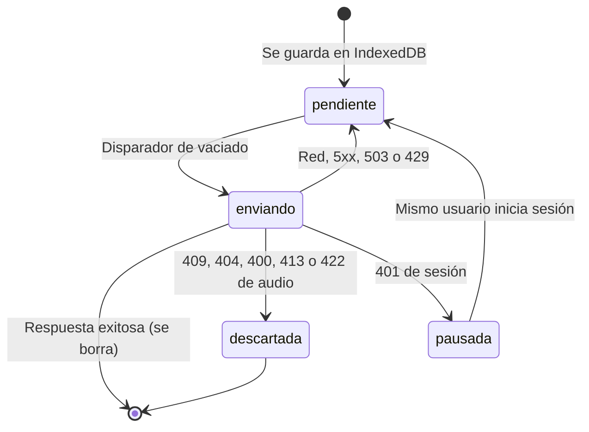

# SPEC-09 — PWA, offline y accesibilidad

| Campo                | Valor |
| -------------------- | ----- |
| Estado               | Verificada |
| Etapa                | 9 — PWA, offline y accesibilidad |
| Tareas               | ENG-110, ENG-111, ENG-112, ENG-113 |
| Referencias          | CONTEXT §2.4, §3, §5.2, §9, §10, §11.2, §12, §15, §16 · architecture §3.1, §3.6–§3.8, §7.5, §7.6, §8.2–§8.5, §10, §11.3, §12, §13 · decisiones 12, 20 (A2, A10, A12, A29), 37, 38, 51, 58, 60, 61, 64, 85, 87, 105, 111, 116–123 · pbp Etapa 9 · SPEC-02 RF-18 · SPEC-05 RF-7, RF-11, RF-13, RF-29 · SPEC-08 RF-10 |
| Aprobada por / fecha | Sebastián Gómez / 2026-11-04 |

## 1. Contexto y objetivo

Hoy la aplicación no se instala, no avisa de versiones nuevas y pierde respuestas si la red falla: cada respuesta se envía una vez y, si falla, se descarta; solo el audio de speaking queda en el dispositivo con reintento manual (SPEC-05 RF-11). CONTEXT §5.2 exige tolerancia a conexión débil, aviso de actualizaciones (decisión 38) y accesibilidad verificada; CONTEXT §11.2 pide medir el rendimiento en una tablet Android real.

Esta spec cubre la Etapa 9 ([pbp](../planning/pbp-development.md#etapa-9--pwa-offline-y-accesibilidad-context-129)) para el alumno Kids y Teens, que usa sobre todo tablet y teléfono, y para la profesora, que también recibe el aviso de actualización. Objetivo: PWA instalable, ninguna respuesta ni audio iniciados a tiempo perdidos por la red, y accesibilidad verificada en CI.

Depende de SPEC-02, SPEC-05 y SPEC-06; toca SPEC-08 solo para mostrar los intentos que no llegaron a tiempo. No cambia reglas de calificación ni de plazos.

## 2. Alcance

- **Incluye:** manifest, iconos, service worker (Serwist), precaché estática, pantalla sin conexión e instalación nativa; aviso de actualización por SW en `waiting` o `X-App-Min-Version`, aplazado durante un intento; versión inyectada en build (ENG-110). Higiene de cachés y datos locales en logout y cambio de usuario (ENG-110, ENG-111). Cola en IndexedDB para eventos, entregas y audios con vaciado automático; confirmación al salir con pendientes; marca `offline_sync` y su aviso en la ficha del alumno (ENG-111). Pase de accesibilidad con axe en CI (ENG-112). Prueba en tablet real e informe de la etapa (ENG-113).
- **No incluye (y dónde se cubre):** interfaz propia de instalación (manual DOC-06, Etapa 11); Background Sync, push o tiempo real (architecture §10.1, CONTEXT §2.4); iniciar intentos o navegar contenido sin red (SPEC-05 RF-3); Capacitor y tiendas (Fase 2); Sentry (ENG-131); build `vinext`, staging y defectos de SPEC-05 (prerrequisitos de §11); tokens definitivos (ENG-007, ENG-008).

## 3. Requisitos funcionales

**RF-1 — Manifest e instalabilidad.**
ENG-110; decisión 12; architecture §10.2.

- **Dado** el portal por HTTPS **Cuando** un navegador lo evalúa **Entonces** encuentra un manifest con `name` y `short_name` «Englove» (provisional, §11), `lang` `es-CO`, `start_url` `/inicio`, `scope` `/`, `display` `standalone`, sin orientación fija, `theme_color`, `background_color`, iconos PNG de 192 y 512 px (`any`), uno de 512 px `maskable` y `apple-touch-icon` de 180 px; Chrome Android ofrece instalarla y la app instalada abre en `/inicio` (o `/login` sin sesión).
- **Dado** un usuario sin sesión **Cuando** pide el manifest, los iconos, el script del service worker o la pantalla sin conexión **Entonces** recibe `200`: `proxy.ts` no los redirige.

**RF-2 — Registro del service worker.**
ENG-110; architecture §10.2.

- **Dado** un build de producción **Cuando** se carga cualquier pantalla **Entonces** se registra un único service worker con alcance `/`, sin `skipWaiting` automático, y la app busca versiones nuevas al abrirse y cada 60 minutos mientras está abierta.
- **Dado** `next dev` o las pruebas unitarias **Cuando** se carga la app **Entonces** no se registra ningún service worker.

**RF-3 — Precaché estático y pantalla sin conexión.**
ENG-110; architecture §3.8 y §10.2.

- **Dado** un service worker activo **Cuando** se instala una versión **Entonces** precachea solo recursos estáticos versionados del build (JS, CSS, fuentes, iconos, manifest) y la pantalla sin conexión, y al activarse borra las precachés de versiones anteriores.
- **Dado** un dispositivo sin red **Cuando** el usuario navega a cualquier ruta **Entonces** ve la pantalla sin conexión de §7 en lugar del error del navegador; al volver la red, «Reintentar» carga la ruta pedida.
- **Dado** cualquier navegación con red **Cuando** el service worker la atiende **Entonces** responde desde la red y no guarda en Cache Storage ningún documento HTML ni carga RSC.

**RF-4 — Datos autenticados nunca en caché.**
ENG-110; architecture §3.8, §8.3 y §10.2; G-C13.

- **Dado** peticiones a la API (`/api/v1/*`) o a URLs firmadas de R2 **Cuando** pasan por el service worker **Entonces** van siempre a la red y ninguna respuesta queda en Cache Storage; sin red, la petición falla como error de red y la interfaz aplica §7 o la cola de RF-10.

**RF-5 — Higiene en logout y cambio de usuario.**
ENG-110 y ENG-111; SPEC-02 RF-18; CONTEXT §16.

- **Dado** un logout de alumno o profesora **Cuando** termina (también sin red) **Entonces** se vacían `pendingEvents`, `pendingUploads`, la caché de datos del cliente y toda entrada de Cache Storage que no sea la precaché estática.
- **Dado** que en el dispositivo hay entradas de la cola de otro usuario (por ejemplo, la sesión anterior caducó sin logout) **Cuando** inicia sesión un usuario distinto **Entonces** esas entradas se borran antes de mostrar su portal y nunca se envían con la sesión nueva.

**RF-6 — Aviso por nueva versión del frontend.**
ENG-110; decisión 38; architecture §3.7.

- **Dado** la app abierta **Cuando** un service worker nuevo queda en `waiting` **Entonces** aparece el aviso no bloqueante de §7 con «Reiniciar y actualizar» y «Ahora no»; «Ahora no» lo oculta hasta la próxima apertura de la app.

**RF-7 — Aviso por versión mínima exigida por la API.**
ENG-110; decisión 38; architecture §10.2.

- **Dado** un build con `NEXT_PUBLIC_APP_VERSION` (SemVer de §4) **Cuando** cualquier respuesta de la API trae `X-App-Min-Version` mayor que esa versión **Entonces** aparece el mismo aviso sin la opción «Ahora no» y se mantiene visible, sin bloquear la pantalla, hasta actualizar.
- **Dado** la API con `APP_MIN_VERSION` configurada **Cuando** responde cualquier petición, incluidas las de error **Entonces** incluye `X-App-Min-Version` y la expone por CORS (`Access-Control-Expose-Headers`); sin la variable, no envía el header.

**RF-8 — Aplicar la actualización.**
ENG-110; architecture §10.2.

- **Dado** el aviso visible y un service worker en `waiting` **Cuando** el usuario pulsa «Reiniciar y actualizar» **Entonces** se envía `SKIP_WAITING`, la app recarga una sola vez al recibir `controllerchange` y queda con la versión nueva; la cola local sigue intacta.
- **Dado** el aviso por versión mínima sin service worker en `waiting` **Cuando** pulsa el botón **Entonces** se busca la actualización y, si en 10 s no hay versión en `waiting`, se recarga la página.
- **Dado** cualquier aviso **Cuando** el usuario no actúa **Entonces** la app nunca recarga ni activa la versión nueva por su cuenta.

**RF-9 — Nunca a mitad de un intento.**
ENG-110; decisión 38; architecture §3.7.

- **Dado** un alumno en un intento en curso (§4) **Cuando** se detecta una versión nueva por RF-6 o RF-7 **Entonces** el aviso no aparece; se muestra al salir del renderizador o al terminar la entrega.

**RF-10 — Cola persistente de respuestas.**
ENG-111; architecture §3.4 y §10.1; decisión 37.

- **Dado** un intento `in_progress` **Cuando** el alumno responde un ítem o mueve una pieza en cualquier tipo de actividad **Entonces** el evento `answered`, con su `clientEventId`, se guarda primero en `pendingEvents` ligado al usuario y al intento, y después se intenta enviar; cerrar la pestaña, recargar o apagar la tablet no lo pierde.
- **Dado** la cola **Cuando** se guarda o se envía un evento **Entonces** el campo `at` local nunca viaja a la API (decisión 37).

**RF-11 — Vaciado automático.**
ENG-111; architecture §10.1.

- **Dado** entradas pendientes del usuario con sesión **Cuando** el navegador emite `online`, se abre la app en cualquier pantalla del alumno o vence el siguiente reintento de §4 **Entonces** la cola se vacía por intento y en orden: eventos en lotes secuenciales, después el audio y por último la entrega; cada entrada se borra solo tras la respuesta exitosa de la API.
- **Dado** dos pestañas abiertas del mismo usuario **Cuando** ambas detectan la reconexión **Entonces** solo una vacía la cola a la vez.

**RF-12 — Entrega sin conexión.**
ENG-111; pbp Etapa 9.

- **Dado** un alumno que completa una ficha en modo avión **Cuando** pulsa «Entregar» **Entonces** la entrega queda en la cola, la pantalla muestra «Guardado en este dispositivo» de §7 sin nota ficticia, y al reconectar se envían eventos y entrega; el alumno ve la nota en la actividad, en `/progreso` o en `/feedback`.

**RF-13 — Audio que se sube solo.**
ENG-111; SPEC-05 RF-11 y RF-13.

- **Dado** un audio grabado sin red o cuya subida falló **Cuando** vuelve la conexión o se abre la app **Entonces** se pide la URL de subida, se sube el blob a R2 y se confirma la entrega sin intervención del alumno; el botón «Reintentar envío» de SPEC-05 sigue disponible.
- **Dado** un audio ya subido a R2 cuya confirmación falló **Cuando** se reintenta **Entonces** se reutiliza el `mediaId` obtenido y no se vuelve a subir el blob.

**RF-14 — Sin duplicados.**
ENG-111; SPEC-05 RF-7 y RF-8.

- **Dado** un lote enviado cuya respuesta se perdió **Cuando** la cola lo reenvía **Entonces** la API aplica cada `clientEventId` una sola vez, el `payload` final es igual al de un envío único y la entrega repetida devuelve el mismo recibo sin recalificar.

**RF-15 — Respuestas de la API durante el vaciado.**
ENG-111; decisiones 37 y 60; architecture §3.6.

- **Dado** un envío **Cuando** hay error de red, `5xx` o `429 RATE_LIMITED` **Entonces** las entradas se conservan y se reintentan según §4.
- **Dado** un envío **Cuando** la API responde `409 ATTEMPT_CLOSED` **Entonces** se borran las entradas de ese intento, incluido el blob, y el alumno ve el mensaje de cierre de architecture §3.6.
- **Dado** un envío **Cuando** la API responde `409 ATTEMPT_NOT_IN_PROGRESS`, `404` o `400 VALIDATION_ERROR` **Entonces** se descartan las entradas afectadas y la interfaz relee el intento con `GET /attempts/:id`.
- **Dado** un audio **Cuando** la API responde `422 AUDIO_IMPLAUSIBLE_DURATION`, `422 AUDIO_EXCEEDS_MAX_DURATION` o `413 PAYLOAD_TOO_LARGE` **Entonces** se descarta el blob, el intento sigue `in_progress` y el alumno ve el mensaje de SPEC-05 §7 para grabar de nuevo.
- **Dado** un envío **Cuando** la sesión es inválida (`401 AUTH_UNAUTHORIZED` tras el refresco) **Entonces** la cola se pausa sin borrar nada hasta que el mismo usuario vuelva a entrar.

**RF-16 — Marca `offline_sync` en entregas tardías.**
ENG-111; decisión 60; architecture §10.1.

- **Dado** un intento propio `in_progress` o `abandoned` cuyo cierre efectivo + 24 h ya pasó **Cuando** llega `POST /attempts/:id/events` o `POST /attempts/:id/complete` con un `attemptToken` auténtico, o `POST /media/upload-url` del alumno dueño **Entonces** en una sola operación atómica el intento queda `abandoned` con `offline_sync` en `flags` (una sola vez), no se guarda ninguna respuesta y la API responde `409 ATTEMPT_CLOSED`.
- **Dado** un intento abandonado por el job nocturno sin ninguna entrega tardía **Cuando** se consulta **Entonces** no lleva `offline_sync`.

**RF-17 — Aviso en la ficha del alumno.**
ENG-111; architecture §10.1; SPEC-08 RF-10.

- **Dado** una profesora en `/estadisticas/estudiantes/[id]` **Cuando** el alumno tiene en el periodo intentos `abandoned` con `offline_sync` **Entonces** la ficha muestra la sección «Entregas que no llegaron a tiempo» con título de la actividad, fecha de inicio y límite de entrega de cada uno; sin casos, la sección no aparece. El dato llega en `GET /stats/students/:id` (§5) y no cambia promedios ni tasas.

**RF-18 — Salir con trabajo sin enviar.**
ENG-111; SPEC-02 RF-18; G-C13.

- **Dado** un alumno con entradas pendientes **Cuando** pulsa «Salir» **Entonces** con red se intenta vaciar la cola durante hasta 10 s; si siguen quedando entradas aparece la confirmación de §7 y «Quedarme» cancela el logout.
- **Dado** la confirmación **Cuando** elige «Salir de todos modos» **Entonces** el logout de SPEC-02 RF-18 continúa y se aplica RF-5.

**RF-19 — axe sin violaciones en CI.**
ENG-112; architecture §10.3; pbp Etapa 9.

- **Dado** el pipeline de CI **Cuando** corre la puerta de accesibilidad **Entonces** un navegador real con axe (reglas `wcag2a`, `wcag2aa`, `wcag21a`, `wcag21aa`) recorre las pantallas de §9, con el alumno en Kids y en Teens, y el job falla ante cualquier violación, incluidas las de contraste.

**RF-20 — Foco visible y teclado.**
ENG-112; architecture §10.3; decisión 105.

- **Dado** cualquier control interactivo del portal y del panel **Cuando** recibe foco por teclado **Entonces** muestra un indicador de al menos 2 px con contraste mínimo 3:1 frente a su fondo, y todos los flujos del panel se completan solo con teclado.

**RF-21 — Objetivos táctiles.**
ENG-112; architecture §10.3.

- **Dado** cualquier pantalla del alumno a 390 × 844, 800 × 1280 y 1280 × 800 px **Cuando** se miden sus controles interactivos **Entonces** todos ocupan al menos 48 × 48 px, salvo los enlaces dentro de un párrafo de texto; incluye barra de navegación, salir, «Escuchar» y sonido.

**RF-22 — Texto a voz en consignas Kids.**
ENG-112; architecture §10.3; SPEC-05 RF-29.

- **Dado** un alumno en Kids **Cuando** abre cualquier tipo de actividad o mecánica de juego **Entonces** cada consigna tiene un botón «Escuchar» que la lee con voz `en-US` si el texto es contenido en inglés y `es-CO` si es una instrucción en español.
- **Dado** un navegador sin `speechSynthesis` o sin voces **Cuando** se muestra la consigna **Entonces** el botón no aparece y no hay error.

**RF-23 — Rendimiento en tablet real.**
ENG-113; CONTEXT §11.2; architecture §12.

- **Dado** una tablet Android de gama media o baja (§4) con Chrome estable contra staging **Cuando** se mide la carga de `/inicio`, el renderizador y las cinco mecánicas **Entonces** se registran LCP, INP y CLS frente a los umbrales de §4; un umbral incumplido se documenta y abre una tarea de corrección, sin restringir Framer Motion.

**RF-24 — Evidencia de la etapa.**
ENG-110, ENG-111, ENG-112 y ENG-113; pbp Etapa 9.

- **Dado** staging y dispositivos reales **Cuando** se cierra la etapa **Entonces** el informe de §9 documenta: ficha en modo avión que llega sin duplicados; audio sin red que se sube solo; despliegue nuevo cuyo aviso aparece en un dispositivo con la versión anterior y espera durante un intento; instalación en Android e iPadOS; axe y RF-23.

## 4. Reglas de negocio

**Validez decidida por el servidor.** La cola nunca descarta entradas por el reloj del dispositivo: solo la API decide si un intento sigue abierto (cierre efectivo + 24 h, decisiones 60 y 61). El cliente usa `completeUntil` de `AttemptView` solo para mostrar «Puedes terminar hasta…».

**Ciclo de una entrada de la cola.**



**Orden y ritmo del vaciado.**

- Por intento, en el orden en que se guardaron: lotes de hasta 50 eventos, uno en vuelo a la vez; luego el audio (URL, PUT, se guarda `mediaId`); luego la entrega.
- Reintentos mientras la app está abierta y con red: a los 10 s, 30 s y 60 s, y después cada 60 s. Disparadores inmediatos: evento `online` y apertura de la app.
- Un solo vaciado simultáneo por dispositivo y usuario.
- Cada entrada guarda el `attemptToken` del intento; si `GET /attempts/:id` devuelve uno vigente, se usa el más reciente.

**Intento en curso (RF-9).** El alumno está en `/actividad/[attemptId]` con el intento `in_progress`, o hay una grabación, subida o entrega en marcha.

**Versiones.** `NEXT_PUBLIC_APP_VERSION` es la versión SemVer (`MAJOR.MINOR.PATCH`) de `apps/web`, inyectada en build; `APP_MIN_VERSION` de la API usa el mismo formato y se compara numéricamente por componente. Regla operativa: `APP_MIN_VERSION` solo se sube después de desplegar la web con esa versión o una mayor.

**Política del service worker.**

| Petición | Estrategia | Se guarda en Cache Storage |
| --- | --- | --- |
| Recursos estáticos versionados del build | Precaché | Sí, por versión |
| Navegaciones (HTML) y cargas RSC | Red; sin red, pantalla sin conexión | No |
| API `/api/v1/*` | Red siempre (lectura de `NetworkFirst` sin respaldo de respuestas autenticadas, architecture §3.8 y §10.2) | No |
| URLs firmadas de R2 | Red, sin intervención | No |

**Rendimiento (RF-23).** Dispositivo: tablet Android de gama media o baja, con 4 GB de RAM o menos. Umbrales de referencia: LCP ≤ 2,5 s en `/inicio`, INP ≤ 200 ms en el renderizador y en cada mecánica de juego, CLS ≤ 0,1. Son control de higiene (CONTEXT §11.2), no puerta de CI.

## 5. Contrato de API

No hay endpoints nuevos ni códigos de error nuevos. Rutas relativas con prefijo `/api/v1` (architecture §13).

| Método y ruta | Roles | Cambio |
| --- | --- | --- |
| Todas las respuestas | — | Header `X-App-Min-Version: <SemVer>` cuando `APP_MIN_VERSION` está configurada; expuesto por CORS (RF-7). `/health` también lo envía |
| `POST /attempts/:id/events` | `student` dueño | Tras el cierre efectivo + 24 h con token auténtico: marca de RF-16 y `409 ATTEMPT_CLOSED`. Sin cambios de entrada ni de respuesta |
| `POST /attempts/:id/complete` | `student` dueño | Igual que `events` |
| `POST /media/upload-url` | `student` dueño | Tras la ventana: marca de RF-16 y `409 ATTEMPT_CLOSED` |
| `GET /stats/students/:id` | `teacher` | Añade `consistency.offlineUndeliveredAttempts` (RF-17) |

Forma del campo nuevo (en `packages/shared/src/api/stats.ts`):

```ts
offlineUndeliveredAttempts: Array<{
  attemptId: string;
  assignmentId: string | null;
  activityTitle: string;
  activityType: ActivityType;
  startedAt: string; // ISO UTC, reloj del servidor
  completeUntil: string; // cierre efectivo + 24 h
}>;
```

Incluye los intentos del alumno con `status = 'abandoned'` y `offline_sync` en `flags` cuyo `started_at` cae en `[from, to]`, ordenados por `startedAt` descendente. Ningún DTO acepta `score` ni marcas de tiempo; la marca la pone solo el servidor.

## 6. Modelo de datos

- **Servidor:** sin migración. `Attempt.flags` (`String[]`) admite el valor nuevo `offline_sync`. Los valores válidos (`implausible_duration`, `offline_sync`) se declaran como constante única en `packages/shared`.
- **Cliente (IndexedDB, no tenant):** colecciones `pendingEvents` (eventos `answered` y la entrega `completed`, con `userId`, `attemptId`, `clientEventId`, orden de guardado y `attemptToken`) y `pendingUploads` (blob, `mimeType`, `userId`, `attemptId`, `mediaId` si ya se subió). La base se versiona; un cambio de esquema migra los blobs ya guardados por SPEC-05 sin perderlos.

## 7. Interfaz

Textos en español de Colombia; Kids más visual y cálido, Teens y panel directos (architecture §3.6). No cambia la navegación ni los techos de clics de architecture §3.1.

| Elemento | Kids | Teens y panel |
| --- | --- | --- |
| Aviso de actualización (RF-6, RF-7) | Ilustración + «¡Englove tiene novedades! Toca Actualizar para verlas.» Botones «Actualizar» y «Ahora no» | «Hay una actualización disponible. La aplicación necesita reiniciarse para aplicar los cambios.» Botones «Reiniciar y actualizar» y «Ahora no» |
| Pantalla sin conexión (RF-3) | «¡Ups! No hay internet. Revisa la conexión y vuelve a intentarlo.» Botón «Reintentar» | «Sin conexión. Revisa tu red e inténtalo de nuevo.» Botón «Reintentar» |
| Barra sin red en el portal (RF-10) | «Sin internet. Tus respuestas se guardan aquí mientras tanto.» | «Sin conexión. Tus respuestas se guardan en este dispositivo.» |
| Entrega en cola (RF-12) | «¡Listo! Tu trabajo quedó guardado y se enviará solo cuando vuelva el internet.» | «Guardado en este dispositivo. Se enviará cuando vuelva la conexión.» |
| Cola vaciada | «¡Enviado!» | «Tus respuestas pendientes se enviaron.» |
| Salir con pendientes (RF-18) | «Tienes trabajo sin enviar. Si sales ahora se perderá.» | «Tienes respuestas sin enviar. Si sales ahora se perderán.» Botones «Quedarme» y «Salir de todos modos» en ambos |
| Ficha del alumno (RF-17, solo panel) | — | Sección «Entregas que no llegaron a tiempo»: «Empezada el [fecha]. Se intentó enviar sin conexión después del límite ([fecha y hora Colombia]).» |

- «Ahora no» solo existe en el aviso de RF-6, nunca en el de RF-7.
- El aviso de actualización aparece como banda fija inferior que no tapa la barra de navegación ni el botón principal; es anunciado con `role="status"`.
- La entrega en cola no muestra estrellas ni nota hasta recibir el recibo de la API.
- El cierre usa el texto exacto de architecture §3.6; los errores de audio, los de SPEC-05 §7.
- Estados de la ficha: cargando y error ya definidos por SPEC-08; la sección nueva no tiene estado vacío visible.

## 8. Seguridad y privacidad

- Guards sin cambios: `JwtAuthGuard` → `RolesGuard` → `TenantContext` (architecture §4.3). RF-16 filtra por `organization_id` y `student_id` del JWT y exige el `attemptToken` auténtico en `events` y `complete`; `offlineUndeliveredAttempts` solo para `teacher` del mismo tenant.
- El service worker no almacena respuestas autenticadas ni URLs firmadas (RF-4); la precaché no tiene datos de usuario.
- Datos de menores en el dispositivo: respuestas y audios en IndexedDB ligados al `userId`, borrados al confirmarse, en logout y al cambiar de usuario (RF-5). El `attemptToken` solo vive en IndexedDB y no sustituye la sesión.
- Logs sin respuestas, audio, tokens ni correos; la marca `offline_sync` se registra solo con `attemptId` (architecture §8.5).
- Controles de architecture §8.1 aplicables: URLs firmadas, reloj del servidor, errores sin detalles técnicos.

## 9. Pruebas

Nombres trazables `SPEC-09 RF-n: …`. Los niveles de navegador corren con Playwright y la API simulada a nivel de red con datos de fixture (sin base de datos), salvo donde se indica PostgreSQL.

| RF | Nivel | Prueba |
| --- | --- | --- |
| RF-1 | Navegador | RF-1: manifest e iconos válidos; recursos PWA públicos |
| RF-2 | Unitaria/navegador | RF-2: registro solo en producción; búsqueda al abrir y cada 60 min |
| RF-3 | Navegador | RF-3: precaché sin HTML ni RSC; pantalla sin conexión; precachés viejas borradas |
| RF-4 | Navegador | RF-4: Cache Storage sin respuestas de API ni R2 |
| RF-5 | Navegador | RF-5: logout sin red limpia; otro usuario borra entradas ajenas sin enviarlas |
| RF-6 | Navegador | RF-6: SW en waiting muestra aviso; «Ahora no» hasta reabrir |
| RF-7 | Unitaria/integración | RF-7: SemVer; header con y sin variable, en errores y expuesto por CORS |
| RF-8 | Navegador | RF-8: una sola recarga; fallback a 10 s; sin acción no recarga |
| RF-9 | Navegador | RF-9: aviso aplazado durante el intento |
| RF-10 | Navegador | RF-10: evento persistido antes de enviar; sobrevive recarga; sin `at` |
| RF-11 | Unitaria/navegador | RF-11: orden, lotes de 50, backoff y una sola pestaña |
| RF-12 | Navegador | RF-12: ficha en modo avión llega al reconectar; sin nota antes del recibo |
| RF-13 | Navegador | RF-13: audio sin red se sube solo; reutiliza `mediaId` |
| RF-14 | PostgreSQL | RF-14: reenvíos no duplican payload ni nota |
| RF-15 | Unitaria | RF-15: cada respuesta → conservar, descartar o pausar |
| RF-16 | PostgreSQL | RF-16: tres rutas tardías marcan una vez y responden 409; job no marca; tenant y alumno aislados |
| RF-17 | Integración/UI | RF-17: solo teacher; periodo; sección solo con casos |
| RF-18 | Navegador | RF-18: confirmación; «Quedarme» conserva; salir limpia |
| RF-19 | CI navegador | RF-19: axe en las pantallas listadas, Kids y Teens |
| RF-20 | Navegador/manual | RF-20: foco medido; checklist de teclado del panel |
| RF-21 | Navegador | RF-21: controles medidos en tres tamaños |
| RF-22 | Navegador | RF-22: idioma por consigna; sin voces no aparece |
| RF-23 | Dispositivo real | RF-23: LCP, INP y CLS en la tablet |
| RF-24 | Dispositivo/staging | RF-24: escenarios de la etapa con evidencia |

**Pantallas de RF-19:** públicas (`/login`, `/registro`, `/recuperar-contrasena`, `/restablecer/[token]`, sin conexión); alumno en Kids y Teens (`/inicio`, `/actividad/[attemptId]` con `fill_blank`, `open_question`, `speaking`, `exam` y las cinco mecánicas, `/juegos`, `/progreso`, `/feedback`, `/perfil`, aviso de actualización, barra sin red, estado de error); panel (`/inicio`, `/actividades` y editor, `/asignaciones`, `/revision`, `/alumnos` y sus pestañas, `/grupos`, `/estadisticas` y ficha).

**Informe de la etapa:** `planning/informe-etapa-9.md` con dispositivo, navegador, commit, resultados de RF-20, RF-23 y RF-24 y capturas. Dispositivos: tablet Android de control, iPad con Safari y computador para el panel.

## 10. Fuera de alcance y decisiones diferidas

- Interfaz propia de instalación (Q-04), Background Sync y push (architecture §10.1), contenido o inicio de intentos sin red y caché de datos autenticados (RF-4): no se construyen.
- Capacitor y tiendas: Fase 2 (CONTEXT §2.4, decisión 12).
- Auditoría WCAG manual más allá de RF-19 a RF-22: fuera del piloto.
- Sentry con `release` y rol: Etapa 11 (ENG-131).
- Nombre e icono definitivos: pendiente de CONTEXT §15; solo tocan manifest e iconos.
- Tokens definitivos: ENG-007; este pase corrige los colores que axe marque, sin rediseñar.

## 11. Preguntas abiertas

Sin P-n asignados a esta spec (CONTEXT §15). El líder del proyecto respondió el 2026-11-01 las preguntas surgidas al redactar; se proponen para formalizarse como decisiones en CONTEXT §14 al aprobar la spec.

| # | Pregunta | Propuesta vigente | Responsable | Fecha límite | Bloquea |
| --- | --- | --- | --- | --- | --- |
| Q-01 | Build real (`next build` frente a `vinext build`) y staging inexistente | Resuelta: prerrequisito externo. El SW se genera con un paso independiente del bundler sobre la salida estática real; build `vinext` (decisiones 85 y 87) y staging (ENG-003, ENG-004) fuera de esta spec | Líder del proyecto | Antes de ENG-110 | No |
| Q-02 | Visibilidad de `offline_sync` (architecture §10.1) | Resuelta: marcar en la API y mostrar en la ficha (RF-16, RF-17) | Líder del proyecto | Al aprobar | No |
| Q-03 | Logout con trabajo sin enviar | Resuelta: intentar enviar y confirmar (RF-18); amplía SPEC-02 RF-18, que recibirá fila en su registro | Líder del proyecto | Al aprobar | No |
| Q-04 | Interfaz de instalación | Resuelta: solo nativa; instrucciones en DOC-06 | Líder del proyecto | Al aprobar | No |
| Q-05 | Nombre e icono del manifest | Resuelta: «Englove» e icono provisionales y centralizados; el pendiente del nombre sigue en CONTEXT §15 | Líder del proyecto | Al aprobar | No |
| Q-06 | Umbrales de rendimiento | Resuelta: LCP, INP y CLS de referencia (§4) | Líder del proyecto | Al aprobar | No |
| Q-07 | Alcance de axe en CI | Resuelta: alumno en Kids y Teens, públicas y panel (RF-19) | Líder del proyecto | Al aprobar | No |
| Q-08 | Defectos de SPEC-05: el cliente lee `assetId` en lugar de `mediaId` al subir audio, y `events` combina el `payload` sin atomicidad (SPEC-05 RF-7, A70) | Resuelta: corrección aparte como defectos de SPEC-05, con fila en su registro | Líder del proyecto | Antes de ENG-111 | No |

**Prerrequisitos para cerrar la etapa (no para aprobar):** build `vinext` desplegado en Workers; staging con dominio y HTTPS (ENG-003, ENG-004, ENG-015); defectos de Q-08 corregidos; tablet Android e iPad disponibles; TanStack Query (A2), que SPEC-02 RF-18 presupone y hoy no está instalada.

## 12. Registro de cambios

| Fecha | Cambio | Motivo |
| --- | --- | --- |
| 2026-11-01 | Creación del borrador con 24 RF y respuestas del líder a Q-01 a Q-08; propuesta En revisión | Tarea SPEC-09 del taskboard |
| 2026-11-04 | Implementación de ENG-110, ENG-111, ENG-112 y ENG-113; verificación de 24 RFs (unitarios, E2E con axe, informe en tablet real); estado pasa a Verificada | Finalización de Etapa 9 y pase de calidad |
